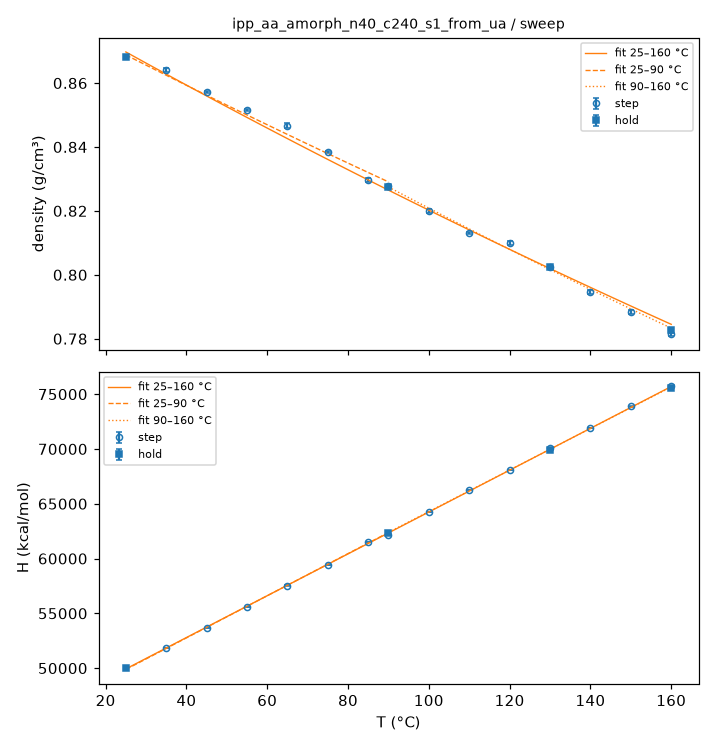
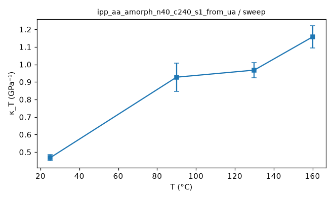
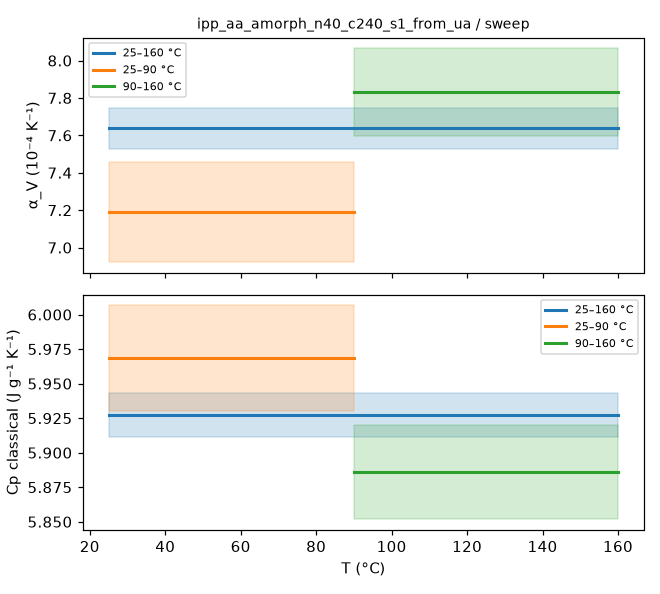
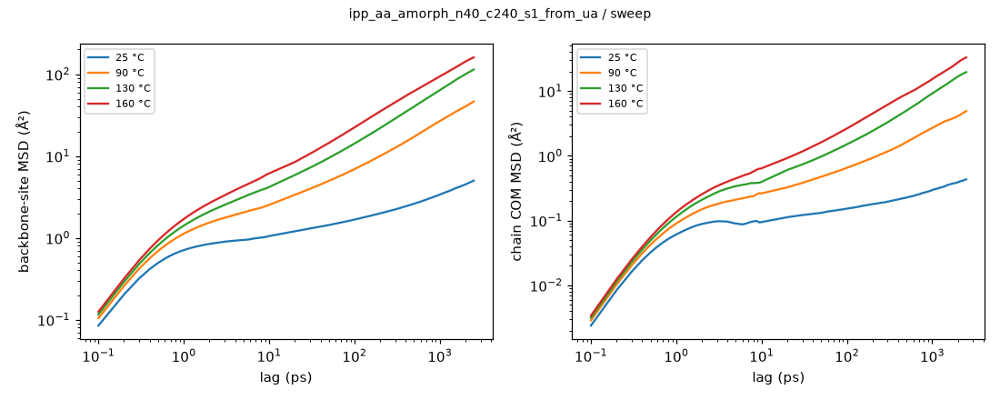
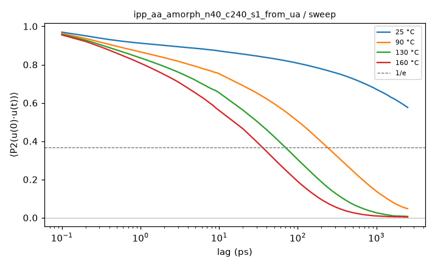
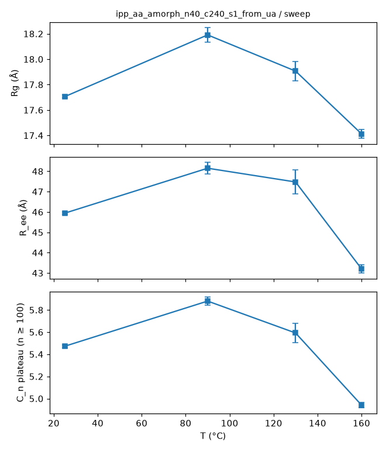
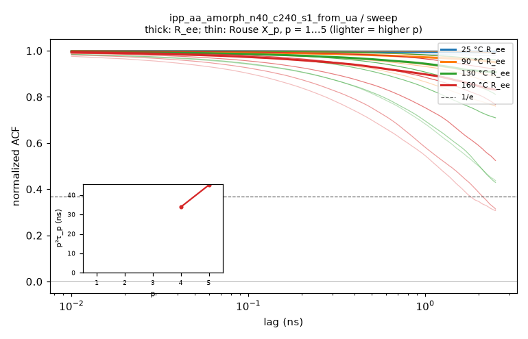
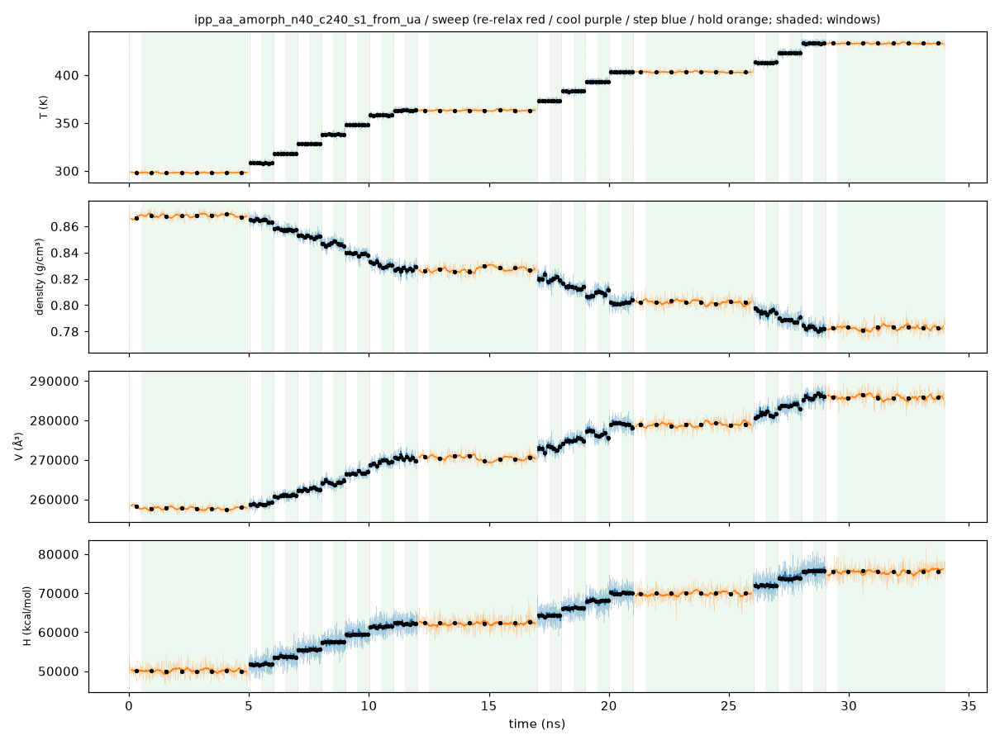
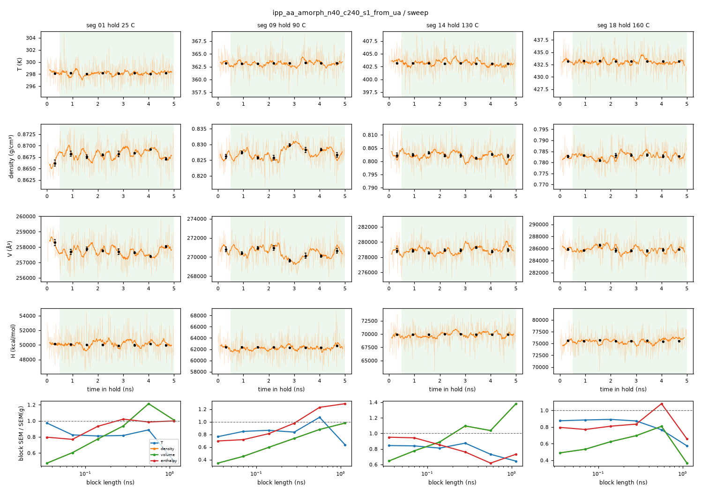

# Sweep analysis: ipp_aa_amorph_n40_c240_s1_from_ua / sweep

- system: `ipp_aa_amorph_n40_c240_s1_from_ua` (aa); source run directory `/home/rdyu/projects/che126_sims/results/runs/ipp_aa_amorph_n40_c240_s1_from_ua/sweep` (status finished, node rdyu-rog, run code commit 94e2001b05)
- analysis: `sepsim analyze sweep` (D49), code commit 70111966f1, 2026-11-21 06:53 on rdyu-server
- windows: steps second half (50% of rows dropped); holds without the first 10% of rows; SEM from the statistical inefficiency (D26)
- system mass 134739.8 g/mol (from Density × Volume)

## Segments

| # | segment | T set (°C) | window (ns) | T (°C) | density (g/cm³) | H (kcal/mol) | V (ų) | drift |
|---|---|---|---|---|---|---|---|---|
| 1 | hold | 25 | 4.50 | 24.99 ± 0.02 | 0.86809 ± 0.00022 | 50019.1 ± 17.0 | 257742 ± 65 |  |
| 2 | step | 35 | 0.50 | 34.98 ± 0.07 | 0.86408 ± 0.00063 | 51818.4 ± 13.0 | 258939 ± 188 | density |
| 3 | step | 45 | 0.50 | 45.01 ± 0.07 | 0.85714 ± 0.00035 | 53690.5 ± 12.0 | 261033 ± 107 |  |
| 4 | step | 55 | 0.50 | 55.02 ± 0.07 | 0.85154 ± 0.00041 | 55572.3 ± 10.9 | 262752 ± 127 |  |
| 5 | step | 65 | 0.50 | 65.00 ± 0.09 | 0.84663 ± 0.00072 | 57538.9 ± 29.8 | 264275 ± 225 | density |
| 6 | step | 75 | 0.50 | 74.87 ± 0.07 | 0.83845 ± 0.00043 | 59420.2 ± 13.6 | 266852 ± 138 |  |
| 7 | step | 85 | 0.50 | 85.00 ± 0.07 | 0.82969 ± 0.00054 | 61505.5 ± 11.3 | 269670 ± 175 | density |
| 8 | step | 90 | 0.50 | 90.03 ± 0.08 | 0.82767 ± 0.00057 | 62186.6 ± 20.6 | 270330 ± 186 |  |
| 9 | hold | 90 | 4.50 | 90.04 ± 0.03 | 0.82739 ± 0.00055 | 62374.7 ± 10.2 | 270421 ± 179 |  |
| 10 | step | 100 | 0.50 | 99.87 ± 0.08 | 0.81986 ± 0.00063 | 64258.8 ± 14.7 | 272905 ± 212 |  |
| 11 | step | 110 | 0.50 | 110.03 ± 0.08 | 0.81304 ± 0.00043 | 66282.8 ± 18.6 | 275193 ± 144 |  |
| 12 | step | 120 | 0.50 | 120.07 ± 0.08 | 0.80996 ± 0.00055 | 68084.9 ± 10.8 | 276241 ± 187 |  |
| 13 | step | 130 | 0.50 | 130.14 ± 0.11 | 0.80254 ± 0.00052 | 70061.9 ± 12.9 | 278796 ± 181 |  |
| 14 | hold | 130 | 4.50 | 129.97 ± 0.03 | 0.80231 ± 0.00023 | 69947.2 ± 8.5 | 278876 ± 81 | density |
| 15 | step | 140 | 0.50 | 139.96 ± 0.16 | 0.79472 ± 0.00057 | 71932.5 ± 18.6 | 281538 ± 202 |  |
| 16 | step | 150 | 0.50 | 150.01 ± 0.14 | 0.78846 ± 0.00067 | 73886.5 ± 11.9 | 283776 ± 239 |  |
| 17 | step | 160 | 0.50 | 159.92 ± 0.09 | 0.78139 ± 0.00041 | 75746.5 ± 16.0 | 286341 ± 152 |  |
| 18 | hold | 160 | 4.50 | 160.02 ± 0.03 | 0.78281 ± 0.00036 | 75574.2 ± 10.6 | 285823 ± 132 |  |

## Isothermal compressibility (holds)

κ_T = (⟨V²⟩ − ⟨V⟩²)/(k_B T ⟨V⟩) over the hold window (NPT iso Nosé–Hoover), T the set point; SEM = statistical-inefficiency SEM of (V − ⟨V⟩)² on 100 ps block means, as for the other thermo SEMs (D55; g given in raw samples).

| T (°C) | κ_T (GPa⁻¹) | σ_V (ų) | ⟨V⟩ (ų) | g | samples |
|---|---|---|---|---|---|
| 25 | 0.468 ± 0.017 | 704.4 | 257742 | 3.2 | 4501 |
| 90 | 0.927 ± 0.081 | 1121.2 | 270421 | 18.0 | 4501 |
| 130 | 0.967 ± 0.043 | 1225.4 | 278876 | 4.0 | 4501 |
| 160 | 1.157 ± 0.063 | 1406.1 | 285823 | 6.2 | 4501 |

## Sweep steps: κ_T and chain size

Per step, over its second half (as its thermo stats): κ_T as for the holds and the static chain properties from the step DCD (no MSD / relaxation). The steps are short, so κ_T is noisier and the chain shape is largely inherited from the segment before.

| T (°C) | κ_T (GPa⁻¹) | frames | R_g (Å) | R_ee (Å) | C_n plateau | ordered fraction |
|---|---|---|---|---|---|---|
| 35 | 0.453 ± 0.035 | 5 | 17.73 ± 0.01 | 45.8 ± 0.1 | 5.47 ± 0.01 | 0.089 |
| 45 | 0.478 ± 0.031 | 5 | 17.77 ± 0.01 | 46.1 ± 0.1 | 5.52 ± 0.01 | 0.092 |
| 55 | 0.582 ± 0.049 | 5 | 17.79 ± 0.02 | 45.9 ± 0.2 | 5.49 ± 0.02 | 0.088 |
| 65 | 0.655 ± 0.065 | 5 | 17.78 ± 0.02 | 45.9 ± 0.2 | 5.48 ± 0.01 | 0.095 |
| 75 | 0.625 ± 0.065 | 5 | 17.90 ± 0.04 | 46.4 ± 0.2 | 5.58 ± 0.02 | 0.087 |
| 85 | 0.592 ± 0.060 | 5 | 17.92 ± 0.02 | 46.4 ± 0.1 | 5.66 ± 0.02 | 0.090 |
| 90 | 0.702 ± 0.076 | 5 | 18.01 ± 0.03 | 47.9 ± 0.3 | 5.77 ± 0.03 | 0.091 |
| 100 | 0.892 ± 0.109 | 5 | 18.17 ± 0.03 | 49.6 ± 0.1 | 5.92 ± 0.01 | 0.095 |
| 110 | 0.714 ± 0.077 | 5 | 18.20 ± 0.02 | 48.0 ± 0.2 | 5.75 ± 0.02 | 0.099 |
| 120 | 0.952 ± 0.100 | 5 | 18.38 ± 0.03 | 47.4 ± 0.3 | 5.84 ± 0.03 | 0.099 |
| 130 | 0.826 ± 0.097 | 5 | 18.24 ± 0.03 | 49.0 ± 0.2 | 5.90 ± 0.03 | 0.102 |
| 140 | 0.969 ± 0.102 | 5 | 17.60 ± 0.04 | 45.3 ± 0.2 | 5.19 ± 0.04 | 0.105 |
| 150 | 1.009 ± 0.066 | 5 | 17.62 ± 0.06 | 43.1 ± 0.3 | 5.08 ± 0.05 | 0.108 |
| 160 | 1.042 ± 0.128 | 5 | 17.31 ± 0.04 | 44.4 ± 0.4 | 5.04 ± 0.04 | 0.104 |

## Thermal expansion and classical Cp (fits over the sweep)

Linear fits in T over each window, SEM-weighted, one point per temperature (hold where there is one): 25, 35, 45, 55, 65, 75, 85, 90, 100, 110, 120, 130, 140, 150, 160 °C. α_V = (1/⟨V⟩) dV/dT; Cp = dH/dT per gram; errors 1σ from the fit, scaled by √χ²_red when χ²_red > 1.

| window (°C) | points | α_V (10⁻⁴ K⁻¹) | χ²_red (V) | Cp (J g⁻¹ K⁻¹) | χ²_red (H) |
|---|---|---|---|---|---|
| 25–160 | 15 | 7.637 ± 0.110 | 17.23 | 5.927 ± 0.016 | 40.93 |
| 25–90 | 8 | 7.190 ± 0.268 | 13.76 | 5.968 ± 0.038 | 36.29 |
| 90–160 | 8 | 7.830 ± 0.235 | 6.45 | 5.886 ± 0.034 | 37.94 |

## Hold trajectories: mobility and chain size

Backbone sites (CG: beads; UA/AA: backbone carbons) and chains, positions relative to the system's mass centre. MSD and P2 combine the D46 bursts (0.1 ps frames, lags < the hold frame interval) with the hold DCD (lags up to half the hold). D_COM from an OLS line over the end of the COM MSD where the local log-slope stays ≥ 0.9 over a factor ≥ 2 in lag and the MSD ≥ 2⟨Rg²⟩ (D55; error: slope spread of the two halves of that range); else "not diffusive" (log-slope at the longest lag given). Rg mass-weighted over all atoms of a chain; C_n plateau over n ≥ 100 carbons (D37) on ≤ 500 frames.

| T (°C) | frames | bursts | MSD seg 10 ps / max (Ų) | COM MSD max (Ų) | D_COM (cm²/s) | P2 1/e (ps) | Rg (Å) | R_ee (Å) | C_n plateau |
|---|---|---|---|---|---|---|---|---|---|
| 25 | 501 × 10 ps | 5 | 1.1 / 5 (2.5 ns) | 0 | not diffusive (log-slope 0.46 at the longest lag) | > 2500 (P2 0.58) | 17.71 ± 0.01 | 45.9 ± 0.1 | 5.473 ± 0.013 |
| 90 | 501 × 10 ps | 5 | 2.6 / 46 (2.5 ns) | 5 | not diffusive (log-slope 0.85 at the longest lag) | 237.9 | 18.19 ± 0.06 | 48.2 ± 0.3 | 5.880 ± 0.037 |
| 130 | 501 × 10 ps | 5 | 4.2 / 114 (2.5 ns) | 20 | not diffusive (log-slope 0.58 at the longest lag) | 69.4 | 17.91 ± 0.08 | 47.5 ± 0.6 | 5.592 ± 0.086 |
| 160 | 501 × 10 ps | 5 | 5.8 / 160 (2.5 ns) | 33 | not diffusive (log-slope 0.68 at the longest lag) | 35.8 | 17.41 ± 0.04 | 43.2 ± 0.2 | 4.942 ± 0.024 |

## Chain relaxation (holds; D56)

End-to-end vector ACF ⟨R(t)·R(0)⟩/⟨R²⟩ and Rouse mode ACFs ⟨X_p(t)·X_p(0)⟩/⟨X_p²⟩, X_p = (1/N) Σ_n cos(pπ(n−½)/N) r_n over the backbone sites, every time origin, lags up to half the hold (2.5 ns here). Times in ns: the first 1/e crossing; if C stays above 1/e within the lag window the time is 'not reached' and only an exponential fit of ln C over 0.2 ≤ C ≤ 0.9 is given (marked extrap.: it extrapolates the early decay). τ_ee fit is that fit for R_ee. τ_1/τ_2 is 4 for Rouse chains. p²⟨X_p²⟩ (relative to p = 1, p = 2…5) is flat for an ideal Rouse chain; it falls at high p where the chain is stiffer than Gaussian on that scale. Crystallinity: D26 local alignment, fraction of backbone sites with p2 ≥ 0.4 (**uncalibrated, melt baseline**: no crystal reference, so the number is a baseline for an amorphous box, not a calibrated crystallinity) and the largest crystalline cluster (sites).

| T (°C) | τ_ee 1/e (ns) | τ_ee fit (ns) | τ_1 (ns) | τ_2 (ns) | τ_3 (ns) | τ_1/τ_2 (Rouse 4) | p²⟨X_p²⟩ / p=1 (p = 2…5) | crystallinity |
|---|---|---|---|---|---|---|---|---|
| 25 | not reached (C 0.99 at max lag) | n/a (extrap.) | not reached (C 1.00 at max lag) | not reached (C 1.00 at max lag) | not reached (C 0.99 at max lag) | n/a | 0.70 / 0.68 / 0.68 / 0.62 | 0.085 (max 0.094; cluster ≤ 69) |
| 90 | not reached (C 0.95 at max lag) | n/a (extrap.) | not reached (C 0.99 at max lag) | not reached (C 0.95 at max lag) | not reached (C 0.89 at max lag; fit 35.4, extrap.) | n/a | 0.75 / 0.72 / 0.74 / 0.61 | 0.091 (max 0.108; cluster ≤ 97) |
| 130 | not reached (C 0.91 at max lag) | n/a (extrap.) | not reached (C 0.96 at max lag) | not reached (C 0.81 at max lag; fit 14.1, extrap.) | not reached (C 0.71 at max lag; fit 7.99, extrap.) | n/a | 0.75 / 0.84 / 0.56 / 0.72 | 0.100 (max 0.117; cluster ≤ 100) |
| 160 | not reached (C 0.83 at max lag; fit 18.4, extrap.) | 18.4 (extrap.) | not reached (C 0.92 at max lag) | not reached (C 0.77 at max lag; fit 10.9, extrap.) | not reached (C 0.52 at max lag; fit 4.07, extrap.) | n/a | 0.91 / 0.78 / 0.75 / 0.76 | 0.109 (max 0.130; cluster ≤ 82) |

Where τ_1 is not reached, p²τ_p of the faster modes estimates it under ideal Rouse scaling (τ_p ∝ p⁻²). Real melts show τ_p ∝ p^−2.2…−2.4 (stiffness, local friction), so p²τ_p underestimates τ_1, more so the higher p:

- 160 °C: τ_1 ≈ p²τ_p from the reached modes: p=4: 33.9, p=5: 45.2 ns.

## Equilibration

Every average uses only the analysis window: steps second half (50% of rows dropped), holds without the first 10% of rows (the rest is equilibration after the T change; see `equilibration.png`, windows shaded, block averages ± SEM overlaid, and `equilibration_holds.png`). Drift: the window's two halves differ by > 2 combined SEM (statistical inefficiency).

Segments with a drifting window (tested: density, enthalpy):

| segment | T set (°C) | drift (second − first half ± SEM) |
|---|---|---|
| seg 02 step 35 C | 35 | density -0.001818 ± 0.00038 |
| seg 05 step 65 C | 65 | density -0.001952 ± 0.00096 |
| seg 07 step 85 C | 85 | density +0.001439 ± 0.00059 |
| seg 14 hold 130 C | 130 | density -0.0008557 ± 0.00042 |

Block-average check of the hold SEMs: SEM of the means of 32 / 16 / 8 blocks vs the statistical-inefficiency SEM (blocks longer than the correlation time plateau at it; flagged if the 8-block SEM exceeds it by > 2×).

| T (°C) | quantity | SEM (g) | block SEM 32 / 16 / 8 | converged |
|---|---|---|---|---|
| 25 | density | 0.000218 | 0.000169 / 0.000204 / 0.000265 | yes |
| 25 | enthalpy | 26.8 | 25 / 27.4 / 26.4 | yes |
| 90 | density | 0.000548 | 0.000326 / 0.000404 / 0.000481 | yes |
| 90 | enthalpy | 36.2 | 29.4 / 35.4 / 44.5 | yes |
| 130 | density | 0.000234 | 0.000208 / 0.000256 / 0.000242 | yes |
| 130 | enthalpy | 24.9 | 21.2 / 18.9 / 15.4 | yes |
| 160 | density | 0.000362 | 0.000226 / 0.000252 / 0.000293 | yes |
| 160 | enthalpy | 31.3 | 25.4 / 26.1 / 33.8 | yes |

Local quantities (density, enthalpy, κ_T, segmental MSD, bond P2: relaxation times ~10–100 ps in CG, the bond P2 1/e time above) equilibrate within the dropped part of each segment; their windows are what the drift and block checks test.

Chain-scale quantities (Rg, R_ee, C_n, chain COM motion) relax on the end-to-end time (CG C240 at 25 °C: of order 100 ns; C1500 far longer), longer than a 25 ns hold: their hold averages describe the chain configurations carried in from the 500 K equilibration and cooling rather than a re-equilibrated state at T. Per hold:
- 25 °C: chain COM MSD at 2.5 ns / ⟨Rg²⟩ = 0.00; chains have **not** moved their own size: chain-scale averages sample a partly relaxed set of chain configurations.
- 90 °C: chain COM MSD at 2.5 ns / ⟨Rg²⟩ = 0.01; chains have **not** moved their own size: chain-scale averages sample a partly relaxed set of chain configurations.
- 130 °C: chain COM MSD at 2.5 ns / ⟨Rg²⟩ = 0.06; chains have **not** moved their own size: chain-scale averages sample a partly relaxed set of chain configurations.
- 160 °C: chain COM MSD at 2.5 ns / ⟨Rg²⟩ = 0.11; chains have **not** moved their own size: chain-scale averages sample a partly relaxed set of chain configurations.

## Caveats

- Cp is the classical dH/dT and is not comparable to experiment: classical MD gives every degree of freedom k_B/2 per quadratic term, so the stiff C–H/C–C modes that are quantum-frozen at these T make AA Cp too high; it needs the VDOS quantum correction (D12c), not done here.
- Chains may not be relaxed: the D47 criteria fail on the prep 500 K hold (prep/progress.json: end-to-end ACF 0.72 at 2.5 ns, needs < 1/e; COM MSD/<Rg²> 0.25, needs >= 2).
- α_V and Cp are linear fits in T over each window with SEM weights; a reduced χ² > 1 (curvature over the window, or SEMs too small) inflates the quoted errors by √χ²_red, and a large χ²_red over 25–160 °C means α_V or Cp depends on T (compare the two half windows).

## Plots

**density and enthalpy vs T with the linear fits**

**κ_T vs T (holds)**

**α_V and Cp per fit window**

**backbone-site and chain COM MSD**

**bond P2 autocorrelation**

**Rg, R_ee and C_n vs T**

**end-to-end and Rouse mode ACFs, p²τ_p vs p**

**thermo vs time, analysis windows shaded, block averages ± SEM**

**holds: thermo vs time, analysis window shaded, block averages ± SEM**

