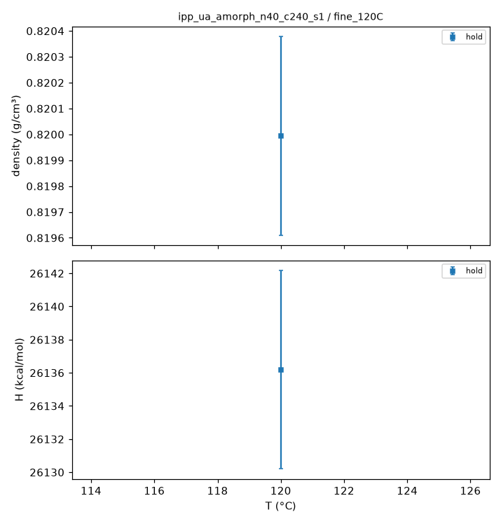
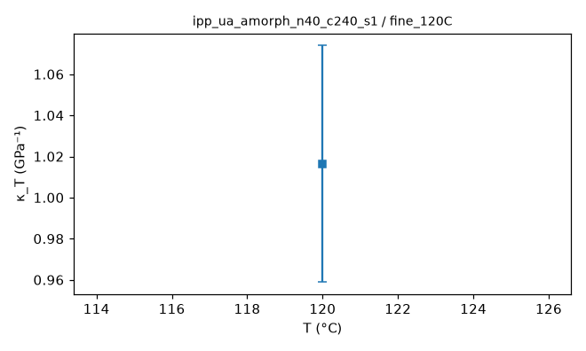
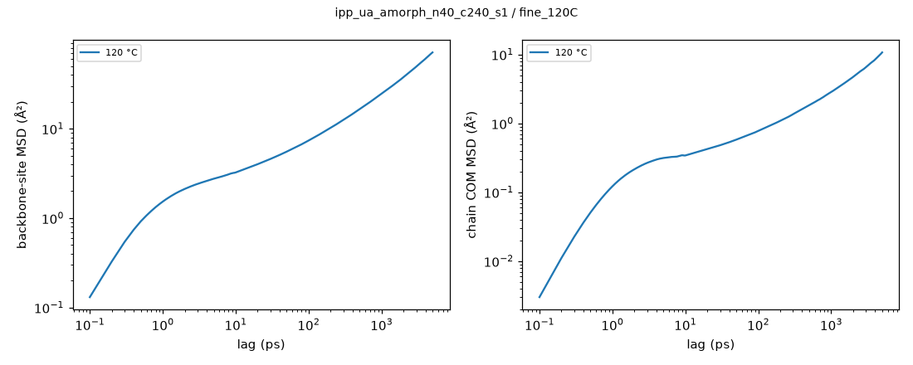
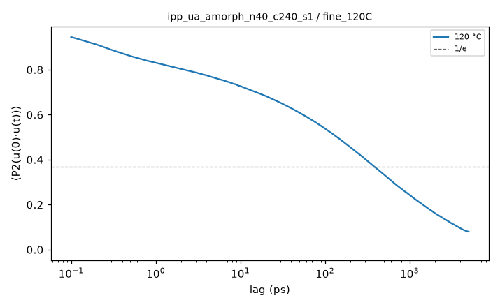
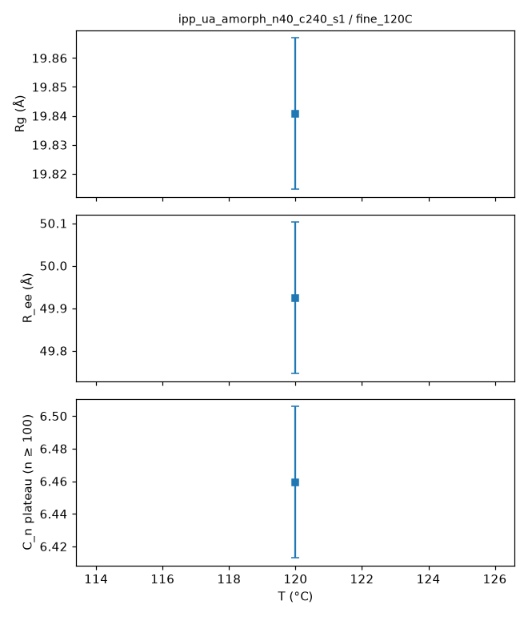
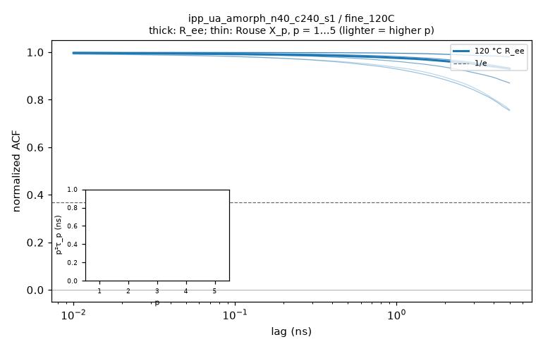
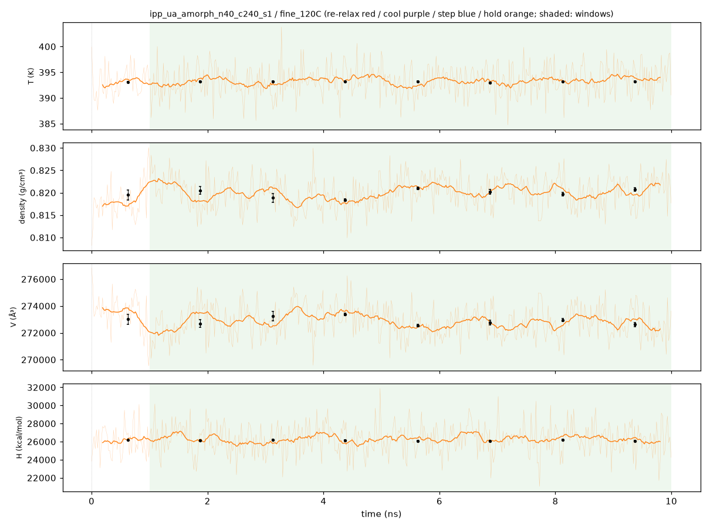
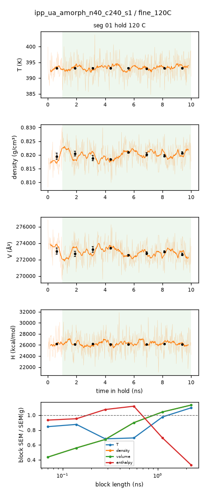

# Sweep analysis: ipp_ua_amorph_n40_c240_s1 / fine_120C

- system: `ipp_ua_amorph_n40_c240_s1` (ua); source run directory `/home/rdyu/projects/che126_sims/results/runs/ipp_ua_amorph_n40_c240_s1/fine_120C` (status finished, node rdyu-rog, run code commit b969a5e8c3)
- analysis: `sepsim analyze sweep` (D49), code commit 0375ae4252 (dirty), 2026-11-23 03:33 on rdyu-server
- windows: steps second half (50% of rows dropped); holds without the first 10% of rows; SEM from the statistical inefficiency (D26)
- system mass 134739.8 g/mol (from Density × Volume)

## Segments

| # | segment | T set (°C) | window (ns) | T (°C) | density (g/cm³) | H (kcal/mol) | V (ų) | drift |
|---|---|---|---|---|---|---|---|---|
| 1 | hold | 120 | 9.00 | 120.01 ± 0.03 | 0.81999 ± 0.00038 | 26136.2 ± 6.0 | 272862 ± 128 |  |

## Isothermal compressibility (holds)

κ_T = (⟨V²⟩ − ⟨V⟩²)/(k_B T ⟨V⟩) over the hold window (NPT iso Nosé–Hoover), T the set point; SEM = statistical-inefficiency SEM of (V − ⟨V⟩)² on 100 ps block means, as for the other thermo SEMs (D55; g given in raw samples).

| T (°C) | κ_T (GPa⁻¹) | σ_V (ų) | ⟨V⟩ (ų) | g | samples |
|---|---|---|---|---|---|
| 120 | 1.016 ± 0.058 | 1227.0 | 272862 | 14.8 | 9001 |

## Thermal expansion and classical Cp (fits over the sweep)

Not enough completed segments for a fit.

## Hold trajectories: mobility and chain size

Backbone sites (CG: beads; UA/AA: backbone carbons) and chains, positions relative to the system's mass centre. MSD and P2 combine the D46 bursts (0.1 ps frames, lags < the hold frame interval) with the hold DCD (lags up to half the hold). D_COM from an OLS line over the end of the COM MSD where the local log-slope stays ≥ 0.9 over a factor ≥ 2 in lag and the MSD ≥ 2⟨Rg²⟩ (D55; error: slope spread of the two halves of that range); else "not diffusive" (log-slope at the longest lag given). Rg mass-weighted over all atoms of a chain; C_n plateau over n ≥ 100 carbons (D37) on ≤ 500 frames.

| T (°C) | frames | bursts | MSD seg 10 ps / max (Ų) | COM MSD max (Ų) | D_COM (cm²/s) | P2 1/e (ps) | Rg (Å) | R_ee (Å) | C_n plateau |
|---|---|---|---|---|---|---|---|---|---|
| 120 | 1001 × 10 ps | 10 | 3.2 / 71 (5 ns) | 11 | not diffusive (log-slope 1.11 at the longest lag) | 387.0 | 19.84 ± 0.03 | 49.9 ± 0.2 | 6.459 ± 0.046 |

## Chain relaxation (holds; D56)

End-to-end vector ACF ⟨R(t)·R(0)⟩/⟨R²⟩ and Rouse mode ACFs ⟨X_p(t)·X_p(0)⟩/⟨X_p²⟩, X_p = (1/N) Σ_n cos(pπ(n−½)/N) r_n over the backbone sites, every time origin, lags up to half the hold (5 ns here). Times in ns: the first 1/e crossing; if C stays above 1/e within the lag window the time is 'not reached' and only an exponential fit of ln C over 0.2 ≤ C ≤ 0.9 is given (marked extrap.: it extrapolates the early decay). τ_ee fit is that fit for R_ee. τ_1/τ_2 is 4 for Rouse chains. p²⟨X_p²⟩ (relative to p = 1, p = 2…5) is flat for an ideal Rouse chain; it falls at high p where the chain is stiffer than Gaussian on that scale. Crystallinity: D26 local alignment, fraction of backbone sites with p2 ≥ 0.4 (**uncalibrated, melt baseline**: no crystal reference, so the number is a baseline for an amorphous box, not a calibrated crystallinity) and the largest crystalline cluster (sites).

| T (°C) | τ_ee 1/e (ns) | τ_ee fit (ns) | τ_1 (ns) | τ_2 (ns) | τ_3 (ns) | τ_1/τ_2 (Rouse 4) | p²⟨X_p²⟩ / p=1 (p = 2…5) | crystallinity |
|---|---|---|---|---|---|---|---|---|
| 120 | not reached (C 0.93 at max lag) | n/a (extrap.) | not reached (C 0.98 at max lag) | not reached (C 0.93 at max lag) | not reached (C 0.87 at max lag; fit 37.7, extrap.) | n/a | 0.95 / 1.00 / 0.79 / 0.98 | 0.148 (max 0.170; cluster ≤ 478) |

## Equilibration

Every average uses only the analysis window: steps second half (50% of rows dropped), holds without the first 10% of rows (the rest is equilibration after the T change; see `equilibration.png`, windows shaded, block averages ± SEM overlaid, and `equilibration_holds.png`). Drift: the window's two halves differ by > 2 combined SEM (statistical inefficiency).

No segment window drifts (tested: density, enthalpy).

Block-average check of the hold SEMs: SEM of the means of 32 / 16 / 8 blocks vs the statistical-inefficiency SEM (blocks longer than the correlation time plateau at it; flagged if the 8-block SEM exceeds it by > 2×).

| T (°C) | quantity | SEM (g) | block SEM 32 / 16 / 8 | converged |
|---|---|---|---|---|
| 120 | density | 0.000384 | 0.000259 / 0.000346 / 0.000401 | yes |
| 120 | enthalpy | 17.1 | 18.4 / 19.2 / 11.9 | yes |

Local quantities (density, enthalpy, κ_T, segmental MSD, bond P2: relaxation times ~10–100 ps in CG, the bond P2 1/e time above) equilibrate within the dropped part of each segment; their windows are what the drift and block checks test.

Chain-scale quantities (Rg, R_ee, C_n, chain COM motion) relax on the end-to-end time (CG C240 at 25 °C: of order 100 ns; C1500 far longer), longer than a 25 ns hold: their hold averages describe the chain configurations carried in from the 500 K equilibration and cooling rather than a re-equilibrated state at T. Per hold:
- 120 °C: chain COM MSD at 5 ns / ⟨Rg²⟩ = 0.03; chains have **not** moved their own size: chain-scale averages sample a partly relaxed set of chain configurations.

## Caveats

- Cp is the classical dH/dT and is not comparable to experiment: classical MD gives every degree of freedom k_B/2 per quadratic term; UA also drops degrees of freedom (the hydrogens), so its Cp per gram is not a property of the real polymer at all (reported for completeness and resolution comparisons only).
- Chains may not be relaxed: the D47 criteria fail on the prep 500 K hold (prep/progress.json: end-to-end ACF 0.45 at 10.0 ns, needs < 1/e; COM MSD/<Rg²> 1.05, needs >= 2).
- D37 chain check FAIL on the prep 500 K hold: C_n plateau 4.77 vs melt 6.15 ±10%.
- α_V and Cp are linear fits in T over each window with SEM weights; a reduced χ² > 1 (curvature over the window, or SEMs too small) inflates the quoted errors by √χ²_red, and a large χ²_red over 25–160 °C means α_V or Cp depends on T (compare the two half windows).

## Plots

**density and enthalpy vs T with the linear fits**

**κ_T vs T (holds)**

**backbone-site and chain COM MSD**

**bond P2 autocorrelation**

**Rg, R_ee and C_n vs T**

**end-to-end and Rouse mode ACFs, p²τ_p vs p**

**thermo vs time, analysis windows shaded, block averages ± SEM**

**holds: thermo vs time, analysis window shaded, block averages ± SEM**

