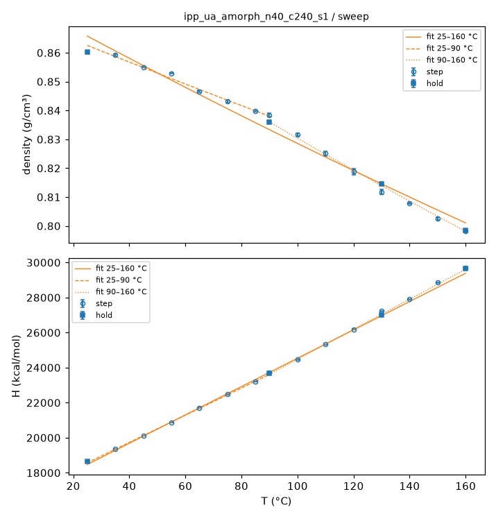
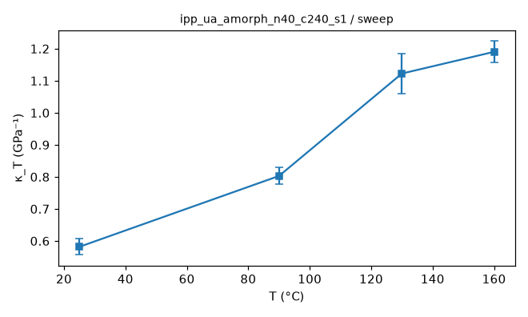
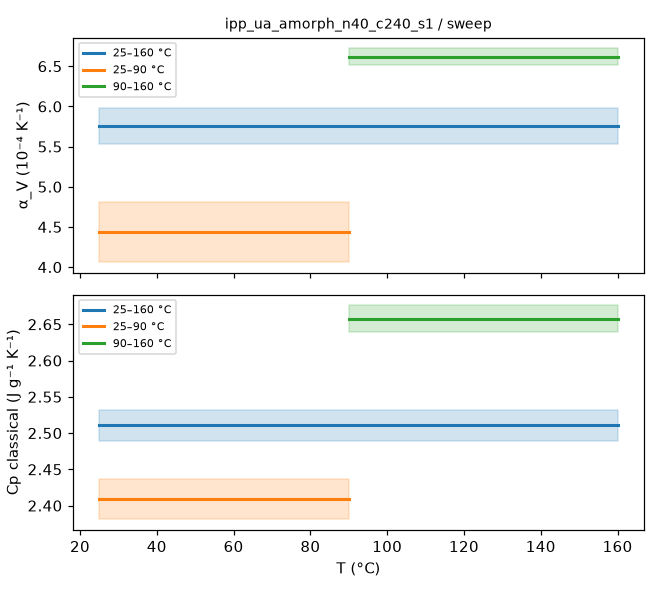
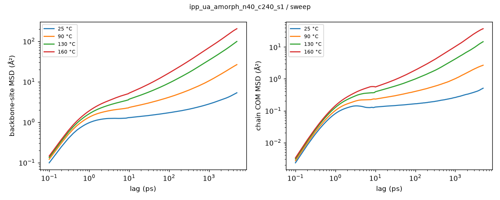
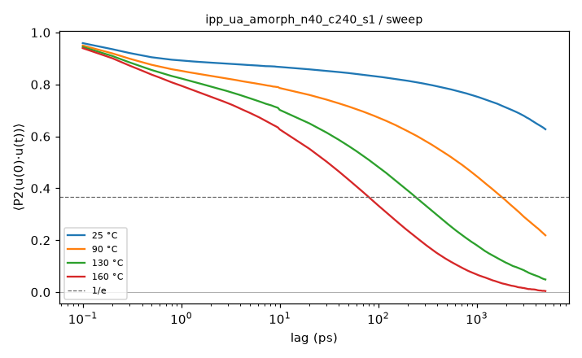
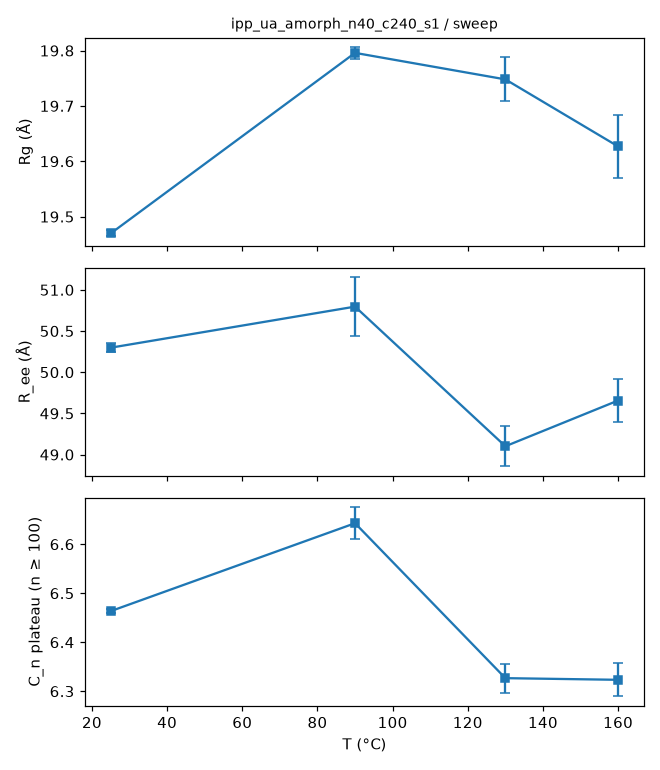
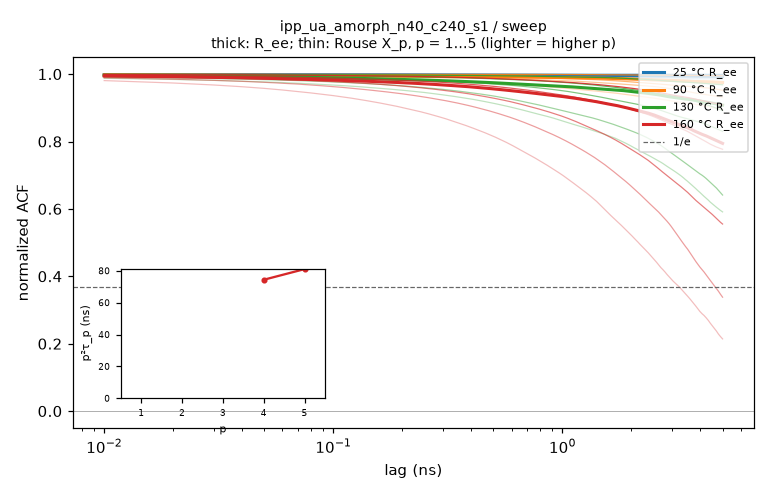
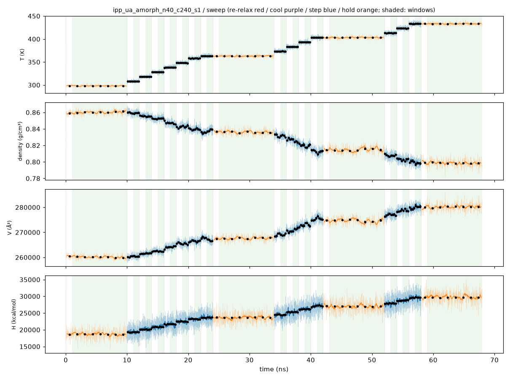
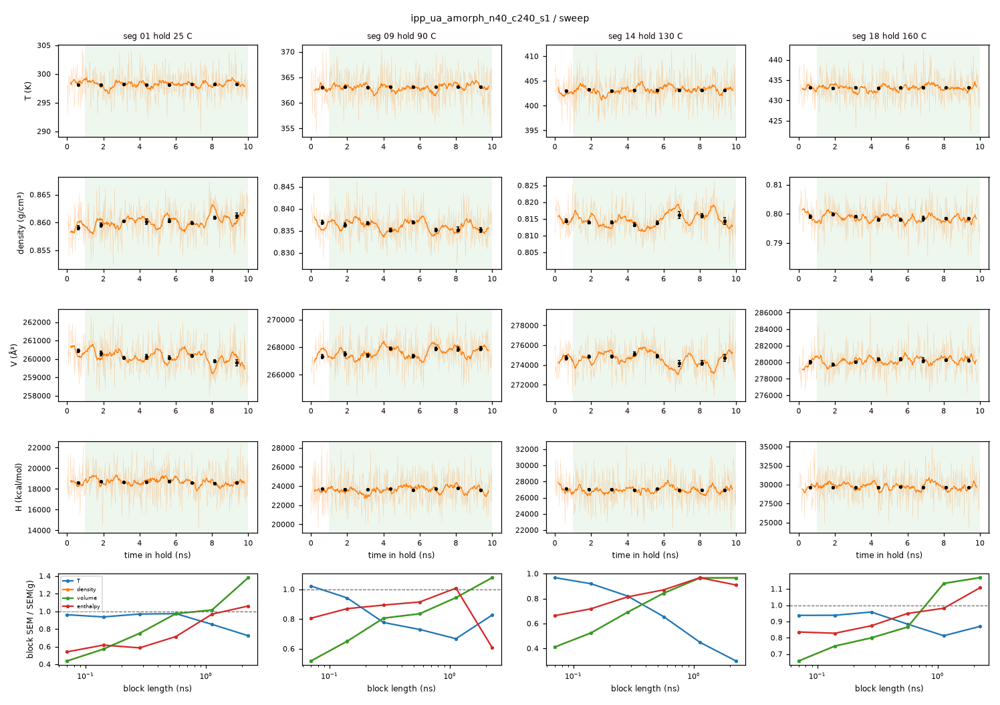

# Sweep analysis: ipp_ua_amorph_n40_c240_s1 / sweep

- system: `ipp_ua_amorph_n40_c240_s1` (ua); source run directory `/home/rdyu/projects/che126_sims/results/runs/ipp_ua_amorph_n40_c240_s1/sweep` (status finished, node rdyu-rog, run code commit eb03f2965b)
- analysis: `sepsim analyze sweep` (D49), code commit 798e36106d (dirty), 2026-11-07 03:47 on rdyu-server
- windows: steps second half (50% of rows dropped); holds without the first 10% of rows; SEM from the statistical inefficiency (D26)
- system mass 134739.8 g/mol (from Density × Volume)

## Segments

| # | segment | T set (°C) | window (ns) | T (°C) | density (g/cm³) | H (kcal/mol) | V (ų) | drift |
|---|---|---|---|---|---|---|---|---|
| 1 | hold | 25 | 9.00 | 25.02 ± 0.03 | 0.86029 ± 0.00022 | 18662.7 ± 16.6 | 260077 ± 68 | enthalpy |
| 2 | step | 35 | 1.00 | 35.00 ± 0.08 | 0.85921 ± 0.00035 | 19351.4 ± 6.3 | 260405 ± 107 |  |
| 3 | step | 45 | 1.00 | 45.01 ± 0.09 | 0.85507 ± 0.00020 | 20115.0 ± 6.7 | 261666 ± 63 |  |
| 4 | step | 55 | 1.00 | 54.94 ± 0.08 | 0.85284 ± 0.00015 | 20866.6 ± 4.1 | 262350 ± 47 |  |
| 5 | step | 65 | 1.00 | 65.21 ± 0.08 | 0.84659 ± 0.00040 | 21715.9 ± 5.8 | 264287 ± 124 | density |
| 6 | step | 75 | 1.00 | 75.00 ± 0.08 | 0.84320 ± 0.00052 | 22484.9 ± 20.5 | 265350 ± 164 |  |
| 7 | step | 85 | 1.00 | 85.00 ± 0.09 | 0.83979 ± 0.00032 | 23191.1 ± 7.5 | 266428 ± 101 |  |
| 8 | step | 90 | 1.00 | 89.93 ± 0.09 | 0.83843 ± 0.00065 | 23735.9 ± 8.7 | 266859 ± 208 | density |
| 9 | hold | 90 | 9.00 | 89.97 ± 0.03 | 0.83585 ± 0.00025 | 23683.1 ± 13.3 | 267684 ± 81 |  |
| 10 | step | 100 | 1.00 | 99.99 ± 0.18 | 0.83158 ± 0.00049 | 24457.8 ± 9.4 | 269059 ± 160 |  |
| 11 | step | 110 | 1.00 | 110.08 ± 0.09 | 0.82510 ± 0.00079 | 25329.7 ± 9.9 | 271175 ± 261 |  |
| 12 | step | 120 | 1.00 | 119.83 ± 0.11 | 0.81885 ± 0.00107 | 26189.6 ± 13.6 | 273245 ± 358 | density |
| 13 | step | 130 | 1.00 | 129.99 ± 0.10 | 0.81178 ± 0.00090 | 27220.4 ± 7.8 | 275623 ± 305 | density, enthalpy |
| 14 | hold | 130 | 9.00 | 129.97 ± 0.03 | 0.81456 ± 0.00045 | 27001.4 ± 20.2 | 274684 ± 150 | density |
| 15 | step | 140 | 1.00 | 140.04 ± 0.10 | 0.80782 ± 0.00032 | 27905.9 ± 13.2 | 276973 ± 110 |  |
| 16 | step | 150 | 1.00 | 150.00 ± 0.10 | 0.80252 ± 0.00046 | 28845.1 ± 34.5 | 278804 ± 159 | density |
| 17 | step | 160 | 1.00 | 160.07 ± 0.16 | 0.79815 ± 0.00052 | 29679.1 ± 16.7 | 280330 ± 182 |  |
| 18 | hold | 160 | 9.00 | 159.99 ± 0.03 | 0.79855 ± 0.00024 | 29637.3 ± 18.1 | 280189 ± 83 |  |

## Isothermal compressibility (holds)

κ_T = (⟨V²⟩ − ⟨V⟩²)/(k_B T ⟨V⟩) over the hold window (NPT iso Nosé–Hoover), T the set point; SEM = statistical-inefficiency SEM of (V − ⟨V⟩)² on 100 ps block means, as for the other thermo SEMs (D55; g given in raw samples).

| T (°C) | κ_T (GPa⁻¹) | σ_V (ų) | ⟨V⟩ (ų) | g | samples |
|---|---|---|---|---|---|
| 25 | 0.582 ± 0.025 | 789.1 | 260077 | 8.3 | 9001 |
| 90 | 0.803 ± 0.026 | 1038.1 | 267684 | 4.7 | 9001 |
| 130 | 1.122 ± 0.063 | 1310.0 | 274684 | 14.3 | 9001 |
| 160 | 1.190 ± 0.034 | 1412.2 | 280189 | 3.6 | 9001 |

## Sweep steps: κ_T and chain size

Per step, over its second half (as its thermo stats): κ_T as for the holds and the static chain properties from the step DCD (no MSD / relaxation). The steps are short, so κ_T is noisier and the chain shape is largely inherited from the segment before.

| T (°C) | κ_T (GPa⁻¹) | frames | R_g (Å) | R_ee (Å) | C_n plateau | ordered fraction |
|---|---|---|---|---|---|---|
| 35 | 0.629 ± 0.057 | 11 | 19.47 ± 0.01 | 49.8 ± 0.1 | 6.43 ± 0.01 | 0.146 |
| 45 | 0.549 ± 0.027 | 11 | 19.49 ± 0.01 | 50.3 ± 0.1 | 6.46 ± 0.01 | 0.140 |
| 55 | 0.544 ± 0.025 | 11 | 19.51 ± 0.01 | 49.7 ± 0.1 | 6.44 ± 0.01 | 0.138 |
| 65 | 0.628 ± 0.029 | 11 | 19.59 ± 0.02 | 49.9 ± 0.1 | 6.49 ± 0.01 | 0.129 |
| 75 | 0.731 ± 0.075 | 11 | 19.67 ± 0.03 | 50.1 ± 0.2 | 6.55 ± 0.02 | 0.138 |
| 85 | 0.708 ± 0.035 | 11 | 19.63 ± 0.01 | 50.0 ± 0.1 | 6.54 ± 0.01 | 0.141 |
| 90 | 0.728 ± 0.041 | 11 | 19.72 ± 0.02 | 50.7 ± 0.1 | 6.65 ± 0.01 | 0.140 |
| 100 | 0.784 ± 0.057 | 11 | 19.73 ± 0.02 | 50.0 ± 0.3 | 6.52 ± 0.04 | 0.142 |
| 110 | 1.000 ± 0.107 | 11 | 19.71 ± 0.04 | 51.8 ± 0.2 | 6.62 ± 0.02 | 0.158 |
| 120 | 1.028 ± 0.071 | 11 | 19.52 ± 0.02 | 50.6 ± 0.3 | 6.44 ± 0.03 | 0.161 |
| 130 | 1.085 ± 0.102 | 11 | 19.76 ± 0.02 | 50.2 ± 0.2 | 6.52 ± 0.01 | 0.143 |
| 140 | 0.912 ± 0.051 | 11 | 19.83 ± 0.02 | 50.6 ± 0.3 | 6.58 ± 0.02 | 0.133 |
| 150 | 1.093 ± 0.074 | 11 | 19.67 ± 0.09 | 48.9 ± 0.6 | 6.34 ± 0.08 | 0.139 |
| 160 | 1.243 ± 0.104 | 11 | 20.08 ± 0.08 | 51.9 ± 0.5 | 6.79 ± 0.07 | 0.131 |

## Thermal expansion and classical Cp (fits over the sweep)

Linear fits in T over each window, SEM-weighted, one point per temperature (hold where there is one): 25, 35, 45, 55, 65, 75, 85, 90, 100, 110, 120, 130, 140, 150, 160 °C. α_V = (1/⟨V⟩) dV/dT; Cp = dH/dT per gram; errors 1σ from the fit, scaled by √χ²_red when χ²_red > 1.

| window (°C) | points | α_V (10⁻⁴ K⁻¹) | χ²_red (V) | Cp (J g⁻¹ K⁻¹) | χ²_red (H) |
|---|---|---|---|---|---|
| 25–160 | 15 | 5.755 ± 0.223 | 105.84 | 2.511 ± 0.021 | 84.00 |
| 25–90 | 8 | 4.434 ± 0.372 | 52.94 | 2.409 ± 0.027 | 32.38 |
| 90–160 | 8 | 6.619 ± 0.103 | 3.45 | 2.657 ± 0.019 | 6.44 |

## Hold trajectories: mobility and chain size

Backbone sites (CG: beads; UA/AA: backbone carbons) and chains, positions relative to the system's mass centre. MSD and P2 combine the D46 bursts (0.1 ps frames, lags < the hold frame interval) with the hold DCD (lags up to half the hold). D_COM from an OLS line over the end of the COM MSD where the local log-slope stays ≥ 0.9 over a factor ≥ 2 in lag and the MSD ≥ 2⟨Rg²⟩ (D55; error: slope spread of the two halves of that range); else "not diffusive" (log-slope at the longest lag given). Rg mass-weighted over all atoms of a chain; C_n plateau over n ≥ 100 carbons (D37) on ≤ 500 frames.

| T (°C) | frames | bursts | MSD seg 10 ps / max (Ų) | COM MSD max (Ų) | D_COM (cm²/s) | P2 1/e (ps) | Rg (Å) | R_ee (Å) | C_n plateau |
|---|---|---|---|---|---|---|---|---|---|
| 25 | 1001 × 10 ps | 10 | 1.3 / 5 (5 ns) | 1 | not diffusive (log-slope 0.68 at the longest lag) | > 5000 (P2 0.63) | 19.47 ± 0.01 | 50.3 ± 0.1 | 6.464 ± 0.004 |
| 90 | 1001 × 10 ps | 10 | 2.3 / 26 (5 ns) | 3 | not diffusive (log-slope 0.48 at the longest lag) | 1784.5 | 19.80 ± 0.01 | 50.8 ± 0.4 | 6.643 ± 0.033 |
| 130 | 1001 × 10 ps | 10 | 3.7 / 99 (5 ns) | 15 | not diffusive (log-slope 0.75 at the longest lag) | 236.9 | 19.75 ± 0.04 | 49.1 ± 0.2 | 6.327 ± 0.029 |
| 160 | 1001 × 10 ps | 10 | 5.2 / 204 (5 ns) | 38 | not diffusive (log-slope 0.56 at the longest lag) | 79.3 | 19.63 ± 0.06 | 49.7 ± 0.3 | 6.323 ± 0.033 |

## Chain relaxation (holds; D56)

End-to-end vector ACF ⟨R(t)·R(0)⟩/⟨R²⟩ and Rouse mode ACFs ⟨X_p(t)·X_p(0)⟩/⟨X_p²⟩, X_p = (1/N) Σ_n cos(pπ(n−½)/N) r_n over the backbone sites, every time origin, lags up to half the hold (5 ns here). Times in ns: the first 1/e crossing; if C stays above 1/e within the lag window the time is 'not reached' and only an exponential fit of ln C over 0.2 ≤ C ≤ 0.9 is given (marked extrap.: it extrapolates the early decay). τ_ee fit is that fit for R_ee. τ_1/τ_2 is 4 for Rouse chains. p²⟨X_p²⟩ (relative to p = 1, p = 2…5) is flat for an ideal Rouse chain; it falls at high p where the chain is stiffer than Gaussian on that scale. Crystallinity: D26 local alignment, fraction of backbone sites with p2 ≥ 0.4 (**uncalibrated, melt baseline**: no crystal reference, so the number is a baseline for an amorphous box, not a calibrated crystallinity) and the largest crystalline cluster (sites).

| T (°C) | τ_ee 1/e (ns) | τ_ee fit (ns) | τ_1 (ns) | τ_2 (ns) | τ_3 (ns) | τ_1/τ_2 (Rouse 4) | p²⟨X_p²⟩ / p=1 (p = 2…5) | crystallinity |
|---|---|---|---|---|---|---|---|---|
| 25 | not reached (C 0.99 at max lag) | n/a (extrap.) | not reached (C 1.00 at max lag) | not reached (C 1.00 at max lag) | not reached (C 0.99 at max lag) | n/a | 0.92 / 0.86 / 0.93 / 0.80 | 0.137 (max 0.148; cluster ≤ 473) |
| 90 | not reached (C 0.98 at max lag) | n/a (extrap.) | not reached (C 1.00 at max lag) | not reached (C 0.98 at max lag) | not reached (C 0.95 at max lag) | n/a | 0.87 / 0.83 / 0.95 / 0.79 | 0.138 (max 0.155; cluster ≤ 413) |
| 130 | not reached (C 0.91 at max lag) | n/a (extrap.) | not reached (C 0.97 at max lag) | not reached (C 0.89 at max lag; fit 38.1, extrap.) | not reached (C 0.83 at max lag; fit 33.2, extrap.) | n/a | 1.04 / 1.02 / 0.80 / 0.79 | 0.143 (max 0.161; cluster ≤ 405) |
| 160 | not reached (C 0.79 at max lag; fit 24.3, extrap.) | 24.3 (extrap.) | not reached (C 0.91 at max lag) | not reached (C 0.78 at max lag; fit 20.2, extrap.) | not reached (C 0.56 at max lag; fit 8.65, extrap.) | n/a | 1.05 / 1.06 / 0.96 / 0.74 | 0.134 (max 0.153; cluster ≤ 319) |

Where τ_1 is not reached, p²τ_p of the faster modes estimates it under ideal Rouse scaling (τ_p ∝ p⁻²). Real melts show τ_p ∝ p^−2.2…−2.4 (stiffness, local friction), so p²τ_p underestimates τ_1, more so the higher p:

- 160 °C: τ_1 ≈ p²τ_p from the reached modes: p=4: 74.4, p=5: 81.1 ns.

## Equilibration

Every average uses only the analysis window: steps second half (50% of rows dropped), holds without the first 10% of rows (the rest is equilibration after the T change; see `equilibration.png`, windows shaded, block averages ± SEM overlaid, and `equilibration_holds.png`). Drift: the window's two halves differ by > 2 combined SEM (statistical inefficiency).

Segments with a drifting window (tested: density, enthalpy):

| segment | T set (°C) | drift (second − first half ± SEM) |
|---|---|---|
| seg 01 hold 25 C | 25 | enthalpy -88.97 ± 36 |
| seg 05 step 65 C | 65 | density -0.00142 ± 0.00033 |
| seg 08 step 90 C | 90 | density +0.001983 ± 0.00041 |
| seg 12 step 120 C | 120 | density +0.002975 ± 0.00063 |
| seg 13 step 130 C | 130 | density +0.002619 ± 0.00091; enthalpy -220.1 ± 1e+02 |
| seg 14 hold 130 C | 130 | density +0.001447 ± 0.00068 |
| seg 16 step 150 C | 150 | density +0.001829 ± 0.00089 |

Block-average check of the hold SEMs: SEM of the means of 32 / 16 / 8 blocks vs the statistical-inefficiency SEM (blocks longer than the correlation time plateau at it; flagged if the 8-block SEM exceeds it by > 2×).

| T (°C) | quantity | SEM (g) | block SEM 32 / 16 / 8 | converged |
|---|---|---|---|---|
| 25 | density | 0.000225 | 0.000169 / 0.000219 / 0.000228 | yes |
| 25 | enthalpy | 26 | 15.3 / 18.6 / 25.2 | yes |
| 90 | density | 0.000253 | 0.000204 / 0.000211 / 0.000239 | yes |
| 90 | enthalpy | 18 | 16.1 / 16.4 / 18.1 | yes |
| 130 | density | 0.000446 | 0.000308 / 0.000376 / 0.000431 | yes |
| 130 | enthalpy | 23.4 | 19 / 20.3 / 22.6 | yes |
| 160 | density | 0.000236 | 0.000189 / 0.000204 / 0.000267 | yes |
| 160 | enthalpy | 18.8 | 16.4 / 17.8 / 18.4 | yes |

Local quantities (density, enthalpy, κ_T, segmental MSD, bond P2: relaxation times ~10–100 ps in CG, the bond P2 1/e time above) equilibrate within the dropped part of each segment; their windows are what the drift and block checks test.

Chain-scale quantities (Rg, R_ee, C_n, chain COM motion) relax on the end-to-end time (CG C240 at 25 °C: of order 100 ns; C1500 far longer), longer than a 25 ns hold: their hold averages describe the chain configurations carried in from the 500 K equilibration and cooling rather than a re-equilibrated state at T. Per hold:
- 25 °C: chain COM MSD at 5 ns / ⟨Rg²⟩ = 0.00; chains have **not** moved their own size: chain-scale averages sample a partly relaxed set of chain configurations.
- 90 °C: chain COM MSD at 5 ns / ⟨Rg²⟩ = 0.01; chains have **not** moved their own size: chain-scale averages sample a partly relaxed set of chain configurations.
- 130 °C: chain COM MSD at 5 ns / ⟨Rg²⟩ = 0.04; chains have **not** moved their own size: chain-scale averages sample a partly relaxed set of chain configurations.
- 160 °C: chain COM MSD at 5 ns / ⟨Rg²⟩ = 0.10; chains have **not** moved their own size: chain-scale averages sample a partly relaxed set of chain configurations.

## Caveats

- Cp is the classical dH/dT and is not comparable to experiment: classical MD gives every degree of freedom k_B/2 per quadratic term; UA also drops degrees of freedom (the hydrogens), so its Cp per gram is not a property of the real polymer at all (reported for completeness and resolution comparisons only).
- Chains may not be relaxed: the D47 criteria fail on the prep 500 K hold (prep/progress.json: end-to-end ACF 0.45 at 10.0 ns, needs < 1/e; COM MSD/<Rg²> 1.05, needs >= 2).
- D37 chain check FAIL on the prep 500 K hold: C_n plateau 4.77 vs melt 6.15 ±10%.
- α_V and Cp are linear fits in T over each window with SEM weights; a reduced χ² > 1 (curvature over the window, or SEMs too small) inflates the quoted errors by √χ²_red, and a large χ²_red over 25–160 °C means α_V or Cp depends on T (compare the two half windows).

## Plots

**density and enthalpy vs T with the linear fits**

**κ_T vs T (holds)**

**α_V and Cp per fit window**

**backbone-site and chain COM MSD**

**bond P2 autocorrelation**

**Rg, R_ee and C_n vs T**

**end-to-end and Rouse mode ACFs, p²τ_p vs p**

**thermo vs time, analysis windows shaded, block averages ± SEM**

**holds: thermo vs time, analysis window shaded, block averages ± SEM**

