# Pore analysis: ipp_ua_pore_w5nm_n40_c240_s1 / pore

- system: `ipp_ua_pore_w5nm_n40_c240_s1` (ua); source run directory `/home/rdyu/projects/che126_sims/results/runs/ipp_ua_pore_w5nm_n40_c240_s1/pore` (status finished, node rdyu-rog, run code commit 762a019e3e)
- analysis: `sepsim analyze pore` (D51), code commit 55637f384f (dirty), 2026-11-08 07:25 on rdyu-rog
- pore: nominal width 5 nm at 25 °C, wall 63.6 Å at 25 °C, Lz 113.57 Å (fixed), slab mass 134740 g/mol; units real
- windows: steps, cool stages and the re-relaxation second half (50% of rows dropped); holds without the first 10% of rows; SEM from the statistical inefficiency (D26)
- bulk reference: `results/analysis/ipp_ua_amorph_n40_c240_s1/sweep/results.json`
- note: bulk energies not available: /home/rdyu/projects/che126_sims/results/runs/ipp_ua_amorph_n40_c240_s1/sweep/in.sweep: bulk uses a tail correction, the pore does not (D48)

## Segments: box, pressure tensor and surface tension

γ = (Lz/2)[Pzz − (Pxx+Pyy)/2] per surface (two surfaces), mean ± SEM of the instantaneous series.

| # | segment | T set (°C) | window (ns) | T (°C) | Lx (Å) | Ly (Å) | Pxx (atm) | Pyy (atm) | Pzz (atm) | γ (mN/m) | drift |
|---|---|---|---|---|---|---|---|---|---|---|---|
|  | Stage 2: surface re-relaxation 1000 ps NVT at 500 K after narrowing | 226.9 | 0.50 | 226.87 ± 0.20 | 66.558 | 66.558 | -70.4 ± 19.1 | -61.1 ± 22.8 | -58.6 ± 15.0 | 4.07 ± 15.26 | gamma |
|  | Stage 3 cool 1/8 (474.8 K) | 201.6 | 1.00 | 201.55 ± 0.13 | 66.188 | 66.188 | -66.3 ± 11.1 | -81.6 ± 10.7 | -49.2 ± 12.0 | 14.22 ± 6.64 |  |
|  | Stage 3 cool 2/8 (449.5 K) | 176.4 | 1.00 | 176.30 ± 0.15 | 65.810 | 65.810 | -83.6 ± 13.0 | -91.3 ± 10.5 | -40.7 ± 11.6 | 26.90 ± 6.55 |  |
|  | Stage 3 cool 3/8 (424.3 K) | 151.2 | 1.00 | 151.13 ± 0.10 | 65.429 | 65.429 | -93.9 ± 10.3 | -76.8 ± 10.3 | -49.4 ± 12.4 | 20.66 ± 6.56 |  |
|  | Stage 3 cool 4/8 (399.1 K) | 125.9 | 1.00 | 126.07 ± 0.10 | 65.084 | 65.084 | -77.5 ± 10.3 | -81.7 ± 10.2 | -21.2 ± 17.1 | 33.63 ± 9.64 | pe, gamma |
|  | Stage 3 cool 5/8 (373.8 K) | 100.7 | 1.00 | 100.58 ± 0.10 | 64.795 | 64.795 | -66.3 ± 9.9 | -95.6 ± 9.8 | -33.5 ± 10.0 | 27.30 ± 6.53 | pe |
|  | Stage 3 cool 6/8 (348.6 K) | 75.46 | 1.00 | 75.62 ± 0.11 | 64.535 | 64.535 | -84.1 ± 11.7 | -88.7 ± 13.0 | -42.9 ± 11.1 | 25.05 ± 7.86 | pe |
|  | Stage 3 cool 7/8 (323.4 K) | 50.23 | 1.00 | 50.15 ± 0.09 | 64.204 | 64.204 | -67.7 ± 16.0 | -89.4 ± 12.0 | -32.9 ± 11.7 | 26.29 ± 14.01 | pe, gamma |
|  | Stage 3 cool 8/8 (298.1 K) | 25 | 1.00 | 25.01 ± 0.07 | 63.968 | 63.968 | -93.7 ± 9.7 | -91.5 ± 9.5 | -32.0 ± 10.4 | 34.89 ± 7.27 | pe |
| 1 | hold | 25 | 9.00 | 25.05 ± 0.03 | 63.950 | 63.950 | -71.4 ± 3.9 | -64.0 ± 3.8 | -31.9 ± 3.9 | 20.58 ± 2.13 | pe, film_gibbs |
| 2 | step | 35 | 1.00 | 35.09 ± 0.08 | 63.984 | 63.984 | -28.7 ± 9.3 | -67.1 ± 13.7 | -34.1 ± 8.9 | 7.97 ± 6.82 | pe |
| 3 | step | 45 | 1.00 | 44.88 ± 0.08 | 64.088 | 64.088 | -89.8 ± 9.6 | -83.2 ± 10.5 | -34.0 ± 9.4 | 30.20 ± 7.41 | pe |
| 4 | step | 55 | 1.00 | 55.09 ± 0.08 | 64.143 | 64.143 | -85.9 ± 9.6 | -94.4 ± 10.5 | -35.0 ± 9.4 | 31.73 ± 5.69 |  |
| 5 | step | 65 | 1.00 | 64.87 ± 0.08 | 64.301 | 64.301 | -69.9 ± 9.6 | -96.1 ± 12.7 | -47.8 ± 10.2 | 20.26 ± 10.08 | pe, gamma |
| 6 | step | 75 | 1.00 | 74.99 ± 0.08 | 64.387 | 64.387 | -93.5 ± 9.1 | -98.4 ± 9.9 | -48.9 ± 9.6 | 27.05 ± 5.86 |  |
| 7 | step | 85 | 1.00 | 85.00 ± 0.09 | 64.474 | 64.474 | -40.7 ± 10.1 | -82.5 ± 11.0 | -25.9 ± 9.8 | 20.56 ± 6.85 |  |
| 8 | step | 90 | 1.00 | 90.05 ± 0.08 | 64.581 | 64.581 | -77.8 ± 10.6 | -111.5 ± 10.1 | -36.0 ± 9.1 | 33.76 ± 5.69 |  |
| 9 | hold | 90 | 9.00 | 90.03 ± 0.03 | 64.581 | 64.581 | -92.3 ± 10.1 | -86.3 ± 4.2 | -45.6 ± 3.3 | 25.16 ± 2.75 | pe |
| 10 | step | 100 | 1.00 | 100.07 ± 0.09 | 64.685 | 64.685 | -69.3 ± 10.7 | -92.6 ± 10.5 | -34.6 ± 10.0 | 26.65 ± 5.97 |  |
| 11 | step | 110 | 1.00 | 110.09 ± 0.09 | 64.854 | 64.854 | -114.1 ± 10.2 | -98.4 ± 10.5 | -34.6 ± 10.2 | 41.21 ± 6.25 | pe |
| 12 | step | 120 | 1.00 | 120.21 ± 0.09 | 65.019 | 65.019 | -81.2 ± 17.9 | -111.9 ± 10.3 | -54.0 ± 10.2 | 24.49 ± 6.30 |  |
| 13 | step | 130 | 1.00 | 130.04 ± 0.10 | 65.119 | 65.119 | -84.3 ± 10.5 | -64.2 ± 17.2 | -36.2 ± 10.0 | 21.90 ± 6.12 | pe |
| 14 | hold | 130 | 9.00 | 129.98 ± 0.04 | 65.119 | 65.119 | -81.2 ± 3.5 | -85.2 ± 3.6 | -39.3 ± 3.4 | 25.26 ± 2.09 |  |
| 15 | step | 140 | 1.00 | 140.25 ± 0.18 | 65.314 | 65.314 | -83.2 ± 16.5 | -80.7 ± 10.4 | -41.9 ± 10.3 | 23.05 ± 6.53 | pe |
| 16 | step | 150 | 1.00 | 150.07 ± 0.10 | 65.457 | 65.457 | -87.1 ± 10.7 | -77.3 ± 12.1 | -42.2 ± 10.7 | 23.03 ± 6.32 |  |
| 17 | step | 160 | 1.00 | 160.09 ± 0.11 | 65.573 | 65.573 | -63.0 ± 11.3 | -82.7 ± 10.6 | -48.2 ± 10.8 | 14.21 ± 6.31 |  |
| 18 | hold | 160 | 9.00 | 159.98 ± 0.04 | 65.573 | 65.573 | -78.1 ± 4.6 | -84.5 ± 3.5 | -52.9 ± 3.5 | 16.35 ± 2.61 |  |

## Surface tension vs T

SEM-weighted linear fit of γ in T, one point per temperature (hold where there is one); errors 1σ, scaled by √χ²_red when χ²_red > 1.

| branch | points | T range (°C) | dγ/dT (mN m⁻¹ K⁻¹) | γ(25 °C) from fit (mN/m) | χ²_red |
|---|---|---|---|---|---|
| heating (sweep) | 15 | 25–160 | 0.0001 ± 0.0300 | 23.01 | 2.10 |
| cooling (step-cool) | 8 | 25–202 | -0.0821 ± 0.0456 | 33.43 | 0.45 |

## Thermal analysis over the sweep grid

One point per set T (the hold where there is one). Film thickness t_G (Gibbs) and the interior plateau density from the segment's DCD (steps: second half; holds: without the first 10%; ≤ max-frames frames; SEM over frames); E = TotEng (NVT thermo window). Surface excess energy per surface e_s = (E_pore − (M_pore/M_bulk) E_bulk(T))/(2A), E_bulk from the bulk sweep at the same set T; γ − T dγ/dT with the sweep fit slope (should ≈ e_s).

| T (°C) | seg | t_G (Å) | ρ plateau (g/cm³) | ρ bulk (g/cm³) | Δρ/ρ bulk | Lx (Å) | E (kcal/mol) | γ (mN/m) | e_s (mJ/m²) | γ − T dγ/dT (mJ/m²) |
|---|---|---|---|---|---|---|---|---|---|---|
| 25 | hold | 64.52 ± 0.06 | 0.8480 ± 0.0008 | 0.8603 ± 0.0002 | -1.43% | 63.950 | 19536.9 ± 8.0 | 20.58 ± 2.13 | n/a | 20.5 |
| 35 | step | 64.89 ± 0.07 | 0.8423 ± 0.0010 | 0.8592 ± 0.0004 | -1.97% | 63.984 | 20291.5 ± 11.1 | 7.97 ± 6.82 | n/a | 7.9 |
| 45 | step | 64.96 ± 0.09 | 0.8386 ± 0.0012 | 0.8551 ± 0.0002 | -1.92% | 64.088 | 21034.5 ± 12.6 | 30.20 ± 7.41 | n/a | 30.2 |
| 55 | step | 65.15 ± 0.12 | 0.8347 ± 0.0015 | 0.8528 ± 0.0002 | -2.12% | 64.143 | 21841.5 ± 16.9 | 31.73 ± 5.69 | n/a | 31.7 |
| 65 | step | 65.03 ± 0.14 | 0.8322 ± 0.0018 | 0.8466 ± 0.0004 | -1.70% | 64.301 | 22694.0 ± 16.6 | 20.26 ± 10.08 | n/a | 20.2 |
| 75 | step | 65.71 ± 0.11 | 0.8213 ± 0.0014 | 0.8432 ± 0.0005 | -2.60% | 64.387 | 23537.0 ± 10.6 | 27.05 ± 5.86 | n/a | 27.0 |
| 85 | step | 65.97 ± 0.09 | 0.8159 ± 0.0012 | 0.8398 ± 0.0003 | -2.84% | 64.474 | 24402.4 ± 11.4 | 20.56 ± 6.85 | n/a | 20.5 |
| 90 | hold | 65.81 ± 0.06 | 0.8152 ± 0.0007 | 0.8359 ± 0.0003 | -2.47% | 64.581 | 24806.6 ± 18.7 | 25.16 ± 2.75 | n/a | 25.1 |
| 100 | step | 66.07 ± 0.13 | 0.8094 ± 0.0016 | 0.8316 ± 0.0005 | -2.67% | 64.685 | 25585.8 ± 10.0 | 26.65 ± 5.97 | n/a | 26.6 |
| 110 | step | 66.40 ± 0.18 | 0.8012 ± 0.0022 | 0.8251 ± 0.0008 | -2.89% | 64.854 | 26510.2 ± 10.0 | 41.21 ± 6.25 | n/a | 41.2 |
| 120 | step | 66.66 ± 0.14 | 0.7940 ± 0.0016 | 0.8188 ± 0.0011 | -3.04% | 65.019 | 27357.2 ± 14.2 | 24.49 ± 6.30 | n/a | 24.4 |
| 130 | hold | 66.94 ± 0.04 | 0.7883 ± 0.0005 | 0.8146 ± 0.0004 | -3.22% | 65.119 | 28284.8 ± 7.5 | 25.26 ± 2.09 | n/a | 25.2 |
| 140 | step | 66.93 ± 0.16 | 0.7837 ± 0.0019 | 0.8078 ± 0.0003 | -2.98% | 65.314 | 29149.9 ± 17.0 | 23.05 ± 6.53 | n/a | 23.0 |
| 150 | step | 67.53 ± 0.20 | 0.7733 ± 0.0023 | 0.8025 ± 0.0005 | -3.64% | 65.457 | 30037.7 ± 14.2 | 23.03 ± 6.32 | n/a | 23.0 |
| 160 | hold | 67.63 ± 0.04 | 0.7695 ± 0.0004 | 0.7986 ± 0.0002 | -3.64% | 65.573 | 30889.0 ± 10.0 | 16.35 ± 2.61 | n/a | 16.3 |

Surface entropy per area −dγ/dT = -0.0001 ± 0.0300 mJ m⁻² K⁻¹ (sweep fit).

Expansion: α_z = (1/t_G) dt_G/dT (film normal, SEM-weighted, errors ×√χ²_red when > 1); α_L = (1/2A) dA/dT of the imposed box area (D48: follows the bulk density, so ≈ bulk α_V/3 by construction); film α_V = α_z + 2 α_L. Cv = dE/dT per gram (classical, NVT) next to the bulk classical Cp.

| window (°C) | points | α_z (10⁻⁴ K⁻¹) | χ²_red | α_L (10⁻⁴ K⁻¹) | film α_V (10⁻⁴ K⁻¹) | bulk α_V/3 | bulk α_V | Cv (J g⁻¹ K⁻¹) | bulk Cp (J g⁻¹ K⁻¹) |
|---|---|---|---|---|---|---|---|---|---|
| 25–160 | 15 | 3.489 ± 0.091 | 2.16 | 1.950 | 7.389 | 1.918 | 5.755 | 2.616 ± 0.017 | 2.511 |
| 25–90 | 8 | 3.082 ± 0.287 | 2.70 | 1.523 | 6.127 | 1.478 | 4.434 | 2.516 ± 0.025 | 2.409 |
| 90–160 | 8 | 3.846 ± 0.142 | 0.90 | 2.246 | 8.338 | 2.206 | 6.619 | 2.734 ± 0.015 | 2.657 |
- surface excess energy not computed at every T: no bulk energies

## Density profile, film thickness and gap (holds)

ρ(z) is the mass density about the film's mass centre (periodic z, film centred per frame) over ≤ 500 evenly spaced hold frames, symmetrized; plateau = mean over |z| < t_G/2 − 15 Å (SEM over frames); t_G = M/(ρ_plateau A) (equimolar Gibbs surfaces), t_50 between the 50%-of-plateau crossings; gap = Lz − film. Clear gap per frame: z gap = Lz − z extent of all atoms; closest = smallest 3-D distance across the slit (periodic image).

| T (°C) | frames | ρ plateau (g/cm³) | ρ bulk (g/cm³) | Δρ/ρ bulk | t_G (Å) | t_50 (Å) | gap_G (Å) | gap_50 (Å) | z gap mean / min (Å) | closest mean / min (Å) |
|---|---|---|---|---|---|---|---|---|---|---|
| 25 | 450 | 0.8480 ± 0.0008 | 0.8603 ± 0.0002 | -1.43% | 64.52 | 64.51 | 49.05 | 49.06 | 38.2 / 32.8 | 40.2 / 37.0 |
| 90 | 450 | 0.8152 ± 0.0007 | 0.8359 ± 0.0003 | -2.47% | 65.81 | 66.02 | 47.76 | 47.55 | 34.7 / 25.5 | 37.5 / 27.8 |
| 130 | 450 | 0.7883 ± 0.0005 | 0.8146 ± 0.0004 | -3.22% | 66.93 | 67.26 | 46.64 | 46.31 | 31.8 / 24.1 | 35.0 / 24.5 |
| 160 | 450 | 0.7695 ± 0.0004 | 0.7986 ± 0.0002 | -3.64% | 67.62 | 67.87 | 45.95 | 45.70 | 31.0 / 1.2 | 34.0 / 1.6 |

Gibbs gap at 25 °C 4.905 nm vs nominal 5 nm (the nominal width uses the bulk density, D48).

Interfacial width: 10–90 distance of each surface (outermost crossings of 90% and 10% of the plateau) and the 10–90 width 2 atanh(0.8) δ of a tanh fit ρ_p/2 [1 − tanh((|z| − h)/δ)] to the symmetrized profile.

| T (°C) | 10–90 lower (Å) | 10–90 upper (Å) | tanh δ (Å) | tanh 10–90 (Å) | tanh h (Å) |
|---|---|---|---|---|---|
| 25 | 7.37 | 6.00 | 3.14 ± 0.08 | 6.91 | 32.28 |
| 90 | 7.04 | 7.10 | 3.26 ± 0.03 | 7.15 | 33.01 |
| 130 | 8.56 | 8.35 | 3.83 ± 0.03 | 8.43 | 33.55 |
| 160 | 8.45 | 8.43 | 3.85 ± 0.03 | 8.46 | 33.91 |

## Mobility by layer (holds)

Backbone sites (CG: beads; UA/AA: backbone carbons), positions relative to the system's mass centre, layer at the time origin; ≤ 200 origins per lag (hold DCD, lags ≥ its frame interval) and ≤ 50 per burst (D46 bursts, shorter lags). MSD per dimension (Ų): in-plane xy = (⟨Δx²⟩+⟨Δy²⟩)/2, normal z = ⟨Δz²⟩, bulk = MSD/3 of the bulk hold. P2 1/e: first 1/e crossing of ⟨P2(u(0)·u(t))⟩ of backbone bonds (layer of the bond midpoint at the origin).

| T (°C) | layer | site fraction | xy / z @ 10 ps | xy / z @ 100 ps | xy / z @ 1 ns | xy / z @ max | P2 1/e (ps) |
|---|---|---|---|---|---|---|---|
| 25 | interior | 0.54 | 0.5 / 0.5 | 0.6 / 0.7 | 1.0 / 1.0 | 1.8 / 1.8 | not reached (P2 0.62) |
| 25 | surface | 0.46 | 0.9 / 0.8 | 1.4 / 1.2 | 3.0 / 2.2 | 6.0 / 4.1 | not reached (P2 0.46) |
| 25 | film | 1.00 | 0.7 / 0.6 | 1.0 / 0.9 | 1.9 / 1.6 | 3.7 / 2.8 | not reached (P2 0.54) |
| 25 | bulk | | 0.4 | 0.6 | 0.9 | 1.8 | not reached |
| 90 | interior | 0.54 | 1.0 / 1.0 | 1.9 / 2.0 | 5.7 / 5.8 | 15.0 / 14.6 | 954.3 |
| 90 | surface | 0.46 | 2.0 / 1.7 | 5.1 / 4.0 | 19.0 / 11.4 | 47.5 / 24.1 | 241.1 |
| 90 | film | 1.00 | 1.4 / 1.3 | 3.4 / 2.9 | 11.8 / 8.4 | 29.9 / 19.0 | 507.9 |
| 90 | bulk | | 0.8 | 1.4 | 3.5 | 8.8 | 1784.5 |
| 130 | interior | 0.55 | 1.6 / 1.7 | 4.9 / 5.1 | 21.2 / 22.1 | 68.1 / 62.8 | 127.5 |
| 130 | surface | 0.45 | 3.3 / 2.8 | 11.8 / 8.6 | 52.7 / 28.1 | 136.8 / 64.7 | 49.9 |
| 130 | film | 1.00 | 2.4 / 2.2 | 8.0 / 6.7 | 35.3 / 24.8 | 98.9 / 63.7 | 84.2 |
| 130 | bulk | | 1.2 | 3.1 | 11.3 | 32.9 | 236.9 |
| 160 | interior | 0.56 | 2.4 / 2.5 | 8.5 / 8.8 | 39.1 / 40.5 | 105.5 / 105.6 | 47.1 |
| 160 | surface | 0.44 | 4.5 / 3.9 | 18.0 / 13.0 | 79.3 / 42.0 | 226.9 / 102.6 | 24.2 |
| 160 | film | 1.00 | 3.3 / 3.1 | 12.7 / 10.6 | 57.0 / 41.2 | 159.4 / 104.2 | 35.1 |
| 160 | bulk | | 1.7 | 5.5 | 23.1 | 67.9 | 79.3 |

## Orientation and chain shape by layer (holds)

⟨P2(cos θ_z)⟩ of backbone bonds (θ_z: angle to the film normal; 0 isotropic, −0.5 all in-plane) by the layer of the bond midpoint; ⟨Rg_z²⟩ and ⟨Rg_xy²⟩/2 (mass-weighted, per dimension; equal for isotropic chains) of chains by the layer of their mass centre; over the profile frames, SEM over frames.

| T (°C) | layer | ⟨P2(cos θ_z)⟩ | chains | ⟨Rg_z²⟩ (Ų) | ⟨Rg_xy²⟩/2 (Ų) | ratio z/xy |
|---|---|---|---|---|---|---|
| 25 | interior | -0.017 ± 0.000 | 21.9 | 100 ± 0 | 159 ± 0 | 0.63 |
| 25 | surface | -0.039 ± 0.000 | 18.1 | 51 ± 0 | 140 ± 1 | 0.37 |
| 90 | interior | -0.012 ± 0.002 | 21.8 | 109 ± 1 | 163 ± 1 | 0.67 |
| 90 | surface | -0.021 ± 0.001 | 18.2 | 57 ± 2 | 142 ± 2 | 0.40 |
| 130 | interior | -0.007 ± 0.002 | 25.0 | 127 ± 3 | 135 ± 3 | 0.94 |
| 130 | surface | -0.022 ± 0.002 | 15.0 | 53 ± 1 | 147 ± 6 | 0.36 |
| 160 | interior | -0.003 ± 0.001 | 23.9 | 112 ± 2 | 134 ± 4 | 0.83 |
| 160 | surface | -0.020 ± 0.001 | 16.1 | 58 ± 1 | 151 ± 3 | 0.38 |

## Whole film vs bulk (holds; `analyze sweep` method)

Film-averaged results of the `analyze sweep` hold analysis (FFT MSD over every origin, bursts stitched) next to the bulk hold at the same T.

| T (°C) | MSD max film / bulk (Ų) | COM MSD max film / bulk (Ų) | P2 1/e film / bulk (ps) | Rg film / bulk (Å) | R_ee film / bulk (Å) | C_n film / bulk |
|---|---|---|---|---|---|---|
| 25 | 10 / 5 | 1 / 1 | not reached (P2 0.54) / not reached | 19.47 ± 0.04 / 19.47 ± 0.01 | 48.2 ± 0.2 / 50.3 ± 0.1 | 6.03 ± 0.04 / 6.46 ± 0.00 |
| 90 | 79 / 26 | 13 / 3 | 508.5 / 1784.5 | 19.78 ± 0.05 / 19.80 ± 0.01 | 49.7 ± 0.5 / 50.8 ± 0.4 | 6.28 ± 0.09 / 6.64 ± 0.03 |
| 130 | 261 / 99 | 65 / 15 | 84.0 / 236.9 | 19.53 ± 0.25 / 19.75 ± 0.04 | 48.9 ± 0.8 / 49.1 ± 0.2 | 6.08 ± 0.25 / 6.33 ± 0.03 |
| 160 | 424 / 204 | 153 / 38 | 35.1 / 79.3 | 19.32 ± 0.09 / 19.63 ± 0.06 | 47.6 ± 0.9 / 49.7 ± 0.3 | 5.92 ± 0.15 / 6.32 ± 0.03 |

## Chain relaxation (hold (whole film)s; D56)

End-to-end vector ACF ⟨R(t)·R(0)⟩/⟨R²⟩ and Rouse mode ACFs ⟨X_p(t)·X_p(0)⟩/⟨X_p²⟩, X_p = (1/N) Σ_n cos(pπ(n−½)/N) r_n over the backbone sites, every time origin, lags up to half the hold (whole film) (5 ns here). Times in ns: the first 1/e crossing; if C stays above 1/e within the lag window the time is 'not reached' and only an exponential fit of ln C over 0.2 ≤ C ≤ 0.9 is given (marked extrap.: it extrapolates the early decay). τ_ee fit is that fit for R_ee. τ_1/τ_2 is 4 for Rouse chains. p²⟨X_p²⟩ (relative to p = 1, p = 2…5) is flat for an ideal Rouse chain; it falls at high p where the chain is stiffer than Gaussian on that scale. Crystallinity: D26 local alignment, fraction of backbone sites with p2 ≥ 0.4 (**uncalibrated, melt baseline**: no crystal reference, so the number is a baseline for an amorphous box, not a calibrated crystallinity) and the largest crystalline cluster (sites).

| T (°C) | τ_ee 1/e (ns) | τ_ee fit (ns) | τ_1 (ns) | τ_2 (ns) | τ_3 (ns) | τ_1/τ_2 (Rouse 4) | p²⟨X_p²⟩ / p=1 (p = 2…5) | crystallinity |
|---|---|---|---|---|---|---|---|---|
| 25 | not reached (C 0.98 at max lag) | n/a (extrap.) | not reached (C 1.00 at max lag) | not reached (C 0.99 at max lag) | not reached (C 0.98 at max lag) | n/a | 1.11 / 1.02 / 0.93 / 0.99 | 0.153 (max 0.164; cluster ≤ 413) |
| 90 | not reached (C 0.91 at max lag) | n/a (extrap.) | not reached (C 0.97 at max lag) | not reached (C 0.92 at max lag) | not reached (C 0.87 at max lag; fit 60.2, extrap.) | n/a | 1.10 / 1.08 / 0.99 / 1.05 | 0.157 (max 0.177; cluster ≤ 324) |
| 130 | not reached (C 0.75 at max lag; fit 23.8, extrap.) | 23.8 (extrap.) | not reached (C 0.88 at max lag; fit 36, extrap.) | not reached (C 0.65 at max lag; fit 12.8, extrap.) | not reached (C 0.54 at max lag; fit 9.24, extrap.) | 2.80 (fits) | 1.14 / 1.06 / 0.98 / 0.86 | 0.164 (max 0.202; cluster ≤ 567) |
| 160 | not reached (C 0.66 at max lag; fit 15.1, extrap.) | 15.1 (extrap.) | not reached (C 0.79 at max lag; fit 25.3, extrap.) | not reached (C 0.58 at max lag; fit 9.73, extrap.) | 3.68 | 2.60 (fits) | 1.14 / 0.98 / 0.95 / 0.84 | 0.159 (max 0.195; cluster ≤ 350) |

Where τ_1 is not reached, p²τ_p of the faster modes estimates it under ideal Rouse scaling (τ_p ∝ p⁻²). Real melts show τ_p ∝ p^−2.2…−2.4 (stiffness, local friction), so p²τ_p underestimates τ_1, more so the higher p:

- 130 °C: τ_1 ≈ p²τ_p from the reached modes: p=5: 64 ns.
- 160 °C: τ_1 ≈ p²τ_p from the reached modes: p=3: 33.1, p=4: 31, p=5: 29.3 ns.

## Equilibration

Every average uses only the analysis window: steps second half (50% of rows dropped), holds without the first 10% of rows (the rest is equilibration after the T change; see `equilibration.png`, windows shaded, block averages ± SEM overlaid, and `equilibration_holds.png`). Drift: the window's two halves differ by > 2 combined SEM (statistical inefficiency).

Segments with a drifting window (tested: film_gibbs, gamma, pe):

| segment | T set (°C) | drift (second − first half ± SEM) |
|---|---|---|
| Stage 2: surface re-relaxation 1000 ps NVT at 500 K after narrowing | 226.9 | gamma -52.83 ± 18 |
| Stage 3 cool 4/8 (399.1 K) | 125.9 | pe +78.95 ± 20; gamma -30.11 ± 14 |
| Stage 3 cool 5/8 (373.8 K) | 100.7 | pe -40.77 ± 18 |
| Stage 3 cool 6/8 (348.6 K) | 75.46 | pe -91.52 ± 29 |
| Stage 3 cool 7/8 (323.4 K) | 50.23 | pe +23.92 ± 11; gamma +34.95 ± 16 |
| Stage 3 cool 8/8 (298.1 K) | 25 | pe -38.32 ± 15 |
| seg 01 hold 25 C | 25 | pe -23.39 ± 5.9; film_gibbs +0.2252 ± 0.044 |
| seg 02 step 35 C | 35 | pe +40.53 ± 7 |
| seg 03 step 45 C | 45 | pe +38.64 ± 12 |
| seg 05 step 65 C | 65 | pe +44.42 ± 19; gamma +27.7 ± 13 |
| seg 09 hold 90 C | 90 | pe -54.99 ± 25 |
| seg 11 step 110 C | 110 | pe -31.35 ± 12 |
| seg 13 step 130 C | 130 | pe -80.56 ± 20 |
| seg 15 step 140 C | 140 | pe +64.43 ± 29 |

Block-average check of the hold SEMs: SEM of the means of 32 / 16 / 8 blocks vs the statistical-inefficiency SEM (blocks longer than the correlation time plateau at it; flagged if the 8-block SEM exceeds it by > 2×).

| T (°C) | quantity | SEM (g) | block SEM 32 / 16 / 8 | converged |
|---|---|---|---|---|
| 25 | pe | 7.63 | 3.45 / 3.9 / 5.21 | yes |
| 25 | gamma | 2.13 | 1.89 / 1.9 / 1.57 | yes |
| 90 | pe | 19.3 | 9.25 / 12.5 / 16.9 | yes |
| 90 | gamma | 2.75 | 2.35 / 2.62 / 2.66 | yes |
| 130 | pe | 7.02 | 6.02 / 6.45 / 7.12 | yes |
| 130 | gamma | 2.09 | 1.33 / 1.19 / 1.47 | yes |
| 160 | pe | 7.9 | 6.73 / 8.14 / 9.44 | yes |
| 160 | gamma | 2.61 | 2.2 / 2.1 / 2.4 | yes |

Local quantities (γ, PE, film thickness and interior density, interfacial width, segmental MSD, bond P2: relaxation times ~10–100 ps in CG) equilibrate within the dropped part of each segment (`film_vs_time.png`: thickness, gap, interior density and clear gap per hold frame). Surface chain conformation and orientation by layer (Rg_z vs Rg_xy, layer membership of chains) are chain-scale quantities.

Chain-scale quantities (Rg, R_ee, C_n, chain COM motion) relax on the end-to-end time (CG C240 at 25 °C: of order 100 ns; C1500 far longer), longer than a 25 ns hold: their hold averages describe the chain configurations carried in from the 500 K equilibration and cooling rather than a re-equilibrated state at T. Per hold:
- 25 °C: chain COM MSD at 5 ns / ⟨Rg²⟩ = 0.00; chains have **not** moved their own size: chain-scale averages sample a partly relaxed set of chain configurations.
- 90 °C: chain COM MSD at 5 ns / ⟨Rg²⟩ = 0.03; chains have **not** moved their own size: chain-scale averages sample a partly relaxed set of chain configurations.
- 130 °C: chain COM MSD at 5 ns / ⟨Rg²⟩ = 0.17; chains have **not** moved their own size: chain-scale averages sample a partly relaxed set of chain configurations.
- 160 °C: chain COM MSD at 5 ns / ⟨Rg²⟩ = 0.41; chains have **not** moved their own size: chain-scale averages sample a partly relaxed set of chain configurations.

## Caveats

- γ uses a plain LJ cutoff without tail correction (D44/D48: `pair_modify tail no`, CG 15 Å, UA/AA 14 Å), so it is cutoff-dependent and lower than a full-dispersion (LJ-PPPM or tail-corrected) value; compare it across our runs, not directly with experiment.
- γ is the mechanical (pressure-tensor) value per surface, (Lz/2)[Pzz − (Pxx+Pyy)/2] with two film surfaces; the fits are SEM-weighted linear fits in T with errors scaled by √χ²_red when χ²_red > 1.
- The slit is a local patch of a pore wall: real separator pores are 30–100 nm and their walls semicrystalline (D50); these walls are amorphous (melt-like or post-shutdown).
- Layers: surface = within 15 Å of either Gibbs surface on the film side (or outside it), interior = the rest, assigned at each time origin; sites leave their layer at long lags, so long-lag layer MSDs mix layers. MSDs are per dimension: in-plane (⟨Δx²⟩+⟨Δy²⟩)/2, normal ⟨Δz²⟩, bulk MSD/3 (isotropic).
- Cv = dE/dT (total energy, NVT, per gram) and the surface excess energy are classical: Cv is not comparable to experiment for the same reasons as the bulk Cp (classical equipartition; UA/CG drop degrees of freedom). e_s = (E_pore − (M_pore/M_bulk) E_bulk(T))/(2A) compares the NVT film with the NPT bulk at 1 atm (PV ≈ 0) at the same set T; the film's lateral box follows the bulk density (D48).

## Plots

**γ vs T**

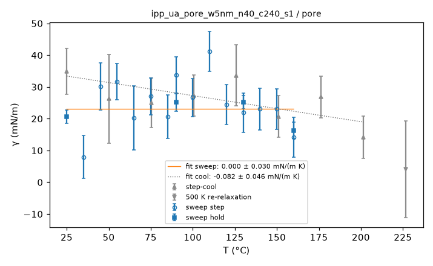

**film thickness, interior density and surface energy vs T**

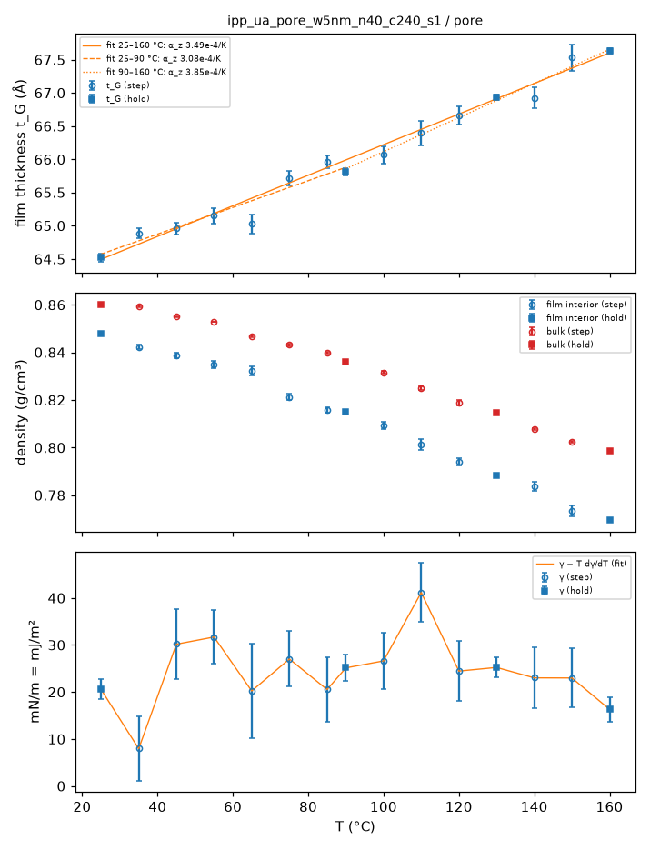

**ρ(z) at the holds**

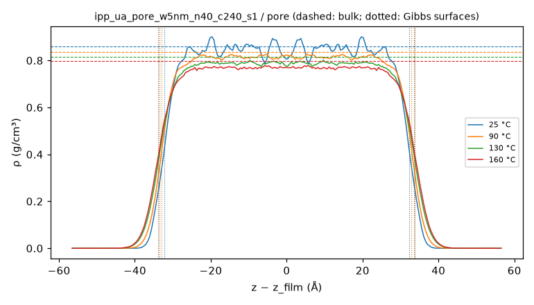

**gap width vs T**

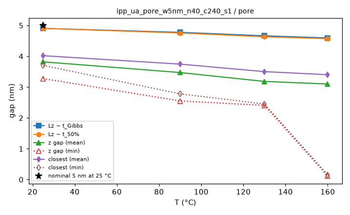

**MSD by layer**

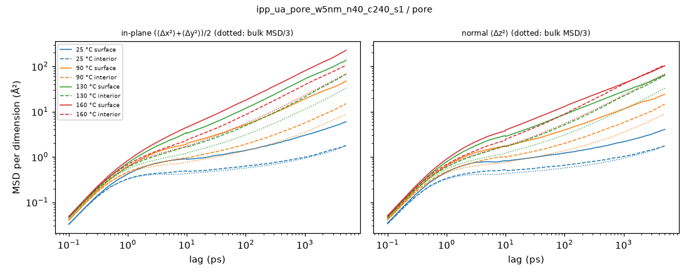

**bond P2 ACF by layer**

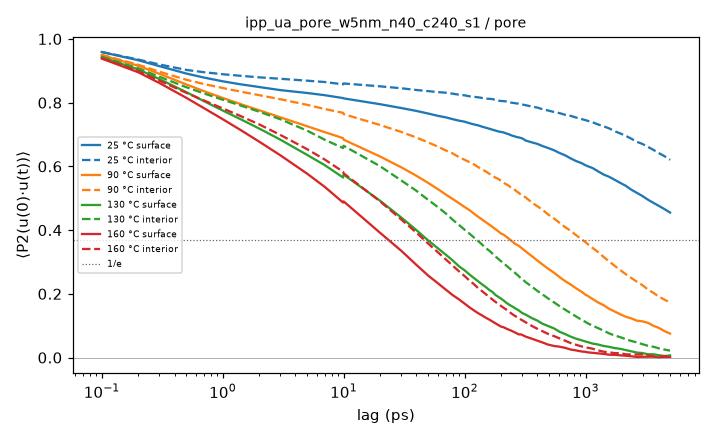

**⟨P2(cos θ_z)⟩ vs z**

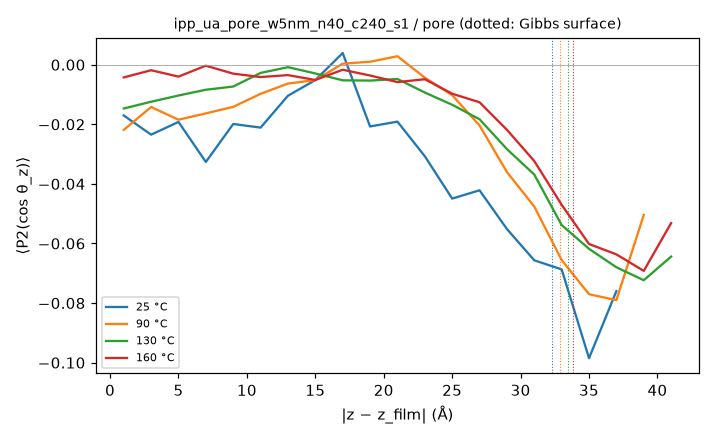

**film thickness, gap, interior density and closest approach vs time (holds)**

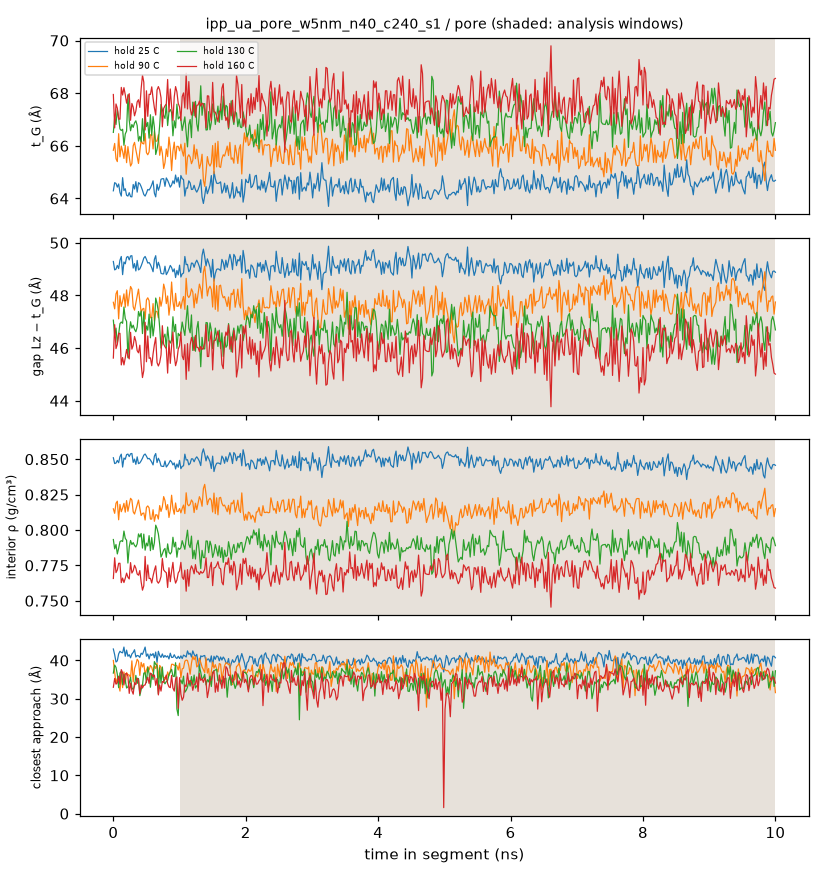

**whole film: end-to-end and Rouse mode ACFs, p²τ_p vs p**

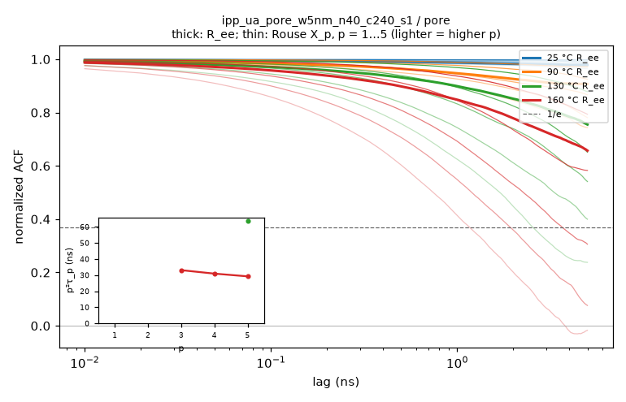

**thermo vs time, analysis windows shaded, block averages ± SEM**

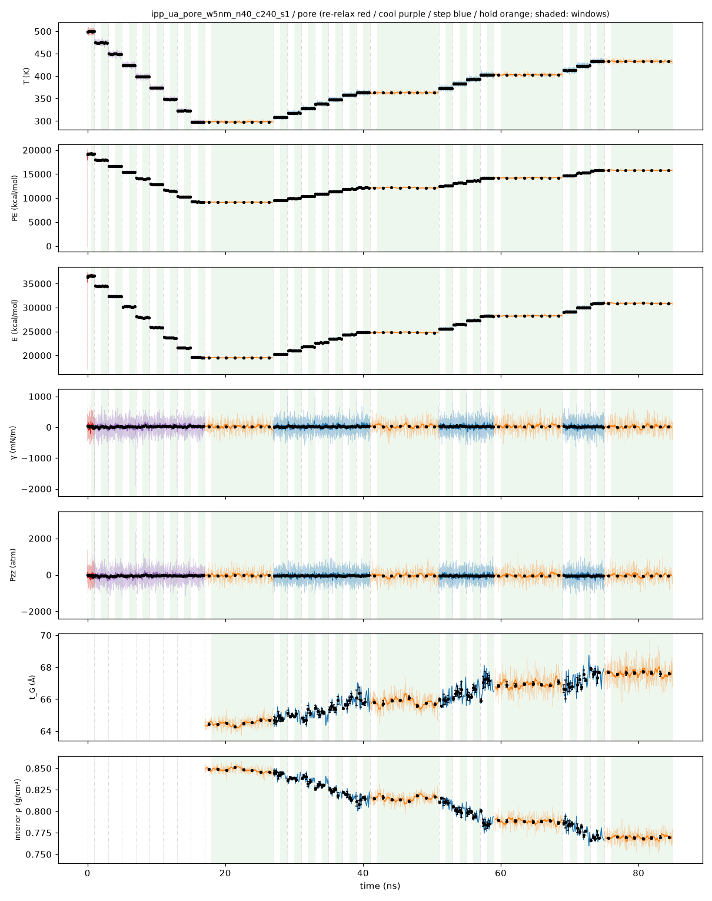

**holds: thermo vs time, analysis window shaded, block averages ± SEM**

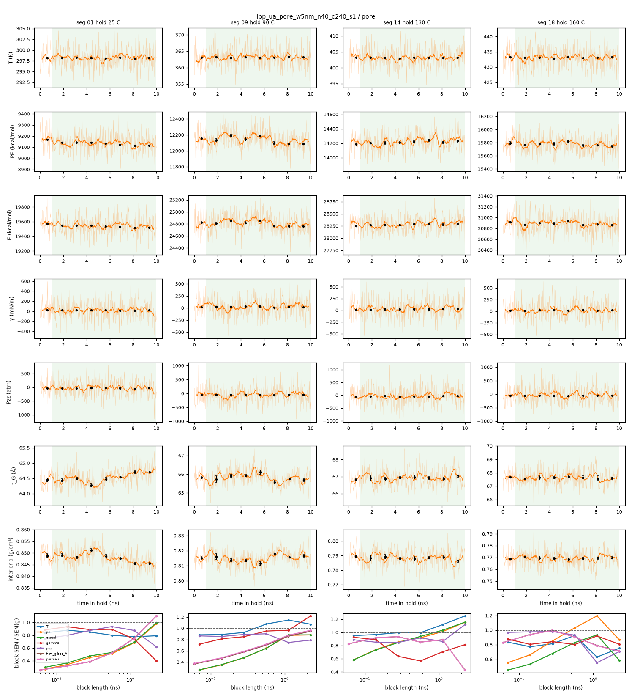

