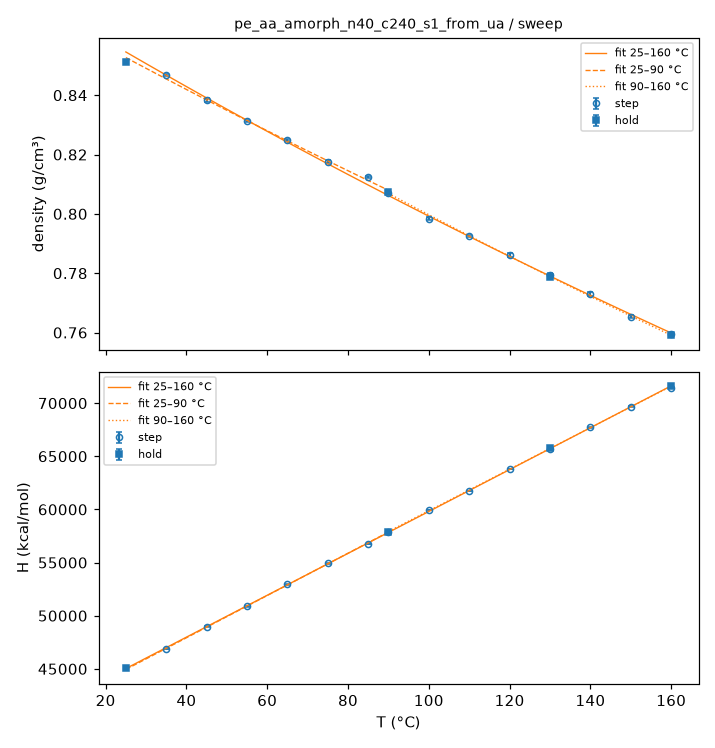
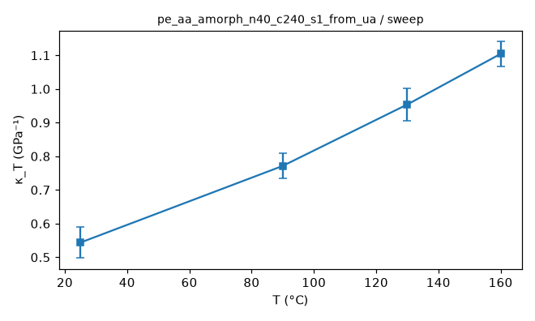
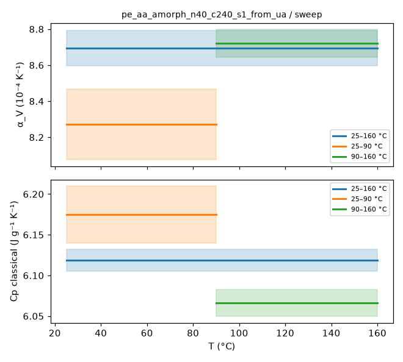
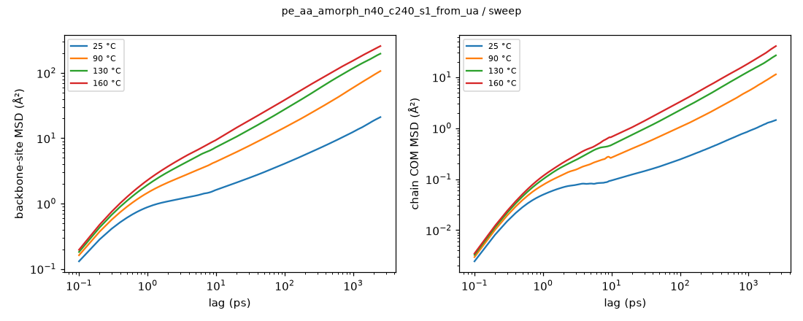
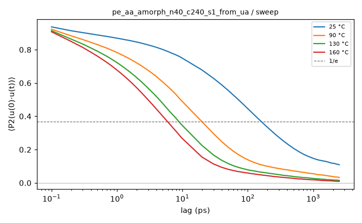
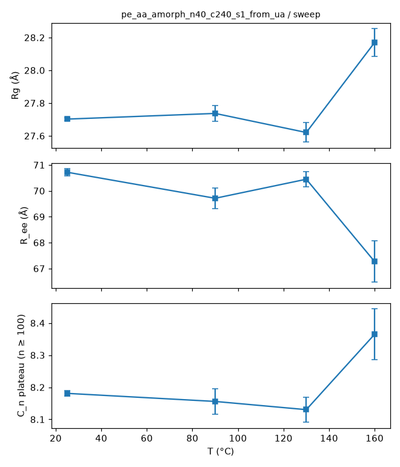
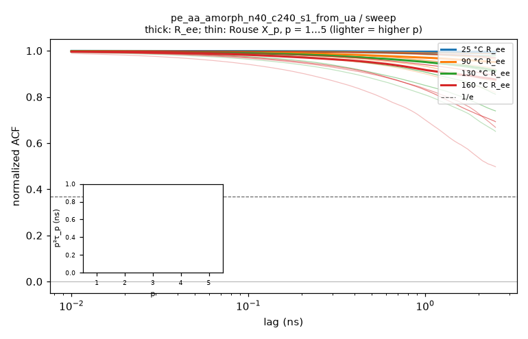
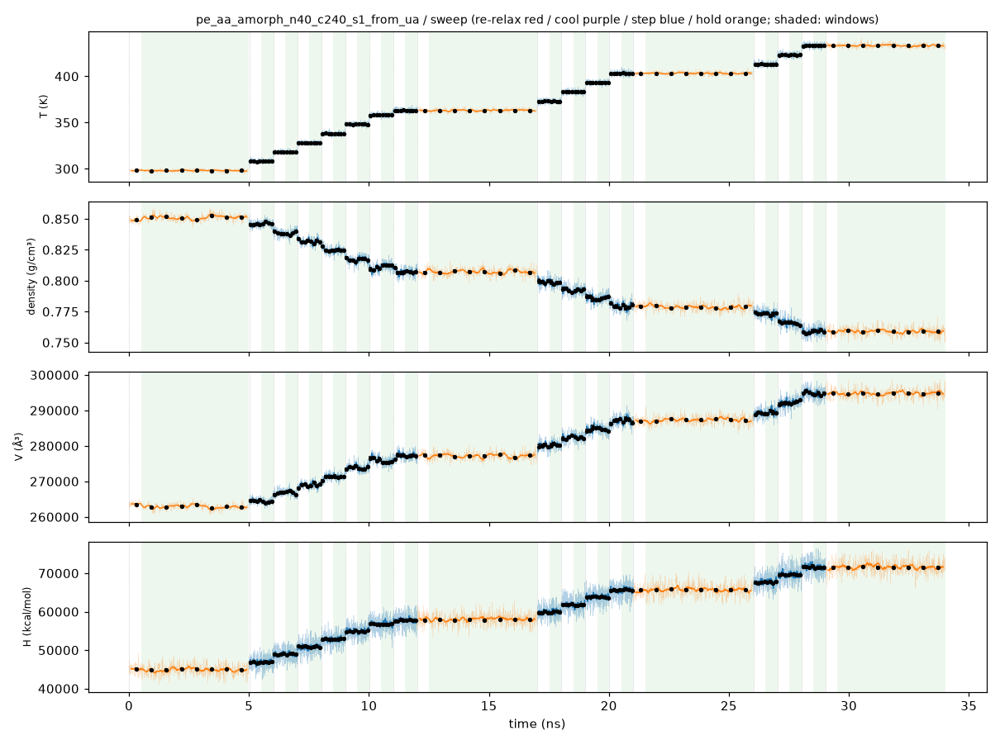
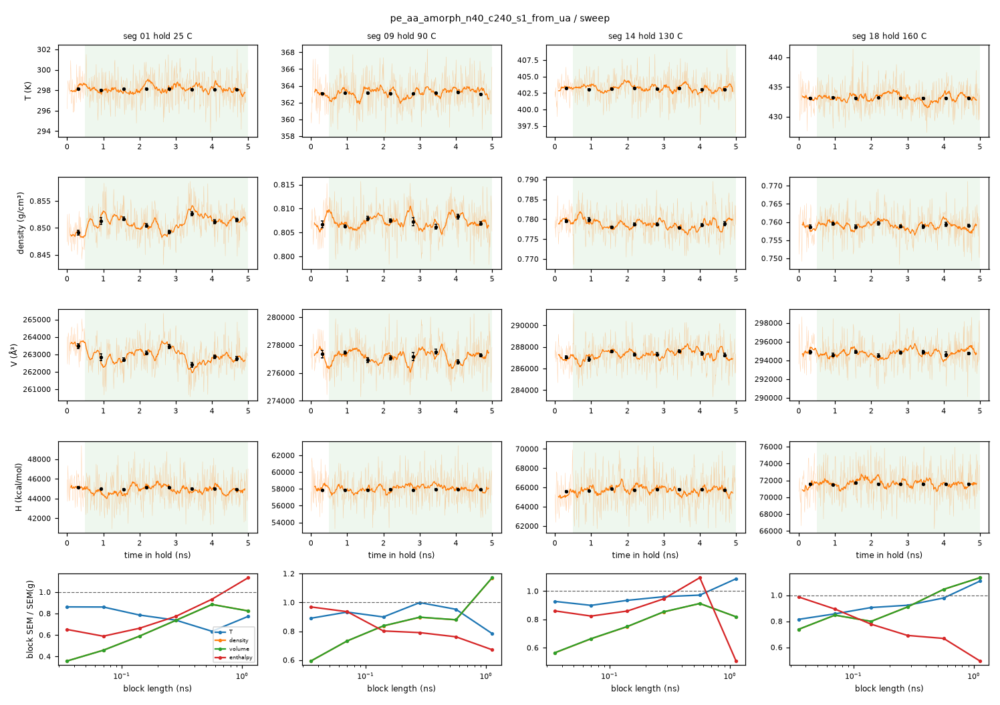

# Sweep analysis: pe_aa_amorph_n40_c240_s1_from_ua / sweep

- system: `pe_aa_amorph_n40_c240_s1_from_ua` (aa); source run directory `/home/rdyu/projects/che126_sims/results/runs/pe_aa_amorph_n40_c240_s1_from_ua/sweep` (status finished: marked by hand after the resume, see run_manifest.json note; node rdyu-rog, run code commit 81fd6be319)
- analysis: `sepsim analyze sweep` (D49), code commit 9191aea0d0 (dirty), 2026-11-11 08:20 on rdyu-rog
- windows: steps second half (50% of rows dropped); holds without the first 10% of rows; SEM from the statistical inefficiency (D26)
- system mass 134739.8 g/mol (from Density × Volume)

## Segments

| # | segment | T set (°C) | window (ns) | T (°C) | density (g/cm³) | H (kcal/mol) | V (ų) | drift |
|---|---|---|---|---|---|---|---|---|
| 1 | hold | 25 | 4.50 | 24.95 ± 0.02 | 0.85115 ± 0.00038 | 45037.6 ± 22.8 | 262872 ± 117 |  |
| 2 | step | 35 | 0.50 | 35.08 ± 0.08 | 0.84675 ± 0.00033 | 46894.6 ± 13.3 | 264236 ± 104 |  |
| 3 | step | 45 | 0.50 | 44.93 ± 0.07 | 0.83833 ± 0.00074 | 48976.2 ± 26.7 | 266890 ± 237 | density |
| 4 | step | 55 | 0.50 | 55.02 ± 0.07 | 0.83140 ± 0.00039 | 50879.4 ± 13.5 | 269117 ± 125 |  |
| 5 | step | 65 | 0.50 | 64.98 ± 0.07 | 0.82488 ± 0.00031 | 52946.3 ± 21.0 | 271244 ± 102 |  |
| 6 | step | 75 | 0.50 | 75.01 ± 0.07 | 0.81756 ± 0.00045 | 54912.4 ± 11.6 | 273672 ± 149 |  |
| 7 | step | 85 | 0.50 | 84.98 ± 0.09 | 0.81257 ± 0.00034 | 56761.9 ± 11.8 | 275355 ± 117 |  |
| 8 | step | 90 | 0.50 | 89.97 ± 0.08 | 0.80716 ± 0.00033 | 57855.2 ± 13.6 | 277197 ± 113 |  |
| 9 | hold | 90 | 4.50 | 89.99 ± 0.03 | 0.80722 ± 0.00024 | 57907.6 ± 8.0 | 277177 ± 84 |  |
| 10 | step | 100 | 0.50 | 99.91 ± 0.08 | 0.79833 ± 0.00048 | 59969.0 ± 19.1 | 280265 ± 170 |  |
| 11 | step | 110 | 0.50 | 110.03 ± 0.08 | 0.79260 ± 0.00027 | 61753.0 ± 14.6 | 282291 ± 95 |  |
| 12 | step | 120 | 0.50 | 119.92 ± 0.08 | 0.78614 ± 0.00055 | 63819.9 ± 21.6 | 284613 ± 199 | density |
| 13 | step | 130 | 0.50 | 130.11 ± 0.14 | 0.77942 ± 0.00077 | 65719.9 ± 23.5 | 287067 ± 285 |  |
| 14 | hold | 130 | 4.50 | 129.98 ± 0.03 | 0.77870 ± 0.00024 | 65779.0 ± 10.3 | 287333 ± 88 |  |
| 15 | step | 140 | 0.50 | 139.95 ± 0.08 | 0.77298 ± 0.00053 | 67723.6 ± 16.1 | 289458 ± 198 |  |
| 16 | step | 150 | 0.50 | 149.92 ± 0.09 | 0.76529 ± 0.00049 | 69673.6 ± 17.6 | 292366 ± 187 | density |
| 17 | step | 160 | 0.50 | 160.00 ± 0.09 | 0.75952 ± 0.00036 | 71426.9 ± 14.3 | 294586 ± 138 |  |
| 18 | hold | 160 | 4.50 | 160.01 ± 0.03 | 0.75916 ± 0.00019 | 71580.9 ± 6.6 | 294726 ± 74 |  |

## Isothermal compressibility (holds)

κ_T = (⟨V²⟩ − ⟨V⟩²)/(k_B T ⟨V⟩) over the hold window (NPT iso Nosé–Hoover), T the set point; SEM = statistical-inefficiency SEM of (V − ⟨V⟩)² on 100 ps block means, as for the other thermo SEMs (D55; g given in raw samples).

| T (°C) | κ_T (GPa⁻¹) | σ_V (ų) | ⟨V⟩ (ų) | g | samples |
|---|---|---|---|---|---|
| 25 | 0.544 ± 0.046 | 766.9 | 262872 | 14.7 | 4501 |
| 90 | 0.771 ± 0.038 | 1035.4 | 277177 | 5.2 | 4501 |
| 130 | 0.954 ± 0.048 | 1235.1 | 287333 | 5.6 | 4501 |
| 160 | 1.104 ± 0.037 | 1395.1 | 294726 | 2.4 | 4501 |

## Sweep steps: κ_T and chain size

Per step, over its second half (as its thermo stats): κ_T as for the holds and the static chain properties from the step DCD (no MSD / relaxation). The steps are short, so κ_T is noisier and the chain shape is largely inherited from the segment before.

| T (°C) | κ_T (GPa⁻¹) | frames | R_g (Å) | R_ee (Å) | C_n plateau | ordered fraction |
|---|---|---|---|---|---|---|
| 35 | 0.419 ± 0.033 | 5 | 27.84 ± 0.01 | 71.2 ± 0.2 | 8.28 ± 0.01 | 0.140 |
| 45 | 0.546 ± 0.085 | 5 | 27.82 ± 0.03 | 70.7 ± 0.1 | 8.25 ± 0.02 | 0.131 |
| 55 | 0.616 ± 0.064 | 5 | 27.79 ± 0.02 | 70.7 ± 0.1 | 8.23 ± 0.02 | 0.113 |
| 65 | 0.559 ± 0.081 | 5 | 27.77 ± 0.01 | 70.5 ± 0.1 | 8.20 ± 0.01 | 0.121 |
| 75 | 0.660 ± 0.094 | 5 | 27.58 ± 0.03 | 69.8 ± 0.2 | 8.09 ± 0.01 | 0.105 |
| 85 | 0.700 ± 0.102 | 5 | 27.51 ± 0.03 | 69.3 ± 0.2 | 8.00 ± 0.02 | 0.104 |
| 90 | 0.652 ± 0.081 | 5 | 27.83 ± 0.01 | 71.5 ± 0.2 | 8.28 ± 0.02 | 0.093 |
| 100 | 0.851 ± 0.157 | 5 | 27.69 ± 0.02 | 70.0 ± 0.1 | 8.19 ± 0.01 | 0.071 |
| 110 | 0.708 ± 0.045 | 5 | 27.91 ± 0.06 | 71.6 ± 0.3 | 8.37 ± 0.04 | 0.069 |
| 120 | 0.810 ± 0.068 | 5 | 27.90 ± 0.04 | 71.3 ± 0.3 | 8.37 ± 0.02 | 0.067 |
| 130 | 1.097 ± 0.179 | 5 | 27.89 ± 0.05 | 69.5 ± 0.3 | 8.21 ± 0.05 | 0.062 |
| 140 | 1.050 ± 0.122 | 5 | 27.49 ± 0.02 | 68.5 ± 0.2 | 8.05 ± 0.02 | 0.061 |
| 150 | 1.054 ± 0.104 | 5 | 27.70 ± 0.08 | 68.3 ± 0.4 | 8.17 ± 0.06 | 0.050 |
| 160 | 1.048 ± 0.098 | 5 | 27.59 ± 0.10 | 68.7 ± 0.3 | 8.19 ± 0.06 | 0.054 |

## Thermal expansion and classical Cp (fits over the sweep)

Linear fits in T over each window, SEM-weighted, one point per temperature (hold where there is one): 25, 35, 45, 55, 65, 75, 85, 90, 100, 110, 120, 130, 140, 150, 160 °C. α_V = (1/⟨V⟩) dV/dT; Cp = dH/dT per gram; errors 1σ from the fit, scaled by √χ²_red when χ²_red > 1.

| window (°C) | points | α_V (10⁻⁴ K⁻¹) | χ²_red (V) | Cp (J g⁻¹ K⁻¹) | χ²_red (H) |
|---|---|---|---|---|---|
| 25–160 | 15 | 8.694 ± 0.099 | 15.53 | 6.119 ± 0.014 | 31.50 |
| 25–90 | 8 | 8.272 ± 0.197 | 9.43 | 6.175 ± 0.035 | 26.68 |
| 90–160 | 8 | 8.720 ± 0.077 | 2.30 | 6.066 ± 0.016 | 14.65 |

## Hold trajectories: mobility and chain size

Backbone sites (CG: beads; UA/AA: backbone carbons) and chains, positions relative to the system's mass centre. MSD and P2 combine the D46 bursts (0.1 ps frames, lags < the hold frame interval) with the hold DCD (lags up to half the hold). D_COM from an OLS line over the end of the COM MSD where the local log-slope stays ≥ 0.9 over a factor ≥ 2 in lag and the MSD ≥ 2⟨Rg²⟩ (D55; error: slope spread of the two halves of that range); else "not diffusive" (log-slope at the longest lag given). Rg mass-weighted over all atoms of a chain; C_n plateau over n ≥ 100 carbons (D37) on ≤ 500 frames.

| T (°C) | frames | bursts | MSD seg 10 ps / max (Ų) | COM MSD max (Ų) | D_COM (cm²/s) | P2 1/e (ps) | Rg (Å) | R_ee (Å) | C_n plateau |
|---|---|---|---|---|---|---|---|---|---|
| 25 | 501 × 10 ps | 5 | 1.6 / 21 (2.5 ns) | 1 | not diffusive (log-slope 0.49 at the longest lag) | 161.0 | 27.70 ± 0.01 | 70.7 ± 0.1 | 8.181 ± 0.009 |
| 90 | 501 × 10 ps | 5 | 4.4 / 107 (2.5 ns) | 11 | not diffusive (log-slope 0.78 at the longest lag) | 19.9 | 27.74 ± 0.05 | 69.7 ± 0.4 | 8.156 ± 0.039 |
| 130 | 501 × 10 ps | 5 | 7.2 / 197 (2.5 ns) | 27 | not diffusive (log-slope 0.83 at the longest lag) | 8.9 | 27.62 ± 0.06 | 70.4 ± 0.3 | 8.130 ± 0.039 |
| 160 | 501 × 10 ps | 5 | 9.8 / 257 (2.5 ns) | 40 | not diffusive (log-slope 0.85 at the longest lag) | 5.9 | 28.17 ± 0.08 | 67.3 ± 0.8 | 8.365 ± 0.080 |

## Chain relaxation (holds; D56)

End-to-end vector ACF ⟨R(t)·R(0)⟩/⟨R²⟩ and Rouse mode ACFs ⟨X_p(t)·X_p(0)⟩/⟨X_p²⟩, X_p = (1/N) Σ_n cos(pπ(n−½)/N) r_n over the backbone sites, every time origin, lags up to half the hold (2.5 ns here). Times in ns: the first 1/e crossing; if C stays above 1/e within the lag window the time is 'not reached' and only an exponential fit of ln C over 0.2 ≤ C ≤ 0.9 is given (marked extrap.: it extrapolates the early decay). τ_ee fit is that fit for R_ee. τ_1/τ_2 is 4 for Rouse chains. p²⟨X_p²⟩ (relative to p = 1, p = 2…5) is flat for an ideal Rouse chain; it falls at high p where the chain is stiffer than Gaussian on that scale. Crystallinity: D26 local alignment, fraction of backbone sites with p2 ≥ 0.4 (**uncalibrated, melt baseline**: no crystal reference, so the number is a baseline for an amorphous box, not a calibrated crystallinity) and the largest crystalline cluster (sites).

| T (°C) | τ_ee 1/e (ns) | τ_ee fit (ns) | τ_1 (ns) | τ_2 (ns) | τ_3 (ns) | τ_1/τ_2 (Rouse 4) | p²⟨X_p²⟩ / p=1 (p = 2…5) | crystallinity |
|---|---|---|---|---|---|---|---|---|
| 25 | not reached (C 0.99 at max lag) | n/a (extrap.) | not reached (C 1.00 at max lag) | not reached (C 1.00 at max lag) | not reached (C 0.99 at max lag) | n/a | 1.12 / 1.20 / 1.15 / 1.12 | 0.134 (max 0.152; cluster ≤ 1380) |
| 90 | not reached (C 0.95 at max lag) | n/a (extrap.) | not reached (C 0.99 at max lag) | not reached (C 0.96 at max lag) | not reached (C 0.92 at max lag) | n/a | 1.14 / 1.19 / 1.18 / 1.24 | 0.095 (max 0.111; cluster ≤ 909) |
| 130 | not reached (C 0.91 at max lag) | n/a (extrap.) | not reached (C 0.98 at max lag) | not reached (C 0.91 at max lag) | not reached (C 0.81 at max lag; fit 13.7, extrap.) | n/a | 1.11 / 1.14 / 1.24 / 1.15 | 0.056 (max 0.073; cluster ≤ 317) |
| 160 | not reached (C 0.88 at max lag; fit 39.1, extrap.) | 39.1 (extrap.) | not reached (C 0.97 at max lag) | not reached (C 0.89 at max lag; fit 24.2, extrap.) | not reached (C 0.69 at max lag; fit 7.48, extrap.) | n/a | 1.18 / 0.90 / 1.33 / 1.02 | 0.048 (max 0.059; cluster ≤ 250) |

## Equilibration

Every average uses only the analysis window: steps second half (50% of rows dropped), holds without the first 10% of rows (the rest is equilibration after the T change; see `equilibration.png`, windows shaded, block averages ± SEM overlaid, and `equilibration_holds.png`). Drift: the window's two halves differ by > 2 combined SEM (statistical inefficiency).

Segments with a drifting window (tested: density, enthalpy):

| segment | T set (°C) | drift (second − first half ± SEM) |
|---|---|---|
| seg 03 step 45 C | 45 | density +0.002033 ± 0.00066 |
| seg 12 step 120 C | 120 | density +0.001371 ± 0.00062 |
| seg 16 step 150 C | 150 | density -0.001623 ± 0.00066 |

Block-average check of the hold SEMs: SEM of the means of 32 / 16 / 8 blocks vs the statistical-inefficiency SEM (blocks longer than the correlation time plateau at it; flagged if the 8-block SEM exceeds it by > 2×).

| T (°C) | quantity | SEM (g) | block SEM 32 / 16 / 8 | converged |
|---|---|---|---|---|
| 25 | density | 0.000378 | 0.000223 / 0.000278 / 0.000335 | yes |
| 25 | enthalpy | 34.3 | 22.7 / 26.5 / 32 | yes |
| 90 | density | 0.000245 | 0.000205 / 0.00022 / 0.000215 | yes |
| 90 | enthalpy | 25.6 | 20.5 / 20.2 / 19.5 | yes |
| 130 | density | 0.00024 | 0.00018 / 0.000204 / 0.000219 | yes |
| 130 | enthalpy | 33.2 | 28.5 / 31.4 / 36.3 | yes |
| 160 | density | 0.000191 | 0.000153 / 0.000174 / 0.0002 | yes |
| 160 | enthalpy | 26 | 20.2 / 18 / 17.4 | yes |

Local quantities (density, enthalpy, κ_T, segmental MSD, bond P2: relaxation times ~10–100 ps in CG, the bond P2 1/e time above) equilibrate within the dropped part of each segment; their windows are what the drift and block checks test.

Chain-scale quantities (Rg, R_ee, C_n, chain COM motion) relax on the end-to-end time (CG C240 at 25 °C: of order 100 ns; C1500 far longer), longer than a 25 ns hold: their hold averages describe the chain configurations carried in from the 500 K equilibration and cooling rather than a re-equilibrated state at T. Per hold:
- 25 °C: chain COM MSD at 2.5 ns / ⟨Rg²⟩ = 0.00; chains have **not** moved their own size: chain-scale averages sample a partly relaxed set of chain configurations.
- 90 °C: chain COM MSD at 2.5 ns / ⟨Rg²⟩ = 0.01; chains have **not** moved their own size: chain-scale averages sample a partly relaxed set of chain configurations.
- 130 °C: chain COM MSD at 2.5 ns / ⟨Rg²⟩ = 0.03; chains have **not** moved their own size: chain-scale averages sample a partly relaxed set of chain configurations.
- 160 °C: chain COM MSD at 2.5 ns / ⟨Rg²⟩ = 0.05; chains have **not** moved their own size: chain-scale averages sample a partly relaxed set of chain configurations.

## Caveats

- Cp is the classical dH/dT and is not comparable to experiment: classical MD gives every degree of freedom k_B/2 per quadratic term, so the stiff C–H/C–C modes that are quantum-frozen at these T make AA Cp too high; it needs the VDOS quantum correction (D12c), not done here.
- Chains may not be relaxed: the D47 criteria fail on the prep 500 K hold (prep/progress.json: end-to-end ACF 0.82 at 2.5 ns, needs < 1/e; COM MSD/<Rg²> 0.08, needs >= 2).
- D37 chain check FAIL on the prep 500 K hold: C_n plateau 8.57 vs melt 6.7 ±10% (drift).
- α_V and Cp are linear fits in T over each window with SEM weights; a reduced χ² > 1 (curvature over the window, or SEMs too small) inflates the quoted errors by √χ²_red, and a large χ²_red over 25–160 °C means α_V or Cp depends on T (compare the two half windows).

## Plots

**density and enthalpy vs T with the linear fits**

**κ_T vs T (holds)**

**α_V and Cp per fit window**

**backbone-site and chain COM MSD**

**bond P2 autocorrelation**

**Rg, R_ee and C_n vs T**

**end-to-end and Rouse mode ACFs, p²τ_p vs p**

**thermo vs time, analysis windows shaded, block averages ± SEM**

**holds: thermo vs time, analysis window shaded, block averages ± SEM**

