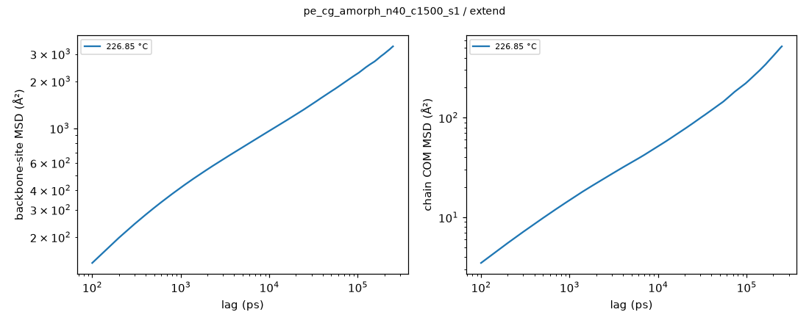
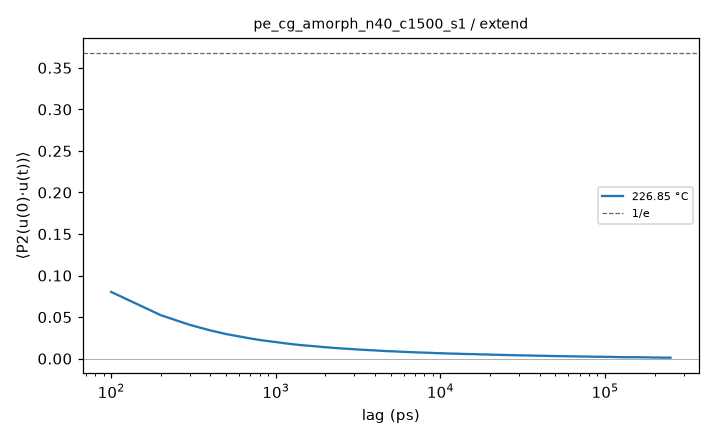
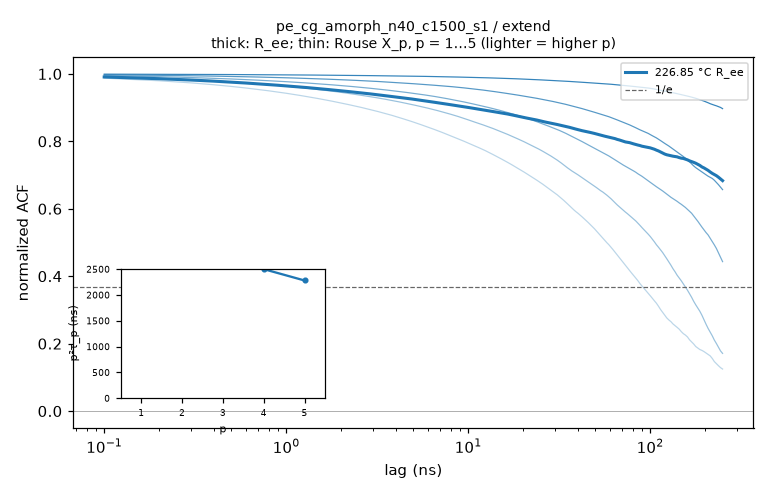

# Hold analysis: pe_cg_amorph_n40_c1500_s1 / extend

- system: `pe_cg_amorph_n40_c1500_s1` (cg); source run directory `/home/rdyu/projects/che126_sims/results/runs/pe_cg_amorph_n40_c1500_s1/extend` (extend, status finished, node rdyu-rog, run code commit db8754358e)
- analysis: `sepsim analyze hold` (D56), code commit e27e3a6c62 (dirty), 2026-11-09 19:34 on rdyu-server
- segment: Stage 1: NPT hold extension 500000 ps at 500 K, 1 atm (500 ns planned, complete); thermo window without the first 10% of rows, SEM from 100 ps block means (D55)
- note: ../prep/hold.dcd has frames every 10 ps, the extension 100 ps: chain checks use the extension alone

## Thermo

| window (ns) | T (°C) | density (g/cm³) | H (kcal/mol) | V (ų) | κ_T (GPa⁻¹) |
|---|---|---|---|---|---|
| 450.00 | 226.85 ± 0.00 | 0.72853 ± 0.00014 | 3465.3 ± 41.6 | 1918484 ± 367 | 2.098 ± 0.010 |

## Trajectory: mobility and chain size

5001 frames × 100 ps (500 ns).

| COM MSD max (Ų) at lag (ns) | D_COM (D55 criterion) | bond P2 1/e | Rg (Å) | R_ee (Å) | C_n plateau |
|---|---|---|---|---|---|
| 519 at 250 | not diffusive (log-slope 0.99 at the longest lag, MSD/⟨Rg²⟩ 0.12) | 68.7 ps | 65.75 ± 0.71 | 170.0 ± 2.4 | 7.430 ± 0.160 |

- no burst DCDs (deck without D46 bursts): lags from the hold DCD only

## Chain relaxation (holds; D56)

End-to-end vector ACF ⟨R(t)·R(0)⟩/⟨R²⟩ and Rouse mode ACFs ⟨X_p(t)·X_p(0)⟩/⟨X_p²⟩, X_p = (1/N) Σ_n cos(pπ(n−½)/N) r_n over the backbone sites, every time origin, lags up to half the hold (250 ns here). Times in ns: the first 1/e crossing; if C stays above 1/e within the lag window the time is 'not reached' and only an exponential fit of ln C over 0.2 ≤ C ≤ 0.9 is given (marked extrap.: it extrapolates the early decay). τ_ee fit is that fit for R_ee. τ_1/τ_2 is 4 for Rouse chains. p²⟨X_p²⟩ (relative to p = 1, p = 2…5) is flat for an ideal Rouse chain; it falls at high p where the chain is stiffer than Gaussian on that scale. Crystallinity: D26 local alignment, fraction of backbone sites with p2 ≥ 0.4 (**uncalibrated, melt baseline**: no crystal reference, so the number is a baseline for an amorphous box, not a calibrated crystallinity) and the largest crystalline cluster (sites).

| T (°C) | τ_ee 1/e (ns) | τ_ee fit (ns) | τ_1 (ns) | τ_2 (ns) | τ_3 (ns) | τ_1/τ_2 (Rouse 4) | p²⟨X_p²⟩ / p=1 (p = 2…5) | crystallinity |
|---|---|---|---|---|---|---|---|---|
| 226.85 | not reached (C 0.68 at max lag; fit 1.04e+03, extrap.) | 1.04e+03 (extrap.) | not reached (C 0.90 at max lag; fit 1.63e+03, extrap.) | not reached (C 0.66 at max lag; fit 668, extrap.) | not reached (C 0.44 at max lag; fit 377, extrap.) | 2.43 (fits) | 1.00 / 1.11 / 1.23 / 1.19 | 0.089 (max 0.099; cluster ≤ 62) |

Where τ_1 is not reached, p²τ_p of the faster modes estimates it under ideal Rouse scaling (τ_p ∝ p⁻²). Real melts show τ_p ∝ p^−2.2…−2.4 (stiffness, local friction), so p²τ_p underestimates τ_1, more so the higher p:

- 226.85 °C: τ_1 ≈ p²τ_p from the reached modes: p=4: 2.5e+03, p=5: 2.28e+03 ns.

CG time is not real time: SDK PE chains diffuse ≈ 4.07× faster than real PE (Hall et al. 2019; docs/experiment_comparison.md), so MSD, D_COM, P2 and relaxation times are model times (not rescaled); multiply chain-motion times by 4.07 before comparing with experiment.

## Caveats

- Relaxation times use lags up to half the analysed hold (250 ns); a time beyond that is 'not reached' and only the extrapolated exponential fit is given.
- CG time is not real time: SDK PE chains diffuse ≈ 4.07× faster than real PE (Hall et al. 2019; docs/experiment_comparison.md), so MSD, D_COM, P2 and relaxation times are model times (not rescaled); multiply chain-motion times by 4.07 before comparing with experiment.

## Plots

**backbone-site and chain COM MSD**

**bond P2 autocorrelation**

**end-to-end and Rouse mode ACFs, p²τ_p vs p**

