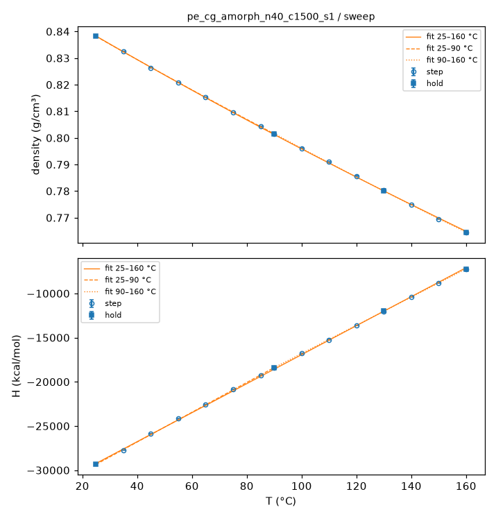
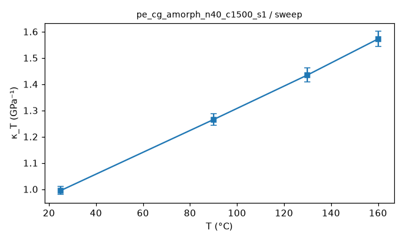
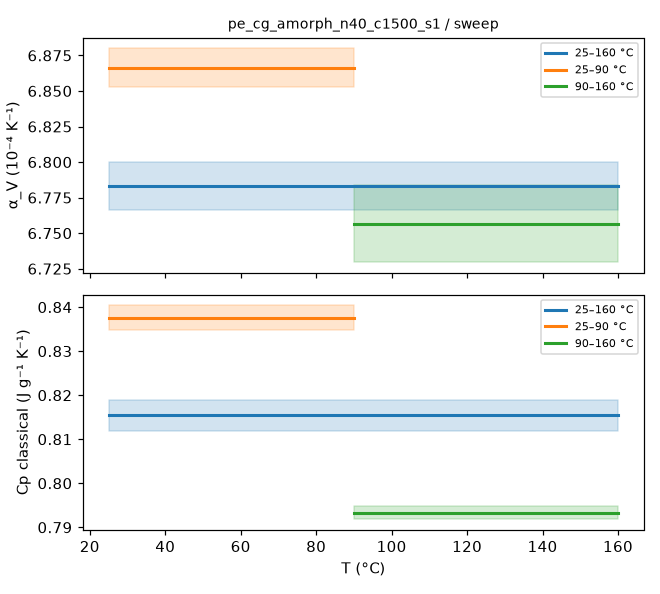
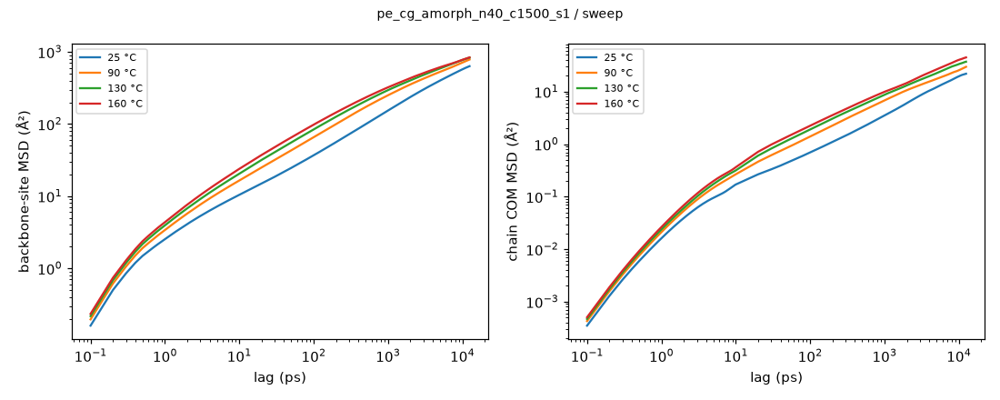
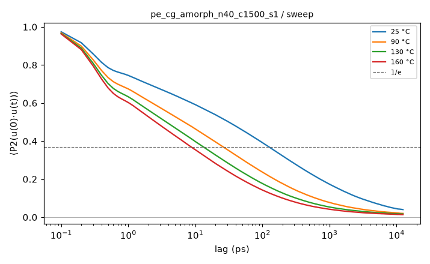
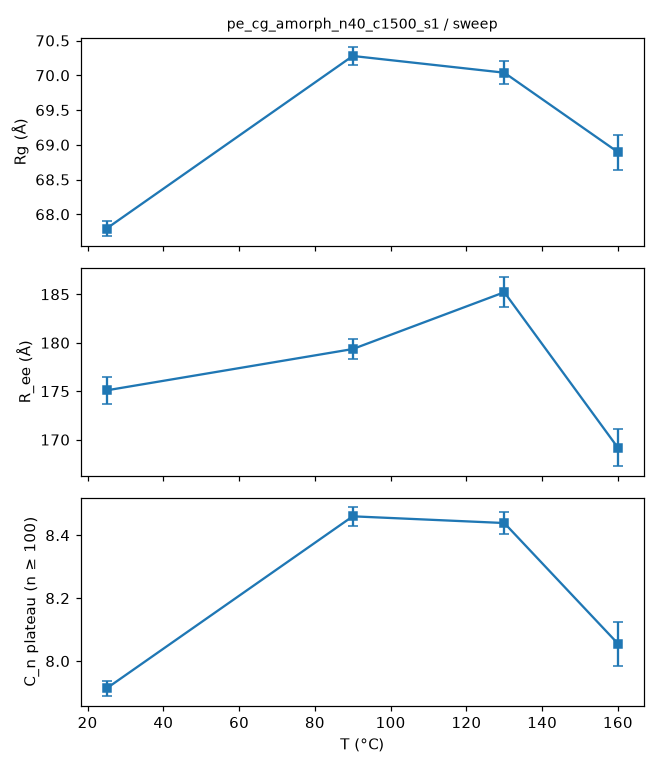

# Sweep analysis: pe_cg_amorph_n40_c1500_s1 / sweep

- system: `pe_cg_amorph_n40_c1500_s1` (cg); source run directory `/home/rdyu/projects/che126_sims/results/runs/pe_cg_amorph_n40_c1500_s1/sweep` (status finished, node rdyu-rog, run code commit db8754358e)
- analysis: `sepsim analyze sweep` (D49), code commit ef6559db89 (dirty), 2026-10-26 13:41 on rdyu-rog
- windows: steps second half (50% of rows dropped); holds without the first 10% of rows; SEM from the statistical inefficiency (D26)
- system mass 841688.6 g/mol (from Density × Volume)

## Segments

| # | segment | T set (°C) | window (ns) | T (°C) | density (g/cm³) | H (kcal/mol) | V (ų) |
|---|---|---|---|---|---|---|---|
| 1 | hold | 25 | 22.50 | 24.99 ± 0.01 | 0.83817 ± 0.00001 | -29352.3 ± 4.1 | 1667512 ± 25 |
| 2 | step | 35 | 2.50 | 34.98 ± 0.04 | 0.83259 ± 0.00004 | -27719.5 ± 12.6 | 1678692 ± 75 |
| 3 | step | 45 | 2.50 | 45.04 ± 0.04 | 0.82639 ± 0.00004 | -25868.8 ± 12.1 | 1691283 ± 86 |
| 4 | step | 55 | 2.50 | 55.01 ± 0.04 | 0.82084 ± 0.00004 | -24166.9 ± 13.0 | 1702731 ± 93 |
| 5 | step | 65 | 2.50 | 65.01 ± 0.04 | 0.81532 ± 0.00004 | -22544.2 ± 12.9 | 1714256 ± 94 |
| 6 | step | 75 | 2.50 | 75.01 ± 0.04 | 0.80966 ± 0.00005 | -20861.5 ± 13.4 | 1726226 ± 104 |
| 7 | step | 85 | 2.50 | 85.05 ± 0.04 | 0.80434 ± 0.00005 | -19255.1 ± 13.9 | 1737653 ± 115 |
| 8 | step | 90 | 2.50 | 90.04 ± 0.04 | 0.80153 ± 0.00005 | -18398.5 ± 13.7 | 1743749 ± 115 |
| 9 | hold | 90 | 22.50 | 90.02 ± 0.01 | 0.80154 ± 0.00002 | -18403.8 ± 4.5 | 1743720 ± 39 |
| 10 | step | 100 | 2.50 | 100.04 ± 0.05 | 0.79611 ± 0.00005 | -16786.7 ± 13.8 | 1755621 ± 121 |
| 11 | step | 110 | 2.50 | 110.02 ± 0.04 | 0.79094 ± 0.00006 | -15233.5 ± 14.1 | 1767080 ± 133 |
| 12 | step | 120 | 2.50 | 120.04 ± 0.05 | 0.78566 ± 0.00006 | -13630.7 ± 14.0 | 1778970 ± 137 |
| 13 | step | 130 | 2.50 | 130.00 ± 0.05 | 0.78034 ± 0.00006 | -12029.8 ± 13.8 | 1791089 ± 145 |
| 14 | hold | 130 | 22.50 | 130.00 ± 0.02 | 0.78019 ± 0.00002 | -11983.6 ± 4.8 | 1791449 ± 48 |
| 15 | step | 140 | 2.50 | 140.00 ± 0.05 | 0.77495 ± 0.00007 | -10393.8 ± 14.6 | 1803543 ± 152 |
| 16 | step | 150 | 2.50 | 150.06 ± 0.05 | 0.76953 ± 0.00007 | -8813.3 ± 15.0 | 1816254 ± 162 |
| 17 | step | 160 | 2.50 | 160.00 ± 0.05 | 0.76437 ± 0.00007 | -7238.5 ± 15.0 | 1828519 ± 162 |
| 18 | hold | 160 | 22.50 | 160.01 ± 0.02 | 0.76444 ± 0.00002 | -7240.7 ± 4.9 | 1828349 ± 55 |

## Isothermal compressibility (holds)

κ_T = (⟨V²⟩ − ⟨V⟩²)/(k_B T ⟨V⟩) over the hold window (NPT iso Nosé–Hoover), T the set point; SEM = statistical-inefficiency SEM of (V − ⟨V⟩)² (g given).

| T (°C) | κ_T (GPa⁻¹) | σ_V (ų) | ⟨V⟩ (ų) | g | samples |
|---|---|---|---|---|---|
| 25 | 0.995 ± 0.015 | 2613.4 | 1667512 | 2.6 | 22501 |
| 90 | 1.265 ± 0.022 | 3325.9 | 1743720 | 3.2 | 22501 |
| 130 | 1.435 ± 0.026 | 3782.8 | 1791449 | 3.7 | 22501 |
| 160 | 1.572 ± 0.029 | 4146.1 | 1828349 | 4.0 | 22501 |

## Thermal expansion and classical Cp (fits over the sweep)

Linear fits in T over each window, SEM-weighted, one point per temperature (hold where there is one): 25, 35, 45, 55, 65, 75, 85, 90, 100, 110, 120, 130, 140, 150, 160 °C. α_V = (1/⟨V⟩) dV/dT; Cp = dH/dT per gram; errors 1σ from the fit, scaled by √χ²_red when χ²_red > 1.

| window (°C) | points | α_V (10⁻⁴ K⁻¹) | χ²_red (V) | Cp (J g⁻¹ K⁻¹) | χ²_red (H) |
|---|---|---|---|---|---|
| 25–160 | 15 | 6.783 ± 0.017 | 76.81 | 0.815 ± 0.004 | 306.28 |
| 25–90 | 8 | 6.866 ± 0.013 | 11.99 | 0.838 ± 0.003 | 39.66 |
| 90–160 | 8 | 6.757 ± 0.027 | 29.50 | 0.793 ± 0.001 | 10.07 |

## Hold trajectories: mobility and chain size

Backbone sites (CG: beads; UA/AA: backbone carbons) and chains, positions relative to the system's mass centre. MSD and P2 combine the D46 bursts (0.1 ps frames, lags < the hold frame interval) with the hold DCD (lags up to half the hold). D_COM from an OLS line over the end of the COM MSD where the local log-slope stays ≥ 0.9 over a factor ≥ 2 in lag; else "not diffusive" (largest slope given). Rg mass-weighted over all atoms of a chain; C_n plateau over n ≥ 100 carbons (D37) on ≤ 500 frames.

| T (°C) | frames | bursts | MSD seg 10 ps / max (Ų) | COM MSD max (Ų) | D_COM (cm²/s) | P2 1/e (ps) | Rg (Å) | R_ee (Å) | C_n plateau |
|---|---|---|---|---|---|---|---|---|---|
| 25 | 2501 × 10 ps | 25 | 10.4 / 633 (12.5 ns) | 22 | not diffusive (max log-slope 1.88) | 127.6 | 67.79 ± 0.11 | 175.1 ± 1.4 | 7.913 ± 0.025 |
| 90 | 2501 × 10 ps | 25 | 16.5 / 783 (12.5 ns) | 30 | not diffusive (max log-slope 1.89) | 26.9 | 70.28 ± 0.13 | 179.3 ± 1.0 | 8.460 ± 0.029 |
| 130 | 2501 × 10 ps | 25 | 20.6 / 831 (12.5 ns) | 37 | not diffusive (max log-slope 1.90) | 14.3 | 70.04 ± 0.16 | 185.2 ± 1.6 | 8.439 ± 0.034 |
| 160 | 2501 × 10 ps | 25 | 23.9 / 837 (12.5 ns) | 45 | not diffusive (max log-slope 1.90) | 8.8 | 68.89 ± 0.25 | 169.2 ± 1.9 | 8.055 ± 0.070 |

## Caveats

- Cp is the classical dH/dT and is not comparable to experiment: classical MD gives every degree of freedom k_B/2 per quadratic term; CG also drops degrees of freedom (all motion inside a 3-CH2 bead), so its Cp per gram is not a property of the real polymer at all (reported for completeness and resolution comparisons only).
- Chains may not be relaxed: the D47 criteria fail on the prep hold + extension (extend/progress.json: end-to-end ACF 0.68 at 250.0 ns, needs < 1/e; COM MSD/<Rg²> 0.12, needs >= 2).
- D37 chain check FAIL on the prep hold + extension: C_n plateau 7.43 vs melt 6.7 ±10%.
- α_V and Cp are linear fits in T over each window with SEM weights; a reduced χ² > 1 (curvature over the window, or SEMs too small) inflates the quoted errors by √χ²_red, and a large χ²_red over 25–160 °C means α_V or Cp depends on T (compare the two half windows).
- CG time is not real time: SDK beads move faster than the atoms they represent, so MSD, D_COM and P2 times are model times (not rescaled).

## Plots

**density and enthalpy vs T with the linear fits**

**κ_T vs T (holds)**

**α_V and Cp per fit window**

**backbone-site and chain COM MSD**

**bond P2 autocorrelation**

**Rg, R_ee and C_n vs T**

