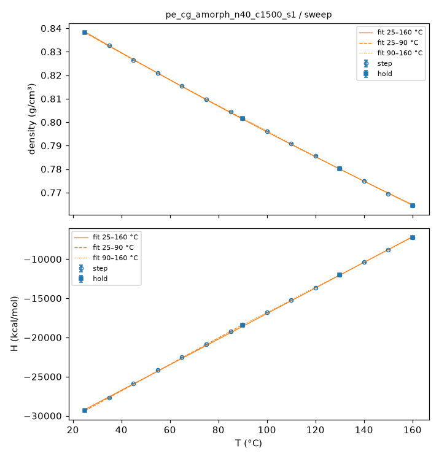
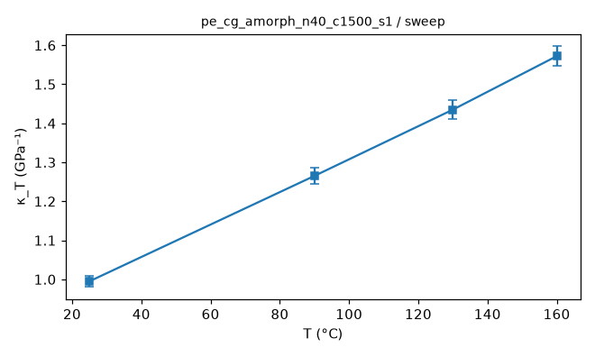
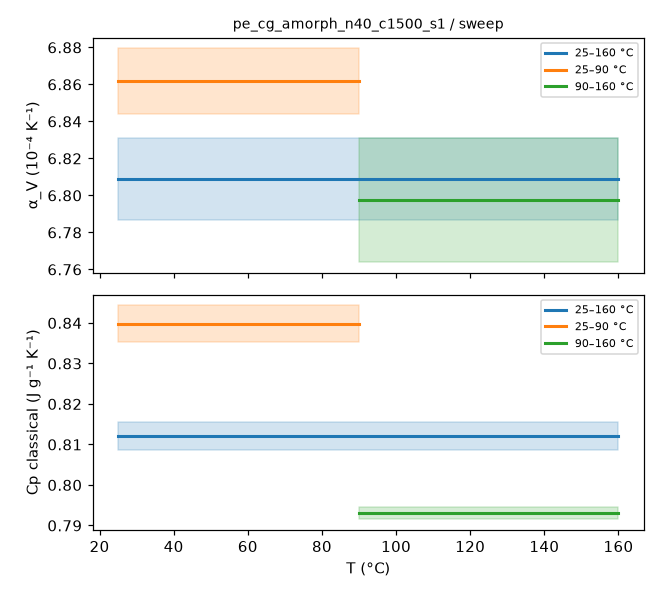
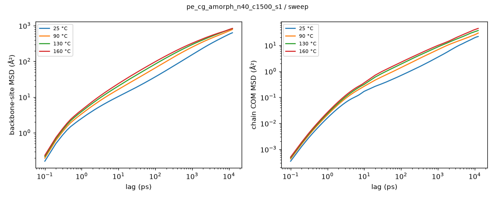
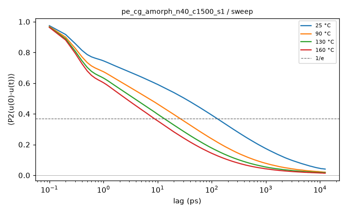
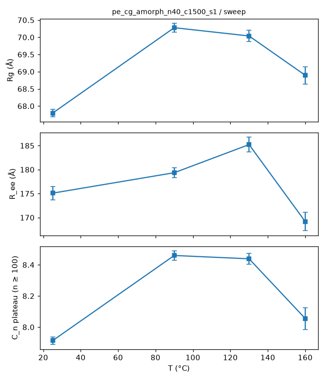
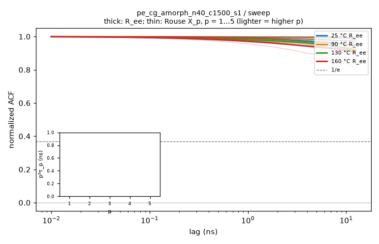
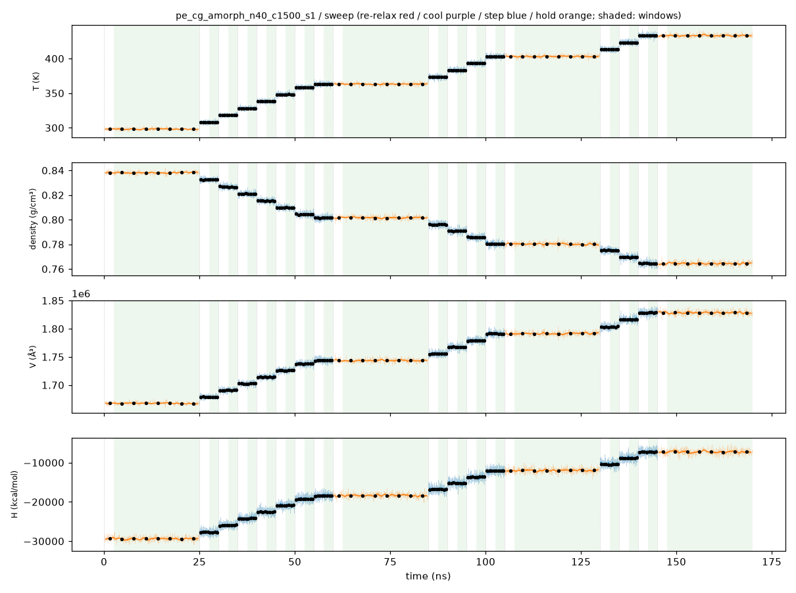
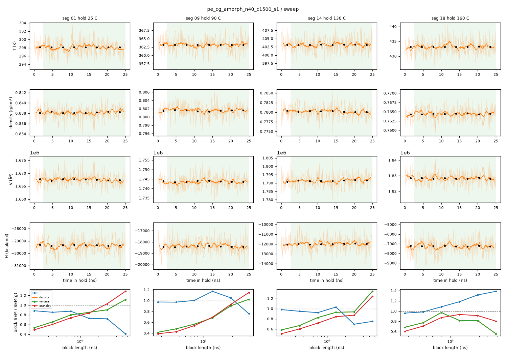

# Sweep analysis: pe_cg_amorph_n40_c1500_s1 / sweep

- system: `pe_cg_amorph_n40_c1500_s1` (cg); source run directory `/home/rdyu/projects/che126_sims/results/runs/pe_cg_amorph_n40_c1500_s1/sweep` (status finished, node rdyu-rog, run code commit db8754358e)
- analysis: `sepsim analyze sweep` (D49), code commit 496d05cea3 (dirty), 2026-11-02 06:00 on rdyu-rog
- windows: steps second half (50% of rows dropped); holds without the first 10% of rows; SEM from the statistical inefficiency (D26)
- system mass 841688.6 g/mol (from Density × Volume)

## Segments

| # | segment | T set (°C) | window (ns) | T (°C) | density (g/cm³) | H (kcal/mol) | V (ų) | drift |
|---|---|---|---|---|---|---|---|---|
| 1 | hold | 25 | 22.50 | 24.99 ± 0.01 | 0.83817 ± 0.00004 | -29352.3 ± 13.1 | 1667512 ± 87 |  |
| 2 | step | 35 | 2.50 | 34.98 ± 0.04 | 0.83259 ± 0.00010 | -27719.5 ± 11.6 | 1678692 ± 193 | density |
| 3 | step | 45 | 2.50 | 45.04 ± 0.05 | 0.82639 ± 0.00008 | -25868.8 ± 18.9 | 1691283 ± 166 |  |
| 4 | step | 55 | 2.50 | 55.01 ± 0.05 | 0.82084 ± 0.00011 | -24166.9 ± 36.9 | 1702731 ± 236 |  |
| 5 | step | 65 | 2.50 | 65.01 ± 0.04 | 0.81532 ± 0.00009 | -22544.2 ± 14.3 | 1714256 ± 192 |  |
| 6 | step | 75 | 2.50 | 75.01 ± 0.06 | 0.80966 ± 0.00014 | -20861.5 ± 29.2 | 1726226 ± 288 |  |
| 7 | step | 85 | 2.50 | 85.05 ± 0.04 | 0.80434 ± 0.00007 | -19255.1 ± 16.4 | 1737653 ± 149 |  |
| 8 | step | 90 | 2.50 | 90.04 ± 0.04 | 0.80153 ± 0.00005 | -18398.5 ± 10.6 | 1743749 ± 111 |  |
| 9 | hold | 90 | 22.50 | 90.02 ± 0.02 | 0.80154 ± 0.00006 | -18403.8 ± 15.7 | 1743720 ± 129 |  |
| 10 | step | 100 | 2.50 | 100.04 ± 0.06 | 0.79611 ± 0.00006 | -16786.7 ± 18.7 | 1755621 ± 131 | enthalpy |
| 11 | step | 110 | 2.50 | 110.02 ± 0.04 | 0.79094 ± 0.00005 | -15233.5 ± 12.1 | 1767080 ± 117 |  |
| 12 | step | 120 | 2.50 | 120.04 ± 0.05 | 0.78566 ± 0.00006 | -13630.7 ± 20.0 | 1778970 ± 144 |  |
| 13 | step | 130 | 2.50 | 130.00 ± 0.05 | 0.78034 ± 0.00009 | -12029.8 ± 20.6 | 1791089 ± 202 |  |
| 14 | hold | 130 | 22.50 | 130.00 ± 0.02 | 0.78019 ± 0.00004 | -11983.6 ± 14.6 | 1791449 ± 98 | enthalpy |
| 15 | step | 140 | 2.50 | 140.00 ± 0.05 | 0.77495 ± 0.00009 | -10393.8 ± 22.8 | 1803543 ± 202 |  |
| 16 | step | 150 | 2.50 | 150.06 ± 0.05 | 0.76953 ± 0.00008 | -8813.3 ± 17.5 | 1816254 ± 180 |  |
| 17 | step | 160 | 2.50 | 160.00 ± 0.07 | 0.76437 ± 0.00007 | -7238.5 ± 18.0 | 1828519 ± 164 |  |
| 18 | hold | 160 | 22.50 | 160.01 ± 0.02 | 0.76444 ± 0.00003 | -7240.7 ± 7.6 | 1828349 ± 82 |  |

## Isothermal compressibility (holds)

κ_T = (⟨V²⟩ − ⟨V⟩²)/(k_B T ⟨V⟩) over the hold window (NPT iso Nosé–Hoover), T the set point; SEM = statistical-inefficiency SEM of (V − ⟨V⟩)² (g given).

| T (°C) | κ_T (GPa⁻¹) | σ_V (ų) | ⟨V⟩ (ų) | g | samples |
|---|---|---|---|---|---|
| 25 | 0.995 ± 0.015 | 2613.4 | 1667512 | 2.6 | 22501 |
| 90 | 1.265 ± 0.022 | 3325.9 | 1743720 | 3.2 | 22501 |
| 130 | 1.435 ± 0.026 | 3782.8 | 1791449 | 3.7 | 22501 |
| 160 | 1.572 ± 0.029 | 4146.1 | 1828349 | 4.0 | 22501 |

## Thermal expansion and classical Cp (fits over the sweep)

Linear fits in T over each window, SEM-weighted, one point per temperature (hold where there is one): 25, 35, 45, 55, 65, 75, 85, 90, 100, 110, 120, 130, 140, 150, 160 °C. α_V = (1/⟨V⟩) dV/dT; Cp = dH/dT per gram; errors 1σ from the fit, scaled by √χ²_red when χ²_red > 1.

| window (°C) | points | α_V (10⁻⁴ K⁻¹) | χ²_red (V) | Cp (J g⁻¹ K⁻¹) | χ²_red (H) |
|---|---|---|---|---|---|
| 25–160 | 15 | 6.809 ± 0.022 | 27.20 | 0.812 ± 0.003 | 72.73 |
| 25–90 | 8 | 6.862 ± 0.018 | 2.29 | 0.840 ± 0.005 | 14.88 |
| 90–160 | 8 | 6.797 ± 0.033 | 11.81 | 0.793 ± 0.001 | 2.48 |

## Hold trajectories: mobility and chain size

Backbone sites (CG: beads; UA/AA: backbone carbons) and chains, positions relative to the system's mass centre. MSD and P2 combine the D46 bursts (0.1 ps frames, lags < the hold frame interval) with the hold DCD (lags up to half the hold). D_COM from an OLS line over the end of the COM MSD where the local log-slope stays ≥ 0.9 over a factor ≥ 2 in lag and the MSD ≥ 2⟨Rg²⟩ (D55; error: slope spread of the two halves of that range); else "not diffusive" (log-slope at the longest lag given). Rg mass-weighted over all atoms of a chain; C_n plateau over n ≥ 100 carbons (D37) on ≤ 500 frames.

| T (°C) | frames | bursts | MSD seg 10 ps / max (Ų) | COM MSD max (Ų) | D_COM (cm²/s) | P2 1/e (ps) | Rg (Å) | R_ee (Å) | C_n plateau |
|---|---|---|---|---|---|---|---|---|---|
| 25 | 2501 × 10 ps | 25 | 10.4 / 633 (12.5 ns) | 22 | not diffusive (log-slope 0.42 at the longest lag) | 127.6 | 67.79 ± 0.11 | 175.1 ± 1.4 | 7.913 ± 0.025 |
| 90 | 2501 × 10 ps | 25 | 16.5 / 783 (12.5 ns) | 30 | not diffusive (log-slope 0.69 at the longest lag) | 26.9 | 70.28 ± 0.13 | 179.3 ± 1.0 | 8.460 ± 0.029 |
| 130 | 2501 × 10 ps | 25 | 20.6 / 831 (12.5 ns) | 37 | not diffusive (log-slope 0.48 at the longest lag) | 14.3 | 70.04 ± 0.16 | 185.2 ± 1.6 | 8.439 ± 0.034 |
| 160 | 2501 × 10 ps | 25 | 23.9 / 837 (12.5 ns) | 45 | not diffusive (log-slope 0.50 at the longest lag) | 8.8 | 68.89 ± 0.25 | 169.2 ± 1.9 | 8.055 ± 0.070 |

## Chain relaxation (holds; D56)

End-to-end vector ACF ⟨R(t)·R(0)⟩/⟨R²⟩ and Rouse mode ACFs ⟨X_p(t)·X_p(0)⟩/⟨X_p²⟩, X_p = (1/N) Σ_n cos(pπ(n−½)/N) r_n over the backbone sites, every time origin, lags up to half the hold (12.5 ns here). Times in ns: the first 1/e crossing; if C stays above 1/e within the lag window the time is 'not reached' and only an exponential fit of ln C over 0.2 ≤ C ≤ 0.9 is given (marked extrap.: it extrapolates the early decay). τ_ee fit is that fit for R_ee. τ_1/τ_2 is 4 for Rouse chains. p²⟨X_p²⟩ (relative to p = 1, p = 2…5) is flat for an ideal Rouse chain; it falls at high p where the chain is stiffer than Gaussian on that scale. Crystallinity: D26 local alignment, fraction of backbone sites with p2 ≥ 0.4 (**uncalibrated, melt baseline**: no crystal reference, so the number is a baseline for an amorphous box, not a calibrated crystallinity) and the largest crystalline cluster (sites).

| T (°C) | τ_ee 1/e (ns) | τ_ee fit (ns) | τ_1 (ns) | τ_2 (ns) | τ_3 (ns) | τ_1/τ_2 (Rouse 4) | p²⟨X_p²⟩ / p=1 (p = 2…5) | crystallinity |
|---|---|---|---|---|---|---|---|---|
| 25 | not reached (C 0.95 at max lag) | n/a (extrap.) | not reached (C 1.00 at max lag) | not reached (C 0.98 at max lag) | not reached (C 0.96 at max lag) | n/a | 1.23 / 1.26 / 1.27 / 1.27 | 0.191 (max 0.208; cluster ≤ 3531) |
| 90 | not reached (C 0.92 at max lag) | n/a (extrap.) | not reached (C 0.99 at max lag) | not reached (C 0.98 at max lag) | not reached (C 0.95 at max lag) | n/a | 1.25 / 1.24 / 1.17 / 1.26 | 0.111 (max 0.124; cluster ≤ 375) |
| 130 | not reached (C 0.91 at max lag) | n/a (extrap.) | not reached (C 0.99 at max lag) | not reached (C 0.97 at max lag) | not reached (C 0.95 at max lag) | n/a | 1.17 / 1.16 / 1.30 / 1.10 | 0.095 (max 0.105; cluster ≤ 121) |
| 160 | not reached (C 0.90 at max lag) | n/a (extrap.) | not reached (C 0.99 at max lag) | not reached (C 0.97 at max lag) | not reached (C 0.95 at max lag) | n/a | 1.09 / 1.23 / 1.25 / 0.97 | 0.088 (max 0.096; cluster ≤ 135) |

CG times are model times: SDK PE chains move ≈ 4.07× faster than real PE (Hall et al. 2019; docs/experiment_comparison.md), so multiply by 4.07 before comparing with experiment.

## Equilibration

Every average uses only the analysis window: steps second half (50% of rows dropped), holds without the first 10% of rows (the rest is equilibration after the T change; see `equilibration.png`, windows shaded, block averages ± SEM overlaid, and `equilibration_holds.png`). Drift: the window's two halves differ by > 2 combined SEM (statistical inefficiency).

Segments with a drifting window (tested: density, enthalpy):

| segment | T set (°C) | drift (second − first half ± SEM) |
|---|---|---|
| seg 02 step 35 C | 35 | density -0.0002803 ± 7.9e-05 |
| seg 10 step 100 C | 100 | enthalpy -72.33 ± 32 |
| seg 14 hold 130 C | 130 | enthalpy +40.93 ± 18 |

Block-average check of the hold SEMs: SEM of the means of 32 / 16 / 8 blocks vs the statistical-inefficiency SEM (blocks longer than the correlation time plateau at it; flagged if the 8-block SEM exceeds it by > 2×).

| T (°C) | quantity | SEM (g) | block SEM 32 / 16 / 8 | converged |
|---|---|---|---|---|
| 25 | density | 4.39e-05 | 3.52e-05 / 3.75e-05 / 3.98e-05 | yes |
| 25 | enthalpy | 12.4 | 9.22 / 10.4 / 12.8 | yes |
| 90 | density | 5.92e-05 | 3.35e-05 / 4.05e-05 / 5.35e-05 | yes |
| 90 | enthalpy | 16.4 | 8.88 / 11.4 / 15.3 | yes |
| 130 | density | 4.28e-05 | 3.54e-05 / 3.98e-05 / 4.02e-05 | yes |
| 130 | enthalpy | 12.3 | 8.85 / 10.4 / 10.8 | yes |
| 160 | density | 3.42e-05 | 3.32e-05 / 2.79e-05 / 2.78e-05 | yes |
| 160 | enthalpy | 9.57 | 8.37 / 8.95 / 8.74 | yes |

Local quantities (density, enthalpy, κ_T, segmental MSD, bond P2: relaxation times ~10–100 ps in CG, the bond P2 1/e time above) equilibrate within the dropped part of each segment; their windows are what the drift and block checks test.

Chain-scale quantities (Rg, R_ee, C_n, chain COM motion) relax on the end-to-end time (CG C240 at 25 °C: of order 100 ns; C1500 far longer), longer than a 25 ns hold: their hold averages describe the chain configurations carried in from the 500 K equilibration and cooling rather than a re-equilibrated state at T. Per hold:
- 25 °C: chain COM MSD at 12.5 ns / ⟨Rg²⟩ = 0.00; chains have **not** moved their own size: chain-scale averages sample a partly relaxed set of chain configurations.
- 90 °C: chain COM MSD at 12.5 ns / ⟨Rg²⟩ = 0.01; chains have **not** moved their own size: chain-scale averages sample a partly relaxed set of chain configurations.
- 130 °C: chain COM MSD at 12.5 ns / ⟨Rg²⟩ = 0.01; chains have **not** moved their own size: chain-scale averages sample a partly relaxed set of chain configurations.
- 160 °C: chain COM MSD at 12.5 ns / ⟨Rg²⟩ = 0.01; chains have **not** moved their own size: chain-scale averages sample a partly relaxed set of chain configurations.

## Caveats

- Cp is the classical dH/dT and is not comparable to experiment: classical MD gives every degree of freedom k_B/2 per quadratic term; CG also drops degrees of freedom (all motion inside a 3-CH2 bead), so its Cp per gram is not a property of the real polymer at all (reported for completeness and resolution comparisons only).
- Chains may not be relaxed: the D47 criteria fail on the prep hold + extension (extend/progress.json: end-to-end ACF 0.68 at 250.0 ns, needs < 1/e; COM MSD/<Rg²> 0.12, needs >= 2).
- D37 chain check FAIL on the prep hold + extension: C_n plateau 7.43 vs melt 6.7 ±10%.
- α_V and Cp are linear fits in T over each window with SEM weights; a reduced χ² > 1 (curvature over the window, or SEMs too small) inflates the quoted errors by √χ²_red, and a large χ²_red over 25–160 °C means α_V or Cp depends on T (compare the two half windows).
- CG time is not real time: SDK beads move faster than the atoms they represent, so MSD, D_COM and P2 times are model times (not rescaled).

## Plots

**density and enthalpy vs T with the linear fits**

**κ_T vs T (holds)**

**α_V and Cp per fit window**

**backbone-site and chain COM MSD**

**bond P2 autocorrelation**

**Rg, R_ee and C_n vs T**

**end-to-end and Rouse mode ACFs, p²τ_p vs p**

**thermo vs time, analysis windows shaded, block averages ± SEM**

**holds: thermo vs time, analysis window shaded, block averages ± SEM**

