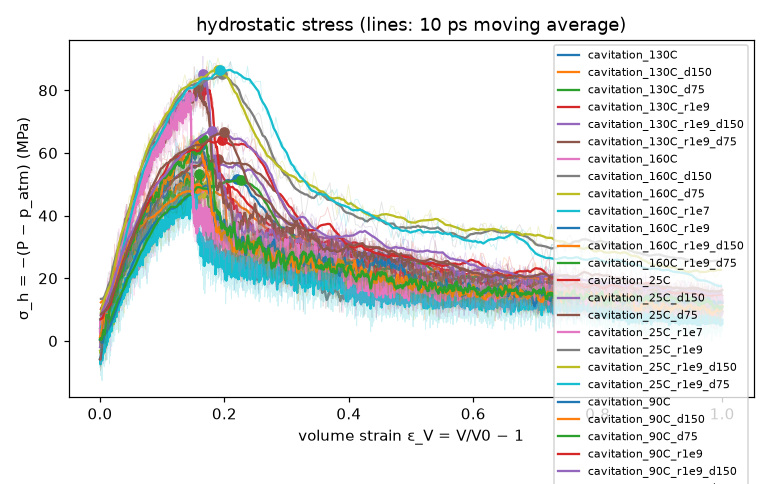
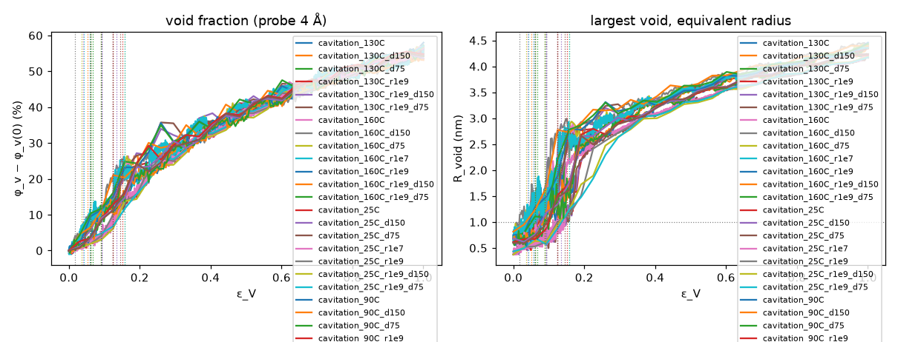
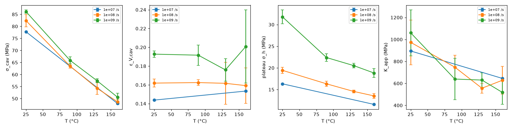

# Cavitation analysis (D58)

Generated 2026-11-10T19:19:56+00:00. σ_h = −(P − p_atm) in MPa (tension positive), smoothed over 10 ps; σ_cav = its maximum at ε_V,cav (ε_V = V/V0 − 1); drop = σ_cav − the lowest smoothed σ_h after it; plateau = mean σ_h over ε_V ≥ ε_V,cav + 0.2; K_app = dσ_h/dε_V over ε_V ≤ 0.02. Voids: probe 4 Å on a 2 Å grid; first void = largest void > 4.2 nm³ (R = 1 nm) for 3 frames in a row.

## pe_cg_amorph_n40_c240_s1 / cavitation_130C

- 130 °C, 1e+08 s⁻¹ per axis (triaxial) to strain 0.26; status finished; `/home/rdyu/projects/che126_sims/results/runs/pe_cg_amorph_n40_c240_s1/cavitation_130C`

| quantity | value |
|---|---|
| σ_cav (MPa) | 52.4 |
| ε_V,cav (pressure) | 0.140 |
| ε_V at the first void (voids) | 0.058 |
| drop after σ_cav (MPa) | 44.2 |
| plateau σ_h (MPa) | 14.2 |
| K_app (MPa) | 573 ± 55; 1/κ_T (sweep) 666 |
| T mean (K) | 403.3 |
| largest void (frame 260) | 349.19 nm³, R_void 4.37 nm, 2 voids > 1 nm³ at ε_V 1.000 |

## pe_cg_amorph_n40_c240_s1 / cavitation_130C_d150

- 130 °C, 1e+08 s⁻¹ per axis (triaxial) to strain 0.26; status finished; `/home/rdyu/projects/che126_sims/results/runs/pe_cg_amorph_n40_c240_s1/cavitation_130C_d150`

| quantity | value |
|---|---|
| σ_cav (MPa) | 57.1 |
| ε_V,cav (pressure) | 0.185 |
| ε_V at the first void (voids) | 0.052 |
| drop after σ_cav (MPa) | 49.9 |
| plateau σ_h (MPa) | 14.7 |
| K_app (MPa) | 589 ± 61; 1/κ_T (sweep) 666 |
| T mean (K) | 403.1 |
| largest void (frame 260) | 342.83 nm³, R_void 4.34 nm, 1 voids > 1 nm³ at ε_V 1.000 |

## pe_cg_amorph_n40_c240_s1 / cavitation_130C_d75

- 130 °C, 1e+08 s⁻¹ per axis (triaxial) to strain 0.26; status finished; `/home/rdyu/projects/che126_sims/results/runs/pe_cg_amorph_n40_c240_s1/cavitation_130C_d75`

| quantity | value |
|---|---|
| σ_cav (MPa) | 53.3 |
| ε_V,cav (pressure) | 0.159 |
| ε_V at the first void (voids) | 0.067 |
| drop after σ_cav (MPa) | 43.8 |
| plateau σ_h (MPa) | 14.8 |
| K_app (MPa) | 505 ± 58; 1/κ_T (sweep) 666 |
| T mean (K) | 403.3 |
| largest void (frame 260) | 349.83 nm³, R_void 4.37 nm, 1 voids > 1 nm³ at ε_V 1.000 |

## pe_cg_amorph_n40_c240_s1 / cavitation_130C_r1e9

- 130 °C, 1e+09 s⁻¹ per axis (triaxial) to strain 0.26; status finished; `/home/rdyu/projects/che126_sims/results/runs/pe_cg_amorph_n40_c240_s1/cavitation_130C_r1e9`

| quantity | value |
|---|---|
| σ_cav (MPa) | 56.5 |
| ε_V,cav (pressure) | 0.173 |
| ε_V at the first void (voids) | 0.093 |
| drop after σ_cav (MPa) | 44.2 |
| plateau σ_h (MPa) | 21.0 |
| K_app (MPa) | 704 ± 150; 1/κ_T (sweep) 666 |
| T mean (K) | 403.1 |
| largest void (frame 26) | 350.52 nm³, R_void 4.37 nm, 2 voids > 1 nm³ at ε_V 1.000 |

## pe_cg_amorph_n40_c240_s1 / cavitation_130C_r1e9_d150

- 130 °C, 1e+09 s⁻¹ per axis (triaxial) to strain 0.26; status finished; `/home/rdyu/projects/che126_sims/results/runs/pe_cg_amorph_n40_c240_s1/cavitation_130C_r1e9_d150`

| quantity | value |
|---|---|
| σ_cav (MPa) | 57.5 |
| ε_V,cav (pressure) | 0.166 |
| ε_V at the first void (voids) | 0.093 |
| drop after σ_cav (MPa) | 45.4 |
| plateau σ_h (MPa) | 20.6 |
| K_app (MPa) | 574 ± 169; 1/κ_T (sweep) 666 |
| T mean (K) | 403.5 |
| largest void (frame 26) | 344.31 nm³, R_void 4.35 nm, 1 voids > 1 nm³ at ε_V 1.000 |

## pe_cg_amorph_n40_c240_s1 / cavitation_130C_r1e9_d75

- 130 °C, 1e+09 s⁻¹ per axis (triaxial) to strain 0.26; status finished; `/home/rdyu/projects/che126_sims/results/runs/pe_cg_amorph_n40_c240_s1/cavitation_130C_r1e9_d75`

| quantity | value |
|---|---|
| σ_cav (MPa) | 58.1 |
| ε_V,cav (pressure) | 0.189 |
| ε_V at the first void (voids) | 0.061 |
| drop after σ_cav (MPa) | 46.5 |
| plateau σ_h (MPa) | 20.0 |
| K_app (MPa) | 613 ± 170; 1/κ_T (sweep) 666 |
| T mean (K) | 403.8 |
| largest void (frame 26) | 344.13 nm³, R_void 4.35 nm, 1 voids > 1 nm³ at ε_V 1.000 |

## pe_cg_amorph_n40_c240_s1 / cavitation_160C

- 160 °C, 1e+08 s⁻¹ per axis (triaxial) to strain 0.26; status finished; `/home/rdyu/projects/che126_sims/results/runs/pe_cg_amorph_n40_c240_s1/cavitation_160C`

| quantity | value |
|---|---|
| σ_cav (MPa) | 48.3 |
| ε_V,cav (pressure) | 0.166 |
| ε_V at the first void (voids) | 0.040 |
| drop after σ_cav (MPa) | 41.9 |
| plateau σ_h (MPa) | 13.6 |
| K_app (MPa) | 699 ± 66; 1/κ_T (sweep) 602 |
| T mean (K) | 433.1 |
| largest void (frame 259) | 357.02 nm³, R_void 4.40 nm, 1 voids > 1 nm³ at ε_V 0.996 |

## pe_cg_amorph_n40_c240_s1 / cavitation_160C_d150

- 160 °C, 1e+08 s⁻¹ per axis (triaxial) to strain 0.26; status finished; `/home/rdyu/projects/che126_sims/results/runs/pe_cg_amorph_n40_c240_s1/cavitation_160C_d150`

| quantity | value |
|---|---|
| σ_cav (MPa) | 47.8 |
| ε_V,cav (pressure) | 0.138 |
| ε_V at the first void (voids) | 0.018 |
| drop after σ_cav (MPa) | 39.2 |
| plateau σ_h (MPa) | 12.9 |
| K_app (MPa) | 483 ± 56; 1/κ_T (sweep) 602 |
| T mean (K) | 433.2 |
| largest void (frame 258) | 368.78 nm³, R_void 4.45 nm, 1 voids > 1 nm³ at ε_V 0.991 |

## pe_cg_amorph_n40_c240_s1 / cavitation_160C_d75

- 160 °C, 1e+08 s⁻¹ per axis (triaxial) to strain 0.26; status finished; `/home/rdyu/projects/che126_sims/results/runs/pe_cg_amorph_n40_c240_s1/cavitation_160C_d75`

| quantity | value |
|---|---|
| σ_cav (MPa) | 49.8 |
| ε_V,cav (pressure) | 0.173 |
| ε_V at the first void (voids) | 0.036 |
| drop after σ_cav (MPa) | 40.6 |
| plateau σ_h (MPa) | 14.1 |
| K_app (MPa) | 703 ± 66; 1/κ_T (sweep) 602 |
| T mean (K) | 433.3 |
| largest void (frame 257) | 362.09 nm³, R_void 4.42 nm, 1 voids > 1 nm³ at ε_V 0.986 |

## pe_cg_amorph_n40_c240_s1 / cavitation_160C_r1e7

- 160 °C, 1e+07 s⁻¹ per axis (triaxial) to strain 0.26; status finished; `/home/rdyu/projects/che126_sims/results/runs/pe_cg_amorph_n40_c240_s1/cavitation_160C_r1e7`

| quantity | value |
|---|---|
| σ_cav (MPa) | 47.9 |
| ε_V,cav (pressure) | 0.153 |
| ε_V at the first void (voids) | 0.043 |
| drop after σ_cav (MPa) | 43.0 |
| plateau σ_h (MPa) | 11.6 |
| K_app (MPa) | 645 ± 22; 1/κ_T (sweep) 602 |
| T mean (K) | 433.1 |
| largest void (frame 2600) | 353.60 nm³, R_void 4.39 nm, 1 voids > 1 nm³ at ε_V 1.000 |

## pe_cg_amorph_n40_c240_s1 / cavitation_160C_r1e9

- 160 °C, 1e+09 s⁻¹ per axis (triaxial) to strain 0.26; status finished; `/home/rdyu/projects/che126_sims/results/runs/pe_cg_amorph_n40_c240_s1/cavitation_160C_r1e9`

| quantity | value |
|---|---|
| σ_cav (MPa) | 51.6 |
| ε_V,cav (pressure) | 0.220 |
| ε_V at the first void (voids) | 0.061 |
| drop after σ_cav (MPa) | 37.0 |
| plateau σ_h (MPa) | 18.3 |
| K_app (MPa) | 587 ± 162; 1/κ_T (sweep) 602 |
| T mean (K) | 432.8 |
| largest void (frame 26) | 370.88 nm³, R_void 4.46 nm, 1 voids > 1 nm³ at ε_V 1.000 |

## pe_cg_amorph_n40_c240_s1 / cavitation_160C_r1e9_d150

- 160 °C, 1e+09 s⁻¹ per axis (triaxial) to strain 0.26; status finished; `/home/rdyu/projects/che126_sims/results/runs/pe_cg_amorph_n40_c240_s1/cavitation_160C_r1e9_d150`

| quantity | value |
|---|---|
| σ_cav (MPa) | 48.7 |
| ε_V,cav (pressure) | 0.156 |
| ε_V at the first void (voids) | 0.061 |
| drop after σ_cav (MPa) | 35.0 |
| plateau σ_h (MPa) | 20.0 |
| K_app (MPa) | 392 ± 151; 1/κ_T (sweep) 602 |
| T mean (K) | 433.0 |
| largest void (frame 25) | 356.25 nm³, R_void 4.40 nm, 3 voids > 1 nm³ at ε_V 0.953 |

## pe_cg_amorph_n40_c240_s1 / cavitation_160C_r1e9_d75

- 160 °C, 1e+09 s⁻¹ per axis (triaxial) to strain 0.26; status finished; `/home/rdyu/projects/che126_sims/results/runs/pe_cg_amorph_n40_c240_s1/cavitation_160C_r1e9_d75`

| quantity | value |
|---|---|
| σ_cav (MPa) | 51.4 |
| ε_V,cav (pressure) | 0.227 |
| ε_V at the first void (voids) | 0.061 |
| drop after σ_cav (MPa) | 38.8 |
| plateau σ_h (MPa) | 18.1 |
| K_app (MPa) | 576 ± 199; 1/κ_T (sweep) 602 |
| T mean (K) | 433.0 |
| largest void (frame 26) | 365.08 nm³, R_void 4.43 nm, 2 voids > 1 nm³ at ε_V 1.000 |

## pe_cg_amorph_n40_c240_s1 / cavitation_25C

- 25 °C, 1e+08 s⁻¹ per axis (triaxial) to strain 0.26; status finished; `/home/rdyu/projects/che126_sims/results/runs/pe_cg_amorph_n40_c240_s1/cavitation_25C`

| quantity | value |
|---|---|
| σ_cav (MPa) | 80.6 |
| ε_V,cav (pressure) | 0.163 |
| ε_V at the first void (voids) | 0.151 |
| drop after σ_cav (MPa) | 68.0 |
| plateau σ_h (MPa) | 18.6 |
| K_app (MPa) | 796 ± 62; 1/κ_T (sweep) 1000 |
| T mean (K) | 298.1 |
| largest void (frame 260) | 307.56 nm³, R_void 4.19 nm, 1 voids > 1 nm³ at ε_V 1.000 |

## pe_cg_amorph_n40_c240_s1 / cavitation_25C_d150

- 25 °C, 1e+08 s⁻¹ per axis (triaxial) to strain 0.26; status finished; `/home/rdyu/projects/che126_sims/results/runs/pe_cg_amorph_n40_c240_s1/cavitation_25C_d150`

| quantity | value |
|---|---|
| σ_cav (MPa) | 85.3 |
| ε_V,cav (pressure) | 0.165 |
| ε_V at the first void (voids) | 0.135 |
| drop after σ_cav (MPa) | 75.0 |
| plateau σ_h (MPa) | 19.8 |
| K_app (MPa) | 929 ± 66; 1/κ_T (sweep) 1000 |
| T mean (K) | 298.1 |
| largest void (frame 259) | 304.31 nm³, R_void 4.17 nm, 1 voids > 1 nm³ at ε_V 0.996 |

## pe_cg_amorph_n40_c240_s1 / cavitation_25C_d75

- 25 °C, 1e+08 s⁻¹ per axis (triaxial) to strain 0.26; status finished; `/home/rdyu/projects/che126_sims/results/runs/pe_cg_amorph_n40_c240_s1/cavitation_25C_d75`

| quantity | value |
|---|---|
| σ_cav (MPa) | 81.2 |
| ε_V,cav (pressure) | 0.157 |
| ε_V at the first void (voids) | 0.144 |
| drop after σ_cav (MPa) | 67.6 |
| plateau σ_h (MPa) | 19.9 |
| K_app (MPa) | 1196 ± 64; 1/κ_T (sweep) 1000 |
| T mean (K) | 298.1 |
| largest void (frame 259) | 304.38 nm³, R_void 4.17 nm, 1 voids > 1 nm³ at ε_V 0.996 |

## pe_cg_amorph_n40_c240_s1 / cavitation_25C_r1e7

- 25 °C, 1e+07 s⁻¹ per axis (triaxial) to strain 0.26; status finished; `/home/rdyu/projects/che126_sims/results/runs/pe_cg_amorph_n40_c240_s1/cavitation_25C_r1e7`

| quantity | value |
|---|---|
| σ_cav (MPa) | 77.8 |
| ε_V,cav (pressure) | 0.144 |
| ε_V at the first void (voids) | 0.125 |
| drop after σ_cav (MPa) | 67.1 |
| plateau σ_h (MPa) | 16.3 |
| K_app (MPa) | 895 ± 20; 1/κ_T (sweep) 1000 |
| T mean (K) | 298.1 |
| largest void (frame 2592) | 309.42 nm³, R_void 4.20 nm, 1 voids > 1 nm³ at ε_V 0.997 |

## pe_cg_amorph_n40_c240_s1 / cavitation_25C_r1e9

- 25 °C, 1e+09 s⁻¹ per axis (triaxial) to strain 0.26; status finished; `/home/rdyu/projects/che126_sims/results/runs/pe_cg_amorph_n40_c240_s1/cavitation_25C_r1e9`

| quantity | value |
|---|---|
| σ_cav (MPa) | 85.3 |
| ε_V,cav (pressure) | 0.196 |
| ε_V at the first void (voids) | 0.125 |
| drop after σ_cav (MPa) | 60.5 |
| plateau σ_h (MPa) | 32.5 |
| K_app (MPa) | 861 ± 316; 1/κ_T (sweep) 1000 |
| T mean (K) | 298.2 |
| largest void (frame 26) | 305.91 nm³, R_void 4.18 nm, 1 voids > 1 nm³ at ε_V 1.000 |

## pe_cg_amorph_n40_c240_s1 / cavitation_25C_r1e9_d150

- 25 °C, 1e+09 s⁻¹ per axis (triaxial) to strain 0.26; status finished; `/home/rdyu/projects/che126_sims/results/runs/pe_cg_amorph_n40_c240_s1/cavitation_25C_r1e9_d150`

| quantity | value |
|---|---|
| σ_cav (MPa) | 86.6 |
| ε_V,cav (pressure) | 0.189 |
| ε_V at the first void (voids) | 0.158 |
| drop after σ_cav (MPa) | 64.5 |
| plateau σ_h (MPa) | 32.9 |
| K_app (MPa) | 1279 ± 207; 1/κ_T (sweep) 1000 |
| T mean (K) | 298.2 |
| largest void (frame 26) | 307.44 nm³, R_void 4.19 nm, 1 voids > 1 nm³ at ε_V 1.000 |

## pe_cg_amorph_n40_c240_s1 / cavitation_25C_r1e9_d75

- 25 °C, 1e+09 s⁻¹ per axis (triaxial) to strain 0.26; status finished; `/home/rdyu/projects/che126_sims/results/runs/pe_cg_amorph_n40_c240_s1/cavitation_25C_r1e9_d75`

| quantity | value |
|---|---|
| σ_cav (MPa) | 86.6 |
| ε_V,cav (pressure) | 0.193 |
| ε_V at the first void (voids) | 0.158 |
| drop after σ_cav (MPa) | 69.1 |
| plateau σ_h (MPa) | 29.9 |
| K_app (MPa) | 1039 ± 124; 1/κ_T (sweep) 1000 |
| T mean (K) | 298.8 |
| largest void (frame 26) | 304.90 nm³, R_void 4.18 nm, 1 voids > 1 nm³ at ε_V 1.000 |

## pe_cg_amorph_n40_c240_s1 / cavitation_90C

- 90 °C, 1e+08 s⁻¹ per axis (triaxial) to strain 0.26; status finished; `/home/rdyu/projects/che126_sims/results/runs/pe_cg_amorph_n40_c240_s1/cavitation_90C`

| quantity | value |
|---|---|
| σ_cav (MPa) | 62.5 |
| ε_V,cav (pressure) | 0.162 |
| ε_V at the first void (voids) | 0.093 |
| drop after σ_cav (MPa) | 51.5 |
| plateau σ_h (MPa) | 17.0 |
| K_app (MPa) | 755 ± 53; 1/κ_T (sweep) 774 |
| T mean (K) | 363.1 |
| largest void (frame 252) | 320.29 nm³, R_void 4.24 nm, 1 voids > 1 nm³ at ε_V 0.963 |

## pe_cg_amorph_n40_c240_s1 / cavitation_90C_d150

- 90 °C, 1e+08 s⁻¹ per axis (triaxial) to strain 0.26; status finished; `/home/rdyu/projects/che126_sims/results/runs/pe_cg_amorph_n40_c240_s1/cavitation_90C_d150`

| quantity | value |
|---|---|
| σ_cav (MPa) | 63.6 |
| ε_V,cav (pressure) | 0.160 |
| ε_V at the first void (voids) | 0.090 |
| drop after σ_cav (MPa) | 55.2 |
| plateau σ_h (MPa) | 15.8 |
| K_app (MPa) | 637 ± 65; 1/κ_T (sweep) 774 |
| T mean (K) | 363.3 |
| largest void (frame 252) | 318.15 nm³, R_void 4.23 nm, 1 voids > 1 nm³ at ε_V 0.963 |

## pe_cg_amorph_n40_c240_s1 / cavitation_90C_d75

- 90 °C, 1e+08 s⁻¹ per axis (triaxial) to strain 0.26; status finished; `/home/rdyu/projects/che126_sims/results/runs/pe_cg_amorph_n40_c240_s1/cavitation_90C_d75`

| quantity | value |
|---|---|
| σ_cav (MPa) | 64.4 |
| ε_V,cav (pressure) | 0.166 |
| ε_V at the first void (voids) | 0.090 |
| drop after σ_cav (MPa) | 54.1 |
| plateau σ_h (MPa) | 16.2 |
| K_app (MPa) | 852 ± 73; 1/κ_T (sweep) 774 |
| T mean (K) | 363.1 |
| largest void (frame 252) | 321.44 nm³, R_void 4.25 nm, 1 voids > 1 nm³ at ε_V 0.963 |

## pe_cg_amorph_n40_c240_s1 / cavitation_90C_r1e9

- 90 °C, 1e+09 s⁻¹ per axis (triaxial) to strain 0.26; status finished; `/home/rdyu/projects/che126_sims/results/runs/pe_cg_amorph_n40_c240_s1/cavitation_90C_r1e9`

| quantity | value |
|---|---|
| σ_cav (MPa) | 64.2 |
| ε_V,cav (pressure) | 0.196 |
| ε_V at the first void (voids) | 0.125 |
| drop after σ_cav (MPa) | 49.8 |
| plateau σ_h (MPa) | 21.7 |
| K_app (MPa) | 456 ± 180; 1/κ_T (sweep) 774 |
| T mean (K) | 363.2 |
| largest void (frame 26) | 314.03 nm³, R_void 4.22 nm, 2 voids > 1 nm³ at ε_V 1.000 |

## pe_cg_amorph_n40_c240_s1 / cavitation_90C_r1e9_d150

- 90 °C, 1e+09 s⁻¹ per axis (triaxial) to strain 0.26; status finished; `/home/rdyu/projects/che126_sims/results/runs/pe_cg_amorph_n40_c240_s1/cavitation_90C_r1e9_d150`

| quantity | value |
|---|---|
| σ_cav (MPa) | 66.9 |
| ε_V,cav (pressure) | 0.179 |
| ε_V at the first void (voids) | 0.093 |
| drop after σ_cav (MPa) | 51.9 |
| plateau σ_h (MPa) | 23.3 |
| K_app (MPa) | 830 ± 160; 1/κ_T (sweep) 774 |
| T mean (K) | 363.7 |
| largest void (frame 26) | 317.73 nm³, R_void 4.23 nm, 2 voids > 1 nm³ at ε_V 1.000 |

## pe_cg_amorph_n40_c240_s1 / cavitation_90C_r1e9_d75

- 90 °C, 1e+09 s⁻¹ per axis (triaxial) to strain 0.26; status finished; `/home/rdyu/projects/che126_sims/results/runs/pe_cg_amorph_n40_c240_s1/cavitation_90C_r1e9_d75`

| quantity | value |
|---|---|
| σ_cav (MPa) | 66.5 |
| ε_V,cav (pressure) | 0.199 |
| ε_V at the first void (voids) | 0.125 |
| drop after σ_cav (MPa) | 50.7 |
| plateau σ_h (MPa) | 22.2 |
| K_app (MPa) | 632 ± 250; 1/κ_T (sweep) 774 |
| T mean (K) | 363.0 |
| largest void (frame 26) | 318.33 nm³, R_void 4.24 nm, 1 voids > 1 nm³ at ε_V 1.000 |

## Pooled over runs at the same T, rate and mode (replicas, tags)

| system | T (°C) | rate (1/s) | mode | runs | σ_cav (MPa) | ε_V,cav | plateau (MPa) | K_app (MPa) | ε_V first void |
|---|---|---|---|---|---|---|---|---|---|
| pe_cg_amorph_n40_c240_s1 | 25 | 1e+07 | triaxial | cavitation_25C_r1e7 | 77.8 | 0.144 | 16.3 | 895 | 0.125 |
| pe_cg_amorph_n40_c240_s1 | 25 | 1e+08 | triaxial | cavitation_25C, cavitation_25C_d150, cavitation_25C_d75 | 82.4 ± 2.6 | 0.162 ± 0.004 | 19.4 ± 0.7 | 973 ± 203 | 0.143 ± 0.008 |
| pe_cg_amorph_n40_c240_s1 | 25 | 1e+09 | triaxial | cavitation_25C_r1e9, cavitation_25C_r1e9_d150, cavitation_25C_r1e9_d75 | 86.1 ± 0.7 | 0.193 ± 0.003 | 31.8 ± 1.6 | 1060 ± 210 | 0.147 ± 0.019 |
| pe_cg_amorph_n40_c240_s1 | 90 | 1e+08 | triaxial | cavitation_90C, cavitation_90C_d150, cavitation_90C_d75 | 63.5 ± 0.9 | 0.162 ± 0.003 | 16.3 ± 0.6 | 748 ± 107 | 0.091 ± 0.002 |
| pe_cg_amorph_n40_c240_s1 | 90 | 1e+09 | triaxial | cavitation_90C_r1e9, cavitation_90C_r1e9_d150, cavitation_90C_r1e9_d75 | 65.9 ± 1.4 | 0.192 ± 0.011 | 22.4 ± 0.9 | 639 ± 187 | 0.114 ± 0.019 |
| pe_cg_amorph_n40_c240_s1 | 130 | 1e+08 | triaxial | cavitation_130C, cavitation_130C_d150, cavitation_130C_d75 | 54.3 ± 2.5 | 0.162 ± 0.022 | 14.6 ± 0.3 | 556 ± 45 | 0.059 ± 0.008 |
| pe_cg_amorph_n40_c240_s1 | 130 | 1e+09 | triaxial | cavitation_130C_r1e9, cavitation_130C_r1e9_d150, cavitation_130C_r1e9_d75 | 57.4 ± 0.8 | 0.176 ± 0.012 | 20.5 ± 0.5 | 630 ± 67 | 0.082 ± 0.018 |
| pe_cg_amorph_n40_c240_s1 | 160 | 1e+07 | triaxial | cavitation_160C_r1e7 | 47.9 | 0.153 | 11.6 | 645 | 0.043 |
| pe_cg_amorph_n40_c240_s1 | 160 | 1e+08 | triaxial | cavitation_160C, cavitation_160C_d150, cavitation_160C_d75 | 48.6 ± 1.1 | 0.159 ± 0.019 | 13.5 ± 0.6 | 628 ± 126 | 0.031 ± 0.012 |
| pe_cg_amorph_n40_c240_s1 | 160 | 1e+09 | triaxial | cavitation_160C_r1e9, cavitation_160C_r1e9_d150, cavitation_160C_r1e9_d75 | 50.6 ± 1.6 | 0.201 ± 0.039 | 18.8 ± 1.1 | 518 ± 110 | 0.061 ± 0.000 |

## Caveats

- The box is an amorphous melt (no crystallinity): cavitation of a melt under fast triaxial tension, not the cavitation of the amorphous layers between lamellae of a stretched semicrystalline separator.
- MD strain rates (10⁸–10¹⁰ s⁻¹ per axis) are many orders of magnitude above experiment, and CG time runs ≈ 4× fast: σ_cav is rate-inflated.
- The strain is homogeneous and affine (fix deform with remap x): the box cannot neck or localise beyond its size, and NVT removes the heat of the deformation.
- Voids are defined by a probe: space farther than the probe radius from every bead centre, swept by the probe sphere, on a 2 Å grid; the volumes depend on the probe radius (--probe-a).
- A small periodic box holds about one void: after cavitation it grows as a single cavity, so the plateau stress is box-size dependent (compare the 2×2×2 box).
- Plain LJ cutoff without tail correction: the missing attractive tail grows in magnitude as the density drops, biasing σ_h low at large strain.

## Plots

**σ_h vs volume strain**

**void fraction and size**

**cavitation vs T**

