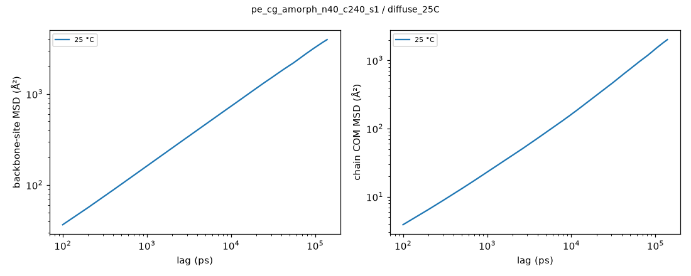
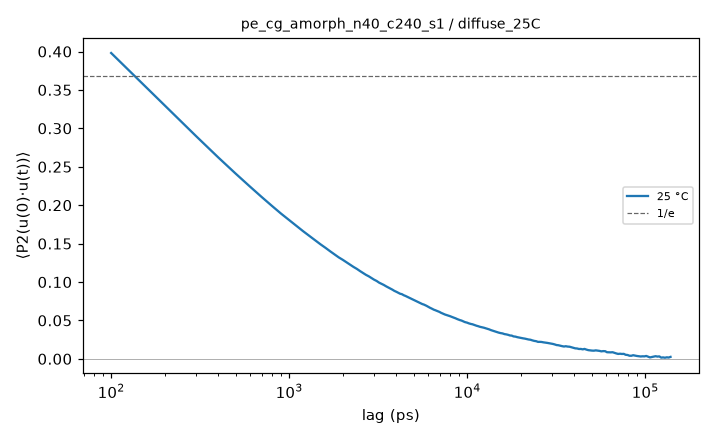
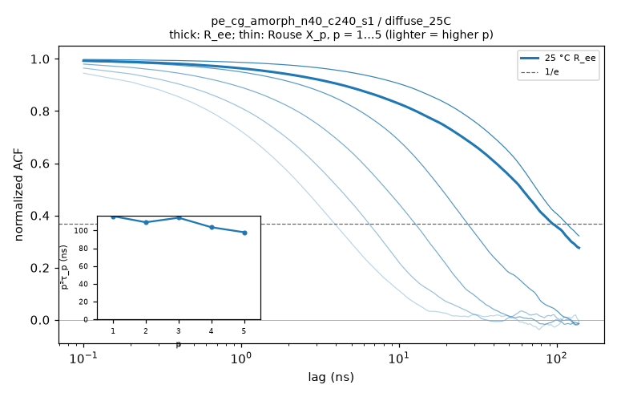

# Hold analysis: pe_cg_amorph_n40_c240_s1 / diffuse_25C

- system: `pe_cg_amorph_n40_c240_s1` (cg); source run directory `/home/rdyu/projects/che126_sims/results/runs/pe_cg_amorph_n40_c240_s1/diffuse_25C` (diffuse, status interrupted, node rdyu-rog, run code commit 8942598e98)
- analysis: `sepsim analyze hold` (D56), code commit 798e36106d (dirty), 2026-11-07 03:41 on rdyu-server
- segment: Stage 1: NPT hold 300000 ps at 298.15 K (300 ns planned, not complete); thermo window without the first 10% of rows, SEM from 100 ps block means (D55)
- note: hold not complete: thermo and trajectory over the part run

## Thermo

| window (ns) | T (°C) | density (g/cm³) | H (kcal/mol) | V (ų) | κ_T (GPa⁻¹) |
|---|---|---|---|---|---|
| 249.78 | 24.99 ± 0.01 | 0.83523 ± 0.00010 | -4826.5 ± 5.1 | 267879 ± 31 | 1.011 ± 0.005 |

## Trajectory: mobility and chain size

2776 frames × 100 ps (278 ns).

| COM MSD max (Ų) at lag (ns) | D_COM (D55 criterion) | bond P2 1/e | Rg (Å) | R_ee (Å) | C_n plateau |
|---|---|---|---|---|---|
| 2019 at 138.8 | not diffusive (log-slope 0.95 at the longest lag, MSD/⟨Rg²⟩ 1.64) | 144.3 ps | 35.13 ± 0.51 | 89.5 ± 1.9 | 13.879 ± 0.521 |

- no burst DCDs (deck without D46 bursts): lags from the hold DCD only

## Chain relaxation (holds; D56)

End-to-end vector ACF ⟨R(t)·R(0)⟩/⟨R²⟩ and Rouse mode ACFs ⟨X_p(t)·X_p(0)⟩/⟨X_p²⟩, X_p = (1/N) Σ_n cos(pπ(n−½)/N) r_n over the backbone sites, every time origin, lags up to half the hold (138.8 ns here). Times in ns: the first 1/e crossing; if C stays above 1/e within the lag window the time is 'not reached' and only an exponential fit of ln C over 0.2 ≤ C ≤ 0.9 is given (marked extrap.: it extrapolates the early decay). τ_ee fit is that fit for R_ee. τ_1/τ_2 is 4 for Rouse chains. p²⟨X_p²⟩ (relative to p = 1, p = 2…5) is flat for an ideal Rouse chain; it falls at high p where the chain is stiffer than Gaussian on that scale. Crystallinity: D26 local alignment, fraction of backbone sites with p2 ≥ 0.4 (**uncalibrated, melt baseline**: no crystal reference, so the number is a baseline for an amorphous box, not a calibrated crystallinity) and the largest crystalline cluster (sites).

| T (°C) | τ_ee 1/e (ns) | τ_ee fit (ns) | τ_1 (ns) | τ_2 (ns) | τ_3 (ns) | τ_1/τ_2 (Rouse 4) | p²⟨X_p²⟩ / p=1 (p = 2…5) | crystallinity |
|---|---|---|---|---|---|---|---|---|
| 25 | 94.7 | 115 | 116 | 27.3 | 12.7 | 4.25 | 0.97 / 0.86 / 0.77 / 0.68 | 0.192 (max 0.239; cluster ≤ 672) |

CG time is not real time: SDK PE chains diffuse ≈ 4.07× faster than real PE (Hall et al. 2019; docs/experiment_comparison.md), so MSD, D_COM, P2 and relaxation times are model times (not rescaled); multiply chain-motion times by 4.07 before comparing with experiment.

## Caveats

- Relaxation times use lags up to half the analysed hold (138.8 ns); a time beyond that is 'not reached' and only the extrapolated exponential fit is given.
- CG time is not real time: SDK PE chains diffuse ≈ 4.07× faster than real PE (Hall et al. 2019; docs/experiment_comparison.md), so MSD, D_COM, P2 and relaxation times are model times (not rescaled); multiply chain-motion times by 4.07 before comparing with experiment.

## Plots

**backbone-site and chain COM MSD**

**bond P2 autocorrelation**

**end-to-end and Rouse mode ACFs, p²τ_p vs p**

