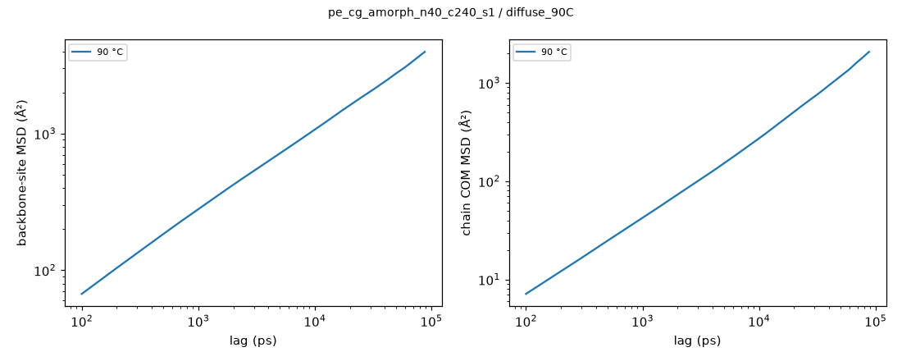
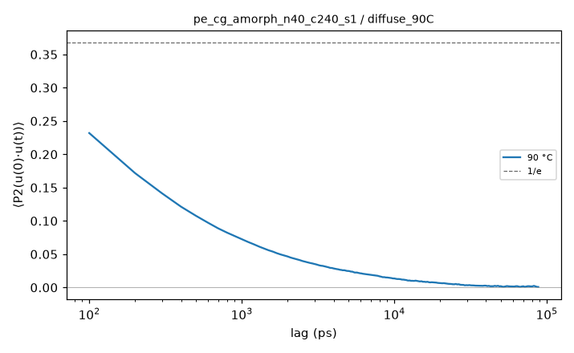
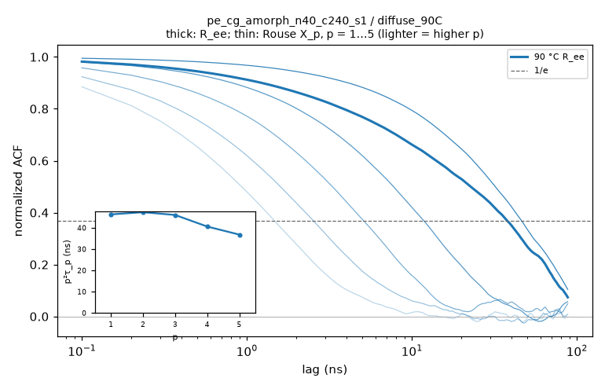

# Hold analysis: pe_cg_amorph_n40_c240_s1 / diffuse_90C

- system: `pe_cg_amorph_n40_c240_s1` (cg); source run directory `/home/rdyu/projects/che126_sims/results/runs/pe_cg_amorph_n40_c240_s1/diffuse_90C` (diffuse, status started, node rdyu-rog, run code commit 496d05cea3)
- analysis: `sepsim analyze hold` (D56), code commit 91e1157fbe (dirty), 2026-11-02 06:13 on rdyu-rog
- segment: Stage 1: NPT hold 300000 ps at 363.15 K (300 ns planned, not complete); thermo window without the first 10% of rows, SEM from 100 ps block means (D55)
- note: hold not complete: thermo and trajectory over the part run

## Thermo

| window (ns) | T (°C) | density (g/cm³) | H (kcal/mol) | V (ų) | κ_T (GPa⁻¹) |
|---|---|---|---|---|---|
| 158.47 | 90.03 ± 0.01 | 0.79797 ± 0.00009 | -3035.9 ± 5.8 | 280390 ± 32 | 1.271 ± 0.008 |

## Trajectory: mobility and chain size

1761 frames × 100 ps (176 ns).

| COM MSD max (Ų) at lag (ns) | D_COM (D55 criterion) | bond P2 1/e | Rg (Å) | R_ee (Å) | C_n plateau |
|---|---|---|---|---|---|
| 2069 at 88 | not diffusive (log-slope 1.04 at the longest lag, MSD/⟨Rg²⟩ 2.00) | 82.3 ps | 32.15 ± 0.42 | 80.6 ± 2.0 | 11.421 ± 0.427 |

- no burst DCDs (deck without D46 bursts): lags from the hold DCD only

## Chain relaxation (holds; D56)

End-to-end vector ACF ⟨R(t)·R(0)⟩/⟨R²⟩ and Rouse mode ACFs ⟨X_p(t)·X_p(0)⟩/⟨X_p²⟩, X_p = (1/N) Σ_n cos(pπ(n−½)/N) r_n over the backbone sites, every time origin, lags up to half the hold (88 ns here). Times in ns: the first 1/e crossing; if C stays above 1/e within the lag window the time is 'not reached' and only an exponential fit of ln C over 0.2 ≤ C ≤ 0.9 is given (marked extrap.: it extrapolates the early decay). τ_ee fit is that fit for R_ee. τ_1/τ_2 is 4 for Rouse chains. p²⟨X_p²⟩ (relative to p = 1, p = 2…5) is flat for an ideal Rouse chain; it falls at high p where the chain is stiffer than Gaussian on that scale. Crystallinity: D26 local alignment, fraction of backbone sites with p2 ≥ 0.4 (**uncalibrated, melt baseline**: no crystal reference, so the number is a baseline for an amorphous box, not a calibrated crystallinity) and the largest crystalline cluster (sites).

| T (°C) | τ_ee 1/e (ns) | τ_ee fit (ns) | τ_1 (ns) | τ_2 (ns) | τ_3 (ns) | τ_1/τ_2 (Rouse 4) | p²⟨X_p²⟩ / p=1 (p = 2…5) | crystallinity |
|---|---|---|---|---|---|---|---|---|
| 90 | 37.9 | 44.8 | 46.3 | 11.8 | 5.11 | 3.91 | 0.99 / 0.95 / 0.83 / 0.75 | 0.116 (max 0.147; cluster ≤ 207) |

CG times are model times: SDK PE chains move ≈ 4.07× faster than real PE (Hall et al. 2019; docs/experiment_comparison.md), so multiply by 4.07 before comparing with experiment.

## Caveats

- Relaxation times use lags up to half the analysed hold (88 ns); a time beyond that is 'not reached' and only the extrapolated exponential fit is given.
- CG time is not real time: SDK beads move ≈ 4.07× faster than real PE, so MSD, D_COM and relaxation times are model times (docs/experiment_comparison.md).

## Plots

**backbone-site and chain COM MSD**

**bond P2 autocorrelation**

**end-to-end and Rouse mode ACFs, p²τ_p vs p**

