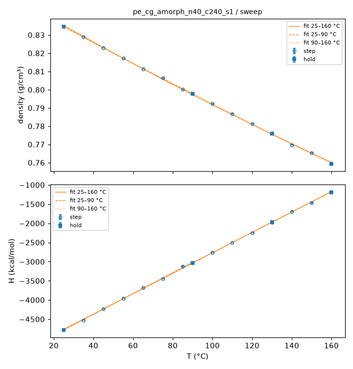
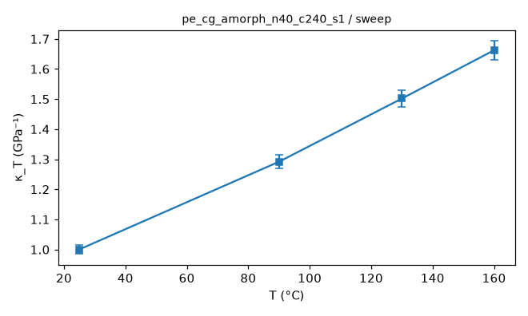
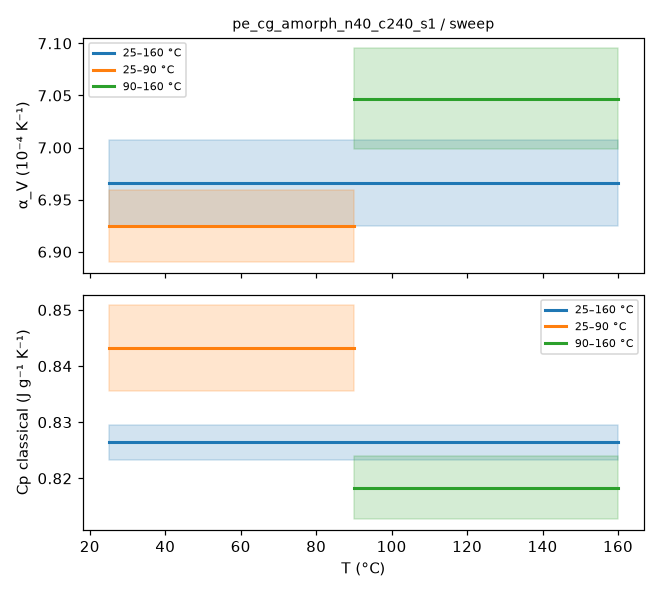
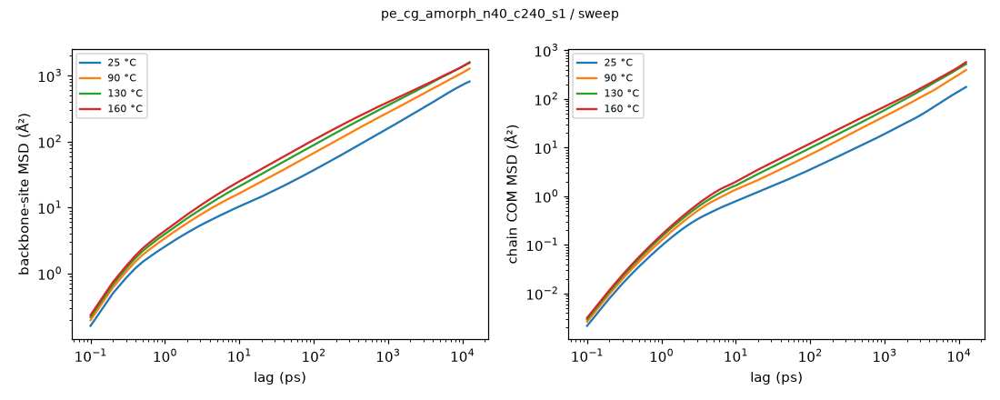
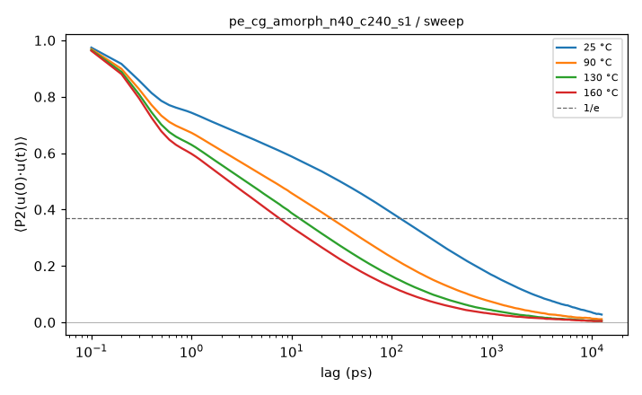
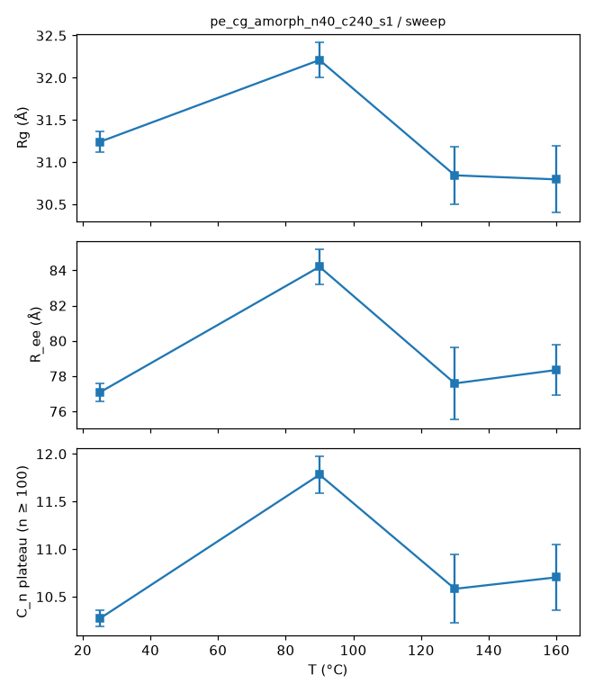
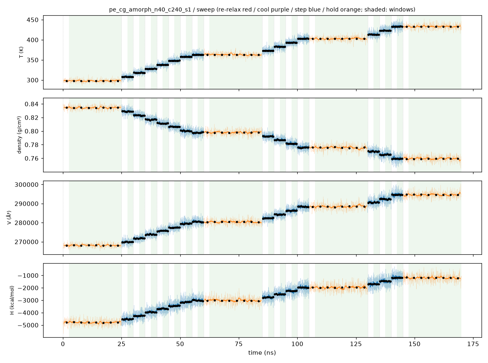
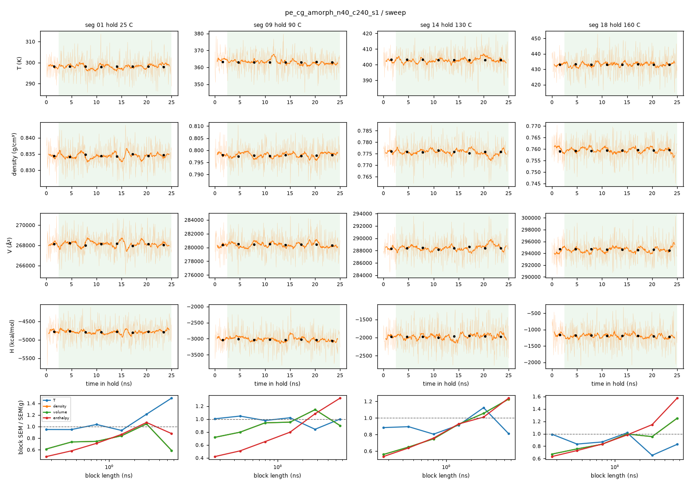

# Sweep analysis: pe_cg_amorph_n40_c240_s1 / sweep

- system: `pe_cg_amorph_n40_c240_s1` (cg); source run directory `/home/rdyu/projects/che126_sims/results/runs/pe_cg_amorph_n40_c240_s1/sweep` (status finished, node rdyu-rog, run code commit 4d12e74601)
- analysis: `sepsim analyze sweep` (D49), code commit 56b2b8890f (dirty), 2026-10-30 18:23 on rdyu-server
- windows: steps second half (50% of rows dropped); holds without the first 10% of rows; SEM from the statistical inefficiency (D26)
- system mass 134737.9 g/mol (from Density × Volume)

## Segments

| # | segment | T set (°C) | window (ns) | T (°C) | density (g/cm³) | H (kcal/mol) | V (ų) | drift |
|---|---|---|---|---|---|---|---|---|
| 1 | hold | 25 | 22.50 | 25.00 ± 0.03 | 0.83453 ± 0.00009 | -4785.9 ± 4.4 | 268105 ± 28 |  |
| 2 | step | 35 | 2.50 | 35.00 ± 0.09 | 0.82900 ± 0.00020 | -4520.0 ± 8.2 | 269893 ± 64 | density, enthalpy |
| 3 | step | 45 | 2.50 | 45.18 ± 0.09 | 0.82297 ± 0.00014 | -4236.0 ± 4.9 | 271871 ± 47 |  |
| 4 | step | 55 | 2.50 | 55.05 ± 0.10 | 0.81718 ± 0.00013 | -3953.8 ± 5.2 | 273799 ± 42 |  |
| 5 | step | 65 | 2.50 | 65.03 ± 0.10 | 0.81142 ± 0.00015 | -3680.3 ± 5.2 | 275742 ± 50 | enthalpy |
| 6 | step | 75 | 2.50 | 75.08 ± 0.10 | 0.80632 ± 0.00011 | -3439.2 ± 5.1 | 277485 ± 39 |  |
| 7 | step | 85 | 2.50 | 85.03 ± 0.10 | 0.80015 ± 0.00013 | -3123.8 ± 7.5 | 279627 ± 47 |  |
| 8 | step | 90 | 2.50 | 89.97 ± 0.11 | 0.79788 ± 0.00032 | -3031.5 ± 11.9 | 280423 ± 112 | density, enthalpy |
| 9 | hold | 90 | 22.50 | 89.96 ± 0.04 | 0.79783 ± 0.00007 | -3031.1 ± 5.4 | 280439 ± 26 |  |
| 10 | step | 100 | 2.50 | 99.93 ± 0.12 | 0.79234 ± 0.00015 | -2758.0 ± 4.8 | 282382 ± 53 |  |
| 11 | step | 110 | 2.50 | 109.99 ± 0.11 | 0.78677 ± 0.00015 | -2505.4 ± 5.7 | 284381 ± 56 |  |
| 12 | step | 120 | 2.50 | 120.06 ± 0.12 | 0.78129 ± 0.00012 | -2243.7 ± 3.7 | 286378 ± 44 |  |
| 13 | step | 130 | 2.50 | 130.09 ± 0.13 | 0.77603 ± 0.00014 | -1979.9 ± 4.4 | 288320 ± 51 |  |
| 14 | hold | 130 | 22.50 | 129.97 ± 0.04 | 0.77580 ± 0.00011 | -1970.4 ± 5.6 | 288406 ± 40 | enthalpy |
| 15 | step | 140 | 2.50 | 139.89 ± 0.12 | 0.76979 ± 0.00012 | -1691.1 ± 4.5 | 290657 ± 45 |  |
| 16 | step | 150 | 2.50 | 149.93 ± 0.13 | 0.76544 ± 0.00020 | -1465.0 ± 8.7 | 292311 ± 75 |  |
| 17 | step | 160 | 2.50 | 160.11 ± 0.13 | 0.75926 ± 0.00017 | -1187.5 ± 4.8 | 294690 ± 67 |  |
| 18 | hold | 160 | 22.50 | 159.99 ± 0.04 | 0.75938 ± 0.00009 | -1189.1 ± 4.5 | 294640 ± 36 | enthalpy |

## Isothermal compressibility (holds)

κ_T = (⟨V²⟩ − ⟨V⟩²)/(k_B T ⟨V⟩) over the hold window (NPT iso Nosé–Hoover), T the set point; SEM = statistical-inefficiency SEM of (V − ⟨V⟩)² (g given).

| T (°C) | κ_T (GPa⁻¹) | σ_V (ų) | ⟨V⟩ (ų) | g | samples |
|---|---|---|---|---|---|
| 25 | 1.000 ± 0.015 | 1050.6 | 268105 | 2.7 | 22501 |
| 90 | 1.292 ± 0.022 | 1347.7 | 280439 | 3.2 | 22501 |
| 130 | 1.502 ± 0.027 | 1552.7 | 288406 | 3.7 | 22501 |
| 160 | 1.662 ± 0.031 | 1711.5 | 294640 | 4.0 | 22501 |

## Thermal expansion and classical Cp (fits over the sweep)

Linear fits in T over each window, SEM-weighted, one point per temperature (hold where there is one): 25, 35, 45, 55, 65, 75, 85, 90, 100, 110, 120, 130, 140, 150, 160 °C. α_V = (1/⟨V⟩) dV/dT; Cp = dH/dT per gram; errors 1σ from the fit, scaled by √χ²_red when χ²_red > 1.

| window (°C) | points | α_V (10⁻⁴ K⁻¹) | χ²_red (V) | Cp (J g⁻¹ K⁻¹) | χ²_red (H) |
|---|---|---|---|---|---|
| 25–160 | 15 | 6.966 ± 0.041 | 20.93 | 0.826 ± 0.003 | 9.87 |
| 25–90 | 8 | 6.925 ± 0.035 | 3.27 | 0.843 ± 0.008 | 7.98 |
| 90–160 | 8 | 7.047 ± 0.048 | 6.12 | 0.818 ± 0.006 | 5.07 |

## Hold trajectories: mobility and chain size

Backbone sites (CG: beads; UA/AA: backbone carbons) and chains, positions relative to the system's mass centre. MSD and P2 combine the D46 bursts (0.1 ps frames, lags < the hold frame interval) with the hold DCD (lags up to half the hold). D_COM from an OLS line over the end of the COM MSD where the local log-slope stays ≥ 0.9 over a factor ≥ 2 in lag and the MSD ≥ 2⟨Rg²⟩ (D55; error: slope spread of the two halves of that range); else "not diffusive" (log-slope at the longest lag given). Rg mass-weighted over all atoms of a chain; C_n plateau over n ≥ 100 carbons (D37) on ≤ 500 frames.

| T (°C) | frames | bursts | MSD seg 10 ps / max (Ų) | COM MSD max (Ų) | D_COM (cm²/s) | P2 1/e (ps) | Rg (Å) | R_ee (Å) | C_n plateau |
|---|---|---|---|---|---|---|---|---|---|
| 25 | 2501 × 10 ps | 25 | 10.3 / 816 (12.5 ns) | 177 | not diffusive (log-slope 0.90 at the longest lag) | 122.9 | 31.24 ± 0.12 | 77.1 ± 0.5 | 10.270 ± 0.084 |
| 90 | 2501 × 10 ps | 25 | 16.5 / 1280 (12.5 ns) | 396 | not diffusive (log-slope 0.98 at the longest lag) | 25.5 | 32.21 ± 0.21 | 84.2 ± 1.0 | 11.782 ± 0.190 |
| 130 | 2501 × 10 ps | 25 | 21.1 / 1602 (12.5 ns) | 523 | not diffusive (log-slope 0.90 at the longest lag) | 12.7 | 30.84 ± 0.34 | 77.6 ± 2.1 | 10.583 ± 0.358 |
| 160 | 2501 × 10 ps | 25 | 24.8 / 1570 (12.5 ns) | 573 | not diffusive (log-slope 0.99 at the longest lag) | 7.6 | 30.80 ± 0.39 | 78.3 ± 1.4 | 10.704 ± 0.344 |

## Equilibration

Every average uses only the analysis window: steps second half (50% of rows dropped), holds without the first 10% of rows (the rest is equilibration after the T change; see `equilibration.png`, windows shaded, block averages ± SEM overlaid, and `equilibration_holds.png`). Drift: the window's two halves differ by > 2 combined SEM (statistical inefficiency).

Segments with a drifting window (tested: density, enthalpy):

| segment | T set (°C) | drift (second − first half ± SEM) |
|---|---|---|
| seg 02 step 35 C | 35 | density -0.0005737 ± 0.0002; enthalpy +29.8 ± 13 |
| seg 05 step 65 C | 65 | enthalpy -24.51 ± 12 |
| seg 08 step 90 C | 90 | density +0.0009501 ± 0.00024; enthalpy -47.01 ± 13 |
| seg 14 hold 130 C | 130 | enthalpy +16.04 ± 7.6 |
| seg 18 hold 160 C | 160 | enthalpy -19.18 ± 8.8 |

Block-average check of the hold SEMs: SEM of the means of 32 / 16 / 8 blocks vs the statistical-inefficiency SEM (blocks longer than the correlation time plateau at it; flagged if the 8-block SEM exceeds it by > 2×).

| T (°C) | quantity | SEM (g) | block SEM 32 / 16 / 8 | converged |
|---|---|---|---|---|
| 25 | density | 8.73e-05 | 6.51e-05 / 7.34e-05 / 9.12e-05 | yes |
| 25 | enthalpy | 4.22 | 3 / 3.65 / 4.51 | yes |
| 90 | density | 7.31e-05 | 6.88e-05 / 6.96e-05 / 8.37e-05 | yes |
| 90 | enthalpy | 5.81 | 3.79 / 4.64 / 6.29 | yes |
| 130 | density | 0.000108 | 8.12e-05 / 0.0001 / 0.000115 | yes |
| 130 | enthalpy | 4.63 | 3.51 / 4.29 / 4.68 | yes |
| 160 | density | 9.25e-05 | 7.68e-05 / 9.21e-05 / 8.82e-05 | yes |
| 160 | enthalpy | 4.85 | 4.04 / 4.76 / 5.56 | yes |

Local quantities (density, enthalpy, κ_T, segmental MSD, bond P2: relaxation times ~10–100 ps in CG, the bond P2 1/e time above) equilibrate within the dropped part of each segment; their windows are what the drift and block checks test.

Chain-scale quantities (Rg, R_ee, C_n, chain COM motion) relax on the end-to-end time (CG C240 at 25 °C: of order 100 ns; C1500 far longer), longer than a 25 ns hold: their hold averages describe the chain configurations carried in from the 500 K equilibration and cooling rather than a re-equilibrated state at T. Per hold:
- 25 °C: chain COM MSD at 12.5 ns / ⟨Rg²⟩ = 0.18; chains have **not** moved their own size: chain-scale averages sample a partly relaxed set of chain configurations.
- 90 °C: chain COM MSD at 12.5 ns / ⟨Rg²⟩ = 0.38; chains have **not** moved their own size: chain-scale averages sample a partly relaxed set of chain configurations.
- 130 °C: chain COM MSD at 12.5 ns / ⟨Rg²⟩ = 0.55; chains have **not** moved their own size: chain-scale averages sample a partly relaxed set of chain configurations.
- 160 °C: chain COM MSD at 12.5 ns / ⟨Rg²⟩ = 0.60; chains have **not** moved their own size: chain-scale averages sample a partly relaxed set of chain configurations.

## Caveats

- Cp is the classical dH/dT and is not comparable to experiment: classical MD gives every degree of freedom k_B/2 per quadratic term; CG also drops degrees of freedom (all motion inside a 3-CH2 bead), so its Cp per gram is not a property of the real polymer at all (reported for completeness and resolution comparisons only).
- D37 chain check FAIL on the prep hold + extension: C_n plateau 9.11 vs melt 6.7 ±10%.
- α_V and Cp are linear fits in T over each window with SEM weights; a reduced χ² > 1 (curvature over the window, or SEMs too small) inflates the quoted errors by √χ²_red, and a large χ²_red over 25–160 °C means α_V or Cp depends on T (compare the two half windows).
- CG time is not real time: SDK beads move faster than the atoms they represent, so MSD, D_COM and P2 times are model times (not rescaled).

## Plots

**density and enthalpy vs T with the linear fits**

**κ_T vs T (holds)**

**α_V and Cp per fit window**

**backbone-site and chain COM MSD**

**bond P2 autocorrelation**

**Rg, R_ee and C_n vs T**

**thermo vs time, analysis windows shaded, block averages ± SEM**

**holds: thermo vs time, analysis window shaded, block averages ± SEM**

