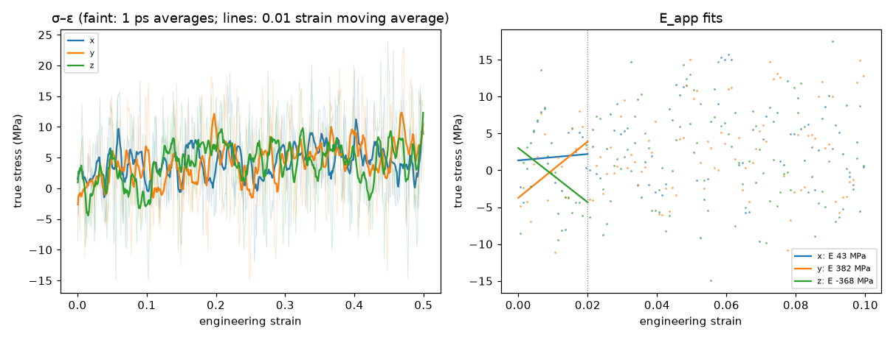
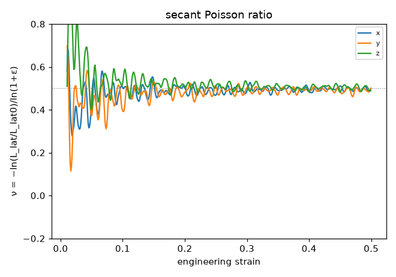

# Tensile analysis (D54)

Generated 2026-10-30T17:21:04-07:00. E_app and ν fitted over 0 ≤ ε ≤ 0.02; peak after a 0.01-strain moving average; flow stress = mean true stress over ε ∈ [0.3, 0.5]. True stress σ = −(P_axis − p_atm), tension positive; engineering stress σ·A/A0.

## pe_cg_amorph_n40_c240_s1 / tensile_160C_r1e9

- 160 °C, 1e+09 s⁻¹ to strain 0.5, lateral 1 atm; status finished on rdyu-rog; `/home/rdyu/projects/che126_sims/results/runs/pe_cg_amorph_n40_c240_s1/tensile_160C_r1e9`

| axis | strain reached | E_app (MPa) | ν (fit) | ν (run) | σ_peak (MPa) | ε_peak | flow σ (MPa) | T (K) |
|---|---|---|---|---|---|---|---|---|
| x | 0.500 | 43 ± 187 | 0.38 | 0.50 | 11.2 | 0.403 | 5.2 | 433.3 |
| y | 0.500 | 382 ± 184 | 0.27 | 0.50 | 12.3 | 0.469 | 6.0 | 432.9 |
| z | 0.500 | -368 ± 229 | 0.80 | 0.50 | 9.8 | 0.326 | 4.9 | 433.0 |
| mean ± SD | | 19 ± 376 | 0.48 ± 0.28 | 0.50 ± 0.00 | 11.1 ± 1.3 | 0.399 ± 0.072 | 5.4 ± 0.6 | |

## Caveats

- The box is an amorphous melt above Tg (Tg is below 25 °C for PE, D14), so the response is viscoelastic and rate-dependent: these are not the moduli of a semicrystalline separator, whose stiffness and yield come from its crystallinity.
- E_app is the apparent (high-frequency) modulus at the simulated strain rate, many orders of magnitude above experiment; it falls with the rate.
- There is no true yield in a melt: the peak or plateau is a viscous flow stress (≈ 3 η × rate for a Newtonian melt), again rate-dependent.
- ν is biased at high rate: the lateral barostat (Pdamp = 1000 dt) lags the imposed strain, so the lateral contraction trails the axial extension (ν low at small strain); a fully relaxed melt approaches ν = 0.5.
- Stress is -(P_axis - p_atm) from the virial pressure tensor averaged over avg_ps; the axes of one run start from the same snapshot, so their spread is not a full independent-sample error.

## Plots

**stress–strain and E_app fits**

**secant Poisson ratio vs strain**

