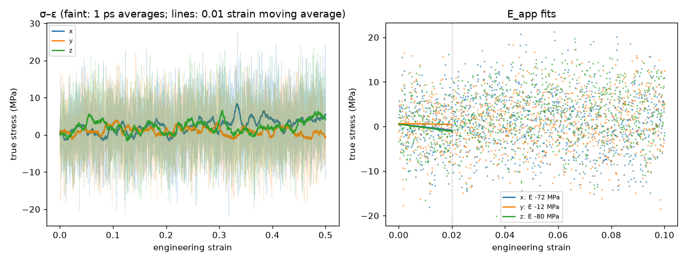
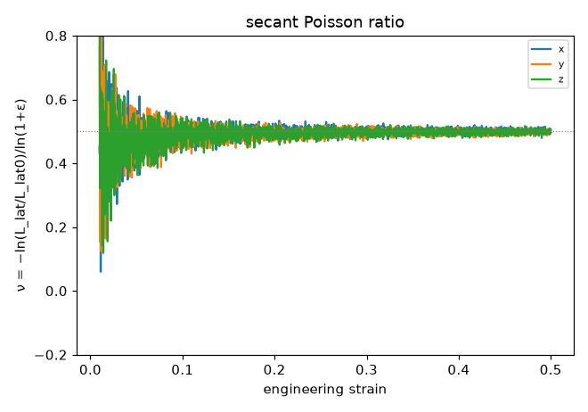

# Tensile analysis (D54)

Generated 2026-10-30T17:20:55-07:00. E_app and ν fitted over 0 ≤ ε ≤ 0.02; peak after a 0.01-strain moving average; flow stress = mean true stress over ε ∈ [0.3, 0.5]. True stress σ = −(P_axis − p_atm), tension positive; engineering stress σ·A/A0.

## pe_cg_amorph_n40_c240_s1 / tensile_25C

- 25 °C, 1e+08 s⁻¹ to strain 0.5, lateral 1 atm; status finished on rdyu-rog; `/home/rdyu/projects/che126_sims/results/runs/pe_cg_amorph_n40_c240_s1/tensile_25C`

| axis | strain reached | E_app (MPa) | ν (fit) | ν (run) | σ_peak (MPa) | ε_peak | flow σ (MPa) | T (K) |
|---|---|---|---|---|---|---|---|---|
| x | 0.500 | -72 ± 73 | 0.46 | 0.50 | 8.5 | 0.333 | 3.9 | 298.1 |
| y | 0.500 | -12 ± 72 | 0.49 | 0.50 | 4.0 | 0.108 | 0.6 | 298.1 |
| z | 0.500 | -80 ± 66 | 0.42 | 0.50 | 6.6 | 0.306 | 2.5 | 298.1 |
| mean ± SD | | -55 ± 37 | 0.45 ± 0.04 | 0.50 ± 0.00 | 6.4 ± 2.2 | 0.249 ± 0.123 | 2.3 ± 1.6 | |

## Caveats

- The box is an amorphous melt above Tg (Tg is below 25 °C for PE, D14), so the response is viscoelastic and rate-dependent: these are not the moduli of a semicrystalline separator, whose stiffness and yield come from its crystallinity.
- E_app is the apparent (high-frequency) modulus at the simulated strain rate, many orders of magnitude above experiment; it falls with the rate.
- There is no true yield in a melt: the peak or plateau is a viscous flow stress (≈ 3 η × rate for a Newtonian melt), again rate-dependent.
- ν is biased at high rate: the lateral barostat (Pdamp = 1000 dt) lags the imposed strain, so the lateral contraction trails the axial extension (ν low at small strain); a fully relaxed melt approaches ν = 0.5.
- Stress is -(P_axis - p_atm) from the virial pressure tensor averaged over avg_ps; the axes of one run start from the same snapshot, so their spread is not a full independent-sample error.

## Plots

**stress–strain and E_app fits**

**secant Poisson ratio vs strain**

