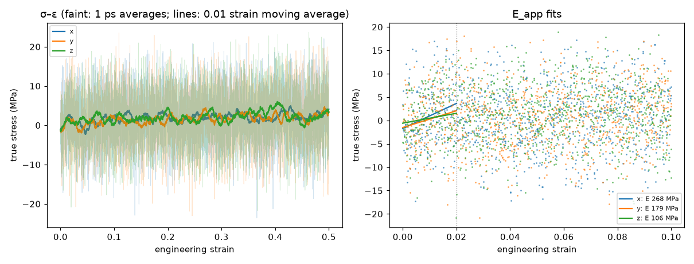
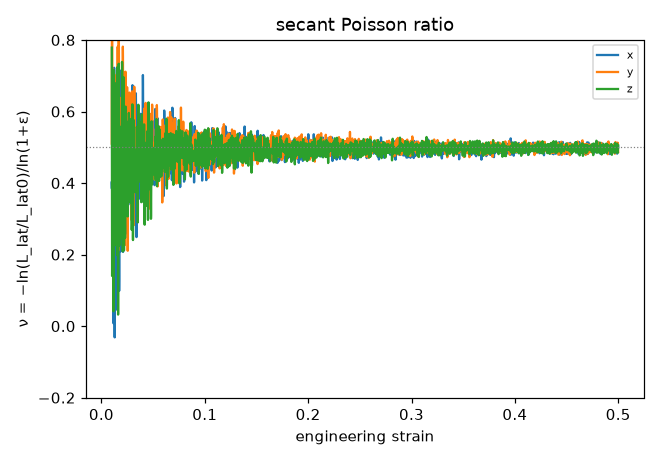

# Tensile analysis (D54)

Generated 2026-10-31T04:51:25-07:00. E_app and ν fitted over 0 ≤ ε ≤ 0.02; peak after a 0.01-strain moving average; flow stress = mean true stress over ε ∈ [0.3, 0.5]. True stress σ = −(P_axis − p_atm), tension positive; engineering stress σ·A/A0.

## pe_cg_amorph_n40_c240_s1 / tensile_90C

- 90 °C, 1e+08 s⁻¹ to strain 0.5, lateral 1 atm; status finished on rdyu-rog; `/home/rdyu/projects/che126_sims/results/runs/pe_cg_amorph_n40_c240_s1/tensile_90C`

| axis | strain reached | E_app (MPa) | ν (fit) | ν (run) | σ_peak (MPa) | ε_peak | flow σ (MPa) | T (K) |
|---|---|---|---|---|---|---|---|---|
| x | 0.500 | 268 ± 80 | 0.39 | 0.50 | 4.9 | 0.429 | 2.4 | 363.1 |
| y | 0.500 | 179 ± 76 | 0.49 | 0.50 | 4.7 | 0.492 (end) | 2.1 | 363.1 |
| z | 0.500 | 106 ± 71 | 0.43 | 0.50 | 6.0 | 0.404 | 2.6 | 363.1 |
| mean ± SD | | 184 ± 81 | 0.44 ± 0.05 | 0.50 ± 0.00 | 5.2 ± 0.7 | 0.442 ± 0.045 | 2.4 ± 0.2 | |

## Caveats

- The box is an amorphous melt above Tg (Tg is below 25 °C for PE, D14), so the response is viscoelastic and rate-dependent: these are not the moduli of a semicrystalline separator, whose stiffness and yield come from its crystallinity.
- E_app is the apparent (high-frequency) modulus at the simulated strain rate, many orders of magnitude above experiment; it falls with the rate.
- There is no true yield in a melt: the peak or plateau is a viscous flow stress (≈ 3 η × rate for a Newtonian melt), again rate-dependent.
- ν is biased at high rate: the lateral barostat (Pdamp = 1000 dt) lags the imposed strain, so the lateral contraction trails the axial extension (ν low at small strain); a fully relaxed melt approaches ν = 0.5.
- Stress is -(P_axis - p_atm) from the virial pressure tensor averaged over avg_ps; the axes of one run start from the same snapshot, so their spread is not a full independent-sample error.

## Plots

**stress–strain and E_app fits**

**secant Poisson ratio vs strain**

