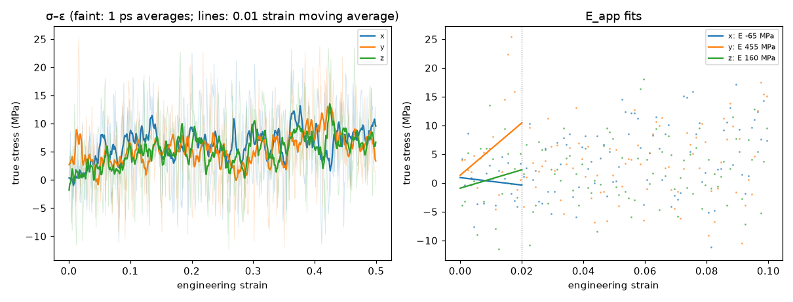
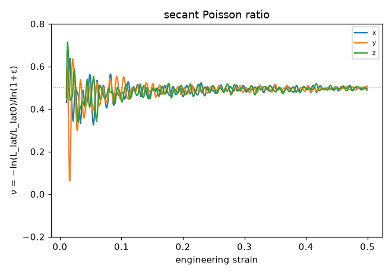

# Tensile analysis (D54)

Generated 2026-10-30T17:21:00-07:00. E_app and ν fitted over 0 ≤ ε ≤ 0.02; peak after a 0.01-strain moving average; flow stress = mean true stress over ε ∈ [0.3, 0.5]. True stress σ = −(P_axis − p_atm), tension positive; engineering stress σ·A/A0.

## pe_cg_amorph_n40_c240_s1 / tensile_90C_r1e9

- 90 °C, 1e+09 s⁻¹ to strain 0.5, lateral 1 atm; status finished on rdyu-rog; `/home/rdyu/projects/che126_sims/results/runs/pe_cg_amorph_n40_c240_s1/tensile_90C_r1e9`

| axis | strain reached | E_app (MPa) | ν (fit) | ν (run) | σ_peak (MPa) | ε_peak | flow σ (MPa) | T (K) |
|---|---|---|---|---|---|---|---|---|
| x | 0.500 | -65 ± 152 | 0.52 | 0.50 | 13.1 | 0.377 | 7.3 | 363.3 |
| y | 0.500 | 455 ± 296 | 0.34 | 0.50 | 13.1 | 0.422 | 7.1 | 363.1 |
| z | 0.500 | 160 ± 249 | 0.48 | 0.50 | 13.5 | 0.425 | 6.8 | 363.2 |
| mean ± SD | | 183 ± 261 | 0.44 ± 0.09 | 0.50 ± 0.00 | 13.2 ± 0.2 | 0.408 ± 0.027 | 7.1 ± 0.3 | |

## Caveats

- The box is an amorphous melt above Tg (Tg is below 25 °C for PE, D14), so the response is viscoelastic and rate-dependent: these are not the moduli of a semicrystalline separator, whose stiffness and yield come from its crystallinity.
- E_app is the apparent (high-frequency) modulus at the simulated strain rate, many orders of magnitude above experiment; it falls with the rate.
- There is no true yield in a melt: the peak or plateau is a viscous flow stress (≈ 3 η × rate for a Newtonian melt), again rate-dependent.
- ν is biased at high rate: the lateral barostat (Pdamp = 1000 dt) lags the imposed strain, so the lateral contraction trails the axial extension (ν low at small strain); a fully relaxed melt approaches ν = 0.5.
- Stress is -(P_axis - p_atm) from the virial pressure tensor averaged over avg_ps; the axes of one run start from the same snapshot, so their spread is not a full independent-sample error.

## Plots

**stress–strain and E_app fits**

**secant Poisson ratio vs strain**

