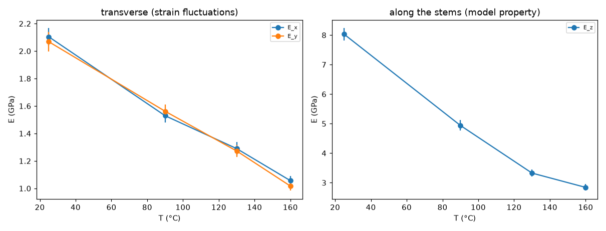

# Crystal analysis: pe_cg_crystal_7x10x27_s1 / crystal

- system: `pe_cg_crystal_7x10x27_s1` (cg); source run directory `/home/rdyu/projects/che126_sims/results/runs/pe_cg_crystal_7x10x27_s1/crystal` (status finished, node rdyu-rog, run code commit 70111966f1)
- analysis: `sepsim analyze crystal` (D59), code commit 8b68bd2293, 2026-11-23 17:44 on rdyu-server
- 140 stems x 27 sites, 7 x 10 x 27 repeats of pe_orthorhombic_busing (a 7.4069, b 4.9491, c 2.5511 Å at 23 °C, 0.9963 g/cm³, 18.33 Ų per chain)
- crystallinity: D26 local P2 with ring chords, r_c 6.31 Å, threshold 0.745 (**calibrated (calibration_cg_pe.json, 2026-11-17)**); stable hold: last frame fraction ≥ 0.8 and stem P2 ≥ 0.8

## Holds

Thermo after the first 10% of each hold (mean ± SEM). a = Lx/na, b = Ly/nb, c = Lz/nz (CG: rise per bead; UA: the 2-CH2 repeat). ρ/ρ_exp and A/A_exp against the Busing cell (0.9963 g/cm³, 18.33 Ų).

| T (°C) | a (Å) | b (Å) | c (Å) | a/b | ρ (g/cm³) | ρ/ρ_exp | A/chain (Ų) | A/A_exp | drift | crystalline (mean; first → last) | stem P2 (last) | largest cluster (last) | stable |
|---|---|---|---|---|---|---|---|---|---|---|---|---|---|
| 25.1 | 8.6679 ± 0.0003 | 5.0045 ± 0.0002 | 3.4756 ± 0.0001 | 1.732 | 0.9270 ± 0.0000 | 0.930 | 21.69 ± 0.00 | 1.183 | a_A, a_over_b | 1.000; 1.000 → 1.000 | 0.972 | 1.000 | True |
| 90.0 | 8.8764 ± 0.0007 | 5.1230 ± 0.0004 | 3.4385 ± 0.0003 | 1.733 | 0.8938 ± 0.0000 | 0.897 | 22.74 ± 0.00 | 1.241 | none | 0.999; 1.000 → 0.999 | 0.955 | 0.999 | True |
| 130.0 | 9.0284 ± 0.0008 | 5.2110 ± 0.0004 | 3.4087 ± 0.0003 | 1.733 | 0.8714 ± 0.0000 | 0.875 | 23.52 ± 0.00 | 1.283 | none | 0.996; 0.999 → 0.997 | 0.950 | 0.997 | True |
| 160.0 | 9.1597 ± 0.0007 | 5.2860 ± 0.0005 | 3.3830 ± 0.0003 | 1.733 | 0.8532 ± 0.0000 | 0.856 | 24.21 ± 0.00 | 1.321 | area_per_chain_A2 | 0.987; 0.997 → 0.988 | 0.936 | 0.988 | True |

## Thermal expansion (stable holds)

Holds 25, 90, 130, 160 °C; α = d ln L/dT, OLS.

| quantity | α (10⁻⁴ K⁻¹) |
|---|---|
| a | 4.060 ± 0.175 |
| b | 4.028 ± 0.181 |
| c | -1.982 ± 0.139 |
| V | 6.106 ± 0.217 |

## Elastic constants (strain fluctuations)

Per hold (after the first 10%): ε_i = (L_i − ⟨L_i⟩)/⟨L_i⟩, S_ij = ⟨V⟩⟨ε_i ε_j⟩/(k_B T) with T the set point, over the normal strains of the orthogonal box (shear fixed; normal–shear couplings assumed zero by symmetry); E_i = 1/S_ii, ν_ij = −S_ij/S_ii, C = S⁻¹. ± is the bootstrap standard error over 100-row blocks (1000 draws). Rate-free (static, isothermal) constants; x, y transverse, z along the stems.

| T (°C) | blocks | E_x (GPa) | E_y (GPa) | E_z (GPa) | ν_xy | ν_yx | ν_xz | ν_yz | C11 | C22 | C33 | C12 | C13 | C23 | stable |
|---|---|---|---|---|---|---|---|---|---|---|---|---|---|---|---|
| 25 | 90 | 2.10 ± 0.06 | 2.07 ± 0.07 | 8.03 ± 0.21 | 0.263 ± 0.026 | 0.259 ± 0.024 | 0.101 ± 0.005 | 0.109 ± 0.006 | 2.4 ± 0.1 | 2.4 ± 0.1 | 9.1 ± 0.3 | 0.8 ± 0.1 | 1.3 ± 0.1 | 1.3 ± 0.1 | True |
| 90 | 90 | 1.53 ± 0.05 | 1.56 ± 0.05 | 4.94 ± 0.18 | 0.162 ± 0.028 | 0.165 ± 0.030 | 0.187 ± 0.010 | 0.175 ± 0.009 | 1.9 ± 0.0 | 1.9 ± 0.0 | 6.6 ± 0.2 | 0.6 ± 0.0 | 1.5 ± 0.1 | 1.4 ± 0.1 | True |
| 130 | 90 | 1.29 ± 0.05 | 1.27 ± 0.04 | 3.33 ± 0.12 | 0.154 ± 0.029 | 0.152 ± 0.029 | 0.226 ± 0.013 | 0.213 ± 0.012 | 1.7 ± 0.0 | 1.6 ± 0.0 | 4.7 ± 0.2 | 0.5 ± 0.0 | 1.3 ± 0.1 | 1.2 ± 0.0 | True |
| 160 | 90 | 1.06 ± 0.03 | 1.02 ± 0.03 | 2.84 ± 0.11 | 0.196 ± 0.029 | 0.188 ± 0.028 | 0.216 ± 0.012 | 0.229 ± 0.011 | 1.4 ± 0.0 | 1.4 ± 0.0 | 4.3 ± 0.1 | 0.5 ± 0.0 | 1.2 ± 0.0 | 1.2 ± 0.0 | True |

Halves check: E from the first vs the second half of the window (each with its own bootstrap error); **flag** when they differ by more than 2σ.

| T (°C) | E_x 1st → 2nd | E_y 1st → 2nd | E_z 1st → 2nd | flagged |
|---|---|---|---|---|
| 25 | 2.13 ± 0.10 → 2.08 ± 0.07 | 2.12 ± 0.10 → 2.02 ± 0.10 | 8.12 ± 0.25 → 7.94 ± 0.31 | none |
| 90 | 1.50 ± 0.07 → 1.56 ± 0.07 | 1.53 ± 0.07 → 1.59 ± 0.07 | 4.92 ± 0.31 → 4.96 ± 0.18 | none |
| 130 | 1.24 ± 0.07 → 1.34 ± 0.06 | 1.29 ± 0.06 → 1.25 ± 0.06 | 3.24 ± 0.18 → 3.42 ± 0.17 | none |
| 160 | 1.03 ± 0.04 → 1.09 ± 0.06 | 1.05 ± 0.05 → 0.99 ± 0.05 | 2.98 ± 0.15 → 2.73 ± 0.16 | none |

## Caveats

- A periodic perfect crystal of infinite stems has no surfaces, ends or defects to nucleate melting: it superheats, so a hold or ramp that stays crystalline bounds its stability from above; it is not the melting point.
- CG (SDK) beads carry no setting angle: the stems pack as the model prefers (a/b = √3 is hexagonal); a, b and c of the CG crystal are not the orthorhombic PE cell.
- The barostat is anisotropic (x, y, z independent, couple none); the stems stay along z only while the crystal holds.
- Elastic constants from the box-length fluctuations of the NPT holds (Parrinello-Rahman/Ray strain-fluctuation formula, T = the set point): the box is orthogonal, so the shear strains are fixed and only the normal-normal block of the compliance is sampled; it equals the normal block of the full S only if the normal-shear couplings vanish, assumed here by the orthorhombic (or pseudo-hexagonal, stems along z) symmetry. They are static (zero-rate, isothermal) constants of the model crystal, to compare with the rate-dependent tensile E_app; they rest on the MTK (Nose-Hoover) barostat sampling the NPT ensemble (Pdamp 1000 dt, frames 1 ps apart), and fluctuation estimates converge slowly: the halves check flags E that differ by more than 2 sigma between the first and second half of the hold.
- E_z is along the covalent stems, each bonded to its own periodic image (infinite chains with no ends or folds): a model property, an upper bound for real crystalline stems.

## Plots

**cell lengths and density per hold**

**crystallinity and stem P2**

**elastic moduli from strain fluctuations**

