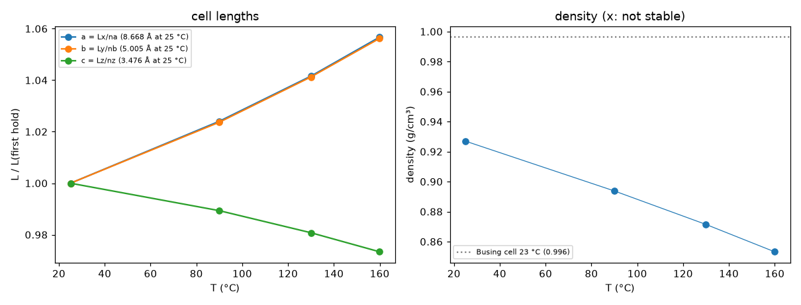
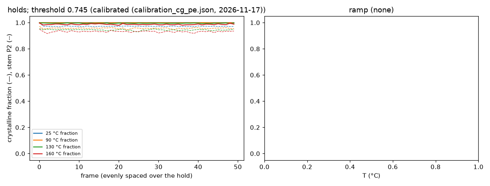
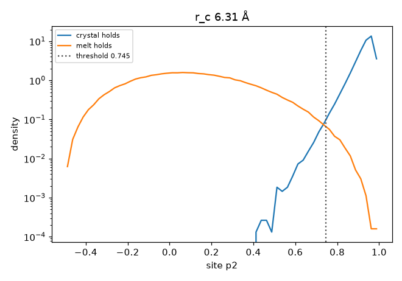

# Crystal analysis: pe_cg_crystal_7x10x27_s1 / crystal

- system: `pe_cg_crystal_7x10x27_s1` (cg); source run directory `/home/rdyu/projects/che126_sims/results/runs/pe_cg_crystal_7x10x27_s1/crystal` (status finished, node rdyu-rog, run code commit 70111966f1)
- analysis: `sepsim analyze crystal` (D59), code commit 70111966f1, 2026-11-17 07:24 on rdyu-server
- 140 stems x 27 sites, 7 x 10 x 27 repeats of pe_orthorhombic_busing (a 7.4069, b 4.9491, c 2.5511 Å at 23 °C, 0.9963 g/cm³, 18.33 Ų per chain)
- crystallinity: D26 local P2 with ring chords, r_c 6.31 Å, threshold 0.745 (**calibrated (calibration_cg_pe.json, 2026-11-17)**); stable hold: last frame fraction ≥ 0.8 and stem P2 ≥ 0.8

## Holds

Thermo after the first 10% of each hold (mean ± SEM). a = Lx/na, b = Ly/nb, c = Lz/nz (CG: rise per bead; UA: the 2-CH2 repeat). ρ/ρ_exp and A/A_exp against the Busing cell (0.9963 g/cm³, 18.33 Ų).

| T (°C) | a (Å) | b (Å) | c (Å) | a/b | ρ (g/cm³) | ρ/ρ_exp | A/chain (Ų) | A/A_exp | drift | crystalline (mean; first → last) | stem P2 (last) | largest cluster (last) | stable |
|---|---|---|---|---|---|---|---|---|---|---|---|---|---|
| 25.1 | 8.6679 ± 0.0003 | 5.0045 ± 0.0002 | 3.4756 ± 0.0001 | 1.732 | 0.9270 ± 0.0000 | 0.930 | 21.69 ± 0.00 | 1.183 | a_A, a_over_b | 1.000; 1.000 → 1.000 | 0.972 | 1.000 | True |
| 90.0 | 8.8764 ± 0.0007 | 5.1230 ± 0.0004 | 3.4385 ± 0.0003 | 1.733 | 0.8938 ± 0.0000 | 0.897 | 22.74 ± 0.00 | 1.241 | none | 0.999; 1.000 → 0.999 | 0.955 | 0.999 | True |
| 130.0 | 9.0284 ± 0.0008 | 5.2110 ± 0.0004 | 3.4087 ± 0.0003 | 1.733 | 0.8714 ± 0.0000 | 0.875 | 23.52 ± 0.00 | 1.283 | none | 0.996; 0.999 → 0.997 | 0.950 | 0.997 | True |
| 160.0 | 9.1597 ± 0.0007 | 5.2860 ± 0.0005 | 3.3830 ± 0.0003 | 1.733 | 0.8532 ± 0.0000 | 0.856 | 24.21 ± 0.00 | 1.321 | area_per_chain_A2 | 0.987; 0.997 → 0.988 | 0.936 | 0.988 | True |

## Thermal expansion (stable holds)

Holds 25, 90, 130, 160 °C; α = d ln L/dT, OLS.

| quantity | α (10⁻⁴ K⁻¹) |
|---|---|
| a | 4.060 ± 0.175 |
| b | 4.028 ± 0.181 |
| c | -1.982 ± 0.139 |
| V | 6.106 ± 0.217 |

## Calibration (D59)

Written to `data/crystals/calibration_cg_pe.json`. equal-error threshold of the per-site p2 distributions (sepsim.analysis.order.calibrate_threshold; Anwar & Schilling, Polymer 2015, 76, 307): crystal holds with stem P2 >= 0.8 (ring chords) vs melt sweep holds, <= 20 evenly spaced frames per hold.

- threshold **0.7448** at r_c 6.308 Å (1.4 σ), equal-error rate 0.0044
- r_c = 1.4 sigma: error rate 0.0044; best of the scan 1.6 sigma (0.0022)
- crystal holds 25, 90, 130, 160 °C, 302400 site values; melt 249599 site values from pe_cg_amorph_n40_c240_s1

| r_c / σ | r_c (Å) | threshold | error rate |
|---|---|---|---|
| 1.2 | 5.407 | 0.7952 | 0.0174 |
| 1.4 | 6.308 | 0.7448 | 0.0044 |
| 1.6 | 7.210 | 0.7121 | 0.0022 |

| source | system | T (°C) | fraction ≥ threshold |
|---|---|---|---|
| crystal | pe_cg_crystal_7x10x27_s1 | 25 | 1.000 |
| crystal | pe_cg_crystal_7x10x27_s1 | 90 | 0.999 |
| crystal | pe_cg_crystal_7x10x27_s1 | 130 | 0.996 |
| crystal | pe_cg_crystal_7x10x27_s1 | 160 | 0.987 |
| melt | pe_cg_amorph_n40_c240_s1 | 25 | 0.008 |
| melt | pe_cg_amorph_n40_c240_s1 | 90 | 0.003 |
| melt | pe_cg_amorph_n40_c240_s1 | 130 | 0.003 |
| melt | pe_cg_amorph_n40_c240_s1 | 160 | 0.003 |

## Caveats

- A periodic perfect crystal of infinite stems has no surfaces, ends or defects to nucleate melting: it superheats, so a hold or ramp that stays crystalline bounds its stability from above; it is not the melting point.
- CG (SDK) beads carry no setting angle: the stems pack as the model prefers (a/b = √3 is hexagonal); a, b and c of the CG crystal are not the orthorhombic PE cell.
- The barostat is anisotropic (x, y, z independent, couple none); the stems stay along z only while the crystal holds.

## Plots

**cell lengths and density per hold**

**crystallinity and stem P2**

**p2 calibration (D59)**

