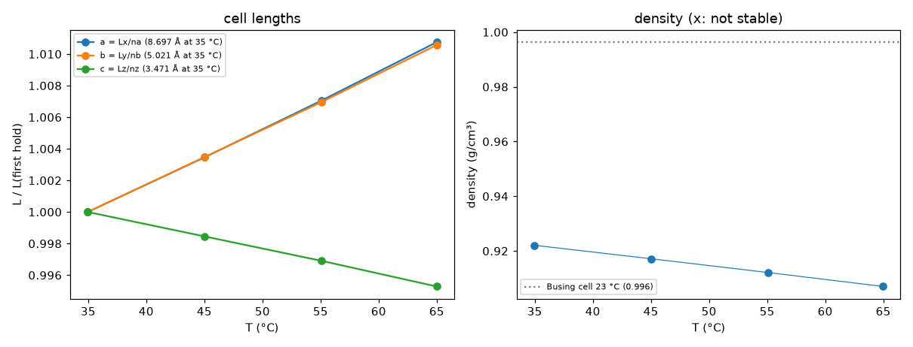
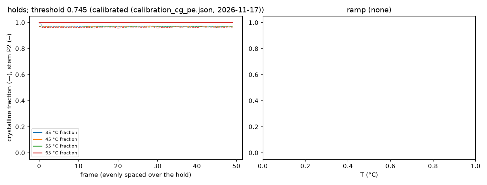
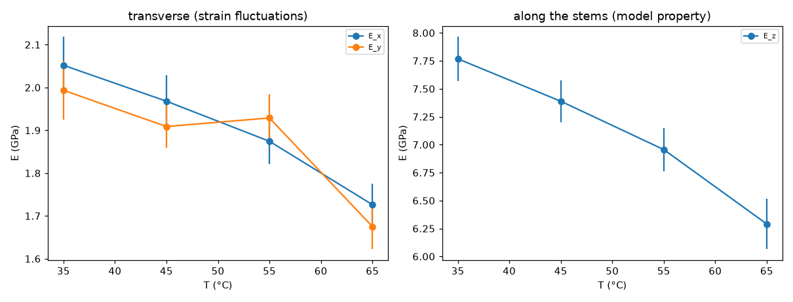

# Crystal analysis: pe_cg_crystal_7x10x27_s1 / crystal_fine_a

- system: `pe_cg_crystal_7x10x27_s1` (cg); source run directory `/home/rdyu/projects/che126_sims/results/runs/pe_cg_crystal_7x10x27_s1/crystal_fine_a` (status finished, node rdyu-server, run code commit b969a5e8c3)
- analysis: `sepsim analyze crystal` (D59), code commit 8b68bd2293 (dirty), 2026-11-23 17:44 on rdyu-server
- 140 stems x 27 sites, 7 x 10 x 27 repeats of pe_orthorhombic_busing (a 7.4069, b 4.9491, c 2.5511 Å at 23 °C, 0.9963 g/cm³, 18.33 Ų per chain)
- crystallinity: D26 local P2 with ring chords, r_c 6.31 Å, threshold 0.745 (**calibrated (calibration_cg_pe.json, 2026-11-17)**); stable hold: last frame fraction ≥ 0.8 and stem P2 ≥ 0.8

## Holds

Thermo after the first 10% of each hold (mean ± SEM). a = Lx/na, b = Ly/nb, c = Lz/nz (CG: rise per bead; UA: the 2-CH2 repeat). ρ/ρ_exp and A/A_exp against the Busing cell (0.9963 g/cm³, 18.33 Ų).

| T (°C) | a (Å) | b (Å) | c (Å) | a/b | ρ (g/cm³) | ρ/ρ_exp | A/chain (Ų) | A/A_exp | drift | crystalline (mean; first → last) | stem P2 (last) | largest cluster (last) | stable |
|---|---|---|---|---|---|---|---|---|---|---|---|---|---|
| 35.0 | 8.6974 ± 0.0004 | 5.0208 ± 0.0002 | 3.4709 ± 0.0001 | 1.732 | 0.9221 ± 0.0000 | 0.926 | 21.83 ± 0.00 | 1.191 | a_A, a_over_b | 1.000; 1.000 → 1.000 | 0.970 | 1.000 | True |
| 45.0 | 8.7276 ± 0.0003 | 5.0382 ± 0.0002 | 3.4655 ± 0.0001 | 1.732 | 0.9171 ± 0.0000 | 0.921 | 21.99 ± 0.00 | 1.200 | none | 1.000; 1.000 → 1.000 | 0.970 | 1.000 | True |
| 55.1 | 8.7588 ± 0.0004 | 5.0557 ± 0.0003 | 3.4601 ± 0.0002 | 1.732 | 0.9121 ± 0.0000 | 0.916 | 22.14 ± 0.00 | 1.208 | none | 1.000; 1.000 → 1.000 | 0.968 | 1.000 | True |
| 65.0 | 8.7909 ± 0.0005 | 5.0738 ± 0.0003 | 3.4545 ± 0.0002 | 1.733 | 0.9070 ± 0.0000 | 0.910 | 22.30 ± 0.00 | 1.217 | none | 1.000; 1.000 → 1.000 | 0.964 | 1.000 | True |

## Thermal expansion (stable holds)

Holds 35, 45, 55, 65 °C; α = d ln L/dT, OLS.

| quantity | α (10⁻⁴ K⁻¹) |
|---|---|
| a | 3.559 ± 0.042 |
| b | 3.494 ± 0.028 |
| c | -1.570 ± 0.018 |
| V | 5.482 ± 0.051 |

## Elastic constants (strain fluctuations)

Per hold (after the first 10%): ε_i = (L_i − ⟨L_i⟩)/⟨L_i⟩, S_ij = ⟨V⟩⟨ε_i ε_j⟩/(k_B T) with T the set point, over the normal strains of the orthogonal box (shear fixed; normal–shear couplings assumed zero by symmetry); E_i = 1/S_ii, ν_ij = −S_ij/S_ii, C = S⁻¹. ± is the bootstrap standard error over 100-row blocks (1000 draws). Rate-free (static, isothermal) constants; x, y transverse, z along the stems.

| T (°C) | blocks | E_x (GPa) | E_y (GPa) | E_z (GPa) | ν_xy | ν_yx | ν_xz | ν_yz | C11 | C22 | C33 | C12 | C13 | C23 | stable |
|---|---|---|---|---|---|---|---|---|---|---|---|---|---|---|---|
| 35 | 90 | 2.05 ± 0.07 | 1.99 ± 0.07 | 7.77 ± 0.20 | 0.250 ± 0.024 | 0.243 ± 0.022 | 0.115 ± 0.006 | 0.117 ± 0.006 | 2.4 ± 0.1 | 2.3 ± 0.1 | 9.0 ± 0.3 | 0.7 ± 0.1 | 1.4 ± 0.1 | 1.4 ± 0.1 | True |
| 45 | 90 | 1.97 ± 0.06 | 1.91 ± 0.05 | 7.39 ± 0.19 | 0.260 ± 0.023 | 0.252 ± 0.025 | 0.118 ± 0.006 | 0.122 ± 0.006 | 2.3 ± 0.1 | 2.3 ± 0.1 | 8.7 ± 0.3 | 0.8 ± 0.1 | 1.4 ± 0.1 | 1.4 ± 0.1 | True |
| 55 | 90 | 1.87 ± 0.05 | 1.93 ± 0.06 | 6.96 ± 0.19 | 0.217 ± 0.025 | 0.223 ± 0.025 | 0.134 ± 0.007 | 0.133 ± 0.007 | 2.2 ± 0.1 | 2.3 ± 0.1 | 8.4 ± 0.3 | 0.7 ± 0.1 | 1.4 ± 0.1 | 1.4 ± 0.1 | True |
| 65 | 90 | 1.73 ± 0.05 | 1.68 ± 0.05 | 6.29 ± 0.23 | 0.236 ± 0.027 | 0.229 ± 0.026 | 0.153 ± 0.008 | 0.139 ± 0.006 | 2.1 ± 0.0 | 2.0 ± 0.0 | 7.9 ± 0.3 | 0.7 ± 0.1 | 1.6 ± 0.1 | 1.5 ± 0.1 | True |

Halves check: E from the first vs the second half of the window (each with its own bootstrap error); **flag** when they differ by more than 2σ.

| T (°C) | E_x 1st → 2nd | E_y 1st → 2nd | E_z 1st → 2nd | flagged |
|---|---|---|---|---|
| 35 | 2.03 ± 0.09 → 2.07 ± 0.10 | 2.09 ± 0.11 → 1.91 ± 0.09 | 7.92 ± 0.27 → 7.63 ± 0.29 | none |
| 45 | 1.90 ± 0.07 → 2.04 ± 0.08 | 1.90 ± 0.07 → 1.91 ± 0.07 | 7.23 ± 0.27 → 7.56 ± 0.24 | none |
| 55 | 1.75 ± 0.07 → 2.01 ± 0.08 | 1.96 ± 0.08 → 1.90 ± 0.08 | 6.94 ± 0.31 → 7.00 ± 0.21 | E_x |
| 65 | 1.69 ± 0.08 → 1.76 ± 0.08 | 1.76 ± 0.09 → 1.60 ± 0.06 | 6.21 ± 0.34 → 6.38 ± 0.28 | none |

## Caveats

- A periodic perfect crystal of infinite stems has no surfaces, ends or defects to nucleate melting: it superheats, so a hold or ramp that stays crystalline bounds its stability from above; it is not the melting point.
- CG (SDK) beads carry no setting angle: the stems pack as the model prefers (a/b = √3 is hexagonal); a, b and c of the CG crystal are not the orthorhombic PE cell.
- The barostat is anisotropic (x, y, z independent, couple none); the stems stay along z only while the crystal holds.
- Elastic constants from the box-length fluctuations of the NPT holds (Parrinello-Rahman/Ray strain-fluctuation formula, T = the set point): the box is orthogonal, so the shear strains are fixed and only the normal-normal block of the compliance is sampled; it equals the normal block of the full S only if the normal-shear couplings vanish, assumed here by the orthorhombic (or pseudo-hexagonal, stems along z) symmetry. They are static (zero-rate, isothermal) constants of the model crystal, to compare with the rate-dependent tensile E_app; they rest on the MTK (Nose-Hoover) barostat sampling the NPT ensemble (Pdamp 1000 dt, frames 1 ps apart), and fluctuation estimates converge slowly: the halves check flags E that differ by more than 2 sigma between the first and second half of the hold.
- E_z is along the covalent stems, each bonded to its own periodic image (infinite chains with no ends or folds): a model property, an upper bound for real crystalline stems.

## Plots

**cell lengths and density per hold**

**crystallinity and stem P2**

**elastic moduli from strain fluctuations**

