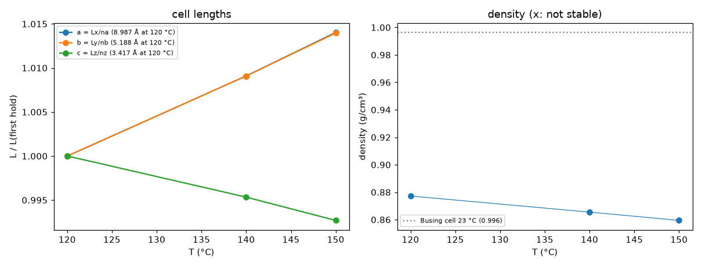

# Crystal analysis: pe_cg_crystal_7x10x27_s1 / crystal_fine_c

- system: `pe_cg_crystal_7x10x27_s1` (cg); source run directory `/home/rdyu/projects/che126_sims/results/runs/pe_cg_crystal_7x10x27_s1/crystal_fine_c` (status finished, node rdyu-server, run code commit b969a5e8c3)
- analysis: `sepsim analyze crystal` (D59), code commit a3fc627969 (dirty), 2026-11-22 16:03 on rdyu-server
- 140 stems x 27 sites, 7 x 10 x 27 repeats of pe_orthorhombic_busing (a 7.4069, b 4.9491, c 2.5511 Å at 23 °C, 0.9963 g/cm³, 18.33 Ų per chain)
- crystallinity: D26 local P2 with ring chords, r_c 6.31 Å, threshold 0.745 (**calibrated (calibration_cg_pe.json, 2026-11-17)**); stable hold: last frame fraction ≥ 0.8 and stem P2 ≥ 0.8

## Holds

Thermo after the first 10% of each hold (mean ± SEM). a = Lx/na, b = Ly/nb, c = Lz/nz (CG: rise per bead; UA: the 2-CH2 repeat). ρ/ρ_exp and A/A_exp against the Busing cell (0.9963 g/cm³, 18.33 Ų).

| T (°C) | a (Å) | b (Å) | c (Å) | a/b | ρ (g/cm³) | ρ/ρ_exp | A/chain (Ų) | A/A_exp | drift | crystalline (mean; first → last) | stem P2 (last) | largest cluster (last) | stable |
|---|---|---|---|---|---|---|---|---|---|---|---|---|---|
| 120.0 | 8.9875 ± 0.0006 | 5.1877 ± 0.0004 | 3.4171 ± 0.0003 | 1.732 | 0.8772 ± 0.0000 | 0.880 | 23.31 ± 0.00 | 1.272 | none | 0.997; 1.000 → 0.999 | 0.948 | 0.999 | True |
| 140.0 | 9.0690 ± 0.0006 | 5.2348 ± 0.0005 | 3.4012 ± 0.0003 | 1.732 | 0.8655 ± 0.0000 | 0.869 | 23.74 ± 0.00 | 1.295 | a_over_b | 0.994; 0.999 → 0.992 | 0.945 | 0.992 | True |
| 150.0 | 9.1135 ± 0.0006 | 5.2601 ± 0.0005 | 3.3921 ± 0.0003 | 1.733 | 0.8594 ± 0.0000 | 0.863 | 23.97 ± 0.00 | 1.308 | none | 0.991; 0.992 → 0.991 | 0.937 | 0.991 | True |

## Thermal expansion (stable holds)

Holds 120, 140, 150 °C; α = d ln L/dT, OLS.

| quantity | α (10⁻⁴ K⁻¹) |
|---|---|
| a | 4.632 ± 0.085 |
| b | 4.612 ± 0.070 |
| c | -2.433 ± 0.079 |
| V | 6.810 ± 0.077 |

## Caveats

- A periodic perfect crystal of infinite stems has no surfaces, ends or defects to nucleate melting: it superheats, so a hold or ramp that stays crystalline bounds its stability from above; it is not the melting point.
- CG (SDK) beads carry no setting angle: the stems pack as the model prefers (a/b = √3 is hexagonal); a, b and c of the CG crystal are not the orthorhombic PE cell.
- The barostat is anisotropic (x, y, z independent, couple none); the stems stay along z only while the crystal holds.

## Plots

**cell lengths and density per hold**

**crystallinity and stem P2**

