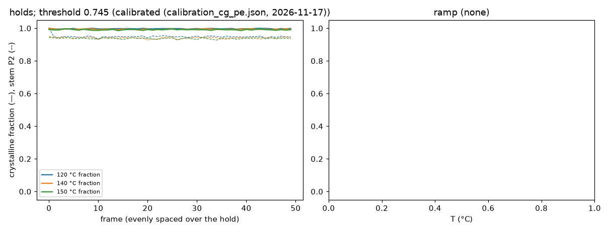
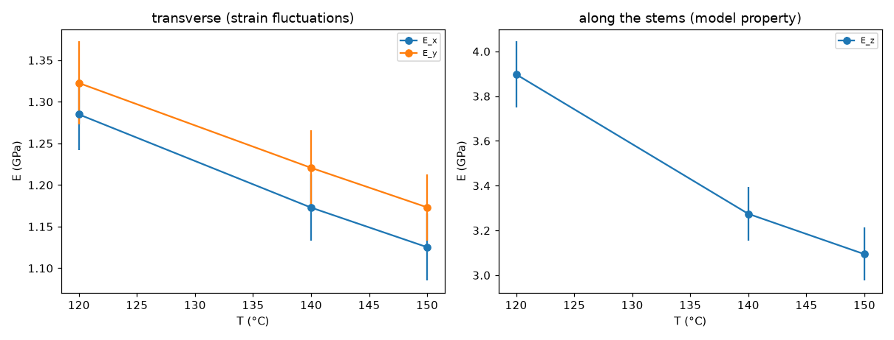

# Crystal analysis: pe_cg_crystal_7x10x27_s1 / crystal_fine_c

- system: `pe_cg_crystal_7x10x27_s1` (cg); source run directory `/home/rdyu/projects/che126_sims/results/runs/pe_cg_crystal_7x10x27_s1/crystal_fine_c` (status finished, node rdyu-server, run code commit b969a5e8c3)
- analysis: `sepsim analyze crystal` (D59), code commit dfacaa42f9 (dirty), 2026-11-23 18:26 on rdyu-server
- 140 stems x 27 sites, 7 x 10 x 27 repeats of pe_orthorhombic_busing (a 7.4069, b 4.9491, c 2.5511 Å at 23 °C, 0.9963 g/cm³, 18.33 Ų per chain)
- crystallinity: D26 local P2 with ring chords, r_c 6.31 Å, threshold 0.745 (**calibrated (calibration_cg_pe.json, 2026-11-17)**); stable hold: last frame fraction ≥ 0.8 and stem P2 ≥ 0.8

## Holds

Thermo after the first 10% of each hold (mean ± SEM). a = Lx/na, b = Ly/nb, c = Lz/nz (CG: rise per bead; UA: the 2-CH2 repeat). ρ/ρ_exp and A/A_exp against the Busing cell (0.9963 g/cm³, 18.33 Ų).

| T (°C) | a (Å) | b (Å) | c (Å) | a/b | ρ (g/cm³) | ρ/ρ_exp | A/chain (Ų) | A/A_exp | drift | crystalline (mean; first → last) | stem P2 (last) | largest cluster (last) | stable |
|---|---|---|---|---|---|---|---|---|---|---|---|---|---|
| 120.0 | 8.9875 ± 0.0006 | 5.1877 ± 0.0004 | 3.4171 ± 0.0003 | 1.732 | 0.8772 ± 0.0000 | 0.880 | 23.31 ± 0.00 | 1.272 | none | 0.997; 1.000 → 0.999 | 0.948 | 0.999 | True |
| 140.0 | 9.0690 ± 0.0006 | 5.2348 ± 0.0005 | 3.4012 ± 0.0003 | 1.732 | 0.8655 ± 0.0000 | 0.869 | 23.74 ± 0.00 | 1.295 | a_over_b | 0.994; 0.999 → 0.992 | 0.945 | 0.992 | True |
| 150.0 | 9.1135 ± 0.0006 | 5.2601 ± 0.0005 | 3.3921 ± 0.0003 | 1.733 | 0.8594 ± 0.0000 | 0.863 | 23.97 ± 0.00 | 1.308 | none | 0.991; 0.992 → 0.991 | 0.937 | 0.991 | True |

## Thermal expansion (stable holds)

Holds 120, 140, 150 °C; α = d ln L/dT, OLS.

| quantity | α (10⁻⁴ K⁻¹) |
|---|---|
| a | 4.632 ± 0.085 |
| b | 4.612 ± 0.070 |
| c | -2.433 ± 0.079 |
| V | 6.810 ± 0.077 |

## Elastic constants (strain fluctuations)

Per hold (after the first 10%): ε_i = (L_i − ⟨L_i⟩)/⟨L_i⟩, S_ij = ⟨V⟩⟨ε_i ε_j⟩/(k_B T) with T the set point, over the normal strains of the orthogonal box (shear fixed; normal–shear couplings assumed zero by symmetry); E_i = 1/S_ii, ν_ij = −S_ij/S_ii, C = S⁻¹. ± is the bootstrap standard error over 100-row blocks (1000 draws). Rate-free (static, isothermal) constants; x, y transverse, z along the stems.

| T (°C) | blocks | E_x (GPa) | E_y (GPa) | E_z (GPa) | ν_xy | ν_yx | ν_xz | ν_yz | C11 | C22 | C33 | C12 | C13 | C23 | stable |
|---|---|---|---|---|---|---|---|---|---|---|---|---|---|---|---|
| 120 | 90 | 1.28 ± 0.04 | 1.32 ± 0.05 | 3.90 ± 0.15 | 0.196 ± 0.026 | 0.202 ± 0.026 | 0.199 ± 0.011 | 0.203 ± 0.011 | 1.7 ± 0.0 | 1.7 ± 0.0 | 5.6 ± 0.2 | 0.6 ± 0.0 | 1.4 ± 0.1 | 1.4 ± 0.0 | True |
| 140 | 90 | 1.17 ± 0.04 | 1.22 ± 0.05 | 3.27 ± 0.12 | 0.161 ± 0.028 | 0.167 ± 0.030 | 0.215 ± 0.009 | 0.231 ± 0.013 | 1.5 ± 0.0 | 1.6 ± 0.0 | 4.8 ± 0.2 | 0.5 ± 0.0 | 1.3 ± 0.0 | 1.3 ± 0.0 | True |
| 150 | 90 | 1.13 ± 0.04 | 1.17 ± 0.04 | 3.09 ± 0.12 | 0.168 ± 0.029 | 0.175 ± 0.031 | 0.232 ± 0.011 | 0.207 ± 0.012 | 1.5 ± 0.0 | 1.5 ± 0.0 | 4.5 ± 0.1 | 0.5 ± 0.0 | 1.2 ± 0.0 | 1.2 ± 0.0 | True |

Halves check: E from the first vs the second half of the window (each with its own bootstrap error); **flag** when they differ by more than 2σ.

| T (°C) | E_x 1st → 2nd | E_y 1st → 2nd | E_z 1st → 2nd | flagged |
|---|---|---|---|---|
| 120 | 1.24 ± 0.06 → 1.33 ± 0.06 | 1.35 ± 0.07 → 1.30 ± 0.08 | 4.03 ± 0.23 → 3.78 ± 0.18 | none |
| 140 | 1.18 ± 0.05 → 1.17 ± 0.06 | 1.15 ± 0.07 → 1.30 ± 0.05 | 3.13 ± 0.20 → 3.44 ± 0.14 | none |
| 150 | 1.14 ± 0.05 → 1.11 ± 0.06 | 1.12 ± 0.06 → 1.24 ± 0.05 | 3.02 ± 0.19 → 3.17 ± 0.16 | none |

## Setting angle (herringbone)

No setting angle at CG: the beads carry no zigzag plane.

## Caveats

- A periodic perfect crystal of infinite stems has no surfaces, ends or defects to nucleate melting: it superheats, so a hold or ramp that stays crystalline bounds its stability from above; it is not the melting point.
- CG (SDK) beads carry no setting angle: the stems pack as the model prefers (a/b = √3 is hexagonal); a, b and c of the CG crystal are not the orthorhombic PE cell.
- The barostat is anisotropic (x, y, z independent, couple none); the stems stay along z only while the crystal holds.
- Elastic constants from the box-length fluctuations of the NPT holds (Parrinello-Rahman/Ray strain-fluctuation formula, T = the set point): the box is orthogonal, so the shear strains are fixed and only the normal-normal block of the compliance is sampled; it equals the normal block of the full S only if the normal-shear couplings vanish, assumed here by the orthorhombic (or pseudo-hexagonal, stems along z) symmetry. They are static (zero-rate, isothermal) constants of the model crystal, to compare with the rate-dependent tensile E_app; they rest on the MTK (Nose-Hoover) barostat sampling the NPT ensemble (Pdamp 1000 dt, frames 1 ps apart), and fluctuation estimates converge slowly: the halves check flags E that differ by more than 2 sigma between the first and second half of the hold.
- E_z is along the covalent stems, each bonded to its own periodic image (infinite chains with no ends or folds): a model property, an upper bound for real crystalline stems.

## Plots

**cell lengths and density per hold**

**crystallinity and stem P2**

**elastic moduli from strain fluctuations**

