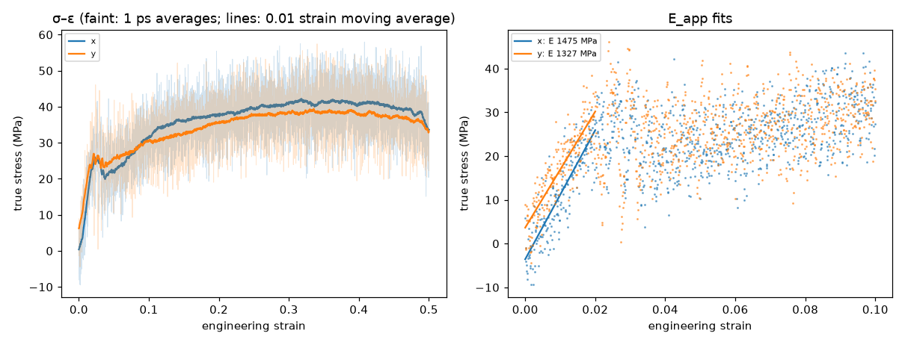
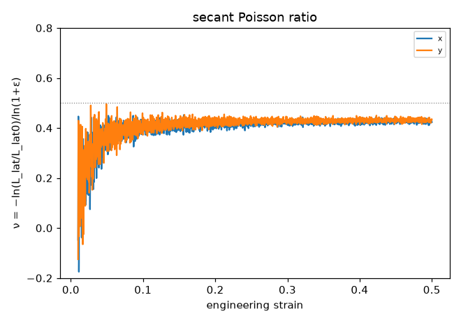

# Tensile analysis (D54)

Generated 2026-11-23T17:15:51+00:00. E_app and ν fitted over the steepest 0.02-wide strain window before the peak (largest slope of the smoothed stress; window in the E_app column); peak after a 0.01-strain moving average; flow stress = mean true stress over ε ∈ [0.3, 0.5]. True stress σ = −(P_axis − p_atm), tension positive; engineering stress σ·A/A0.

## pe_cg_crystal_7x10x27_s1 / tensile_85C

- 85 °C, 1e+08 s⁻¹ to strain 0.5, lateral 1 atm; status finished on rdyu-server; `/home/rdyu/projects/che126_sims/results/runs/pe_cg_crystal_7x10x27_s1/tensile_85C`

| axis | strain reached | E_app (MPa) | ν (fit) | ν (run) | σ_peak (MPa) | ε_peak | flow σ (MPa) | T (K) |
|---|---|---|---|---|---|---|---|---|
| x | 0.500 | 1475 ± 60 (ε 0.000–0.020) | 0.18 | 0.44 | 42.2 | 0.318 | 40.3 | 358.1 |
| y | 0.500 | 1327 ± 55 (ε 0.000–0.020) | 0.19 | 0.44 | 39.4 | 0.335 | 37.7 | 358.1 |
| mean ± SD | | 1401 ± 104 | 0.19 ± 0.00 | 0.44 ± 0.00 | 40.8 ± 2.0 | 0.327 ± 0.012 | 39.0 ± 1.9 | |

## Caveats

- The box is a defect-free periodic single crystal (D59: straight stems along z, each bonded to its own periodic image; no chain ends, amorphous phase, grain boundaries or lamellar interfaces), so these are not the moduli of a semicrystalline separator.
- The load is transverse to the chain axis (x, y): E_app is the transverse modulus of the crystal, governed by the interchain non-bonded (van der Waals) interactions, and much lower than the modulus along the covalent chain axis (z, not a default axis).
- E_app is the apparent modulus at the simulated strain rate, many orders of magnitude above experiment; E_app and the peak stress are rate-dependent.
- The peak is the transverse yield or failure of a perfect crystal (an ideal strength: no defects or interfaces to start it), not the yield stress of a separator; the flow stress after it is that of the yielded crystal, not a viscous melt flow.
- ν is biased at high rate: the lateral barostat (Pdamp = 1000 dt, the two lateral axes independent, couple none) lags the imposed strain. The two lateral axes are inequivalent (one transverse, one along the stems) and contract differently, so ν, their mean, is not an isotropic Poisson ratio (per-axis lateral strains in results.json).
- Stress is -(P_axis - p_atm) from the virial pressure tensor averaged over avg_ps; the axes of one run start from the same snapshot, so their spread is not a full independent-sample error.
- --fit steepest: E_app comes from the steepest window before the peak, which skips a soft toe at small strain (e.g. the UA crystal at 1e9 /s); the maximum over windows biases E_app up by about its noise.

## Plots

**stress–strain and E_app fits**

**secant Poisson ratio vs strain**

