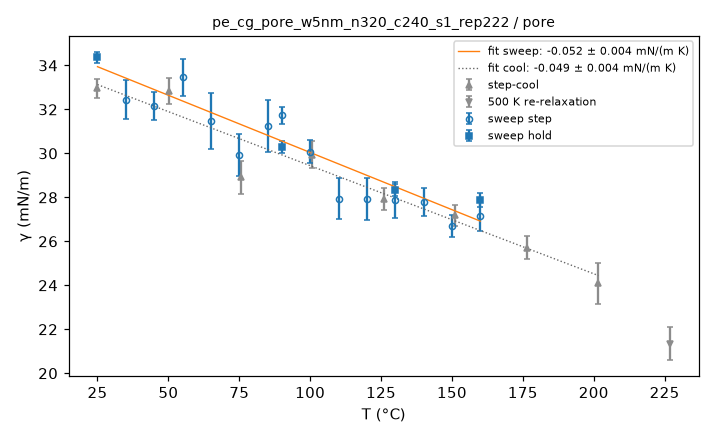
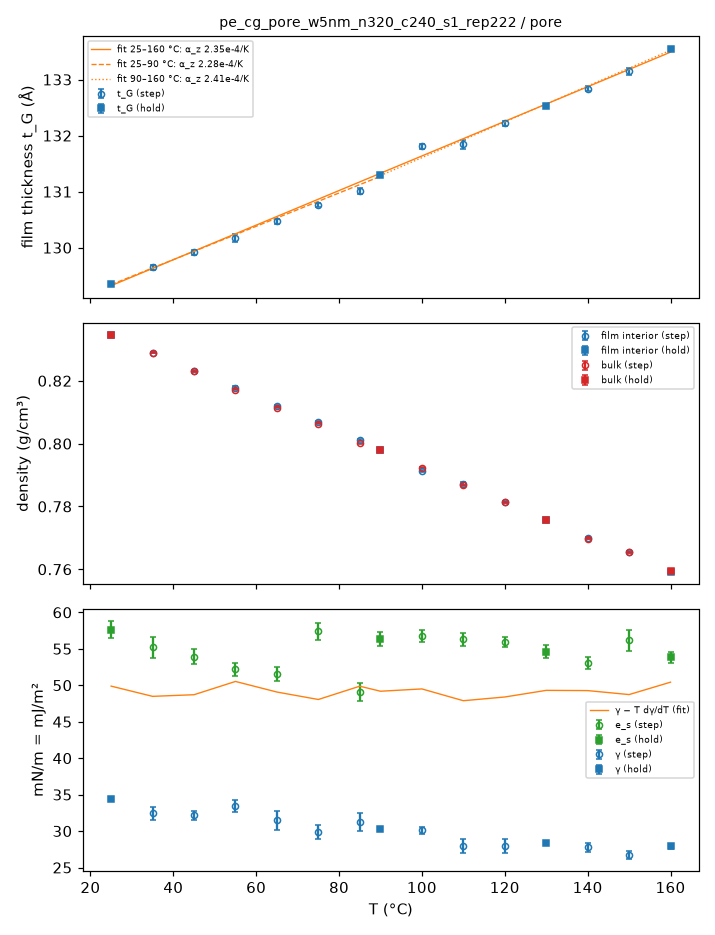
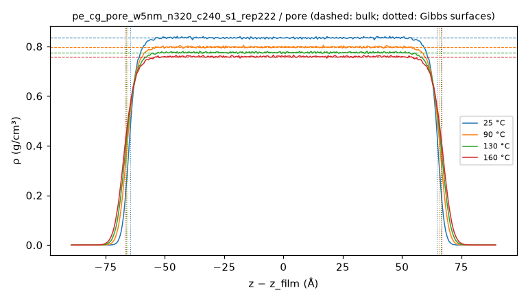
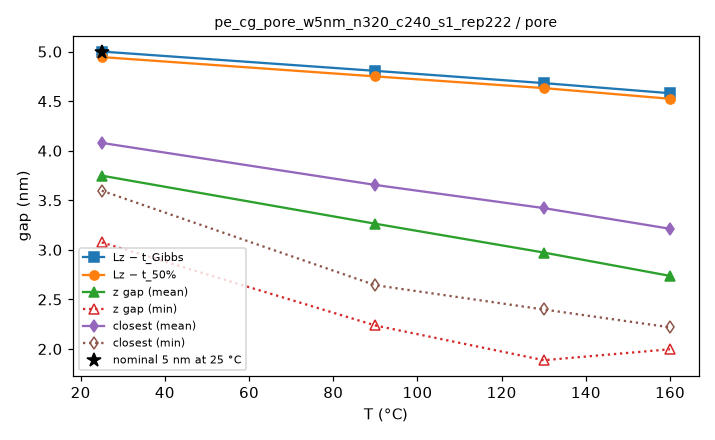
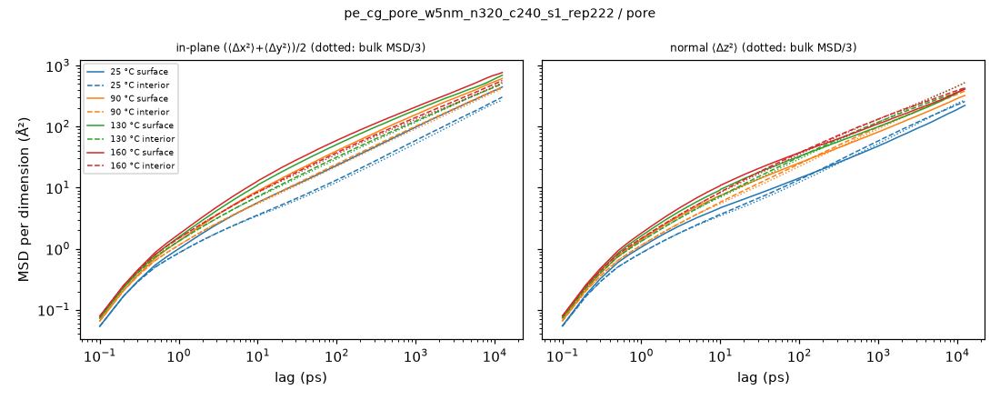
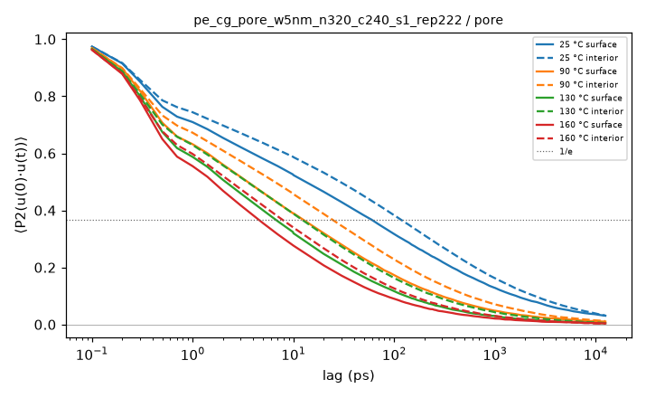
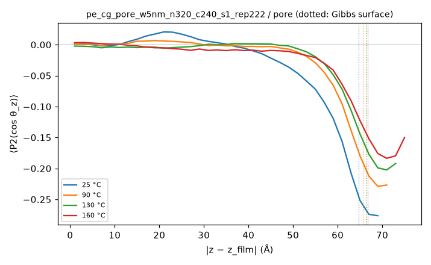
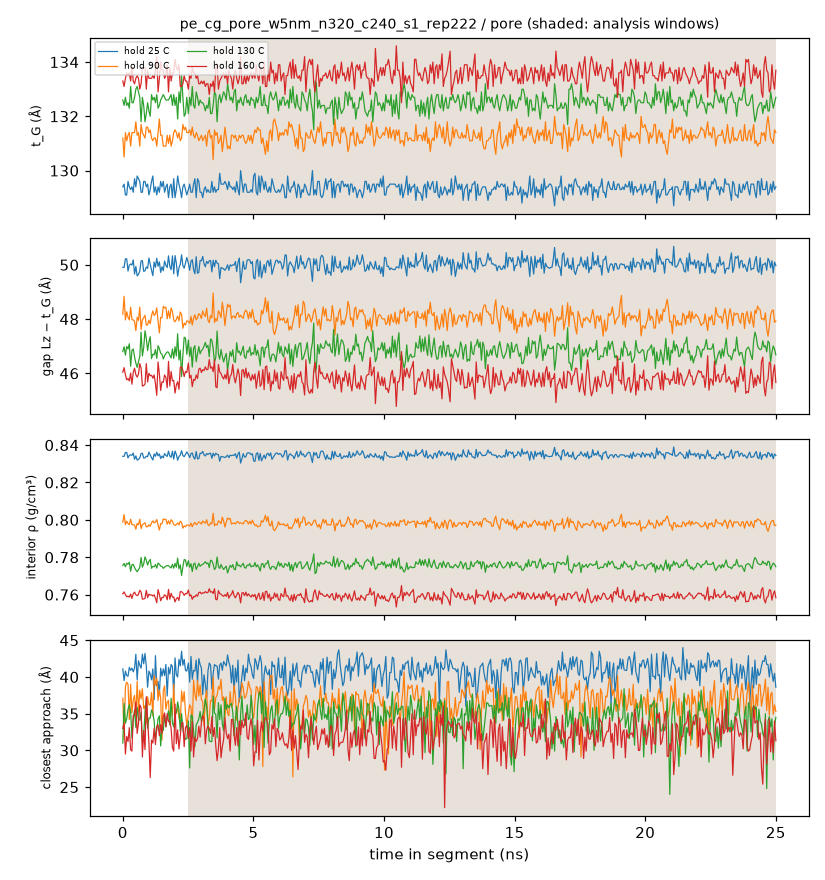
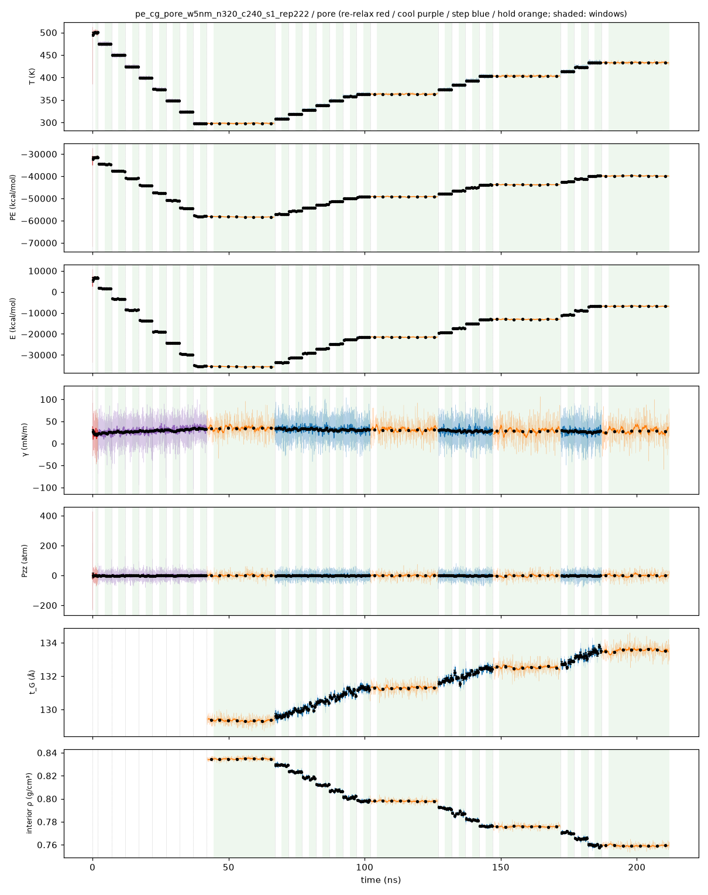
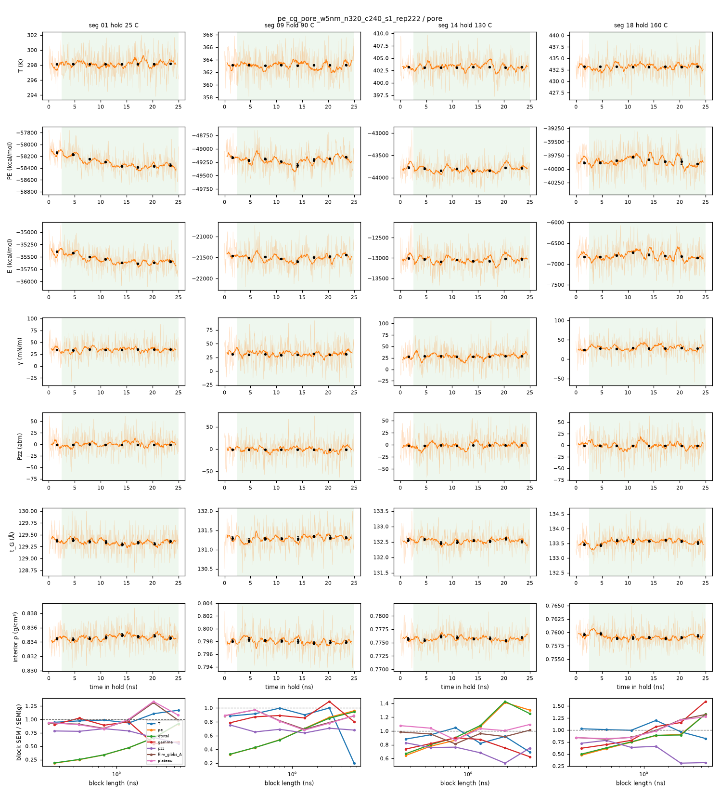

# Pore analysis: pe_cg_pore_w5nm_n320_c240_s1_rep222 / pore

- system: `pe_cg_pore_w5nm_n320_c240_s1_rep222` (cg); source run directory `/home/rdyu/projects/che126_sims/results/runs/pe_cg_pore_w5nm_n320_c240_s1_rep222/pore` (status finished, node rdyu-rog, run code commit 79b6d2d98a)
- analysis: `sepsim analyze pore` (D51), code commit 56b2b8890f (dirty), 2026-10-30 18:29 on rdyu-server
- pore: nominal width 5 nm at 25 °C, wall 129.4 Å at 25 °C, Lz 179.35 Å (fixed), slab mass 1077903 g/mol; units real
- windows: steps, cool stages and the re-relaxation second half (50% of rows dropped); holds without the first 10% of rows; SEM from the statistical inefficiency (D26)
- bulk reference: `/home/rdyu/projects/worktrees/rerun-analyses/results/analysis/pe_cg_amorph_n40_c240_s1/sweep/results.json`

## Segments: box, pressure tensor and surface tension

γ = (Lz/2)[Pzz − (Pxx+Pyy)/2] per surface (two surfaces), mean ± SEM of the instantaneous series.

| # | segment | T set (°C) | window (ns) | T (°C) | Lx (Å) | Ly (Å) | Pxx (atm) | Pyy (atm) | Pzz (atm) | γ (mN/m) | drift |
|---|---|---|---|---|---|---|---|---|---|---|---|
|  | Stage 2: surface re-relaxation 2000 ps NVT at 500 K after narrowing | 226.9 | 1.00 | 226.82 ± 0.09 | 135.037 | 135.037 | -24.3 ± 0.9 | -25.9 ± 1.2 | -1.6 ± 0.7 | 21.35 ± 0.75 |  |
|  | Stage 3 cool 1/8 (474.8 K) | 201.6 | 2.50 | 201.66 ± 0.06 | 134.230 | 134.230 | -27.3 ± 1.5 | -29.4 ± 0.7 | -1.8 ± 0.5 | 24.10 ± 0.93 | gamma |
|  | Stage 3 cool 2/8 (449.5 K) | 176.4 | 2.50 | 176.44 ± 0.05 | 133.403 | 133.403 | -29.4 ± 0.8 | -29.8 ± 0.5 | -1.3 ± 0.5 | 25.71 ± 0.52 | pe |
|  | Stage 3 cool 3/8 (424.3 K) | 151.2 | 2.50 | 151.13 ± 0.04 | 132.618 | 132.618 | -31.3 ± 0.5 | -31.1 ± 0.5 | -1.3 ± 0.5 | 27.18 ± 0.48 |  |
|  | Stage 3 cool 4/8 (399.1 K) | 125.9 | 2.50 | 125.96 ± 0.08 | 131.830 | 131.830 | -32.6 ± 1.1 | -32.8 ± 0.9 | -2.0 ± 0.5 | 27.93 ± 0.49 |  |
|  | Stage 3 cool 5/8 (373.8 K) | 100.7 | 2.50 | 100.63 ± 0.05 | 131.047 | 131.047 | -34.0 ± 1.0 | -34.5 ± 0.8 | -1.3 ± 0.4 | 29.94 ± 0.62 |  |
|  | Stage 3 cool 6/8 (348.6 K) | 75.46 | 2.50 | 75.44 ± 0.04 | 130.289 | 130.289 | -32.7 ± 1.1 | -33.5 ± 0.6 | -1.3 ± 0.5 | 28.91 ± 0.74 | gamma |
|  | Stage 3 cool 7/8 (323.4 K) | 50.23 | 2.50 | 50.23 ± 0.03 | 129.547 | 129.547 | -37.4 ± 0.6 | -37.5 ± 0.6 | -1.3 ± 0.4 | 32.84 ± 0.57 |  |
|  | Stage 3 cool 8/8 (298.1 K) | 25 | 2.50 | 25.00 ± 0.03 | 128.743 | 128.743 | -36.5 ± 0.7 | -37.7 ± 1.3 | -0.8 ± 0.4 | 32.96 ± 0.43 | pe |
| 1 | hold | 25 | 22.50 | 24.99 ± 0.01 | 128.762 | 128.762 | -38.2 ± 0.3 | -39.0 ± 0.3 | -0.8 ± 0.1 | 34.37 ± 0.26 | pe |
| 2 | step | 35 | 2.50 | 35.03 ± 0.04 | 129.052 | 129.052 | -36.9 ± 0.7 | -36.6 ± 1.1 | -1.0 ± 0.4 | 32.45 ± 0.90 | gamma |
| 3 | step | 45 | 2.50 | 44.97 ± 0.03 | 129.366 | 129.366 | -36.3 ± 0.6 | -36.5 ± 1.0 | -1.1 ± 0.4 | 32.15 ± 0.65 | pe |
| 4 | step | 55 | 2.50 | 55.05 ± 0.03 | 129.671 | 129.671 | -36.7 ± 0.9 | -38.6 ± 1.2 | -0.9 ± 0.4 | 33.45 ± 0.84 | film_gibbs |
| 5 | step | 65 | 2.50 | 64.99 ± 0.03 | 129.977 | 129.977 | -34.9 ± 1.4 | -36.8 ± 1.2 | -1.2 ± 0.5 | 31.48 ± 1.28 | pe |
| 6 | step | 75 | 2.50 | 74.94 ± 0.04 | 130.250 | 130.250 | -31.4 ± 0.9 | -36.4 ± 1.2 | -0.9 ± 0.4 | 29.94 ± 0.96 | pe, gamma |
| 7 | step | 85 | 2.50 | 84.99 ± 0.04 | 130.585 | 130.585 | -34.5 ± 0.9 | -36.4 ± 1.4 | -1.1 ± 0.4 | 31.24 ± 1.19 | gamma |
| 8 | step | 90 | 2.50 | 89.93 ± 0.04 | 130.706 | 130.706 | -35.9 ± 0.7 | -36.1 ± 0.6 | -1.1 ± 0.4 | 31.73 ± 0.40 | pe |
| 9 | hold | 90 | 22.50 | 89.98 ± 0.01 | 130.706 | 130.706 | -34.6 ± 0.3 | -34.6 ± 0.3 | -1.3 ± 0.1 | 30.29 ± 0.26 |  |
| 10 | step | 100 | 2.50 | 100.00 ± 0.07 | 131.012 | 131.012 | -34.9 ± 0.6 | -34.1 ± 0.9 | -1.4 ± 0.4 | 30.08 ± 0.54 |  |
| 11 | step | 110 | 2.50 | 110.03 ± 0.04 | 131.320 | 131.320 | -31.9 ± 0.6 | -31.0 ± 1.0 | -0.7 ± 0.5 | 27.95 ± 0.91 |  |
| 12 | step | 120 | 2.50 | 119.97 ± 0.04 | 131.627 | 131.627 | -33.2 ± 0.9 | -31.4 ± 0.6 | -1.6 ± 0.5 | 27.94 ± 0.95 |  |
| 13 | step | 130 | 2.50 | 129.99 ± 0.05 | 131.945 | 131.945 | -31.7 ± 0.6 | -32.0 ± 1.0 | -1.2 ± 0.5 | 27.88 ± 0.83 | gamma |
| 14 | hold | 130 | 22.50 | 130.01 ± 0.02 | 131.945 | 131.945 | -32.1 ± 0.3 | -33.0 ± 0.3 | -1.4 ± 0.1 | 28.33 ± 0.28 |  |
| 15 | step | 140 | 2.50 | 140.04 ± 0.04 | 132.279 | 132.279 | -30.9 ± 0.7 | -32.7 ± 1.2 | -1.2 ± 0.4 | 27.77 ± 0.64 |  |
| 16 | step | 150 | 2.50 | 150.02 ± 0.05 | 132.529 | 132.529 | -29.0 ± 0.7 | -31.7 ± 0.7 | -1.0 ± 0.5 | 26.71 ± 0.50 |  |
| 17 | step | 160 | 2.50 | 159.90 ± 0.06 | 132.872 | 132.872 | -30.4 ± 0.8 | -33.0 ± 0.9 | -1.8 ± 0.5 | 27.17 ± 0.69 | pe |
| 18 | hold | 160 | 22.50 | 160.01 ± 0.02 | 132.872 | 132.872 | -33.3 ± 0.3 | -30.9 ± 0.4 | -1.4 ± 0.2 | 27.89 ± 0.33 |  |

## Surface tension vs T

SEM-weighted linear fit of γ in T, one point per temperature (hold where there is one); errors 1σ, scaled by √χ²_red when χ²_red > 1.

| branch | points | T range (°C) | dγ/dT (mN m⁻¹ K⁻¹) | γ(25 °C) from fit (mN/m) | χ²_red |
|---|---|---|---|---|---|
| heating (sweep) | 15 | 25–160 | -0.0520 ± 0.0035 | 33.94 | 1.99 |
| cooling (step-cool) | 8 | 25–202 | -0.0492 ± 0.0044 | 33.13 | 1.63 |

## Thermal analysis over the sweep grid

One point per set T (the hold where there is one). Film thickness t_G (Gibbs) and the interior plateau density from the segment's DCD (steps: second half; holds: without the first 10%; ≤ max-frames frames; SEM over frames); E = TotEng (NVT thermo window). Surface excess energy per surface e_s = (E_pore − (M_pore/M_bulk) E_bulk(T))/(2A), E_bulk from the bulk sweep at the same set T; γ − T dγ/dT with the sweep fit slope (should ≈ e_s).

| T (°C) | seg | t_G (Å) | ρ plateau (g/cm³) | ρ bulk (g/cm³) | Δρ/ρ bulk | Lx (Å) | E (kcal/mol) | γ (mN/m) | e_s (mJ/m²) | γ − T dγ/dT (mJ/m²) |
|---|---|---|---|---|---|---|---|---|---|---|
| 25 | hold | 129.34 ± 0.01 | 0.8347 ± 0.0001 | 0.8345 ± 0.0001 | +0.02% | 128.762 | -35558.9 ± 42.7 | 34.37 ± 0.26 | 57.6 ± 1.2 | 49.9 |
| 35 | step | 129.65 ± 0.04 | 0.8290 ± 0.0003 | 0.8290 ± 0.0002 | -0.00% | 129.052 | -33568.4 ± 26.1 | 32.45 ± 0.90 | 55.2 ± 1.5 | 48.5 |
| 45 | step | 129.92 ± 0.05 | 0.8232 ± 0.0003 | 0.8230 ± 0.0001 | +0.03% | 129.366 | -31318.5 ± 30.0 | 32.15 ± 0.65 | 53.9 ± 1.0 | 48.7 |
| 55 | step | 130.17 ± 0.07 | 0.8178 ± 0.0005 | 0.8172 ± 0.0001 | +0.07% | 129.671 | -29127.7 ± 9.8 | 33.45 ± 0.84 | 52.2 ± 0.9 | 50.5 |
| 65 | step | 130.47 ± 0.04 | 0.8120 ± 0.0003 | 0.8114 ± 0.0001 | +0.07% | 129.977 | -26965.9 ± 20.9 | 31.48 ± 1.28 | 51.5 ± 1.0 | 49.1 |
| 75 | step | 130.76 ± 0.04 | 0.8068 ± 0.0003 | 0.8063 ± 0.0001 | +0.07% | 130.250 | -24741.7 ± 39.6 | 29.94 ± 0.96 | 57.4 ± 1.2 | 48.0 |
| 85 | step | 131.02 ± 0.06 | 0.8012 ± 0.0003 | 0.8001 ± 0.0001 | +0.13% | 130.585 | -22654.2 ± 14.2 | 31.24 ± 1.19 | 49.1 ± 1.3 | 49.9 |
| 90 | hold | 131.29 ± 0.01 | 0.7980 ± 0.0001 | 0.7978 ± 0.0001 | +0.02% | 130.706 | -21503.9 ± 21.4 | 30.29 ± 0.26 | 56.4 ± 1.0 | 49.2 |
| 100 | step | 131.81 ± 0.05 | 0.7912 ± 0.0003 | 0.7923 ± 0.0001 | -0.15% | 131.012 | -19354.5 ± 14.1 | 30.08 ± 0.54 | 56.7 ± 0.8 | 49.5 |
| 110 | step | 131.84 ± 0.08 | 0.7872 ± 0.0005 | 0.7868 ± 0.0002 | +0.06% | 131.320 | -17222.3 ± 11.3 | 27.95 ± 0.91 | 56.3 ± 0.9 | 47.9 |
| 120 | step | 132.22 ± 0.04 | 0.7814 ± 0.0003 | 0.7813 ± 0.0001 | +0.01% | 131.627 | -15132.2 ± 18.4 | 27.94 ± 0.95 | 56.0 ± 0.7 | 48.4 |
| 130 | hold | 132.53 ± 0.02 | 0.7758 ± 0.0001 | 0.7758 ± 0.0001 | -0.00% | 131.945 | -13050.0 ± 9.5 | 28.33 ± 0.28 | 54.6 ± 0.9 | 49.3 |
| 140 | step | 132.84 ± 0.05 | 0.7700 ± 0.0003 | 0.7698 ± 0.0001 | +0.03% | 132.279 | -10867.6 ± 15.3 | 27.77 ± 0.64 | 53.0 ± 0.8 | 49.3 |
| 150 | step | 133.14 ± 0.06 | 0.7654 ± 0.0004 | 0.7654 ± 0.0002 | -0.01% | 132.529 | -8918.4 ± 25.4 | 26.71 ± 0.50 | 56.2 ± 1.5 | 48.7 |
| 160 | hold | 133.55 ± 0.02 | 0.7592 ± 0.0001 | 0.7594 ± 0.0001 | -0.03% | 132.872 | -6802.7 ± 14.4 | 27.89 ± 0.33 | 53.8 ± 0.8 | 50.4 |

Surface entropy per area −dγ/dT = 0.0520 ± 0.0035 mJ m⁻² K⁻¹ (sweep fit).

Expansion: α_z = (1/t_G) dt_G/dT (film normal, SEM-weighted, errors ×√χ²_red when > 1); α_L = (1/2A) dA/dT of the imposed box area (D48: follows the bulk density, so ≈ bulk α_V/3 by construction); film α_V = α_z + 2 α_L. Cv = dE/dT per gram (classical, NVT) next to the bulk classical Cp.

| window (°C) | points | α_z (10⁻⁴ K⁻¹) | χ²_red | α_L (10⁻⁴ K⁻¹) | film α_V (10⁻⁴ K⁻¹) | bulk α_V/3 | bulk α_V | Cv (J g⁻¹ K⁻¹) | bulk Cp (J g⁻¹ K⁻¹) |
|---|---|---|---|---|---|---|---|---|---|
| 25–160 | 15 | 2.350 ± 0.020 | 4.98 | 2.323 | 6.996 | 2.322 | 6.966 | 0.830 ± 0.003 | 0.826 |
| 25–90 | 8 | 2.282 ± 0.026 | 1.68 | 2.319 | 6.920 | 2.308 | 6.925 | 0.843 ± 0.003 | 0.843 |
| 90–160 | 8 | 2.412 ± 0.047 | 4.66 | 2.344 | 7.099 | 2.349 | 7.047 | 0.814 ± 0.003 | 0.818 |

## Density profile, film thickness and gap (holds)

ρ(z) is the mass density about the film's mass centre (periodic z, film centred per frame) over ≤ 500 evenly spaced hold frames, symmetrized; plateau = mean over |z| < t_G/2 − 15 Å (SEM over frames); t_G = M/(ρ_plateau A) (equimolar Gibbs surfaces), t_50 between the 50%-of-plateau crossings; gap = Lz − film. Clear gap per frame: z gap = Lz − z extent of all atoms; closest = smallest 3-D distance across the slit (periodic image).

| T (°C) | frames | ρ plateau (g/cm³) | ρ bulk (g/cm³) | Δρ/ρ bulk | t_G (Å) | t_50 (Å) | gap_G (Å) | gap_50 (Å) | z gap mean / min (Å) | closest mean / min (Å) |
|---|---|---|---|---|---|---|---|---|---|---|
| 25 | 450 | 0.8347 ± 0.0001 | 0.8345 ± 0.0001 | +0.02% | 129.34 | 129.90 | 50.01 | 49.45 | 37.5 / 30.8 | 40.8 / 36.0 |
| 90 | 450 | 0.7980 ± 0.0001 | 0.7978 ± 0.0001 | +0.02% | 131.29 | 131.85 | 48.06 | 47.50 | 32.6 / 22.4 | 36.6 / 26.4 |
| 130 | 450 | 0.7758 ± 0.0001 | 0.7758 ± 0.0001 | -0.00% | 132.53 | 133.03 | 46.82 | 46.32 | 29.7 / 18.9 | 34.2 / 24.0 |
| 160 | 450 | 0.7592 ± 0.0001 | 0.7594 ± 0.0001 | -0.03% | 133.55 | 134.11 | 45.80 | 45.24 | 27.4 / 20.0 | 32.1 / 22.2 |

Gibbs gap at 25 °C 5.001 nm vs nominal 5 nm (the nominal width uses the bulk density, D48).

Interfacial width: 10–90 distance of each surface (outermost crossings of 90% and 10% of the plateau) and the 10–90 width 2 atanh(0.8) δ of a tanh fit ρ_p/2 [1 − tanh((|z| − h)/δ)] to the symmetrized profile.

| T (°C) | 10–90 lower (Å) | 10–90 upper (Å) | tanh δ (Å) | tanh 10–90 (Å) | tanh h (Å) |
|---|---|---|---|---|---|
| 25 | 7.00 | 6.65 | 3.02 ± 0.03 | 6.63 | 64.85 |
| 90 | 8.20 | 8.03 | 3.62 ± 0.03 | 7.95 | 65.82 |
| 130 | 8.77 | 8.77 | 3.96 ± 0.03 | 8.69 | 66.43 |
| 160 | 9.28 | 9.25 | 4.24 ± 0.03 | 9.31 | 66.94 |

## Mobility by layer (holds)

Backbone sites (CG: beads; UA/AA: backbone carbons), positions relative to the system's mass centre, layer at the time origin; ≤ 200 origins per lag (hold DCD, lags ≥ its frame interval) and ≤ 50 per burst (D46 bursts, shorter lags). MSD per dimension (Ų): in-plane xy = (⟨Δx²⟩+⟨Δy²⟩)/2, normal z = ⟨Δz²⟩, bulk = MSD/3 of the bulk hold. P2 1/e: first 1/e crossing of ⟨P2(u(0)·u(t))⟩ of backbone bonds (layer of the bond midpoint at the origin).

| T (°C) | layer | site fraction | xy / z @ 10 ps | xy / z @ 100 ps | xy / z @ 1 ns | xy / z @ max | P2 1/e (ps) |
|---|---|---|---|---|---|---|---|
| 25 | interior | 0.77 | 3.6 / 3.6 | 13.4 / 13.5 | 59.4 / 58.4 | 306.3 / 259.2 | 116.3 |
| 25 | surface | 0.23 | 5.7 / 4.7 | 23.2 / 14.4 | 98.3 / 48.2 | 447.9 / 223.1 | 59.4 |
| 25 | film | 1.00 | 4.1 / 3.9 | 15.7 / 13.7 | 68.4 / 56.0 | 339.2 / 250.8 | 99.8 |
| 25 | bulk | | 3.5 | 12.3 | 52.7 | 271.9 | 122.9 |
| 90 | interior | 0.77 | 5.7 / 5.8 | 24.4 / 24.5 | 101.6 / 98.5 | 446.3 / 385.0 | 24.8 |
| 90 | surface | 0.23 | 8.8 / 7.4 | 40.2 / 25.5 | 157.8 / 81.9 | 616.4 / 324.8 | 13.2 |
| 90 | film | 1.00 | 6.4 / 6.2 | 28.0 / 24.7 | 114.4 / 94.7 | 485.2 / 371.2 | 21.1 |
| 90 | bulk | | 5.5 | 22.3 | 91.9 | 426.6 | 25.5 |
| 130 | interior | 0.77 | 7.2 / 7.3 | 31.7 / 31.9 | 123.4 / 118.9 | 506.7 / 417.4 | 12.8 |
| 130 | surface | 0.23 | 11.1 / 9.4 | 51.0 / 32.6 | 187.1 / 100.0 | 697.3 / 425.2 | 6.7 |
| 130 | film | 1.00 | 8.1 / 7.8 | 36.1 / 32.1 | 137.8 / 114.6 | 549.9 / 419.2 | 10.7 |
| 130 | bulk | | 7.0 | 29.5 | 118.4 | 533.9 | 12.7 |
| 160 | interior | 0.78 | 8.4 / 8.5 | 37.5 / 37.5 | 141.7 / 133.2 | 573.2 / 431.5 | 7.8 |
| 160 | surface | 0.22 | 12.9 / 10.9 | 59.6 / 37.4 | 210.6 / 111.5 | 772.9 / 414.4 | 4.6 |
| 160 | film | 1.00 | 9.4 / 9.1 | 42.4 / 37.4 | 157.2 / 128.3 | 618.0 / 427.6 | 6.8 |
| 160 | bulk | | 8.3 | 35.3 | 132.6 | 523.4 | 7.6 |

## Orientation and chain shape by layer (holds)

⟨P2(cos θ_z)⟩ of backbone bonds (θ_z: angle to the film normal; 0 isotropic, −0.5 all in-plane) by the layer of the bond midpoint; ⟨Rg_z²⟩ and ⟨Rg_xy²⟩/2 (mass-weighted, per dimension; equal for isotropic chains) of chains by the layer of their mass centre; over the profile frames, SEM over frames.

| T (°C) | layer | ⟨P2(cos θ_z)⟩ | chains | ⟨Rg_z²⟩ (Ų) | ⟨Rg_xy²⟩/2 (Ų) | ratio z/xy |
|---|---|---|---|---|---|---|
| 25 | interior | 0.001 ± 0.001 | 283.8 | 325 ± 5 | 401 ± 6 | 0.81 |
| 25 | surface | -0.116 ± 0.004 | 36.2 | 83 ± 1 | 450 ± 15 | 0.18 |
| 90 | interior | 0.000 ± 0.001 | 283.9 | 322 ± 4 | 366 ± 3 | 0.88 |
| 90 | surface | -0.078 ± 0.001 | 36.1 | 74 ± 2 | 456 ± 16 | 0.16 |
| 130 | interior | -0.002 ± 0.001 | 284.9 | 280 ± 1 | 343 ± 3 | 0.82 |
| 130 | surface | -0.066 ± 0.001 | 35.1 | 81 ± 1 | 354 ± 9 | 0.23 |
| 160 | interior | -0.005 ± 0.001 | 276.2 | 257 ± 4 | 324 ± 2 | 0.80 |
| 160 | surface | -0.065 ± 0.001 | 43.8 | 76 ± 2 | 379 ± 8 | 0.20 |

## Whole film vs bulk (holds; `analyze sweep` method)

Film-averaged results of the `analyze sweep` hold analysis (FFT MSD over every origin, bursts stitched) next to the bulk hold at the same T.

| T (°C) | MSD max film / bulk (Ų) | COM MSD max film / bulk (Ų) | P2 1/e film / bulk (ps) | Rg film / bulk (Å) | R_ee film / bulk (Å) | C_n film / bulk |
|---|---|---|---|---|---|---|
| 25 | 929 / 816 | 227 / 177 | 100.0 / 122.9 | 33.24 ± 0.29 / 31.24 ± 0.12 | 83.6 ± 0.8 / 77.1 ± 0.5 | 12.12 ± 0.25 / 10.27 ± 0.08 |
| 90 | 1341 / 1280 | 418 / 396 | 21.1 / 25.5 | 32.34 ± 0.06 / 32.21 ± 0.21 | 81.2 ± 0.2 / 84.2 ± 1.0 | 11.59 ± 0.04 / 11.78 ± 0.19 |
| 130 | 1519 / 1602 | 515 / 523 | 10.7 / 12.7 | 30.75 ± 0.11 / 30.84 ± 0.34 | 77.2 ± 0.8 / 77.6 ± 2.1 | 10.46 ± 0.12 / 10.58 ± 0.36 |
| 160 | 1664 / 1570 | 585 / 573 | 6.8 / 7.6 | 29.95 ± 0.07 / 30.80 ± 0.39 | 75.0 ± 0.3 / 78.3 ± 1.4 | 9.88 ± 0.07 / 10.70 ± 0.34 |

## Equilibration

Every average uses only the analysis window: steps second half (50% of rows dropped), holds without the first 10% of rows (the rest is equilibration after the T change; see `equilibration.png`, windows shaded, block averages ± SEM overlaid, and `equilibration_holds.png`). Drift: the window's two halves differ by > 2 combined SEM (statistical inefficiency).

Segments with a drifting window (tested: film_gibbs, gamma, pe):

| segment | T set (°C) | drift (second − first half ± SEM) |
|---|---|---|
| Stage 3 cool 1/8 (474.8 K) | 201.6 | gamma +2.887 ± 1.2 |
| Stage 3 cool 2/8 (449.5 K) | 176.4 | pe -72.46 ± 32 |
| Stage 3 cool 6/8 (348.6 K) | 75.46 | gamma +2.448 ± 1.1 |
| Stage 3 cool 8/8 (298.1 K) | 25 | pe +67.47 ± 24 |
| seg 01 hold 25 C | 25 | pe -114.4 ± 38 |
| seg 02 step 35 C | 35 | gamma -3.082 ± 1.5 |
| seg 03 step 45 C | 45 | pe +85.82 ± 33 |
| seg 04 step 55 C | 55 | film_gibbs -0.2056 ± 0.1 |
| seg 05 step 65 C | 65 | pe +51.62 ± 25 |
| seg 06 step 75 C | 75 | pe +120.7 ± 32; gamma +3.128 ± 1 |
| seg 07 step 85 C | 85 | gamma -3.432 ± 1.3 |
| seg 08 step 90 C | 90 | pe +50.75 ± 25 |
| seg 13 step 130 C | 130 | gamma +2.532 ± 0.87 |
| seg 17 step 160 C | 160 | pe +64.9 ± 29 |

Block-average check of the hold SEMs: SEM of the means of 32 / 16 / 8 blocks vs the statistical-inefficiency SEM (blocks longer than the correlation time plateau at it; flagged if the 8-block SEM exceeds it by > 2×).

| T (°C) | quantity | SEM (g) | block SEM 32 / 16 / 8 | converged |
|---|---|---|---|---|
| 25 | pe | 43.3 | 14.6 / 20.4 / 28.3 | yes |
| 25 | gamma | 0.261 | 0.232 / 0.249 / 0.142 | yes |
| 90 | pe | 21.2 | 11.4 / 14.9 / 18.3 | yes |
| 90 | gamma | 0.255 | 0.227 / 0.218 / 0.279 | yes |
| 130 | pe | 9.44 | 8.16 / 10 / 13.3 | yes |
| 130 | gamma | 0.275 | 0.248 / 0.241 / 0.207 | yes |
| 160 | pe | 14.6 | 10.9 / 12.9 / 13.3 | yes |
| 160 | gamma | 0.326 | 0.256 / 0.349 / 0.377 | yes |

Local quantities (γ, PE, film thickness and interior density, interfacial width, segmental MSD, bond P2: relaxation times ~10–100 ps in CG) equilibrate within the dropped part of each segment (`film_vs_time.png`: thickness, gap, interior density and clear gap per hold frame). Surface chain conformation and orientation by layer (Rg_z vs Rg_xy, layer membership of chains) are chain-scale quantities.

Chain-scale quantities (Rg, R_ee, C_n, chain COM motion) relax on the end-to-end time (CG C240 at 25 °C: of order 100 ns; C1500 far longer), longer than a 25 ns hold: their hold averages describe the chain configurations carried in from the 500 K equilibration and cooling rather than a re-equilibrated state at T. Per hold:
- 25 °C: chain COM MSD at 12.5 ns / ⟨Rg²⟩ = 0.21; chains have **not** moved their own size: chain-scale averages sample a partly relaxed set of chain configurations.
- 90 °C: chain COM MSD at 12.5 ns / ⟨Rg²⟩ = 0.40; chains have **not** moved their own size: chain-scale averages sample a partly relaxed set of chain configurations.
- 130 °C: chain COM MSD at 12.5 ns / ⟨Rg²⟩ = 0.54; chains have **not** moved their own size: chain-scale averages sample a partly relaxed set of chain configurations.
- 160 °C: chain COM MSD at 12.5 ns / ⟨Rg²⟩ = 0.65; chains have **not** moved their own size: chain-scale averages sample a partly relaxed set of chain configurations.

## Caveats

- γ uses a plain LJ cutoff without tail correction (D44/D48: `pair_modify tail no`, CG 15 Å, UA/AA 14 Å), so it is cutoff-dependent and lower than a full-dispersion (LJ-PPPM or tail-corrected) value; compare it across our runs, not directly with experiment.
- γ is the mechanical (pressure-tensor) value per surface, (Lz/2)[Pzz − (Pxx+Pyy)/2] with two film surfaces; the fits are SEM-weighted linear fits in T with errors scaled by √χ²_red when χ²_red > 1.
- The slit is a local patch of a pore wall: real separator pores are 30–100 nm and their walls semicrystalline (D50); these walls are amorphous (melt-like or post-shutdown).
- Layers: surface = within 15 Å of either Gibbs surface on the film side (or outside it), interior = the rest, assigned at each time origin; sites leave their layer at long lags, so long-lag layer MSDs mix layers. MSDs are per dimension: in-plane (⟨Δx²⟩+⟨Δy²⟩)/2, normal ⟨Δz²⟩, bulk MSD/3 (isotropic).
- Cv = dE/dT (total energy, NVT, per gram) and the surface excess energy are classical: Cv is not comparable to experiment for the same reasons as the bulk Cp (classical equipartition; UA/CG drop degrees of freedom). e_s = (E_pore − (M_pore/M_bulk) E_bulk(T))/(2A) compares the NVT film with the NPT bulk at 1 atm (PV ≈ 0) at the same set T; the film's lateral box follows the bulk density (D48).
- CG time is not real time: SDK beads move faster than the atoms they represent, so MSD and P2 times are model times (not rescaled).

## Plots

**γ vs T**

**film thickness, interior density and surface energy vs T**

**ρ(z) at the holds**

**gap width vs T**

**MSD by layer**

**bond P2 ACF by layer**

**⟨P2(cos θ_z)⟩ vs z**

**film thickness, gap, interior density and closest approach vs time (holds)**

**thermo vs time, analysis windows shaded, block averages ± SEM**

**holds: thermo vs time, analysis window shaded, block averages ± SEM**

