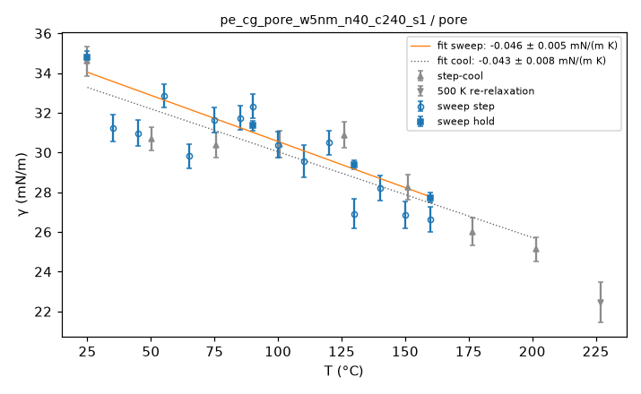
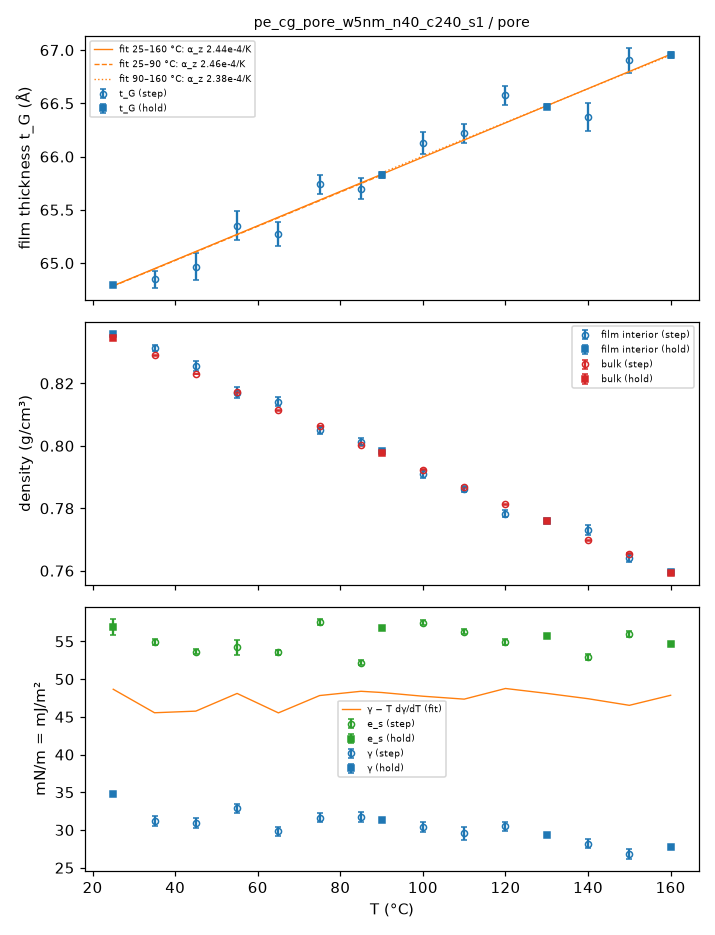
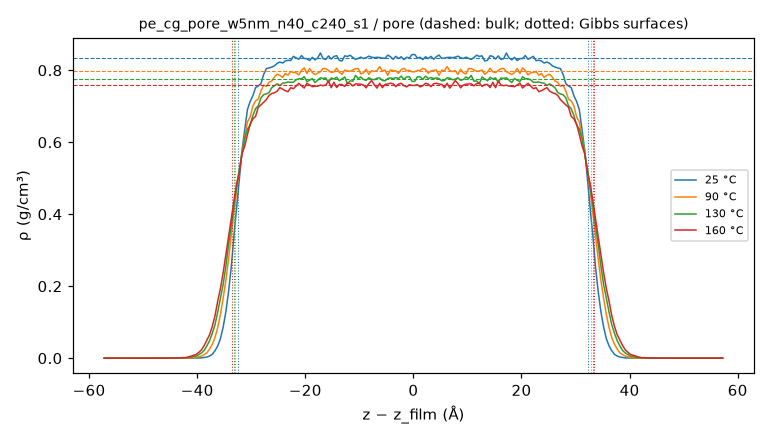
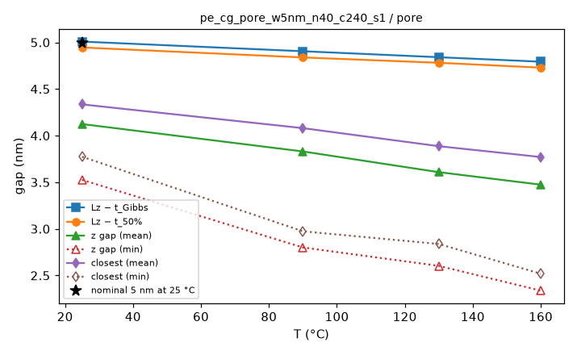
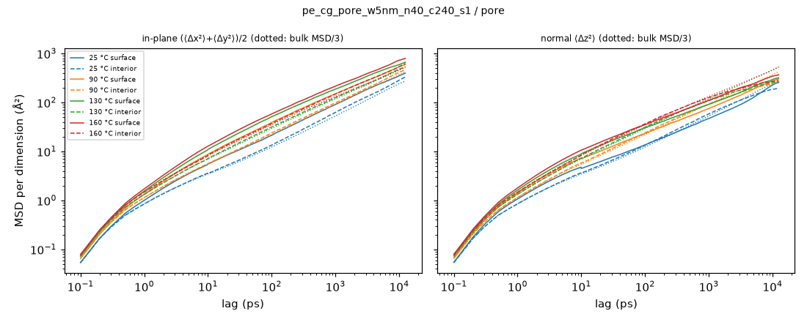
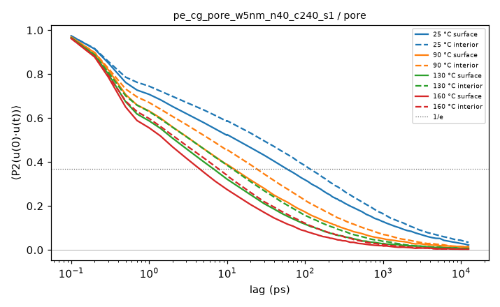
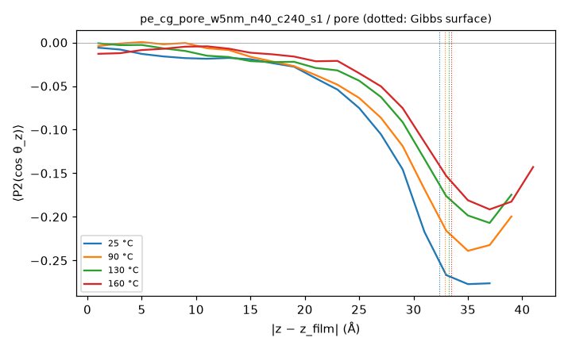
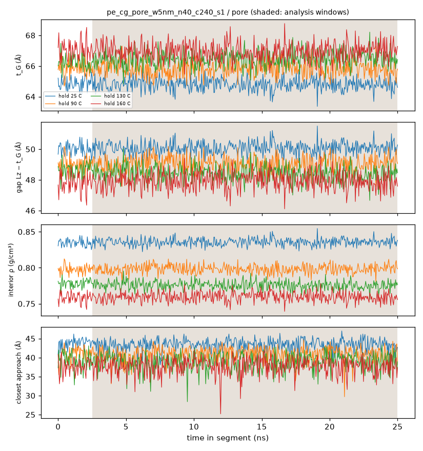
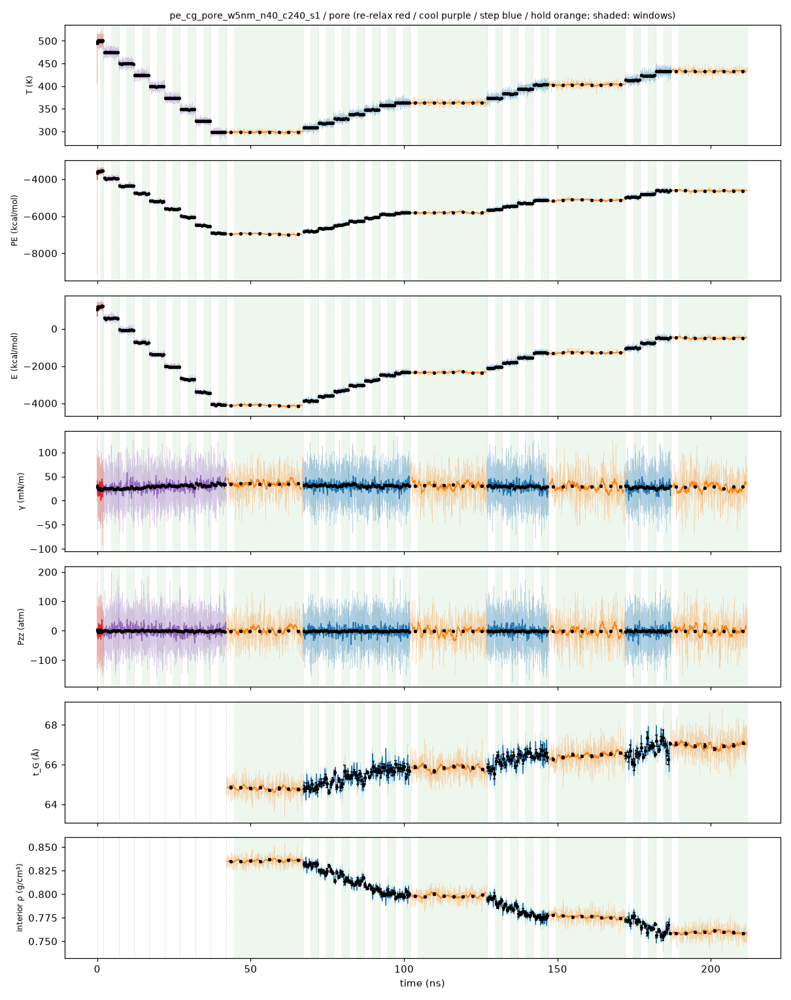
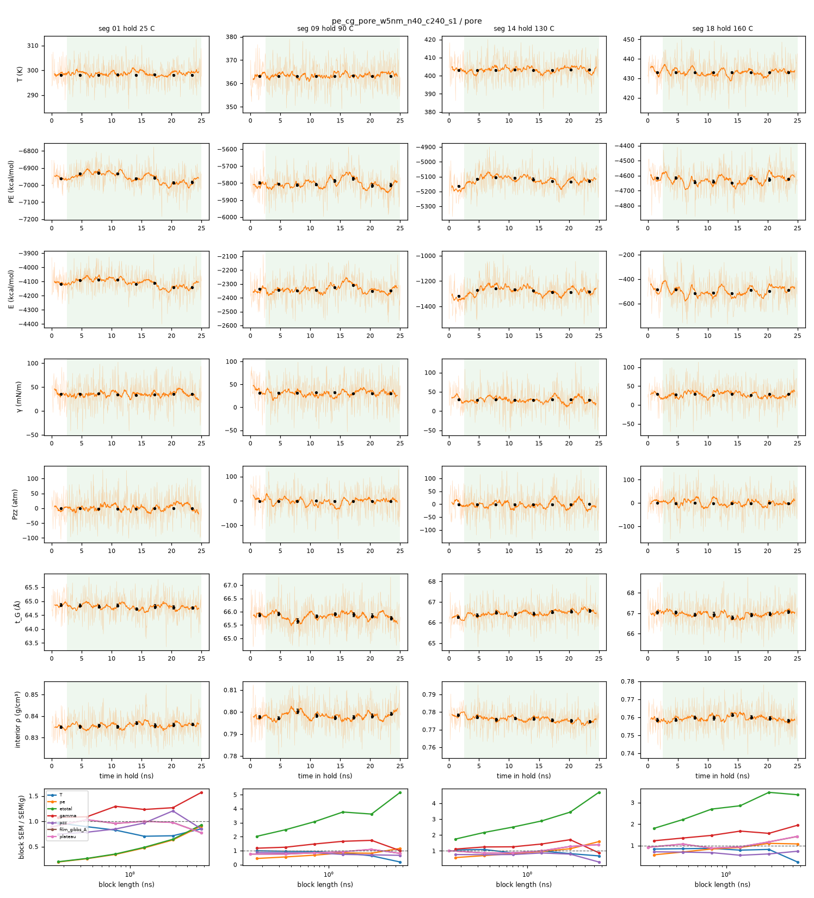

# Pore analysis: pe_cg_pore_w5nm_n40_c240_s1 / pore

- system: `pe_cg_pore_w5nm_n40_c240_s1` (cg); source run directory `/home/rdyu/projects/che126_sims/results/runs/pe_cg_pore_w5nm_n40_c240_s1/pore` (status finished, node rdyu-rog, run code commit eb03f2965b)
- analysis: `sepsim analyze pore` (D51), code commit 79b6d2d98a (dirty), 2026-10-30 17:44 on rdyu-server
- pore: nominal width 5 nm at 25 °C, wall 64.9 Å at 25 °C, Lz 114.87 Å (fixed), slab mass 134738 g/mol; units real
- windows: steps, cool stages and the re-relaxation second half (50% of rows dropped); holds without the first 10% of rows; SEM from the statistical inefficiency (D26)
- bulk reference: `results/analysis/pe_cg_amorph_n40_c240_s1/sweep/results.json`

## Segments: box, pressure tensor and surface tension

γ = (Lz/2)[Pzz − (Pxx+Pyy)/2] per surface (two surfaces), mean ± SEM of the instantaneous series.

| # | segment | T set (°C) | window (ns) | T (°C) | Lx (Å) | Ly (Å) | Pxx (atm) | Pyy (atm) | Pzz (atm) | γ (mN/m) | drift |
|---|---|---|---|---|---|---|---|---|---|---|---|
|  | Stage 2: surface re-relaxation 2000 ps NVT at 500 K after narrowing | 226.9 | 1.00 | 227.15 ± 0.25 | 67.415 | 67.415 | -40.9 ± 1.8 | -38.6 ± 2.1 | -1.2 ± 1.7 | 22.45 ± 1.01 |  |
|  | Stage 3 cool 1/8 (474.8 K) | 201.6 | 2.50 | 201.47 ± 0.13 | 67.012 | 67.012 | -43.0 ± 1.3 | -44.1 ± 1.3 | -0.4 ± 1.1 | 25.13 ± 0.62 |  |
|  | Stage 3 cool 2/8 (449.5 K) | 176.4 | 2.50 | 176.31 ± 0.15 | 66.599 | 66.599 | -44.3 ± 1.3 | -46.4 ± 1.3 | -0.6 ± 1.1 | 26.01 ± 0.70 |  |
|  | Stage 3 cool 3/8 (424.3 K) | 151.2 | 2.50 | 151.16 ± 0.12 | 66.208 | 66.208 | -47.6 ± 1.2 | -48.1 ± 1.3 | 0.7 ± 1.0 | 28.25 ± 0.65 | pe |
|  | Stage 3 cool 4/8 (399.1 K) | 125.9 | 2.50 | 126.01 ± 0.12 | 65.814 | 65.814 | -52.2 ± 1.1 | -55.0 ± 1.2 | -0.5 ± 1.0 | 30.88 ± 0.65 |  |
|  | Stage 3 cool 5/8 (373.8 K) | 100.7 | 2.50 | 100.74 ± 0.12 | 65.423 | 65.423 | -51.1 ± 1.2 | -54.3 ± 1.2 | -0.4 ± 1.0 | 30.42 ± 0.68 |  |
|  | Stage 3 cool 6/8 (348.6 K) | 75.46 | 2.50 | 75.37 ± 0.10 | 65.045 | 65.045 | -51.2 ± 1.1 | -55.8 ± 1.2 | -1.3 ± 0.9 | 30.37 ± 0.62 | gamma |
|  | Stage 3 cool 7/8 (323.4 K) | 50.23 | 2.50 | 50.10 ± 0.09 | 64.674 | 64.674 | -56.0 ± 1.2 | -53.2 ± 1.2 | -1.9 ± 1.0 | 30.68 ± 0.60 | pe |
|  | Stage 3 cool 8/8 (298.1 K) | 25 | 2.50 | 25.01 ± 0.09 | 64.273 | 64.273 | -58.9 ± 1.1 | -61.2 ± 1.2 | -0.6 ± 0.9 | 34.60 ± 0.75 |  |
| 1 | hold | 25 | 22.50 | 25.01 ± 0.03 | 64.282 | 64.282 | -60.5 ± 0.4 | -60.9 ± 0.4 | -0.9 ± 0.3 | 34.80 ± 0.30 | pe |
| 2 | step | 35 | 2.50 | 35.09 ± 0.09 | 64.427 | 64.427 | -54.8 ± 1.1 | -55.0 ± 1.1 | -1.2 ± 0.9 | 31.22 ± 0.68 |  |
| 3 | step | 45 | 2.50 | 45.10 ± 0.09 | 64.584 | 64.584 | -55.9 ± 1.2 | -52.1 ± 1.2 | -0.8 ± 0.9 | 30.97 ± 0.65 |  |
| 4 | step | 55 | 2.50 | 54.89 ± 0.11 | 64.736 | 64.736 | -58.9 ± 1.2 | -57.0 ± 1.1 | -1.5 ± 0.9 | 32.85 ± 0.59 | pe |
| 5 | step | 65 | 2.50 | 65.03 ± 0.10 | 64.889 | 64.889 | -52.6 ± 1.2 | -52.4 ± 1.3 | -1.3 ± 1.0 | 29.81 ± 0.63 |  |
| 6 | step | 75 | 2.50 | 75.11 ± 0.10 | 65.025 | 65.025 | -53.9 ± 1.2 | -55.9 ± 1.2 | -0.5 ± 0.9 | 31.65 ± 0.63 |  |
| 7 | step | 85 | 2.50 | 85.01 ± 0.10 | 65.192 | 65.192 | -54.8 ± 1.2 | -56.3 ± 1.2 | -1.0 ± 1.0 | 31.74 ± 0.63 | pe |
| 8 | step | 90 | 2.50 | 90.00 ± 0.10 | 65.253 | 65.253 | -57.4 ± 1.2 | -54.7 ± 1.2 | -0.5 ± 1.0 | 32.32 ± 0.61 |  |
| 9 | hold | 90 | 22.50 | 89.98 ± 0.03 | 65.253 | 65.253 | -53.9 ± 0.4 | -55.6 ± 0.4 | -0.9 ± 0.3 | 31.35 ± 0.24 |  |
| 10 | step | 100 | 2.50 | 99.88 ± 0.12 | 65.406 | 65.406 | -53.7 ± 1.2 | -51.2 ± 1.2 | -0.2 ± 1.0 | 30.39 ± 0.67 |  |
| 11 | step | 110 | 2.50 | 109.93 ± 0.11 | 65.560 | 65.560 | -52.7 ± 1.2 | -50.8 ± 1.2 | -1.0 ± 1.0 | 29.54 ± 0.81 | gamma |
| 12 | step | 120 | 2.50 | 120.17 ± 0.11 | 65.713 | 65.713 | -53.5 ± 1.3 | -54.1 ± 1.2 | -1.4 ± 1.0 | 30.49 ± 0.61 |  |
| 13 | step | 130 | 2.50 | 130.09 ± 0.13 | 65.872 | 65.872 | -49.7 ± 1.2 | -47.3 ± 1.3 | -2.2 ± 1.1 | 26.91 ± 0.73 |  |
| 14 | hold | 130 | 22.50 | 130.00 ± 0.04 | 65.872 | 65.872 | -51.4 ± 0.4 | -50.7 ± 0.4 | -0.6 ± 0.3 | 29.38 ± 0.23 | pe |
| 15 | step | 140 | 2.50 | 140.09 ± 0.13 | 66.038 | 66.038 | -49.9 ± 1.2 | -49.1 ± 1.3 | -1.0 ± 1.0 | 28.21 ± 0.63 |  |
| 16 | step | 150 | 2.50 | 149.91 ± 0.14 | 66.163 | 66.163 | -47.4 ± 1.3 | -47.0 ± 1.2 | -1.1 ± 1.0 | 26.86 ± 0.66 |  |
| 17 | step | 160 | 2.50 | 160.03 ± 0.15 | 66.334 | 66.334 | -48.5 ± 1.2 | -46.7 ± 1.2 | -1.8 ± 1.0 | 26.64 ± 0.64 |  |
| 18 | hold | 160 | 22.50 | 159.94 ± 0.04 | 66.334 | 66.334 | -49.8 ± 0.4 | -47.4 ± 0.4 | -1.0 ± 0.4 | 27.73 ± 0.24 |  |

## Surface tension vs T

SEM-weighted linear fit of γ in T, one point per temperature (hold where there is one); errors 1σ, scaled by √χ²_red when χ²_red > 1.

| branch | points | T range (°C) | dγ/dT (mN m⁻¹ K⁻¹) | γ(25 °C) from fit (mN/m) | χ²_red |
|---|---|---|---|---|---|
| heating (sweep) | 15 | 25–160 | -0.0465 ± 0.0048 | 34.04 | 4.20 |
| cooling (step-cool) | 8 | 25–202 | -0.0432 ± 0.0078 | 33.28 | 3.79 |

## Thermal analysis over the sweep grid

One point per set T (the hold where there is one). Film thickness t_G (Gibbs) and the interior plateau density from the segment's DCD (steps: second half; holds: without the first 10%; ≤ max-frames frames; SEM over frames); E = TotEng (NVT thermo window). Surface excess energy per surface e_s = (E_pore − (M_pore/M_bulk) E_bulk(T))/(2A), E_bulk from the bulk sweep at the same set T; γ − T dγ/dT with the sweep fit slope (should ≈ e_s).

| T (°C) | seg | t_G (Å) | ρ plateau (g/cm³) | ρ bulk (g/cm³) | Δρ/ρ bulk | Lx (Å) | E (kcal/mol) | γ (mN/m) | e_s (mJ/m²) | γ − T dγ/dT (mJ/m²) |
|---|---|---|---|---|---|---|---|---|---|---|
| 25 | hold | 64.79 ± 0.02 | 0.8357 ± 0.0003 | 0.8345 ± 0.0000 | +0.14% | 64.282 | -4111.7 ± 12.4 | 34.80 ± 0.30 | 56.9 ± 1.0 | 48.7 |
| 35 | step | 64.85 ± 0.08 | 0.8312 ± 0.0010 | 0.8290 ± 0.0001 | +0.27% | 64.427 | -3870.9 ± 3.0 | 31.22 ± 0.68 | 54.9 ± 0.4 | 45.5 |
| 45 | step | 64.97 ± 0.13 | 0.8257 ± 0.0016 | 0.8230 ± 0.0001 | +0.33% | 64.584 | -3595.5 ± 2.6 | 30.97 ± 0.65 | 53.6 ± 0.4 | 45.8 |
| 55 | step | 65.35 ± 0.14 | 0.8170 ± 0.0017 | 0.8172 ± 0.0001 | -0.02% | 64.736 | -3302.7 ± 11.0 | 32.85 ± 0.59 | 54.2 ± 1.0 | 48.1 |
| 65 | step | 65.27 ± 0.12 | 0.8141 ± 0.0014 | 0.8114 ± 0.0001 | +0.33% | 64.889 | -3034.5 ± 2.7 | 29.81 ± 0.63 | 53.6 ± 0.3 | 45.5 |
| 75 | step | 65.74 ± 0.09 | 0.8049 ± 0.0011 | 0.8063 ± 0.0001 | -0.17% | 65.025 | -2742.5 ± 3.3 | 31.65 ± 0.63 | 57.6 ± 0.4 | 47.8 |
| 85 | step | 65.70 ± 0.10 | 0.8013 ± 0.0012 | 0.8001 ± 0.0001 | +0.15% | 65.192 | -2494.8 ± 3.2 | 31.74 ± 0.63 | 52.2 ± 0.4 | 48.4 |
| 90 | hold | 65.83 ± 0.03 | 0.7983 ± 0.0004 | 0.7978 ± 0.0000 | +0.06% | 65.253 | -2339.1 ± 1.2 | 31.35 ± 0.24 | 56.7 ± 0.1 | 48.2 |
| 100 | step | 66.12 ± 0.10 | 0.7910 ± 0.0012 | 0.7923 ± 0.0001 | -0.17% | 65.406 | -2061.5 ± 3.0 | 30.39 ± 0.67 | 57.5 ± 0.4 | 47.7 |
| 110 | step | 66.22 ± 0.09 | 0.7862 ± 0.0011 | 0.7868 ± 0.0001 | -0.08% | 65.560 | -1805.6 ± 3.4 | 29.54 ± 0.81 | 56.3 ± 0.4 | 47.3 |
| 120 | step | 66.57 ± 0.09 | 0.7783 ± 0.0010 | 0.7813 ± 0.0001 | -0.38% | 65.713 | -1558.1 ± 3.3 | 30.49 ± 0.61 | 54.9 ± 0.4 | 48.8 |
| 130 | hold | 66.47 ± 0.02 | 0.7758 ± 0.0003 | 0.7758 ± 0.0001 | +0.00% | 65.872 | -1277.7 ± 1.3 | 29.38 ± 0.23 | 55.7 ± 0.1 | 48.1 |
| 140 | step | 66.37 ± 0.13 | 0.7730 ± 0.0015 | 0.7698 ± 0.0002 | +0.42% | 66.038 | -1027.6 ± 4.0 | 28.21 ± 0.63 | 53.0 ± 0.4 | 47.4 |
| 150 | step | 66.90 ± 0.12 | 0.7640 ± 0.0013 | 0.7654 ± 0.0002 | -0.19% | 66.163 | -764.7 ± 3.9 | 26.86 ± 0.66 | 56.0 ± 0.4 | 46.5 |
| 160 | hold | 66.95 ± 0.03 | 0.7595 ± 0.0003 | 0.7594 ± 0.0001 | +0.02% | 66.334 | -499.5 ± 1.4 | 27.73 ± 0.24 | 54.7 ± 0.2 | 47.9 |

Surface entropy per area −dγ/dT = 0.0465 ± 0.0048 mJ m⁻² K⁻¹ (sweep fit).

Expansion: α_z = (1/t_G) dt_G/dT (film normal, SEM-weighted, errors ×√χ²_red when > 1); α_L = (1/2A) dA/dT of the imposed box area (D48: follows the bulk density, so ≈ bulk α_V/3 by construction); film α_V = α_z + 2 α_L. Cv = dE/dT per gram (classical, NVT) next to the bulk classical Cp.

| window (°C) | points | α_z (10⁻⁴ K⁻¹) | χ²_red | α_L (10⁻⁴ K⁻¹) | film α_V (10⁻⁴ K⁻¹) | bulk α_V/3 | bulk α_V | Cv (J g⁻¹ K⁻¹) | bulk Cp (J g⁻¹ K⁻¹) |
|---|---|---|---|---|---|---|---|---|---|
| 25–160 | 15 | 2.444 ± 0.045 | 1.88 | 2.323 | 7.090 | 2.306 | 6.919 | 0.832 ± 0.004 | 0.828 |
| 25–90 | 8 | 2.456 ± 0.093 | 1.36 | 2.319 | 7.095 | 2.306 | 6.917 | 0.864 ± 0.004 | 0.840 |
| 90–160 | 8 | 2.378 ± 0.139 | 2.67 | 2.344 | 7.065 | 2.344 | 7.032 | 0.816 ± 0.003 | 0.817 |

## Density profile, film thickness and gap (holds)

ρ(z) is the mass density about the film's mass centre (periodic z, film centred per frame) over ≤ 500 evenly spaced hold frames, symmetrized; plateau = mean over |z| < t_G/2 − 15 Å (SEM over frames); t_G = M/(ρ_plateau A) (equimolar Gibbs surfaces), t_50 between the 50%-of-plateau crossings; gap = Lz − film. Clear gap per frame: z gap = Lz − z extent of all atoms; closest = smallest 3-D distance across the slit (periodic image).

| T (°C) | frames | ρ plateau (g/cm³) | ρ bulk (g/cm³) | Δρ/ρ bulk | t_G (Å) | t_50 (Å) | gap_G (Å) | gap_50 (Å) | z gap mean / min (Å) | closest mean / min (Å) |
|---|---|---|---|---|---|---|---|---|---|---|
| 25 | 450 | 0.8357 ± 0.0003 | 0.8345 ± 0.0000 | +0.14% | 64.79 | 65.42 | 50.09 | 49.45 | 41.2 / 35.3 | 43.4 / 37.7 |
| 90 | 450 | 0.7983 ± 0.0004 | 0.7978 ± 0.0000 | +0.06% | 65.82 | 66.49 | 49.05 | 48.39 | 38.3 / 28.0 | 40.8 / 29.7 |
| 130 | 450 | 0.7758 ± 0.0003 | 0.7758 ± 0.0001 | +0.00% | 66.46 | 67.06 | 48.41 | 47.81 | 36.1 / 26.0 | 38.9 / 28.4 |
| 160 | 450 | 0.7595 ± 0.0003 | 0.7594 ± 0.0001 | +0.02% | 66.95 | 67.58 | 47.93 | 47.29 | 34.7 / 23.4 | 37.7 / 25.2 |

Gibbs gap at 25 °C 5.009 nm vs nominal 5 nm (the nominal width uses the bulk density, D48).

Interfacial width: 10–90 distance of each surface (outermost crossings of 90% and 10% of the plateau) and the 10–90 width 2 atanh(0.8) δ of a tanh fit ρ_p/2 [1 − tanh((|z| − h)/δ)] to the symmetrized profile.

| T (°C) | 10–90 lower (Å) | 10–90 upper (Å) | tanh δ (Å) | tanh 10–90 (Å) | tanh h (Å) |
|---|---|---|---|---|---|
| 25 | 6.00 | 6.10 | 2.58 ± 0.04 | 5.67 | 32.65 |
| 90 | 7.63 | 7.27 | 3.15 ± 0.04 | 6.93 | 33.15 |
| 130 | 7.84 | 8.32 | 3.51 ± 0.04 | 7.71 | 33.44 |
| 160 | 8.54 | 8.45 | 3.76 ± 0.04 | 8.26 | 33.69 |

## Mobility by layer (holds)

Backbone sites (CG: beads; UA/AA: backbone carbons), positions relative to the system's mass centre, layer at the time origin; ≤ 200 origins per lag (hold DCD, lags ≥ its frame interval) and ≤ 50 per burst (D46 bursts, shorter lags). MSD per dimension (Ų): in-plane xy = (⟨Δx²⟩+⟨Δy²⟩)/2, normal z = ⟨Δz²⟩, bulk = MSD/3 of the bulk hold. P2 1/e: first 1/e crossing of ⟨P2(u(0)·u(t))⟩ of backbone bonds (layer of the bond midpoint at the origin).

| T (°C) | layer | site fraction | xy / z @ 10 ps | xy / z @ 100 ps | xy / z @ 1 ns | xy / z @ max | P2 1/e (ps) |
|---|---|---|---|---|---|---|---|
| 25 | interior | 0.54 | 3.5 / 3.6 | 13.4 / 13.3 | 62.3 / 58.2 | 331.9 / 197.0 | 116.4 |
| 25 | surface | 0.46 | 5.5 / 4.5 | 21.3 / 13.6 | 90.5 / 47.0 | 397.1 / 258.8 | 58.7 |
| 25 | film | 1.00 | 4.5 / 4.0 | 17.1 / 13.5 | 75.4 / 53.0 | 362.1 / 225.6 | 85.7 |
| 25 | bulk | | 3.5 | 12.3 | 52.7 | 271.9 | 122.9 |
| 90 | interior | 0.54 | 5.6 / 5.8 | 23.8 / 24.0 | 97.8 / 92.7 | 478.7 / 249.1 | 24.6 |
| 90 | surface | 0.46 | 8.8 / 7.1 | 39.0 / 23.2 | 149.4 / 74.9 | 595.5 / 305.1 | 13.0 |
| 90 | film | 1.00 | 7.1 / 6.4 | 30.7 / 23.6 | 121.3 / 84.6 | 531.9 / 274.6 | 18.3 |
| 90 | bulk | | 5.5 | 22.3 | 91.9 | 426.6 | 25.5 |
| 130 | interior | 0.55 | 7.2 / 7.3 | 31.5 / 31.2 | 124.9 / 109.1 | 527.2 / 267.1 | 12.4 |
| 130 | surface | 0.45 | 11.0 / 9.0 | 51.1 / 30.3 | 187.0 / 91.4 | 665.9 / 317.8 | 6.8 |
| 130 | film | 1.00 | 8.9 / 8.0 | 40.3 / 30.8 | 152.9 / 101.1 | 589.8 / 290.0 | 9.2 |
| 130 | bulk | | 7.0 | 29.5 | 118.4 | 533.9 | 12.7 |
| 160 | interior | 0.55 | 8.5 / 8.5 | 37.2 / 36.5 | 148.0 / 125.2 | 624.5 / 285.3 | 7.9 |
| 160 | surface | 0.45 | 12.8 / 10.6 | 58.2 / 35.3 | 215.0 / 109.9 | 793.2 / 365.9 | 4.6 |
| 160 | film | 1.00 | 10.4 / 9.4 | 46.7 / 36.0 | 178.0 / 118.3 | 700.1 / 321.4 | 6.1 |
| 160 | bulk | | 8.3 | 35.3 | 132.6 | 523.4 | 7.6 |

## Orientation and chain shape by layer (holds)

⟨P2(cos θ_z)⟩ of backbone bonds (θ_z: angle to the film normal; 0 isotropic, −0.5 all in-plane) by the layer of the bond midpoint; ⟨Rg_z²⟩ and ⟨Rg_xy²⟩/2 (mass-weighted, per dimension; equal for isotropic chains) of chains by the layer of their mass centre; over the profile frames, SEM over frames.

| T (°C) | layer | ⟨P2(cos θ_z)⟩ | chains | ⟨Rg_z²⟩ (Ų) | ⟨Rg_xy²⟩/2 (Ų) | ratio z/xy |
|---|---|---|---|---|---|---|
| 25 | interior | -0.015 ± 0.009 | 33.9 | 220 ± 2 | 413 ± 14 | 0.53 |
| 25 | surface | -0.101 ± 0.003 | 6.1 | 75 ± 2 | 524 ± 19 | 0.14 |
| 90 | interior | -0.007 ± 0.002 | 32.1 | 210 ± 4 | 420 ± 4 | 0.50 |
| 90 | surface | -0.091 ± 0.003 | 7.9 | 70 ± 2 | 506 ± 13 | 0.14 |
| 130 | interior | -0.011 ± 0.003 | 31.2 | 211 ± 5 | 319 ± 10 | 0.66 |
| 130 | surface | -0.073 ± 0.002 | 8.8 | 69 ± 3 | 393 ± 34 | 0.17 |
| 160 | interior | -0.009 ± 0.002 | 29.5 | 198 ± 9 | 282 ± 4 | 0.70 |
| 160 | surface | -0.064 ± 0.002 | 10.5 | 76 ± 2 | 306 ± 10 | 0.25 |

## Whole film vs bulk (holds; `analyze sweep` method)

Film-averaged results of the `analyze sweep` hold analysis (FFT MSD over every origin, bursts stitched) next to the bulk hold at the same T.

| T (°C) | MSD max film / bulk (Ų) | COM MSD max film / bulk (Ų) | P2 1/e film / bulk (ps) | Rg film / bulk (Å) | R_ee film / bulk (Å) | C_n film / bulk |
|---|---|---|---|---|---|---|
| 25 | 950 / 816 | 211 / 177 | 85.8 / 122.9 | 32.39 ± 0.48 / 31.24 ± 0.12 | 81.6 ± 1.3 / 77.1 ± 0.5 | 11.25 ± 0.39 / 10.27 ± 0.08 |
| 90 | 1337 / 1280 | 433 / 396 | 18.3 / 25.5 | 32.54 ± 0.13 / 32.21 ± 0.21 | 82.1 ± 0.9 / 84.2 ± 1.0 | 11.89 ± 0.15 / 11.78 ± 0.19 |
| 130 | 1468 / 1602 | 470 / 523 | 9.1 / 12.7 | 29.25 ± 0.17 / 30.84 ± 0.34 | 71.2 ± 1.1 / 77.6 ± 2.1 | 9.09 ± 0.14 / 10.58 ± 0.36 |
| 160 | 1723 / 1570 | 627 / 573 | 6.0 / 7.6 | 27.31 ± 0.15 / 30.80 ± 0.39 | 66.6 ± 0.5 / 78.3 ± 1.4 | 7.85 ± 0.12 / 10.70 ± 0.34 |

## Equilibration

Every average uses only the analysis window: steps second half (50% of rows dropped), holds without the first 10% of rows (the rest is equilibration after the T change; see `equilibration.png`, windows shaded, block averages ± SEM overlaid, and `equilibration_holds.png`). Drift: the window's two halves differ by > 2 combined SEM (statistical inefficiency).

Segments with a drifting window (tested: film_gibbs, gamma, pe):

| segment | T set (°C) | drift (second − first half ± SEM) |
|---|---|---|
| Stage 3 cool 3/8 (424.3 K) | 151.2 | pe -50.26 ± 13 |
| Stage 3 cool 6/8 (348.6 K) | 75.46 | gamma -2.786 ± 1.2 |
| Stage 3 cool 7/8 (323.4 K) | 50.23 | pe -35.2 ± 8.7 |
| seg 01 hold 25 C | 25 | pe -36.14 ± 9 |
| seg 04 step 55 C | 55 | pe +43.31 ± 12 |
| seg 07 step 85 C | 85 | pe -14.56 ± 5.8 |
| seg 11 step 110 C | 110 | gamma -4.408 ± 1.3 |
| seg 14 hold 130 C | 130 | pe -19.36 ± 5.5 |

Block-average check of the hold SEMs: SEM of the means of 32 / 16 / 8 blocks vs the statistical-inefficiency SEM (blocks longer than the correlation time plateau at it; flagged if the 8-block SEM exceeds it by > 2×).

| T (°C) | quantity | SEM (g) | block SEM 32 / 16 / 8 | converged |
|---|---|---|---|---|
| 25 | pe | 12.7 | 4.41 / 6.03 / 8.03 | yes |
| 25 | gamma | 0.299 | 0.388 / 0.369 / 0.38 | yes |
| 90 | pe | 5.17 | 3.51 / 4.35 / 4.25 | yes |
| 90 | gamma | 0.239 | 0.353 / 0.399 / 0.415 | yes |
| 130 | pe | 3.76 | 3.12 / 3.61 / 4.27 | yes |
| 130 | gamma | 0.234 | 0.294 / 0.335 / 0.399 | yes |
| 160 | pe | 4.28 | 3.61 / 3.92 / 4.73 | yes |
| 160 | gamma | 0.243 | 0.359 / 0.408 / 0.382 | yes |

Local quantities (γ, PE, film thickness and interior density, interfacial width, segmental MSD, bond P2: relaxation times ~10–100 ps in CG) equilibrate within the dropped part of each segment (`film_vs_time.png`: thickness, gap, interior density and clear gap per hold frame). Surface chain conformation and orientation by layer (Rg_z vs Rg_xy, layer membership of chains) are chain-scale quantities.

Chain-scale quantities (Rg, R_ee, C_n, chain COM motion) relax on the end-to-end time (CG C240 at 25 °C: of order 100 ns; C1500 far longer), longer than a 25 ns hold: their hold averages describe the chain configurations carried in from the 500 K equilibration and cooling rather than a re-equilibrated state at T. Per hold:
- 25 °C: chain COM MSD at 12.5 ns / ⟨Rg²⟩ = 0.20; chains have **not** moved their own size: chain-scale averages sample a partly relaxed set of chain configurations.
- 90 °C: chain COM MSD at 12.5 ns / ⟨Rg²⟩ = 0.41; chains have **not** moved their own size: chain-scale averages sample a partly relaxed set of chain configurations.
- 130 °C: chain COM MSD at 12.5 ns / ⟨Rg²⟩ = 0.55; chains have **not** moved their own size: chain-scale averages sample a partly relaxed set of chain configurations.
- 160 °C: chain COM MSD at 12.5 ns / ⟨Rg²⟩ = 0.84; chains have **not** moved their own size: chain-scale averages sample a partly relaxed set of chain configurations.

## Caveats

- γ uses a plain LJ cutoff without tail correction (D44/D48: `pair_modify tail no`, CG 15 Å, UA/AA 14 Å), so it is cutoff-dependent and lower than a full-dispersion (LJ-PPPM or tail-corrected) value; compare it across our runs, not directly with experiment.
- γ is the mechanical (pressure-tensor) value per surface, (Lz/2)[Pzz − (Pxx+Pyy)/2] with two film surfaces; the fits are SEM-weighted linear fits in T with errors scaled by √χ²_red when χ²_red > 1.
- The slit is a local patch of a pore wall: real separator pores are 30–100 nm and their walls semicrystalline (D50); these walls are amorphous (melt-like or post-shutdown).
- Layers: surface = within 15 Å of either Gibbs surface on the film side (or outside it), interior = the rest, assigned at each time origin; sites leave their layer at long lags, so long-lag layer MSDs mix layers. MSDs are per dimension: in-plane (⟨Δx²⟩+⟨Δy²⟩)/2, normal ⟨Δz²⟩, bulk MSD/3 (isotropic).
- Cv = dE/dT (total energy, NVT, per gram) and the surface excess energy are classical: Cv is not comparable to experiment for the same reasons as the bulk Cp (classical equipartition; UA/CG drop degrees of freedom). e_s = (E_pore − (M_pore/M_bulk) E_bulk(T))/(2A) compares the NVT film with the NPT bulk at 1 atm (PV ≈ 0) at the same set T; the film's lateral box follows the bulk density (D48).
- CG time is not real time: SDK beads move faster than the atoms they represent, so MSD and P2 times are model times (not rescaled).

## Plots

**γ vs T**

**film thickness, interior density and surface energy vs T**

**ρ(z) at the holds**

**gap width vs T**

**MSD by layer**

**bond P2 ACF by layer**

**⟨P2(cos θ_z)⟩ vs z**

**film thickness, gap, interior density and closest approach vs time (holds)**

**thermo vs time, analysis windows shaded, block averages ± SEM**

**holds: thermo vs time, analysis window shaded, block averages ± SEM**

