# Pore analysis: pe_cg_pore_w5nm_n640_c240_s1_rep441 / pore

- system: `pe_cg_pore_w5nm_n640_c240_s1_rep441` (cg); source run directory `/home/rdyu/projects/che126_sims/results/runs/pe_cg_pore_w5nm_n640_c240_s1_rep441/pore` (status finished, node rdyu-rog, run code commit 2b31a046e7)
- analysis: `sepsim analyze pore` (D51), code commit 3604952a9f (dirty), 2026-11-08 23:04 on rdyu-rog
- pore: nominal width 5 nm at 25 °C, wall 64.5 Å at 25 °C, Lz 114.53 Å (fixed), slab mass 2155807 g/mol; units real
- windows: steps, cool stages and the re-relaxation second half (50% of rows dropped); holds without the first 10% of rows; SEM from the statistical inefficiency (D26)
- bulk reference: `not found`
- note: bulk analysis results.json not found: no bulk comparison

## Segments: box, pressure tensor and surface tension

γ = (Lz/2)[Pzz − (Pxx+Pyy)/2] per surface (two surfaces), mean ± SEM of the instantaneous series.

| # | segment | T set (°C) | window (ns) | T (°C) | Lx (Å) | Ly (Å) | Pxx (atm) | Pyy (atm) | Pzz (atm) | γ (mN/m) | drift |
|---|---|---|---|---|---|---|---|---|---|---|---|
|  | Stage 2: surface re-relaxation 2000 ps NVT at 500 K after narrowing | 226.9 | 1.00 | 226.86 ± 0.06 | 270.375 | 270.375 | -41.6 ± 0.8 | -41.0 ± 0.6 | -1.5 ± 0.5 | 23.11 ± 0.47 |  |
|  | Stage 3 cool 1/8 (474.8 K) | 201.6 | 2.50 | 201.57 ± 0.04 | 268.760 | 268.760 | -43.6 ± 0.3 | -43.5 ± 0.4 | -1.5 ± 0.3 | 24.39 ± 0.20 |  |
|  | Stage 3 cool 2/8 (449.5 K) | 176.4 | 2.50 | 176.35 ± 0.04 | 267.104 | 267.104 | -45.1 ± 0.3 | -45.4 ± 0.4 | -1.1 ± 0.3 | 25.60 ± 0.18 | pe |
|  | Stage 3 cool 3/8 (424.3 K) | 151.2 | 2.50 | 151.17 ± 0.03 | 265.533 | 265.533 | -47.6 ± 0.4 | -47.4 ± 0.5 | -1.0 ± 0.2 | 27.01 ± 0.18 |  |
|  | Stage 3 cool 4/8 (399.1 K) | 125.9 | 2.50 | 125.91 ± 0.03 | 263.956 | 263.956 | -50.7 ± 0.4 | -49.6 ± 0.3 | -0.6 ± 0.2 | 28.77 ± 0.22 |  |
|  | Stage 3 cool 5/8 (373.8 K) | 100.7 | 2.50 | 100.69 ± 0.03 | 262.387 | 262.387 | -52.4 ± 0.4 | -51.4 ± 0.6 | -1.0 ± 0.2 | 29.54 ± 0.28 | pe |
|  | Stage 3 cool 6/8 (348.6 K) | 75.46 | 2.50 | 75.46 ± 0.03 | 260.870 | 260.870 | -54.7 ± 0.5 | -55.0 ± 0.4 | -0.7 ± 0.2 | 31.39 ± 0.19 |  |
|  | Stage 3 cool 7/8 (323.4 K) | 50.23 | 2.50 | 50.25 ± 0.03 | 259.383 | 259.383 | -56.7 ± 0.5 | -56.3 ± 1.0 | -1.2 ± 0.2 | 32.13 ± 0.50 | gamma |
|  | Stage 3 cool 8/8 (298.1 K) | 25 | 2.50 | 24.96 ± 0.04 | 257.775 | 257.775 | -59.7 ± 0.4 | -59.5 ± 0.3 | -0.8 ± 0.2 | 34.14 ± 0.15 |  |
| 1 | hold | 25 | 4.50 | 24.98 ± 0.02 | 257.812 | 257.812 | -60.1 ± 0.6 | -59.9 ± 0.7 | -0.7 ± 0.2 | 34.41 ± 0.40 | pe |
| 2 | step | 90 | 2.50 | 89.94 ± 0.03 | 261.704 | 261.704 | -53.8 ± 0.4 | -53.8 ± 0.5 | -1.1 ± 0.2 | 30.59 ± 0.20 |  |
| 3 | hold | 90 | 4.50 | 89.97 ± 0.02 | 261.704 | 261.704 | -53.7 ± 0.3 | -53.9 ± 0.5 | -0.8 ± 0.2 | 30.76 ± 0.26 |  |
| 4 | step | 130 | 2.50 | 130.01 ± 0.03 | 264.186 | 264.186 | -50.2 ± 0.5 | -49.1 ± 0.4 | -0.9 ± 0.3 | 28.27 ± 0.21 |  |
| 5 | hold | 130 | 4.50 | 130.03 ± 0.02 | 264.186 | 264.186 | -49.3 ± 0.2 | -49.2 ± 0.4 | -0.9 ± 0.2 | 28.05 ± 0.12 |  |
| 6 | step | 160 | 2.50 | 160.09 ± 0.03 | 266.040 | 266.040 | -47.0 ± 0.6 | -46.7 ± 0.4 | -1.0 ± 0.3 | 26.63 ± 0.21 |  |
| 7 | hold | 160 | 4.50 | 160.00 ± 0.02 | 266.040 | 266.040 | -46.7 ± 0.3 | -46.8 ± 0.3 | -1.1 ± 0.2 | 26.50 ± 0.13 | pe |

## Surface tension vs T

SEM-weighted linear fit of γ in T, one point per temperature (hold where there is one); errors 1σ, scaled by √χ²_red when χ²_red > 1.

| branch | points | T range (°C) | dγ/dT (mN m⁻¹ K⁻¹) | γ(25 °C) from fit (mN/m) | χ²_red |
|---|---|---|---|---|---|
| heating (sweep) | 4 | 25–160 | -0.0590 ± 0.0028 | 34.37 | 1.11 |
| cooling (step-cool) | 8 | 25–202 | -0.0556 ± 0.0011 | 34.10 | 0.93 |

## Thermal analysis over the sweep grid

One point per set T (the hold where there is one). Film thickness t_G (Gibbs) and the interior plateau density from the segment's DCD (steps: second half; holds: without the first 10%; ≤ max-frames frames; SEM over frames); E = TotEng (NVT thermo window). Surface excess energy per surface e_s = (E_pore − (M_pore/M_bulk) E_bulk(T))/(2A), E_bulk from the bulk sweep at the same set T; γ − T dγ/dT with the sweep fit slope (should ≈ e_s).

| T (°C) | seg | t_G (Å) | ρ plateau (g/cm³) | ρ bulk (g/cm³) | Δρ/ρ bulk | Lx (Å) | E (kcal/mol) | γ (mN/m) | e_s (mJ/m²) | γ − T dγ/dT (mJ/m²) |
|---|---|---|---|---|---|---|---|---|---|---|
| 25 | hold | 64.53 ± 0.01 | 0.8346 ± 0.0001 | n/a | n/a | 257.812 | -65208.3 ± 55.8 | 34.41 ± 0.40 | n/a | 52.0 |
| 90 | hold | 65.48 ± 0.01 | 0.7982 ± 0.0001 | n/a | n/a | 261.704 | -37393.2 ± 28.8 | 30.76 ± 0.26 | n/a | 52.2 |
| 130 | hold | 66.09 ± 0.01 | 0.7761 ± 0.0001 | n/a | n/a | 264.186 | -20438.8 ± 46.9 | 28.05 ± 0.12 | n/a | 51.9 |
| 160 | hold | 66.58 ± 0.01 | 0.7597 ± 0.0001 | n/a | n/a | 266.040 | -8120.2 ± 40.2 | 26.50 ± 0.13 | n/a | 52.1 |

Surface entropy per area −dγ/dT = 0.0590 ± 0.0028 mJ m⁻² K⁻¹ (sweep fit).

Expansion: α_z = (1/t_G) dt_G/dT (film normal, SEM-weighted, errors ×√χ²_red when > 1); α_L = (1/2A) dA/dT of the imposed box area (D48: follows the bulk density, so ≈ bulk α_V/3 by construction); film α_V = α_z + 2 α_L. Cv = dE/dT per gram (classical, NVT) next to the bulk classical Cp.

| window (°C) | points | α_z (10⁻⁴ K⁻¹) | χ²_red | α_L (10⁻⁴ K⁻¹) | film α_V (10⁻⁴ K⁻¹) | bulk α_V/3 | bulk α_V | Cv (J g⁻¹ K⁻¹) | bulk Cp (J g⁻¹ K⁻¹) |
|---|---|---|---|---|---|---|---|---|---|
| 25–160 | 4 | 2.302 ± 0.034 | 11.98 | 2.317 | 6.935 | n/a | n/a | 0.820 ± 0.005 | n/a |
| 90–160 | 3 | 2.368 ± 0.059 | 7.41 | 2.346 | 7.059 | n/a | n/a | 0.813 ± 0.006 | n/a |
- surface excess energy not computed at every T: no bulk energies
- 25-90 C: fewer than 3 temperatures, no fit

## Density profile, film thickness and gap (holds)

ρ(z) is the mass density about the film's mass centre (periodic z, film centred per frame) over ≤ 500 evenly spaced hold frames, symmetrized; plateau = mean over |z| < t_G/2 − 15 Å (SEM over frames); t_G = M/(ρ_plateau A) (equimolar Gibbs surfaces), t_50 between the 50%-of-plateau crossings; gap = Lz − film. Clear gap per frame: z gap = Lz − z extent of all atoms; closest = smallest 3-D distance across the slit (periodic image).

| T (°C) | frames | ρ plateau (g/cm³) | ρ bulk (g/cm³) | Δρ/ρ bulk | t_G (Å) | t_50 (Å) | gap_G (Å) | gap_50 (Å) | z gap mean / min (Å) | closest mean / min (Å) |
|---|---|---|---|---|---|---|---|---|---|---|
| 25 | 450 | 0.8346 ± 0.0001 | n/a | n/a | 64.53 | 65.00 | 50.00 | 49.53 | 33.5 / 25.6 | 37.9 / 30.2 |
| 90 | 450 | 0.7982 ± 0.0001 | n/a | n/a | 65.48 | 66.01 | 49.05 | 48.52 | 29.5 / 21.3 | 35.1 / 27.5 |
| 130 | 450 | 0.7761 ± 0.0001 | n/a | n/a | 66.09 | 66.55 | 48.44 | 47.98 | 26.0 / 15.2 | 32.4 / 24.9 |
| 160 | 450 | 0.7597 ± 0.0001 | n/a | n/a | 66.58 | 67.10 | 47.95 | 47.43 | 24.0 / 12.4 | 30.8 / 20.5 |

Gibbs gap at 25 °C 5.000 nm vs nominal 5 nm (the nominal width uses the bulk density, D48).

Interfacial width: 10–90 distance of each surface (outermost crossings of 90% and 10% of the plateau) and the 10–90 width 2 atanh(0.8) δ of a tanh fit ρ_p/2 [1 − tanh((|z| − h)/δ)] to the symmetrized profile.

| T (°C) | 10–90 lower (Å) | 10–90 upper (Å) | tanh δ (Å) | tanh 10–90 (Å) | tanh h (Å) |
|---|---|---|---|---|---|
| 25 | 7.33 | 7.57 | 3.31 ± 0.03 | 7.28 | 32.43 |
| 90 | 8.78 | 8.56 | 3.91 ± 0.03 | 8.60 | 32.92 |
| 130 | 9.79 | 9.50 | 4.37 ± 0.03 | 9.60 | 33.20 |
| 160 | 10.03 | 10.32 | 4.64 ± 0.03 | 10.19 | 33.44 |

## Mobility by layer (holds)

Backbone sites (CG: beads; UA/AA: backbone carbons), positions relative to the system's mass centre, layer at the time origin; ≤ 200 origins per lag (hold DCD, lags ≥ its frame interval) and ≤ 50 per burst (D46 bursts, shorter lags). MSD per dimension (Ų): in-plane xy = (⟨Δx²⟩+⟨Δy²⟩)/2, normal z = ⟨Δz²⟩, bulk = MSD/3 of the bulk hold. P2 1/e: first 1/e crossing of ⟨P2(u(0)·u(t))⟩ of backbone bonds (layer of the bond midpoint at the origin).

| T (°C) | layer | site fraction | xy / z @ 10 ps | xy / z @ 100 ps | xy / z @ 1 ns | xy / z @ max | P2 1/e (ps) |
|---|---|---|---|---|---|---|---|
| 25 | interior | 0.54 | 3.7 / 3.9 | 14.7 / 16.4 | 64.9 / 63.3 | 117.4 / 106.9 | 103.4 |
| 25 | surface | 0.46 | 5.7 / 4.8 | 23.1 / 16.2 | 96.9 / 51.6 | 170.9 / 88.0 | 54.7 |
| 25 | film | 1.00 | 4.6 / 4.3 | 18.6 / 16.3 | 79.7 / 57.8 | 142.3 / 98.1 | 77.6 |
| 90 | interior | 0.54 | 5.8 / 6.1 | 25.8 / 28.8 | 105.8 / 100.9 | 176.5 / 153.5 | 23.9 |
| 90 | surface | 0.46 | 8.9 / 7.4 | 39.6 / 27.4 | 151.7 / 84.8 | 249.4 / 138.4 | 13.3 |
| 90 | film | 1.00 | 7.2 / 6.7 | 32.1 / 28.2 | 126.8 / 93.5 | 209.9 / 146.6 | 18.2 |
| 130 | interior | 0.55 | 7.4 / 7.7 | 33.8 / 37.6 | 131.2 / 121.8 | 218.3 / 176.9 | 12.2 |
| 130 | surface | 0.45 | 11.1 / 9.4 | 51.1 / 35.5 | 184.0 / 104.4 | 293.8 / 166.8 | 6.7 |
| 130 | film | 1.00 | 9.0 / 8.4 | 41.6 / 36.6 | 155.2 / 113.9 | 252.6 / 172.3 | 9.1 |
| 160 | interior | 0.55 | 8.6 / 8.9 | 39.7 / 43.9 | 151.2 / 137.4 | 249.9 / 195.3 | 7.8 |
| 160 | surface | 0.45 | 12.8 / 10.9 | 59.7 / 41.4 | 213.3 / 118.9 | 337.9 / 188.9 | 4.6 |
| 160 | film | 1.00 | 10.5 / 9.8 | 48.7 / 42.8 | 179.2 / 129.1 | 289.5 / 192.4 | 6.1 |

## Orientation and chain shape by layer (holds)

⟨P2(cos θ_z)⟩ of backbone bonds (θ_z: angle to the film normal; 0 isotropic, −0.5 all in-plane) by the layer of the bond midpoint; ⟨Rg_z²⟩ and ⟨Rg_xy²⟩/2 (mass-weighted, per dimension; equal for isotropic chains) of chains by the layer of their mass centre; over the profile frames, SEM over frames.

| T (°C) | layer | ⟨P2(cos θ_z)⟩ | chains | ⟨Rg_z²⟩ (Ų) | ⟨Rg_xy²⟩/2 (Ų) | ratio z/xy |
|---|---|---|---|---|---|---|
| 25 | interior | -0.006 ± 0.001 | 501.0 | 215 ± 1 | 386 ± 1 | 0.56 |
| 25 | surface | -0.102 ± 0.001 | 139.0 | 78 ± 1 | 470 ± 5 | 0.17 |
| 90 | interior | 0.001 ± 0.001 | 488.9 | 210 ± 1 | 367 ± 2 | 0.57 |
| 90 | surface | -0.082 ± 0.001 | 151.1 | 82 ± 1 | 415 ± 6 | 0.20 |
| 130 | interior | -0.000 ± 0.001 | 479.5 | 210 ± 1 | 326 ± 1 | 0.64 |
| 130 | surface | -0.068 ± 0.001 | 160.5 | 80 ± 0 | 376 ± 3 | 0.21 |
| 160 | interior | -0.003 ± 0.001 | 477.8 | 204 ± 1 | 313 ± 1 | 0.65 |
| 160 | surface | -0.061 ± 0.000 | 162.2 | 78 ± 1 | 366 ± 2 | 0.21 |

## Whole film vs bulk (holds; `analyze sweep` method)

Film-averaged results of the `analyze sweep` hold analysis (FFT MSD over every origin, bursts stitched) next to the bulk hold at the same T.

| T (°C) | MSD max film / bulk (Ų) | COM MSD max film / bulk (Ų) | P2 1/e film / bulk (ps) | Rg film / bulk (Å) | R_ee film / bulk (Å) | C_n film / bulk |
|---|---|---|---|---|---|---|
| 25 | 383 / n/a | 68 / n/a | 77.7 / not reached | 31.51 ± 0.07 / n/a | 77.7 ± 0.1 / n/a | 10.59 ± 0.05 / n/a |
| 90 | 566 / n/a | 125 / n/a | 18.2 / not reached | 30.61 ± 0.04 / n/a | 75.9 ± 0.2 / n/a | 10.11 ± 0.03 / n/a |
| 130 | 677 / n/a | 154 / n/a | 9.0 / not reached | 29.24 ± 0.03 / n/a | 72.0 ± 0.2 / n/a | 9.14 ± 0.03 / n/a |
| 160 | 771 / n/a | 197 / n/a | 6.0 / not reached | 28.73 ± 0.04 / n/a | 70.0 ± 0.3 / n/a | 8.82 ± 0.04 / n/a |

## Chain relaxation (hold (whole film)s; D56)

End-to-end vector ACF ⟨R(t)·R(0)⟩/⟨R²⟩ and Rouse mode ACFs ⟨X_p(t)·X_p(0)⟩/⟨X_p²⟩, X_p = (1/N) Σ_n cos(pπ(n−½)/N) r_n over the backbone sites, every time origin, lags up to half the hold (whole film) (2.5 ns here). Times in ns: the first 1/e crossing; if C stays above 1/e within the lag window the time is 'not reached' and only an exponential fit of ln C over 0.2 ≤ C ≤ 0.9 is given (marked extrap.: it extrapolates the early decay). τ_ee fit is that fit for R_ee. τ_1/τ_2 is 4 for Rouse chains. p²⟨X_p²⟩ (relative to p = 1, p = 2…5) is flat for an ideal Rouse chain; it falls at high p where the chain is stiffer than Gaussian on that scale. Crystallinity: D26 local alignment, fraction of backbone sites with p2 ≥ 0.4 (**uncalibrated, melt baseline**: no crystal reference, so the number is a baseline for an amorphous box, not a calibrated crystallinity) and the largest crystalline cluster (sites).

| T (°C) | τ_ee 1/e (ns) | τ_ee fit (ns) | τ_1 (ns) | τ_2 (ns) | τ_3 (ns) | τ_1/τ_2 (Rouse 4) | p²⟨X_p²⟩ / p=1 (p = 2…5) | crystallinity |
|---|---|---|---|---|---|---|---|---|
| 25 | not reached (C 0.88 at max lag; fit 29.7, extrap.) | 29.7 (extrap.) | not reached (C 0.95 at max lag) | not reached (C 0.85 at max lag; fit 17.9, extrap.) | not reached (C 0.70 at max lag; fit 7.59, extrap.) | n/a | 1.22 / 1.17 / 1.10 / 0.98 | 0.174 (max 0.186; cluster ≤ 1863) |
| 90 | not reached (C 0.80 at max lag; fit 15.2, extrap.) | 15.2 (extrap.) | not reached (C 0.91 at max lag) | not reached (C 0.73 at max lag; fit 9.24, extrap.) | not reached (C 0.51 at max lag; fit 4.01, extrap.) | n/a | 1.10 / 1.09 / 1.00 / 0.90 | 0.126 (max 0.132; cluster ≤ 335) |
| 130 | not reached (C 0.73 at max lag; fit 10.3, extrap.) | 10.3 (extrap.) | not reached (C 0.86 at max lag; fit 20.2, extrap.) | not reached (C 0.63 at max lag; fit 6.12, extrap.) | not reached (C 0.40 at max lag; fit 2.96, extrap.) | 3.30 (fits) | 1.14 / 1.11 / 1.03 / 0.94 | 0.114 (max 0.121; cluster ≤ 192) |
| 160 | not reached (C 0.68 at max lag; fit 8.41, extrap.) | 8.41 (extrap.) | not reached (C 0.83 at max lag; fit 16, extrap.) | not reached (C 0.56 at max lag; fit 4.7, extrap.) | 1.86 | 3.42 (fits) | 1.11 / 1.07 / 1.00 / 0.94 | 0.108 (max 0.114; cluster ≤ 124) |

Where τ_1 is not reached, p²τ_p of the faster modes estimates it under ideal Rouse scaling (τ_p ∝ p⁻²). Real melts show τ_p ∝ p^−2.2…−2.4 (stiffness, local friction), so p²τ_p underestimates τ_1, more so the higher p:

- 90 °C: τ_1 ≈ p²τ_p from the reached modes: p=4: 31.8, p=5: 29.5 ns.
- 130 °C: τ_1 ≈ p²τ_p from the reached modes: p=4: 20.6, p=5: 17.6 ns.
- 160 °C: τ_1 ≈ p²τ_p from the reached modes: p=3: 16.8, p=4: 14.3, p=5: 13.1 ns.

CG time is not real time: SDK PE chains diffuse ≈ 4.07× faster than real PE (Hall et al. 2019; docs/experiment_comparison.md), so MSD, D_COM, P2 and relaxation times are model times (not rescaled); multiply chain-motion times by 4.07 before comparing with experiment.

## Equilibration

Every average uses only the analysis window: steps second half (50% of rows dropped), holds without the first 10% of rows (the rest is equilibration after the T change; see `equilibration.png`, windows shaded, block averages ± SEM overlaid, and `equilibration_holds.png`). Drift: the window's two halves differ by > 2 combined SEM (statistical inefficiency).

Segments with a drifting window (tested: film_gibbs, gamma, pe):

| segment | T set (°C) | drift (second − first half ± SEM) |
|---|---|---|
| Stage 3 cool 2/8 (449.5 K) | 176.4 | pe +140.5 ± 56 |
| Stage 3 cool 5/8 (373.8 K) | 100.7 | pe -123.8 ± 37 |
| Stage 3 cool 7/8 (323.4 K) | 50.23 | gamma +1.519 ± 0.4 |
| seg 01 hold 25 C | 25 | pe -172.3 ± 38 |
| seg 07 hold 160 C | 160 | pe +132.9 ± 57 |

Block-average check of the hold SEMs: SEM of the means of 32 / 16 / 8 blocks vs the statistical-inefficiency SEM (blocks longer than the correlation time plateau at it; flagged if the 8-block SEM exceeds it by > 2×).

| T (°C) | quantity | SEM (g) | block SEM 32 / 16 / 8 | converged |
|---|---|---|---|---|
| 25 | pe | 56.4 | 21.7 / 29.4 / 38.8 | yes |
| 25 | gamma | 0.397 | 0.217 / 0.266 / 0.302 | yes |
| 90 | pe | 31.1 | 17.9 / 21.9 / 25.3 | yes |
| 90 | gamma | 0.261 | 0.153 / 0.189 / 0.231 | yes |
| 130 | pe | 49.1 | 22.6 / 30.3 / 41.2 | yes |
| 130 | gamma | 0.121 | 0.132 / 0.131 / 0.125 | yes |
| 160 | pe | 38.4 | 21.8 / 28.4 / 38.6 | yes |
| 160 | gamma | 0.135 | 0.146 / 0.124 / 0.132 | yes |

Local quantities (γ, PE, film thickness and interior density, interfacial width, segmental MSD, bond P2: relaxation times ~10–100 ps in CG) equilibrate within the dropped part of each segment (`film_vs_time.png`: thickness, gap, interior density and clear gap per hold frame). Surface chain conformation and orientation by layer (Rg_z vs Rg_xy, layer membership of chains) are chain-scale quantities.

Chain-scale quantities (Rg, R_ee, C_n, chain COM motion) relax on the end-to-end time (CG C240 at 25 °C: of order 100 ns; C1500 far longer), longer than a 25 ns hold: their hold averages describe the chain configurations carried in from the 500 K equilibration and cooling rather than a re-equilibrated state at T. Per hold:
- 25 °C: chain COM MSD at 2.5 ns / ⟨Rg²⟩ = 0.07; chains have **not** moved their own size: chain-scale averages sample a partly relaxed set of chain configurations.
- 90 °C: chain COM MSD at 2.5 ns / ⟨Rg²⟩ = 0.13; chains have **not** moved their own size: chain-scale averages sample a partly relaxed set of chain configurations.
- 130 °C: chain COM MSD at 2.5 ns / ⟨Rg²⟩ = 0.18; chains have **not** moved their own size: chain-scale averages sample a partly relaxed set of chain configurations.
- 160 °C: chain COM MSD at 2.5 ns / ⟨Rg²⟩ = 0.24; chains have **not** moved their own size: chain-scale averages sample a partly relaxed set of chain configurations.

## Caveats

- γ uses a plain LJ cutoff without tail correction (D44/D48: `pair_modify tail no`, CG 15 Å, UA/AA 14 Å), so it is cutoff-dependent and lower than a full-dispersion (LJ-PPPM or tail-corrected) value; compare it across our runs, not directly with experiment.
- γ is the mechanical (pressure-tensor) value per surface, (Lz/2)[Pzz − (Pxx+Pyy)/2] with two film surfaces; the fits are SEM-weighted linear fits in T with errors scaled by √χ²_red when χ²_red > 1.
- The slit is a local patch of a pore wall: real separator pores are 30–100 nm and their walls semicrystalline (D50); these walls are amorphous (melt-like or post-shutdown).
- Layers: surface = within 15 Å of either Gibbs surface on the film side (or outside it), interior = the rest, assigned at each time origin; sites leave their layer at long lags, so long-lag layer MSDs mix layers. MSDs are per dimension: in-plane (⟨Δx²⟩+⟨Δy²⟩)/2, normal ⟨Δz²⟩, bulk MSD/3 (isotropic).
- Cv = dE/dT (total energy, NVT, per gram) and the surface excess energy are classical: Cv is not comparable to experiment for the same reasons as the bulk Cp (classical equipartition; UA/CG drop degrees of freedom). e_s = (E_pore − (M_pore/M_bulk) E_bulk(T))/(2A) compares the NVT film with the NPT bulk at 1 atm (PV ≈ 0) at the same set T; the film's lateral box follows the bulk density (D48).
- CG time is not real time: SDK PE chains diffuse ≈ 4.07× faster than real PE (Hall et al. 2019; docs/experiment_comparison.md), so MSD, D_COM, P2 and relaxation times are model times (not rescaled); multiply chain-motion times by 4.07 before comparing with experiment.

## Plots

**γ vs T**

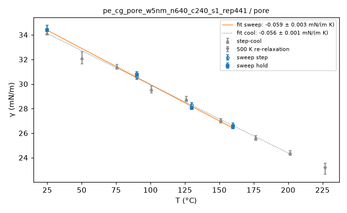

**film thickness, interior density and surface energy vs T**

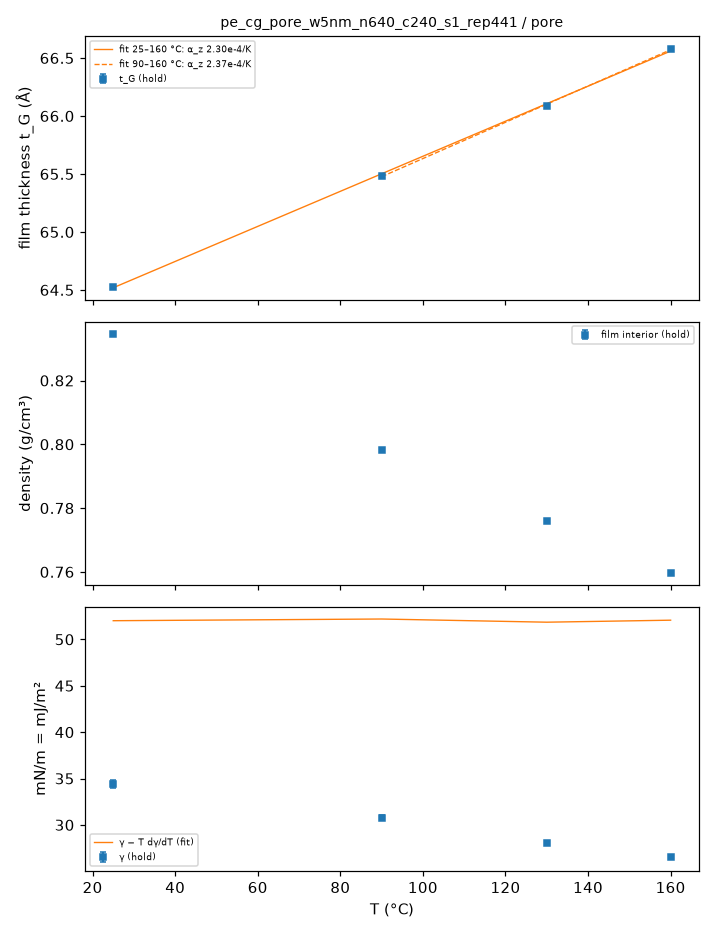

**ρ(z) at the holds**

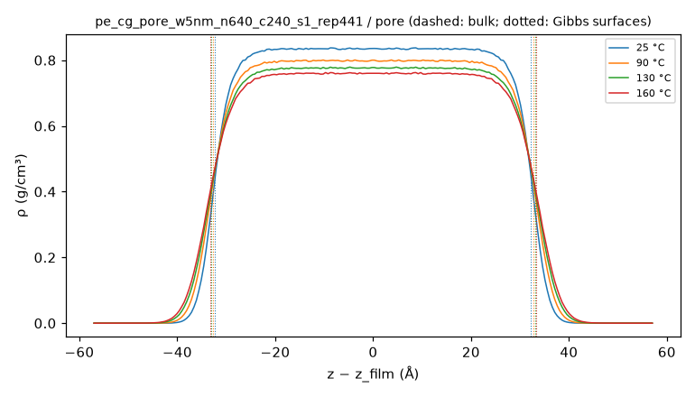

**gap width vs T**

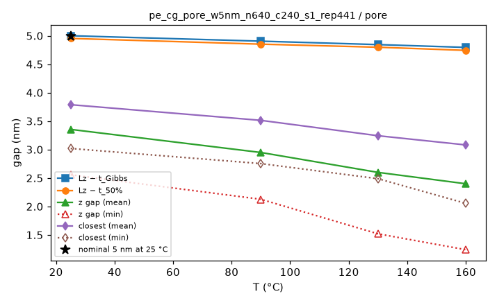

**MSD by layer**

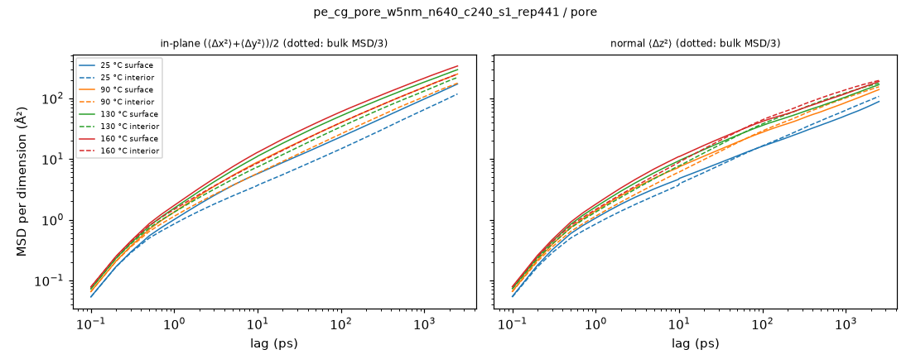

**bond P2 ACF by layer**

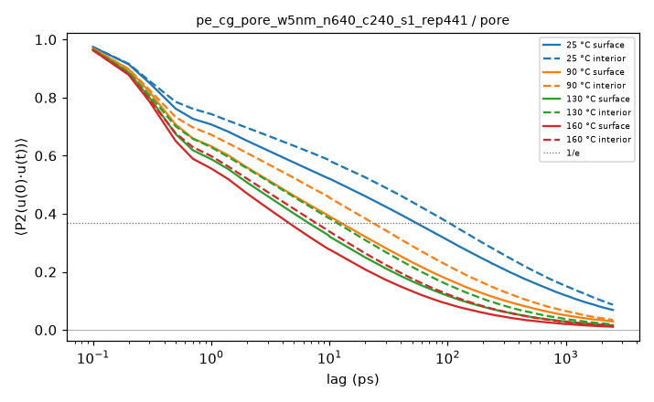

**⟨P2(cos θ_z)⟩ vs z**

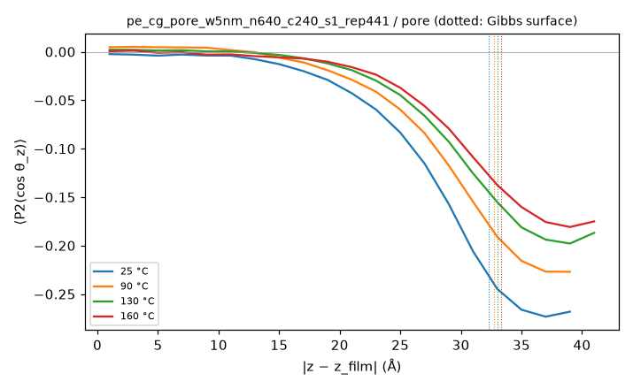

**film thickness, gap, interior density and closest approach vs time (holds)**

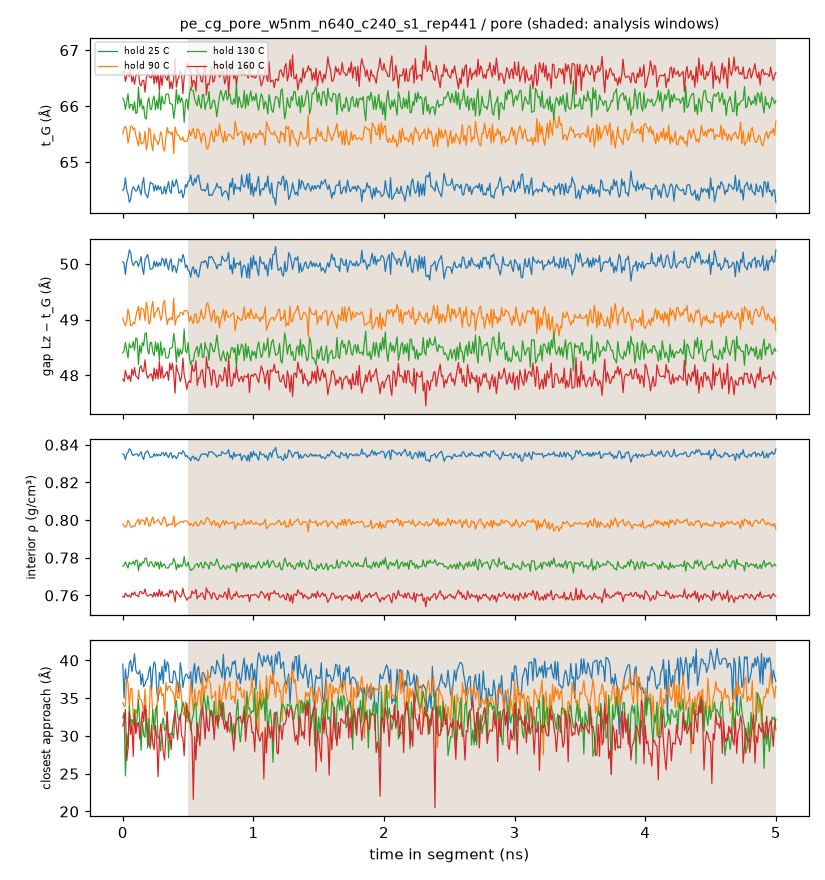

**whole film: end-to-end and Rouse mode ACFs, p²τ_p vs p**

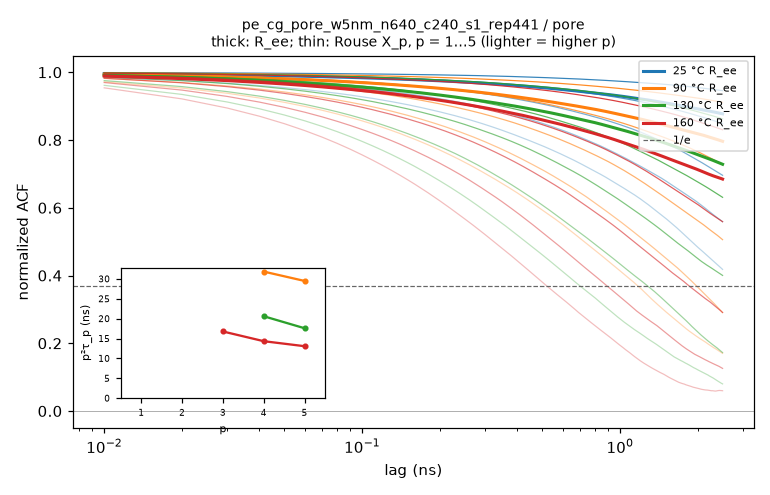

**thermo vs time, analysis windows shaded, block averages ± SEM**

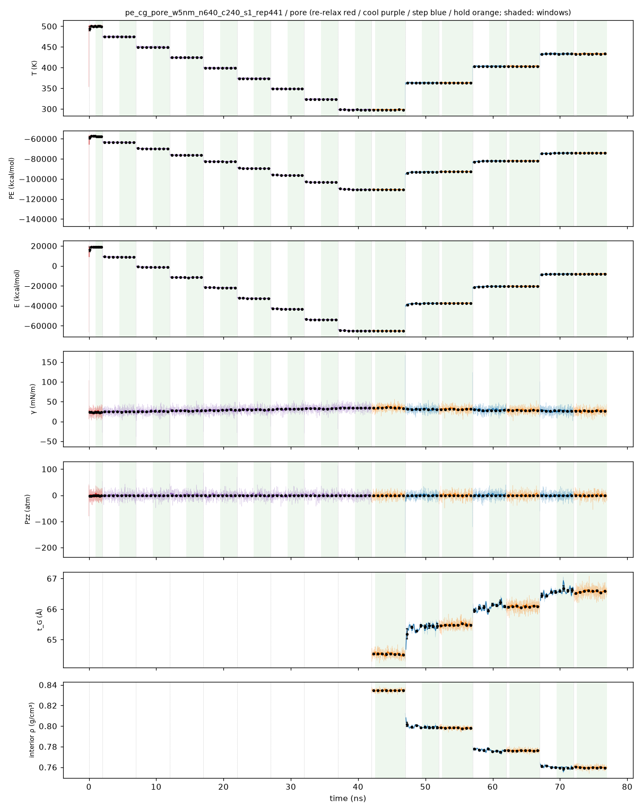

**holds: thermo vs time, analysis window shaded, block averages ± SEM**

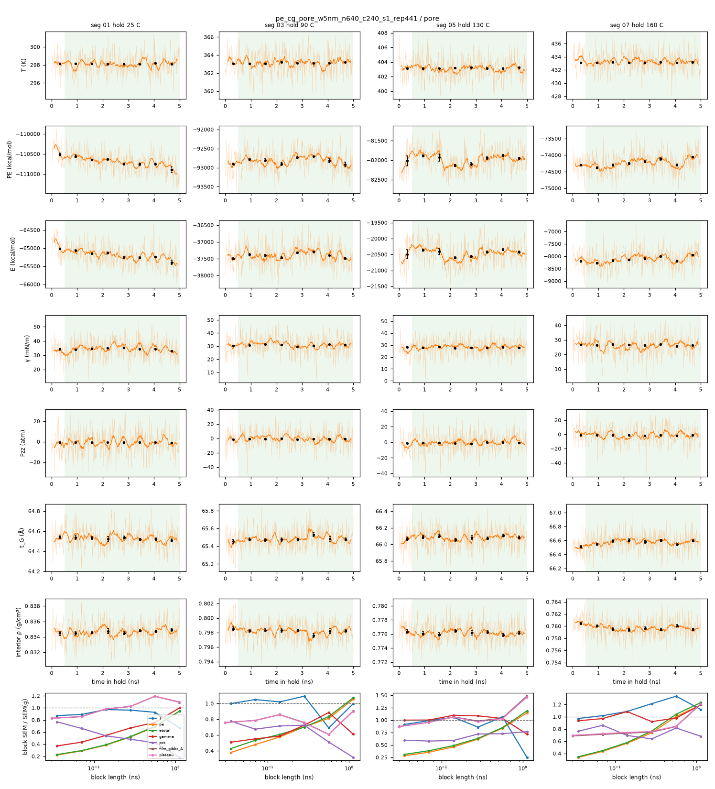

