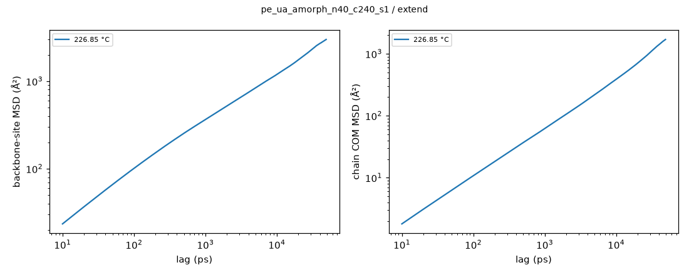
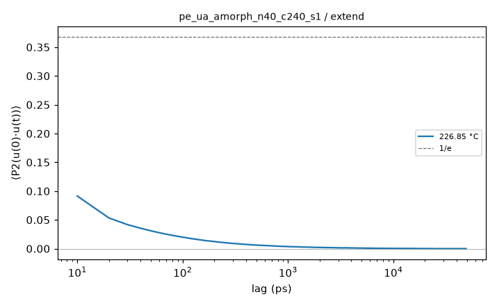
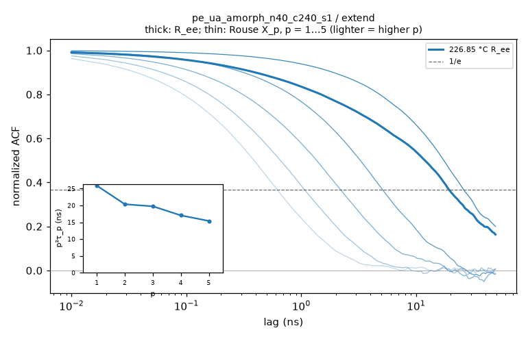

# Hold analysis: pe_ua_amorph_n40_c240_s1 / extend

- system: `pe_ua_amorph_n40_c240_s1` (ua); source run directory `/home/rdyu/projects/che126_sims/results/runs/pe_ua_amorph_n40_c240_s1/extend` (extend, status started, node rdyu-server, run code commit f08478df5d)
- analysis: `sepsim analyze hold` (D56), code commit 05d80a64df (dirty), 2026-10-30 19:25 on rdyu-server
- segment: Stage 1: NPT hold extension 80000 ps at 500 K, 1 atm (80 ns planned, not complete); thermo window without the first 10% of rows, SEM from 100 ps block means (D55)
- trajectory: `/home/rdyu/projects/che126_sims/results/runs/pe_ua_amorph_n40_c240_s1/prep/hold.dcd` read ahead of the hold DCD as one continuous trajectory (D47)
- note: hold not complete: thermo and trajectory over the part run

## Thermo

| window (ns) | T (°C) | density (g/cm³) | H (kcal/mol) | V (ų) | κ_T (GPa⁻¹) |
|---|---|---|---|---|---|
| 70.38 | 226.85 ± 0.02 | 0.74581 ± 0.00008 | 23622.3 ± 2.9 | 300008 ± 31 | 1.632 ± 0.010 |

## Trajectory: mobility and chain size

9820 frames × 10 ps (98.2 ns); parts: hold.dcd 2000, hold_ext.dcd 7820.

| COM MSD max (Ų) at lag (ns) | D_COM (D55 criterion) | bond P2 1/e | Rg (Å) | R_ee (Å) | C_n plateau |
|---|---|---|---|---|---|
| 1699 at 49.1 | not diffusive (log-slope 0.89 at the longest lag, MSD/⟨Rg²⟩ 2.28) | 7.0 ps | 27.32 ± 0.46 | 68.7 ± 1.4 | 8.193 ± 0.353 |

- no burst DCDs (deck without D46 bursts): lags from the hold DCD only

## Chain relaxation (holds; D56)

End-to-end vector ACF ⟨R(t)·R(0)⟩/⟨R²⟩ and Rouse mode ACFs ⟨X_p(t)·X_p(0)⟩/⟨X_p²⟩, X_p = (1/N) Σ_n cos(pπ(n−½)/N) r_n over the backbone sites, every time origin, lags up to half the hold (49.1 ns here). Times in ns: the first 1/e crossing; if C stays above 1/e within the lag window the time is 'not reached' and only an exponential fit of ln C over 0.2 ≤ C ≤ 0.9 is given (marked extrap.: it extrapolates the early decay). τ_ee fit is that fit for R_ee. τ_1/τ_2 is 4 for Rouse chains. p²⟨X_p²⟩ (relative to p = 1, p = 2…5) is flat for an ideal Rouse chain; it falls at high p where the chain is stiffer than Gaussian on that scale. Crystallinity: D26 local alignment, fraction of backbone sites with p2 ≥ 0.4 (**uncalibrated, melt baseline**: no crystal reference, so the number is a baseline for an amorphous box, not a calibrated crystallinity) and the largest crystalline cluster (sites).

| T (°C) | τ_ee 1/e (ns) | τ_ee fit (ns) | τ_1 (ns) | τ_2 (ns) | τ_3 (ns) | τ_1/τ_2 (Rouse 4) | p²⟨X_p²⟩ / p=1 (p = 2…5) | crystallinity |
|---|---|---|---|---|---|---|---|---|
| 226.85 | 19.3 | 27.2 | 25.9 | 5.09 | 2.19 | 5.08 | 0.94 / 0.92 / 0.90 / 0.86 | 0.021 (max 0.030; cluster ≤ 45) |

## Caveats

- Relaxation times use lags up to half the analysed hold (49.1 ns); a time beyond that is 'not reached' and only the extrapolated exponential fit is given.

## Plots

**backbone-site and chain COM MSD**

**bond P2 autocorrelation**

**end-to-end and Rouse mode ACFs, p²τ_p vs p**

