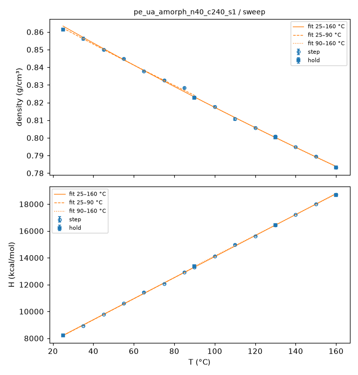
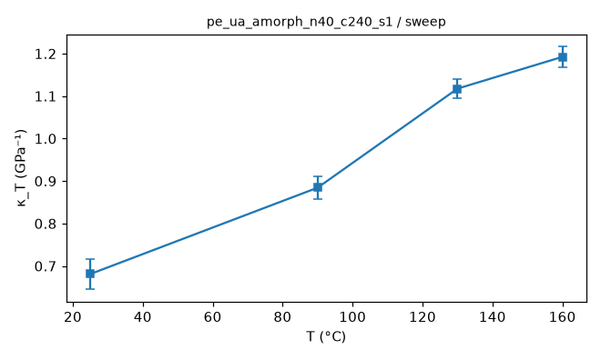
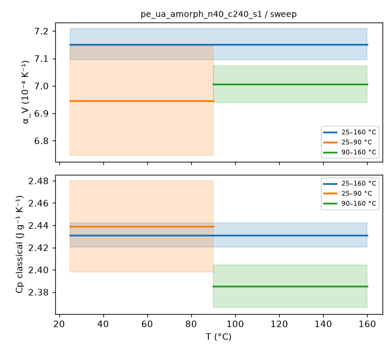
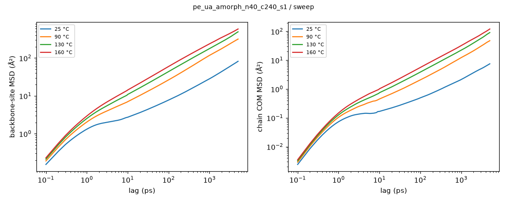
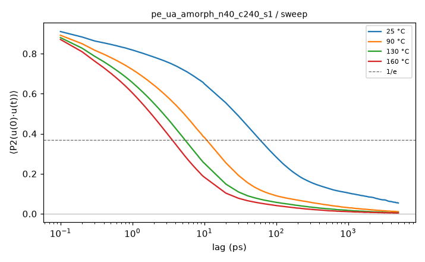
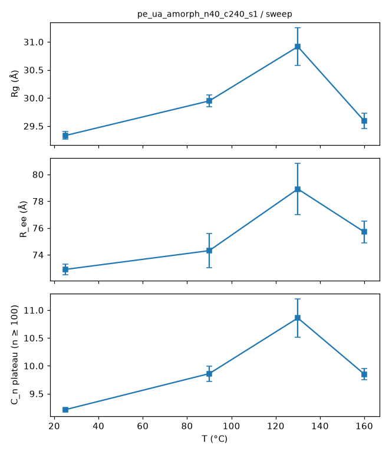
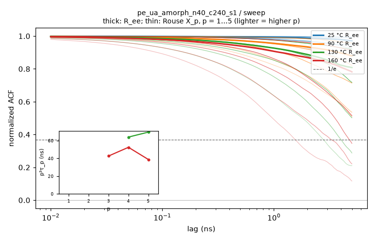
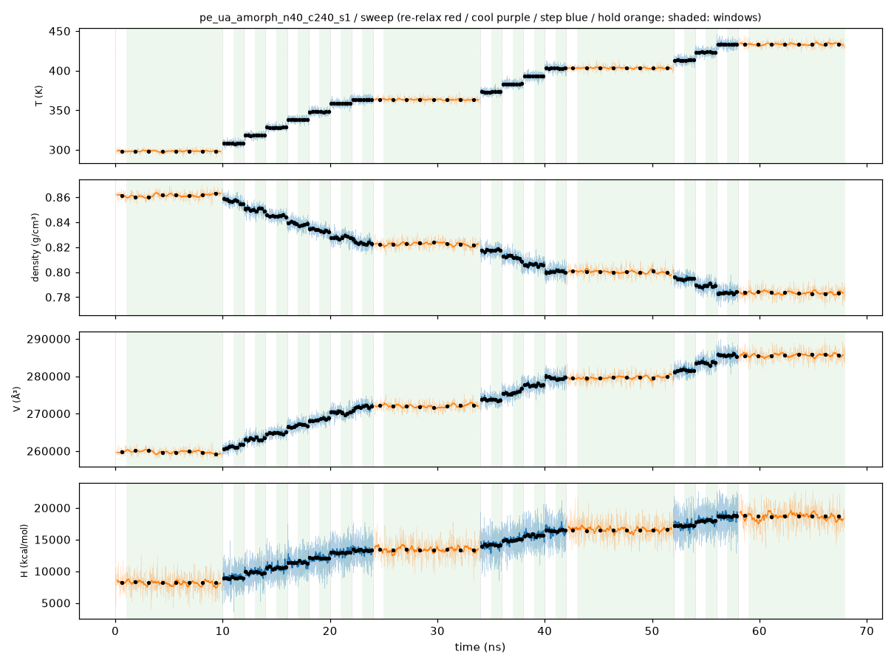
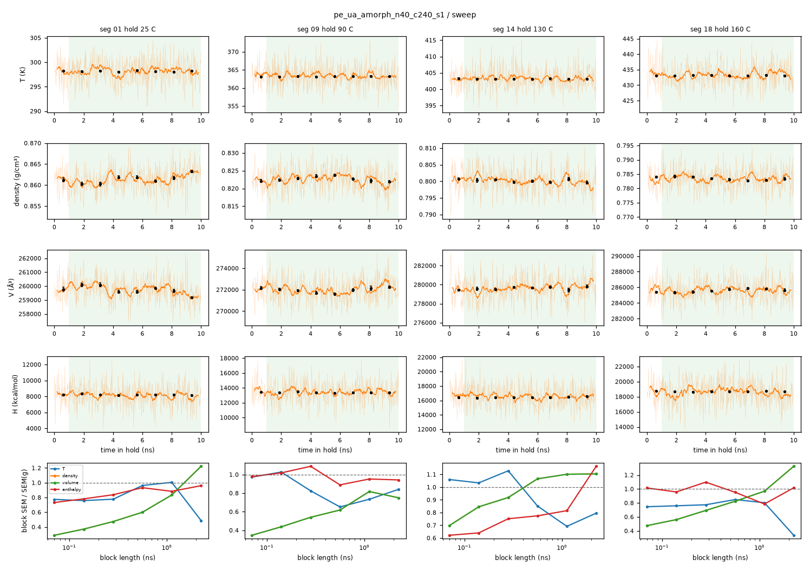

# Sweep analysis: pe_ua_amorph_n40_c240_s1 / sweep

- system: `pe_ua_amorph_n40_c240_s1` (ua); source run directory `/home/rdyu/projects/che126_sims/results/runs/pe_ua_amorph_n40_c240_s1/sweep` (status finished, node rdyu-server, run code commit 79b6d2d98a)
- analysis: `sepsim analyze sweep` (D49), code commit 798e36106d (dirty), 2026-11-07 03:43 on rdyu-server
- windows: steps second half (50% of rows dropped); holds without the first 10% of rows; SEM from the statistical inefficiency (D26)
- system mass 134739.8 g/mol (from Density × Volume)

## Segments

| # | segment | T set (°C) | window (ns) | T (°C) | density (g/cm³) | H (kcal/mol) | V (ų) | drift |
|---|---|---|---|---|---|---|---|---|
| 1 | hold | 25 | 9.00 | 25.01 ± 0.03 | 0.86142 ± 0.00045 | 8222.2 ± 19.5 | 259738 ± 136 |  |
| 2 | step | 35 | 1.00 | 34.91 ± 0.14 | 0.85609 ± 0.00085 | 8935.6 ± 22.5 | 261355 ± 259 | density |
| 3 | step | 45 | 1.00 | 45.04 ± 0.08 | 0.84989 ± 0.00041 | 9784.4 ± 15.2 | 263261 ± 129 | enthalpy |
| 4 | step | 55 | 1.00 | 55.08 ± 0.09 | 0.84492 ± 0.00031 | 10591.7 ± 13.3 | 264810 ± 97 |  |
| 5 | step | 65 | 1.00 | 64.96 ± 0.10 | 0.83789 ± 0.00042 | 11439.9 ± 19.7 | 267031 ± 133 | density |
| 6 | step | 75 | 1.00 | 74.80 ± 0.09 | 0.83278 ± 0.00025 | 12058.6 ± 7.7 | 268670 ± 81 |  |
| 7 | step | 85 | 1.00 | 85.17 ± 0.09 | 0.82830 ± 0.00046 | 12935.9 ± 14.6 | 270123 ± 149 |  |
| 8 | step | 90 | 1.00 | 90.06 ± 0.10 | 0.82292 ± 0.00034 | 13285.3 ± 9.4 | 271892 ± 112 |  |
| 9 | hold | 90 | 9.00 | 90.03 ± 0.03 | 0.82268 ± 0.00035 | 13387.5 ± 13.3 | 271969 ± 116 |  |
| 10 | step | 100 | 1.00 | 100.06 ± 0.10 | 0.81766 ± 0.00038 | 14131.2 ± 14.1 | 273641 ± 126 |  |
| 11 | step | 110 | 1.00 | 109.99 ± 0.10 | 0.81069 ± 0.00077 | 14989.2 ± 29.4 | 275993 ± 261 | density |
| 12 | step | 120 | 1.00 | 119.89 ± 0.11 | 0.80581 ± 0.00038 | 15629.4 ± 10.9 | 277667 ± 132 |  |
| 13 | step | 130 | 1.00 | 129.90 ± 0.12 | 0.80095 ± 0.00037 | 16441.0 ± 7.4 | 279349 ± 130 | density |
| 14 | hold | 130 | 9.00 | 129.97 ± 0.04 | 0.80014 ± 0.00016 | 16450.5 ± 6.5 | 279635 ± 57 | enthalpy |
| 15 | step | 140 | 1.00 | 140.19 ± 0.12 | 0.79474 ± 0.00023 | 17213.3 ± 9.0 | 281531 ± 83 |  |
| 16 | step | 150 | 1.00 | 150.14 ± 0.18 | 0.78942 ± 0.00033 | 18015.7 ± 8.9 | 283431 ± 119 | density |
| 17 | step | 160 | 1.00 | 159.90 ± 0.16 | 0.78332 ± 0.00044 | 18710.1 ± 11.5 | 285639 ± 162 |  |
| 18 | hold | 160 | 9.00 | 159.95 ± 0.05 | 0.78336 ± 0.00025 | 18695.0 ± 13.6 | 285623 ± 90 | density |

## Isothermal compressibility (holds)

κ_T = (⟨V²⟩ − ⟨V⟩²)/(k_B T ⟨V⟩) over the hold window (NPT iso Nosé–Hoover), T the set point; SEM = statistical-inefficiency SEM of (V − ⟨V⟩)² on 100 ps block means, as for the other thermo SEMs (D55; g given in raw samples).

| T (°C) | κ_T (GPa⁻¹) | σ_V (ų) | ⟨V⟩ (ų) | g | samples |
|---|---|---|---|---|---|
| 25 | 0.681 ± 0.036 | 853.4 | 259738 | 12.7 | 9001 |
| 90 | 0.884 ± 0.026 | 1098.1 | 271969 | 4.0 | 9001 |
| 130 | 1.117 ± 0.023 | 1318.8 | 279635 | 1.9 | 9001 |
| 160 | 1.192 ± 0.024 | 1427.1 | 285623 | 1.9 | 9001 |

## Sweep steps: κ_T and chain size

Per step, over its second half (as its thermo stats): κ_T as for the holds and the static chain properties from the step DCD (no MSD / relaxation). The steps are short, so κ_T is noisier and the chain shape is largely inherited from the segment before.

| T (°C) | κ_T (GPa⁻¹) | frames | R_g (Å) | R_ee (Å) | C_n plateau | ordered fraction |
|---|---|---|---|---|---|---|
| 35 | 0.684 ± 0.053 | 11 | 29.50 ± 0.04 | 73.2 ± 0.2 | 9.32 ± 0.04 | 0.116 |
| 45 | 0.741 ± 0.058 | 11 | 29.36 ± 0.02 | 72.3 ± 0.3 | 9.15 ± 0.02 | 0.102 |
| 55 | 0.674 ± 0.047 | 11 | 29.56 ± 0.06 | 73.2 ± 0.2 | 9.23 ± 0.05 | 0.100 |
| 65 | 0.752 ± 0.052 | 11 | 29.71 ± 0.02 | 73.8 ± 0.2 | 9.43 ± 0.04 | 0.088 |
| 75 | 0.700 ± 0.033 | 11 | 29.74 ± 0.06 | 74.5 ± 0.4 | 9.46 ± 0.04 | 0.080 |
| 85 | 0.902 ± 0.073 | 11 | 29.46 ± 0.06 | 72.8 ± 0.3 | 9.29 ± 0.03 | 0.082 |
| 90 | 0.901 ± 0.048 | 11 | 29.45 ± 0.04 | 70.7 ± 0.5 | 9.26 ± 0.03 | 0.057 |
| 100 | 0.903 ± 0.048 | 11 | 30.03 ± 0.06 | 77.7 ± 0.3 | 10.12 ± 0.05 | 0.047 |
| 110 | 0.970 ± 0.075 | 11 | 29.96 ± 0.06 | 76.3 ± 0.2 | 10.08 ± 0.05 | 0.036 |
| 120 | 1.015 ± 0.052 | 11 | 31.12 ± 0.04 | 83.7 ± 0.3 | 11.27 ± 0.03 | 0.035 |
| 130 | 0.887 ± 0.044 | 11 | 31.11 ± 0.12 | 79.2 ± 0.3 | 11.09 ± 0.12 | 0.032 |
| 140 | 1.004 ± 0.083 | 11 | 31.07 ± 0.21 | 80.0 ± 0.4 | 11.03 ± 0.13 | 0.035 |
| 150 | 1.074 ± 0.078 | 11 | 30.62 ± 0.18 | 80.9 ± 0.8 | 10.94 ± 0.16 | 0.028 |
| 160 | 1.227 ± 0.059 | 11 | 28.77 ± 0.21 | 76.6 ± 1.2 | 9.45 ± 0.21 | 0.030 |

## Thermal expansion and classical Cp (fits over the sweep)

Linear fits in T over each window, SEM-weighted, one point per temperature (hold where there is one): 25, 35, 45, 55, 65, 75, 85, 90, 100, 110, 120, 130, 140, 150, 160 °C. α_V = (1/⟨V⟩) dV/dT; Cp = dH/dT per gram; errors 1σ from the fit, scaled by √χ²_red when χ²_red > 1.

| window (°C) | points | α_V (10⁻⁴ K⁻¹) | χ²_red (V) | Cp (J g⁻¹ K⁻¹) | χ²_red (H) |
|---|---|---|---|---|---|
| 25–160 | 15 | 7.151 ± 0.057 | 5.03 | 2.431 ± 0.011 | 18.72 |
| 25–90 | 8 | 6.946 ± 0.200 | 6.04 | 2.439 ± 0.041 | 26.41 |
| 90–160 | 8 | 7.007 ± 0.067 | 1.19 | 2.385 ± 0.019 | 9.98 |

## Hold trajectories: mobility and chain size

Backbone sites (CG: beads; UA/AA: backbone carbons) and chains, positions relative to the system's mass centre. MSD and P2 combine the D46 bursts (0.1 ps frames, lags < the hold frame interval) with the hold DCD (lags up to half the hold). D_COM from an OLS line over the end of the COM MSD where the local log-slope stays ≥ 0.9 over a factor ≥ 2 in lag and the MSD ≥ 2⟨Rg²⟩ (D55; error: slope spread of the two halves of that range); else "not diffusive" (log-slope at the longest lag given). Rg mass-weighted over all atoms of a chain; C_n plateau over n ≥ 100 carbons (D37) on ≤ 500 frames.

| T (°C) | frames | bursts | MSD seg 10 ps / max (Ų) | COM MSD max (Ų) | D_COM (cm²/s) | P2 1/e (ps) | Rg (Å) | R_ee (Å) | C_n plateau |
|---|---|---|---|---|---|---|---|---|---|
| 25 | 1001 × 10 ps | 10 | 2.7 / 82 (5 ns) | 8 | not diffusive (log-slope 0.84 at the longest lag) | 60.1 | 29.33 ± 0.07 | 72.9 ± 0.4 | 9.214 ± 0.015 |
| 90 | 1001 × 10 ps | 10 | 7.0 / 317 (5 ns) | 48 | not diffusive (log-slope 0.83 at the longest lag) | 11.1 | 29.95 ± 0.10 | 74.3 ± 1.3 | 9.860 ± 0.139 |
| 130 | 1001 × 10 ps | 10 | 10.9 / 493 (5 ns) | 91 | not diffusive (log-slope 0.89 at the longest lag) | 5.4 | 30.91 ± 0.34 | 78.9 ± 1.9 | 10.859 ± 0.342 |
| 160 | 1001 × 10 ps | 10 | 14.3 / 586 (5 ns) | 122 | not diffusive (log-slope 0.96 at the longest lag) | 3.6 | 29.59 ± 0.14 | 75.7 ± 0.8 | 9.851 ± 0.100 |

## Chain relaxation (holds; D56)

End-to-end vector ACF ⟨R(t)·R(0)⟩/⟨R²⟩ and Rouse mode ACFs ⟨X_p(t)·X_p(0)⟩/⟨X_p²⟩, X_p = (1/N) Σ_n cos(pπ(n−½)/N) r_n over the backbone sites, every time origin, lags up to half the hold (5 ns here). Times in ns: the first 1/e crossing; if C stays above 1/e within the lag window the time is 'not reached' and only an exponential fit of ln C over 0.2 ≤ C ≤ 0.9 is given (marked extrap.: it extrapolates the early decay). τ_ee fit is that fit for R_ee. τ_1/τ_2 is 4 for Rouse chains. p²⟨X_p²⟩ (relative to p = 1, p = 2…5) is flat for an ideal Rouse chain; it falls at high p where the chain is stiffer than Gaussian on that scale. Crystallinity: D26 local alignment, fraction of backbone sites with p2 ≥ 0.4 (**uncalibrated, melt baseline**: no crystal reference, so the number is a baseline for an amorphous box, not a calibrated crystallinity) and the largest crystalline cluster (sites).

| T (°C) | τ_ee 1/e (ns) | τ_ee fit (ns) | τ_1 (ns) | τ_2 (ns) | τ_3 (ns) | τ_1/τ_2 (Rouse 4) | p²⟨X_p²⟩ / p=1 (p = 2…5) | crystallinity |
|---|---|---|---|---|---|---|---|---|
| 25 | not reached (C 0.97 at max lag) | n/a (extrap.) | not reached (C 0.99 at max lag) | not reached (C 0.97 at max lag) | not reached (C 0.94 at max lag) | n/a | 0.87 / 1.03 / 1.24 / 0.98 | 0.122 (max 0.145; cluster ≤ 1244) |
| 90 | not reached (C 0.88 at max lag; fit 49.2, extrap.) | 49.2 (extrap.) | not reached (C 0.96 at max lag) | not reached (C 0.82 at max lag; fit 26.5, extrap.) | not reached (C 0.71 at max lag; fit 16.7, extrap.) | n/a | 0.82 / 1.02 / 0.93 / 0.96 | 0.053 (max 0.067; cluster ≤ 275) |
| 130 | not reached (C 0.81 at max lag; fit 29.4, extrap.) | 29.4 (extrap.) | not reached (C 0.92 at max lag) | not reached (C 0.72 at max lag; fit 15.2, extrap.) | not reached (C 0.50 at max lag; fit 7.56, extrap.) | n/a | 0.77 / 0.77 / 0.78 / 0.73 | 0.036 (max 0.049; cluster ≤ 130) |
| 160 | not reached (C 0.78 at max lag; fit 28.1, extrap.) | 28.1 (extrap.) | not reached (C 0.91 at max lag) | not reached (C 0.51 at max lag; fit 7.78, extrap.) | 4.75 | n/a | 0.74 / 0.91 / 0.82 / 0.75 | 0.030 (max 0.040; cluster ≤ 122) |

Where τ_1 is not reached, p²τ_p of the faster modes estimates it under ideal Rouse scaling (τ_p ∝ p⁻²). Real melts show τ_p ∝ p^−2.2…−2.4 (stiffness, local friction), so p²τ_p underestimates τ_1, more so the higher p:

- 130 °C: τ_1 ≈ p²τ_p from the reached modes: p=4: 64.1, p=5: 69.7 ns.
- 160 °C: τ_1 ≈ p²τ_p from the reached modes: p=3: 42.7, p=4: 52.5, p=5: 38.8 ns.

## Equilibration

Every average uses only the analysis window: steps second half (50% of rows dropped), holds without the first 10% of rows (the rest is equilibration after the T change; see `equilibration.png`, windows shaded, block averages ± SEM overlaid, and `equilibration_holds.png`). Drift: the window's two halves differ by > 2 combined SEM (statistical inefficiency).

Segments with a drifting window (tested: density, enthalpy):

| segment | T set (°C) | drift (second − first half ± SEM) |
|---|---|---|
| seg 02 step 35 C | 35 | density -0.002657 ± 0.00035 |
| seg 03 step 45 C | 45 | enthalpy -216.8 ± 93 |
| seg 05 step 65 C | 65 | density +0.001146 ± 0.00045 |
| seg 11 step 110 C | 110 | density -0.002003 ± 0.00082 |
| seg 13 step 130 C | 130 | density -0.0009402 ± 0.00047 |
| seg 14 hold 130 C | 130 | enthalpy +97.04 ± 36 |
| seg 16 step 150 C | 150 | density -0.001418 ± 0.00066 |
| seg 18 hold 160 C | 160 | density -0.0009835 ± 0.00032 |

Block-average check of the hold SEMs: SEM of the means of 32 / 16 / 8 blocks vs the statistical-inefficiency SEM (blocks longer than the correlation time plateau at it; flagged if the 8-block SEM exceeds it by > 2×).

| T (°C) | quantity | SEM (g) | block SEM 32 / 16 / 8 | converged |
|---|---|---|---|---|
| 25 | density | 0.000451 | 0.000214 / 0.000271 / 0.000376 | yes |
| 25 | enthalpy | 19.7 | 16.5 / 18.4 / 17.4 | yes |
| 90 | density | 0.000352 | 0.00019 / 0.000217 / 0.000288 | yes |
| 90 | enthalpy | 17.8 | 19.3 / 15.8 / 16.9 | yes |
| 130 | density | 0.000164 | 0.000151 / 0.000175 / 0.000181 | yes |
| 130 | enthalpy | 29.2 | 21.9 / 22.6 / 23.8 | yes |
| 160 | density | 0.000248 | 0.000171 / 0.000204 / 0.00024 | yes |
| 160 | enthalpy | 17.9 | 19.6 / 17 / 14 | yes |

Local quantities (density, enthalpy, κ_T, segmental MSD, bond P2: relaxation times ~10–100 ps in CG, the bond P2 1/e time above) equilibrate within the dropped part of each segment; their windows are what the drift and block checks test.

Chain-scale quantities (Rg, R_ee, C_n, chain COM motion) relax on the end-to-end time (CG C240 at 25 °C: of order 100 ns; C1500 far longer), longer than a 25 ns hold: their hold averages describe the chain configurations carried in from the 500 K equilibration and cooling rather than a re-equilibrated state at T. Per hold:
- 25 °C: chain COM MSD at 5 ns / ⟨Rg²⟩ = 0.01; chains have **not** moved their own size: chain-scale averages sample a partly relaxed set of chain configurations.
- 90 °C: chain COM MSD at 5 ns / ⟨Rg²⟩ = 0.05; chains have **not** moved their own size: chain-scale averages sample a partly relaxed set of chain configurations.
- 130 °C: chain COM MSD at 5 ns / ⟨Rg²⟩ = 0.10; chains have **not** moved their own size: chain-scale averages sample a partly relaxed set of chain configurations.
- 160 °C: chain COM MSD at 5 ns / ⟨Rg²⟩ = 0.14; chains have **not** moved their own size: chain-scale averages sample a partly relaxed set of chain configurations.

## Caveats

- Cp is the classical dH/dT and is not comparable to experiment: classical MD gives every degree of freedom k_B/2 per quadratic term; UA also drops degrees of freedom (the hydrogens), so its Cp per gram is not a property of the real polymer at all (reported for completeness and resolution comparisons only).
- D37 chain check FAIL on the prep hold + extension: C_n plateau 8.19 vs melt 6.7 ±10%.
- α_V and Cp are linear fits in T over each window with SEM weights; a reduced χ² > 1 (curvature over the window, or SEMs too small) inflates the quoted errors by √χ²_red, and a large χ²_red over 25–160 °C means α_V or Cp depends on T (compare the two half windows).

## Plots

**density and enthalpy vs T with the linear fits**

**κ_T vs T (holds)**

**α_V and Cp per fit window**

**backbone-site and chain COM MSD**

**bond P2 autocorrelation**

**Rg, R_ee and C_n vs T**

**end-to-end and Rouse mode ACFs, p²τ_p vs p**

**thermo vs time, analysis windows shaded, block averages ± SEM**

**holds: thermo vs time, analysis window shaded, block averages ± SEM**

