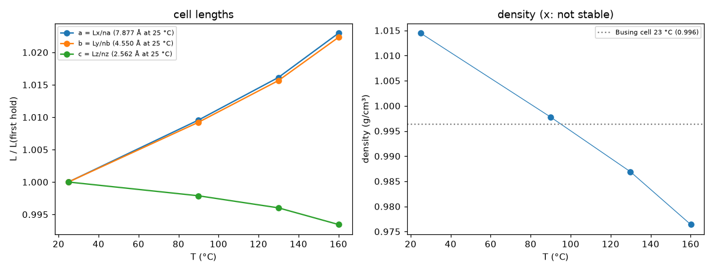

# Crystal analysis: pe_ua_crystal_7x10x40_s1 / crystal

- system: `pe_ua_crystal_7x10x40_s1` (ua); source run directory `/home/rdyu/projects/che126_sims/results/runs/pe_ua_crystal_7x10x40_s1/crystal` (status finished, node rdyu-rog, run code commit 70111966f1)
- analysis: `sepsim analyze crystal` (D59), code commit 3982185c3f (dirty), 2026-11-20 09:28 on rdyu-rog
- 140 stems x 80 sites, 7 x 10 x 40 repeats of pe_orthorhombic_busing (a 7.4069, b 4.9491, c 2.5511 Å at 23 °C, 0.9963 g/cm³, 18.33 Ų per chain)
- crystallinity: D26 local P2 with ring chords, r_c 6.50 Å, threshold 0.4 (**uncalibrated, melt baseline**); stable hold: last frame fraction ≥ 0.8 and stem P2 ≥ 0.8

## Holds

Thermo after the first 10% of each hold (mean ± SEM). a = Lx/na, b = Ly/nb, c = Lz/nz (CG: rise per bead; UA: the 2-CH2 repeat). ρ/ρ_exp and A/A_exp against the Busing cell (0.9963 g/cm³, 18.33 Ų).

| T (°C) | a (Å) | b (Å) | c (Å) | a/b | ρ (g/cm³) | ρ/ρ_exp | A/chain (Ų) | A/A_exp | drift | crystalline (mean; first → last) | stem P2 (last) | largest cluster (last) | stable |
|---|---|---|---|---|---|---|---|---|---|---|---|---|---|
| 25.0 | 7.8771 ± 0.0057 | 4.5504 ± 0.0029 | 2.5623 ± 0.0001 | 1.731 | 1.0145 ± 0.0005 | 1.018 | 17.92 ± 0.01 | 0.978 | c_A, density, volume_A3, area_per_chain_A2 | 1.000; 1.000 → 1.000 | 0.983 | 1.000 | True |
| 89.9 | 7.9524 ± 0.0011 | 4.5923 ± 0.0012 | 2.5569 ± 0.0001 | 1.732 | 0.9978 ± 0.0003 | 1.001 | 18.26 ± 0.01 | 0.996 | density, volume_A3, area_per_chain_A2 | 1.000; 1.000 → 1.000 | 0.977 | 1.000 | True |
| 129.9 | 8.0042 ± 0.0008 | 4.6216 ± 0.0004 | 2.5521 ± 0.0001 | 1.732 | 0.9869 ± 0.0001 | 0.991 | 18.50 ± 0.00 | 1.009 | none | 0.999; 1.000 → 1.000 | 0.973 | 1.000 | True |
| 160.1 | 8.0581 ± 0.0012 | 4.6520 ± 0.0007 | 2.5455 ± 0.0002 | 1.732 | 0.9764 ± 0.0002 | 0.980 | 18.74 ± 0.01 | 1.023 | none | 0.998; 1.000 → 0.998 | 0.964 | 0.998 | True |

## Thermal expansion (stable holds)

Holds 25, 90, 130, 160 °C; α = d ln L/dT, OLS.

| quantity | α (10⁻⁴ K⁻¹) |
|---|---|
| a | 1.650 ± 0.105 |
| b | 1.605 ± 0.106 |
| c | -0.467 ± 0.074 |
| V | 2.791 ± 0.137 |

## Caveats

- A periodic perfect crystal of infinite stems has no surfaces, ends or defects to nucleate melting: it superheats, so a hold or ramp that stays crystalline bounds its stability from above; it is not the melting point.
- CG (SDK) beads carry no setting angle: the stems pack as the model prefers (a/b = √3 is hexagonal); a, b and c of the CG crystal are not the orthorhombic PE cell.
- The barostat is anisotropic (x, y, z independent, couple none); the stems stay along z only while the crystal holds.

## Plots

**cell lengths and density per hold**

**crystallinity and stem P2**

