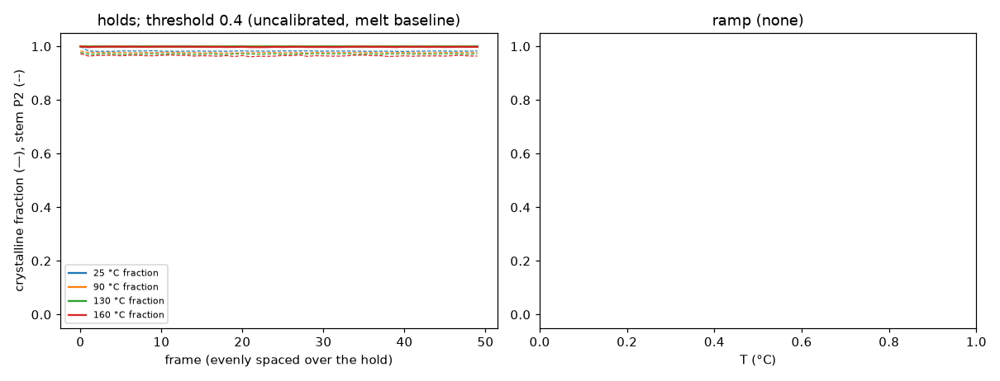
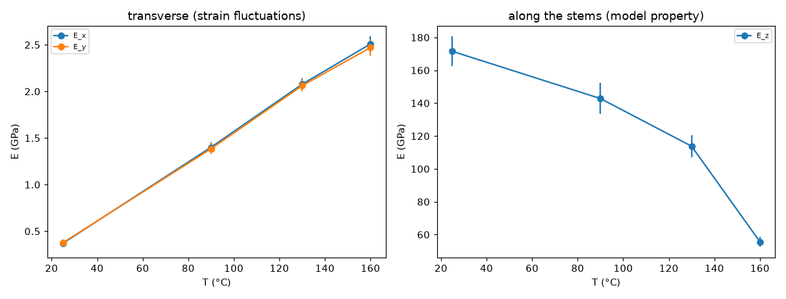
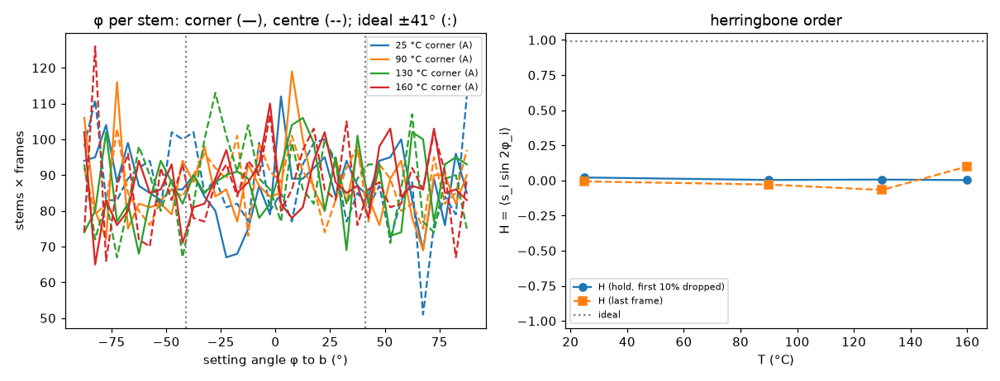

# Crystal analysis: pe_ua_crystal_7x10x40_s1 / crystal

- system: `pe_ua_crystal_7x10x40_s1` (ua); source run directory `/home/rdyu/projects/che126_sims/results/runs/pe_ua_crystal_7x10x40_s1/crystal` (status finished, node rdyu-rog, run code commit 70111966f1)
- analysis: `sepsim analyze crystal` (D59), code commit dfacaa42f9 (dirty), 2026-11-23 18:26 on rdyu-server
- 140 stems x 80 sites, 7 x 10 x 40 repeats of pe_orthorhombic_busing (a 7.4069, b 4.9491, c 2.5511 Å at 23 °C, 0.9963 g/cm³, 18.33 Ų per chain)
- crystallinity: D26 local P2 with ring chords, r_c 6.50 Å, threshold 0.4 (**uncalibrated, melt baseline**); stable hold: last frame fraction ≥ 0.8 and stem P2 ≥ 0.8

## Holds

Thermo after the first 10% of each hold (mean ± SEM). a = Lx/na, b = Ly/nb, c = Lz/nz (CG: rise per bead; UA: the 2-CH2 repeat). ρ/ρ_exp and A/A_exp against the Busing cell (0.9963 g/cm³, 18.33 Ų).

| T (°C) | a (Å) | b (Å) | c (Å) | a/b | ρ (g/cm³) | ρ/ρ_exp | A/chain (Ų) | A/A_exp | drift | crystalline (mean; first → last) | stem P2 (last) | largest cluster (last) | stable |
|---|---|---|---|---|---|---|---|---|---|---|---|---|---|
| 25.0 | 7.8771 ± 0.0057 | 4.5504 ± 0.0029 | 2.5623 ± 0.0001 | 1.731 | 1.0145 ± 0.0005 | 1.018 | 17.92 ± 0.01 | 0.978 | c_A, density, volume_A3, area_per_chain_A2 | 1.000; 1.000 → 1.000 | 0.983 | 1.000 | True |
| 89.9 | 7.9524 ± 0.0011 | 4.5923 ± 0.0012 | 2.5569 ± 0.0001 | 1.732 | 0.9978 ± 0.0003 | 1.001 | 18.26 ± 0.01 | 0.996 | density, volume_A3, area_per_chain_A2 | 1.000; 1.000 → 1.000 | 0.977 | 1.000 | True |
| 129.9 | 8.0042 ± 0.0008 | 4.6216 ± 0.0004 | 2.5521 ± 0.0001 | 1.732 | 0.9869 ± 0.0001 | 0.991 | 18.50 ± 0.00 | 1.009 | none | 0.999; 1.000 → 1.000 | 0.973 | 1.000 | True |
| 160.1 | 8.0581 ± 0.0012 | 4.6520 ± 0.0007 | 2.5455 ± 0.0002 | 1.732 | 0.9764 ± 0.0002 | 0.980 | 18.74 ± 0.01 | 1.023 | none | 0.998; 1.000 → 0.998 | 0.964 | 0.998 | True |

## Thermal expansion (stable holds)

Holds 25, 90, 130, 160 °C; α = d ln L/dT, OLS.

| quantity | α (10⁻⁴ K⁻¹) |
|---|---|
| a | 1.650 ± 0.105 |
| b | 1.605 ± 0.106 |
| c | -0.467 ± 0.074 |
| V | 2.791 ± 0.137 |

## Elastic constants (strain fluctuations)

Per hold (after the first 10%): ε_i = (L_i − ⟨L_i⟩)/⟨L_i⟩, S_ij = ⟨V⟩⟨ε_i ε_j⟩/(k_B T) with T the set point, over the normal strains of the orthogonal box (shear fixed; normal–shear couplings assumed zero by symmetry); E_i = 1/S_ii, ν_ij = −S_ij/S_ii, C = S⁻¹. ± is the bootstrap standard error over 100-row blocks (1000 draws). Rate-free (static, isothermal) constants; x, y transverse, z along the stems.

| T (°C) | blocks | E_x (GPa) | E_y (GPa) | E_z (GPa) | ν_xy | ν_yx | ν_xz | ν_yz | C11 | C22 | C33 | C12 | C13 | C23 | stable |
|---|---|---|---|---|---|---|---|---|---|---|---|---|---|---|---|
| 25 | 18 | 0.37 ± 0.04 | 0.38 ± 0.03 | 171.5 ± 9.1 | 0.943 ± 0.016 | 0.961 ± 0.018 | 0.006 ± 0.002 | -0.003 ± 0.002 | 4.2 ± 0.2 | 4.2 ± 0.2 | 182.6 ± 9.6 | 4.0 ± 0.2 | 6.6 ± 0.6 | 5.8 ± 0.6 | True |
| 90 | 18 | 1.40 ± 0.05 | 1.38 ± 0.06 | 142.8 ± 9.5 | 0.829 ± 0.018 | 0.819 ± 0.011 | 0.006 ± 0.002 | 0.005 ± 0.003 | 4.5 ± 0.2 | 4.5 ± 0.2 | 148.1 ± 10.1 | 3.7 ± 0.2 | 4.7 ± 0.9 | 4.6 ± 1.1 | True |
| 130 | 18 | 2.08 ± 0.06 | 2.06 ± 0.06 | 113.8 ± 6.7 | 0.724 ± 0.015 | 0.718 ± 0.013 | 0.017 ± 0.004 | 0.011 ± 0.003 | 4.7 ± 0.2 | 4.6 ± 0.2 | 123.2 ± 7.4 | 3.4 ± 0.2 | 6.3 ± 0.6 | 5.9 ± 0.6 | True |
| 160 | 18 | 2.51 ± 0.08 | 2.47 ± 0.09 | 55.7 ± 3.1 | 0.560 ± 0.021 | 0.551 ± 0.022 | 0.051 ± 0.005 | 0.049 ± 0.005 | 4.6 ± 0.1 | 4.5 ± 0.2 | 74.4 ± 3.6 | 2.9 ± 0.1 | 8.5 ± 0.5 | 8.3 ± 0.4 | True |

Halves check: E from the first vs the second half of the window (each with its own bootstrap error); **flag** when they differ by more than 2σ.

| T (°C) | E_x 1st → 2nd | E_y 1st → 2nd | E_z 1st → 2nd | flagged |
|---|---|---|---|---|
| 25 | 0.39 ± 0.04 → 0.36 ± 0.05 | 0.40 ± 0.04 → 0.36 ± 0.05 | 162.9 ± 12.0 → 193.0 ± 10.4 | none |
| 90 | 1.44 ± 0.09 → 1.37 ± 0.06 | 1.43 ± 0.09 → 1.35 ± 0.07 | 126.3 ± 13.4 → 164.7 ± 7.5 | E_z |
| 130 | 2.04 ± 0.09 → 2.12 ± 0.09 | 2.00 ± 0.07 → 2.13 ± 0.10 | 102.4 ± 6.8 → 133.2 ± 6.2 | E_z |
| 160 | 2.43 ± 0.11 → 2.60 ± 0.10 | 2.43 ± 0.08 → 2.54 ± 0.16 | 63.1 ± 4.0 → 53.5 ± 3.1 | none |

## Setting angle (herringbone)

Per stem and frame: at each site the bisector w = −(u₋ + u₊) of its two ring bonds, projected on xy, φ = atan2(w_x, w_y) (angle of the zigzag plane to b); folded over the stem by the double angle (w alternates sides). Corner stems (A) ideally +41°, centre stems (B) −41°; herringbone angle (φ_A − φ_B)/2 (≈ 0 if parallel); H = ⟨s_i sin 2φ_i⟩, s = ±1 per sublattice (0.990 ideal, 0 parallel or random). Spreads are circular SDs. Hold values over 45 of 50 frames (the first 10% of the hold, at least the starting frame, dropped); first and last frame over the whole hold.

| T (°C) | a/b | φ_A (°) | φ_B (°) | herringbone (°) | H (first → last) | ⟨abs φ⟩ (°) | across SD A / B (°) | within SD (°) |
|---|---|---|---|---|---|---|---|---|
| 25 | 1.731 | 66.4 | -45.7 | -33.9 | 0.021 (1.000 → -0.007) | 45.3 | 80.1 / 76.8 | 23.9 |
| 90 | 1.732 | 5.0 | -9.6 | 7.3 | 0.003 (-0.007 → -0.029) | 44.6 | 84.7 / 83.5 | 29.2 |
| 130 | 1.732 | 18.3 | -1.6 | 10.0 | 0.006 (-0.029 → -0.068) | 44.2 | 81.2 / 75.5 | 32.3 |
| 160 | 1.732 | 26.2 | 18.2 | 4.0 | 0.002 (-0.068 → 0.100) | 44.5 | 80.2 / 81.0 | 35.3 |

Reading: last-frame H -0.068 to 0.100 over the holds; no herringbone: the zigzag planes are parallel or disordered.

## Caveats

- A periodic perfect crystal of infinite stems has no surfaces, ends or defects to nucleate melting: it superheats, so a hold or ramp that stays crystalline bounds its stability from above; it is not the melting point.
- CG (SDK) beads carry no setting angle: the stems pack as the model prefers (a/b = √3 is hexagonal); a, b and c of the CG crystal are not the orthorhombic PE cell.
- The barostat is anisotropic (x, y, z independent, couple none); the stems stay along z only while the crystal holds.
- Elastic constants from the box-length fluctuations of the NPT holds (Parrinello-Rahman/Ray strain-fluctuation formula, T = the set point): the box is orthogonal, so the shear strains are fixed and only the normal-normal block of the compliance is sampled; it equals the normal block of the full S only if the normal-shear couplings vanish, assumed here by the orthorhombic (or pseudo-hexagonal, stems along z) symmetry. They are static (zero-rate, isothermal) constants of the model crystal, to compare with the rate-dependent tensile E_app; they rest on the MTK (Nose-Hoover) barostat sampling the NPT ensemble (Pdamp 1000 dt, frames 1 ps apart), and fluctuation estimates converge slowly: the halves check flags E that differ by more than 2 sigma between the first and second half of the hold.
- E_z is along the covalent stems, each bonded to its own periodic image (infinite chains with no ends or folds): a model property, an upper bound for real crystalline stems.

## Plots

**cell lengths and density per hold**

**crystallinity and stem P2**

**elastic moduli from strain fluctuations**

**setting angle (herringbone)**

