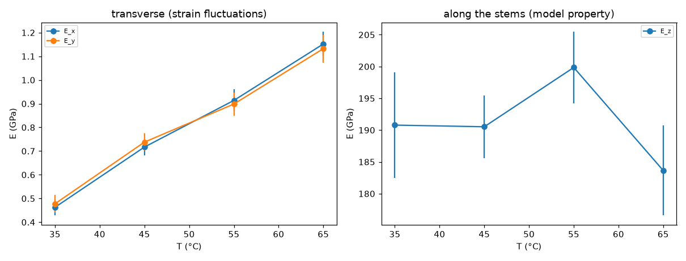

# Crystal analysis: pe_ua_crystal_7x10x40_s1 / crystal_fine_a

- system: `pe_ua_crystal_7x10x40_s1` (ua); source run directory `/home/rdyu/projects/che126_sims/results/runs/pe_ua_crystal_7x10x40_s1/crystal_fine_a` (status finished, node rdyu-rog, run code commit b969a5e8c3)
- analysis: `sepsim analyze crystal` (D59), code commit 8b68bd2293 (dirty), 2026-11-23 17:45 on rdyu-server
- 140 stems x 80 sites, 7 x 10 x 40 repeats of pe_orthorhombic_busing (a 7.4069, b 4.9491, c 2.5511 Å at 23 °C, 0.9963 g/cm³, 18.33 Ų per chain)
- crystallinity: D26 local P2 with ring chords, r_c 6.50 Å, threshold 0.4 (**uncalibrated, melt baseline**); stable hold: last frame fraction ≥ 0.8 and stem P2 ≥ 0.8

## Holds

Thermo after the first 10% of each hold (mean ± SEM). a = Lx/na, b = Ly/nb, c = Lz/nz (CG: rise per bead; UA: the 2-CH2 repeat). ρ/ρ_exp and A/A_exp against the Busing cell (0.9963 g/cm³, 18.33 Ų).

| T (°C) | a (Å) | b (Å) | c (Å) | a/b | ρ (g/cm³) | ρ/ρ_exp | A/chain (Ų) | A/A_exp | drift | crystalline (mean; first → last) | stem P2 (last) | largest cluster (last) | stable |
|---|---|---|---|---|---|---|---|---|---|---|---|---|---|
| 35.0 | 7.8785 ± 0.0040 | 4.5597 ± 0.0021 | 2.5619 ± 0.0001 | 1.728 | 1.0124 ± 0.0002 | 1.016 | 17.96 ± 0.00 | 0.980 | density, volume_A3, area_per_chain_A2 | 1.000; 1.000 → 1.000 | 0.981 | 1.000 | True |
| 45.1 | 7.9013 ± 0.0016 | 4.5638 ± 0.0007 | 2.5609 ± 0.0000 | 1.731 | 1.0089 ± 0.0001 | 1.013 | 18.03 ± 0.00 | 0.984 | none | 1.000; 1.000 → 1.000 | 0.982 | 1.000 | True |
| 55.0 | 7.9203 ± 0.0026 | 4.5680 ± 0.0017 | 2.5600 ± 0.0000 | 1.734 | 1.0059 ± 0.0001 | 1.010 | 18.09 ± 0.00 | 0.987 | density, volume_A3, area_per_chain_A2 | 1.000; 1.000 → 1.000 | 0.980 | 1.000 | True |
| 64.9 | 7.9232 ± 0.0009 | 4.5787 ± 0.0008 | 2.5592 ± 0.0000 | 1.730 | 1.0035 ± 0.0001 | 1.007 | 18.14 ± 0.00 | 0.990 | none | 1.000; 1.000 → 1.000 | 0.979 | 1.000 | True |

## Thermal expansion (stable holds)

Holds 35, 45, 55, 65 °C; α = d ln L/dT, OLS.

| quantity | α (10⁻⁴ K⁻¹) |
|---|---|
| a | 1.948 ± 0.411 |
| b | 1.343 ± 0.256 |
| c | -0.349 ± 0.007 |
| V | 2.948 ± 0.157 |

## Elastic constants (strain fluctuations)

Per hold (after the first 10%): ε_i = (L_i − ⟨L_i⟩)/⟨L_i⟩, S_ij = ⟨V⟩⟨ε_i ε_j⟩/(k_B T) with T the set point, over the normal strains of the orthogonal box (shear fixed; normal–shear couplings assumed zero by symmetry); E_i = 1/S_ii, ν_ij = −S_ij/S_ii, C = S⁻¹. ± is the bootstrap standard error over 100-row blocks (1000 draws). Rate-free (static, isothermal) constants; x, y transverse, z along the stems.

| T (°C) | blocks | E_x (GPa) | E_y (GPa) | E_z (GPa) | ν_xy | ν_yx | ν_xz | ν_yz | C11 | C22 | C33 | C12 | C13 | C23 | stable |
|---|---|---|---|---|---|---|---|---|---|---|---|---|---|---|---|
| 35 | 18 | 0.46 ± 0.03 | 0.48 ± 0.04 | 190.8 ± 8.3 | 0.931 ± 0.008 | 0.961 ± 0.008 | 0.004 ± 0.002 | -0.000 ± 0.002 | 4.6 ± 0.2 | 4.7 ± 0.2 | 202.2 ± 7.8 | 4.4 ± 0.2 | 7.2 ± 0.7 | 6.9 ± 0.7 | True |
| 45 | 18 | 0.72 ± 0.03 | 0.74 ± 0.04 | 190.5 ± 4.9 | 0.906 ± 0.008 | 0.932 ± 0.006 | 0.004 ± 0.001 | -0.000 ± 0.001 | 4.7 ± 0.1 | 4.8 ± 0.1 | 194.8 ± 5.1 | 4.4 ± 0.1 | 4.5 ± 0.6 | 4.2 ± 0.5 | True |
| 55 | 18 | 0.91 ± 0.05 | 0.90 ± 0.05 | 199.9 ± 5.6 | 0.906 ± 0.012 | 0.891 ± 0.009 | 0.003 ± 0.002 | 0.002 ± 0.002 | 4.9 ± 0.2 | 4.8 ± 0.2 | 204.9 ± 5.4 | 4.3 ± 0.2 | 4.9 ± 0.5 | 4.7 ± 0.6 | True |
| 65 | 18 | 1.15 ± 0.05 | 1.13 ± 0.06 | 183.6 ± 7.1 | 0.875 ± 0.015 | 0.860 ± 0.010 | 0.004 ± 0.002 | 0.004 ± 0.002 | 4.8 ± 0.2 | 4.7 ± 0.2 | 190.3 ± 7.7 | 4.2 ± 0.2 | 5.5 ± 0.8 | 5.4 ± 0.8 | True |

Halves check: E from the first vs the second half of the window (each with its own bootstrap error); **flag** when they differ by more than 2σ.

| T (°C) | E_x 1st → 2nd | E_y 1st → 2nd | E_z 1st → 2nd | flagged |
|---|---|---|---|---|
| 35 | 0.47 ± 0.05 → 0.46 ± 0.05 | 0.48 ± 0.05 → 0.49 ± 0.05 | 214.0 ± 10.2 → 176.8 ± 8.8 | E_z |
| 45 | 0.70 ± 0.05 → 0.74 ± 0.05 | 0.72 ± 0.05 → 0.76 ± 0.05 | 186.3 ± 7.4 → 197.4 ± 6.5 | none |
| 55 | 0.92 ± 0.06 → 0.92 ± 0.08 | 0.91 ± 0.06 → 0.90 ± 0.08 | 199.8 ± 7.1 → 203.7 ± 9.6 | none |
| 65 | 1.13 ± 0.08 → 1.17 ± 0.08 | 1.11 ± 0.09 → 1.16 ± 0.09 | 188.5 ± 9.7 → 179.0 ± 9.1 | none |

## Caveats

- A periodic perfect crystal of infinite stems has no surfaces, ends or defects to nucleate melting: it superheats, so a hold or ramp that stays crystalline bounds its stability from above; it is not the melting point.
- CG (SDK) beads carry no setting angle: the stems pack as the model prefers (a/b = √3 is hexagonal); a, b and c of the CG crystal are not the orthorhombic PE cell.
- The barostat is anisotropic (x, y, z independent, couple none); the stems stay along z only while the crystal holds.
- Elastic constants from the box-length fluctuations of the NPT holds (Parrinello-Rahman/Ray strain-fluctuation formula, T = the set point): the box is orthogonal, so the shear strains are fixed and only the normal-normal block of the compliance is sampled; it equals the normal block of the full S only if the normal-shear couplings vanish, assumed here by the orthorhombic (or pseudo-hexagonal, stems along z) symmetry. They are static (zero-rate, isothermal) constants of the model crystal, to compare with the rate-dependent tensile E_app; they rest on the MTK (Nose-Hoover) barostat sampling the NPT ensemble (Pdamp 1000 dt, frames 1 ps apart), and fluctuation estimates converge slowly: the halves check flags E that differ by more than 2 sigma between the first and second half of the hold.
- E_z is along the covalent stems, each bonded to its own periodic image (infinite chains with no ends or folds): a model property, an upper bound for real crystalline stems.

## Plots

**cell lengths and density per hold**

**crystallinity and stem P2**

**elastic moduli from strain fluctuations**

