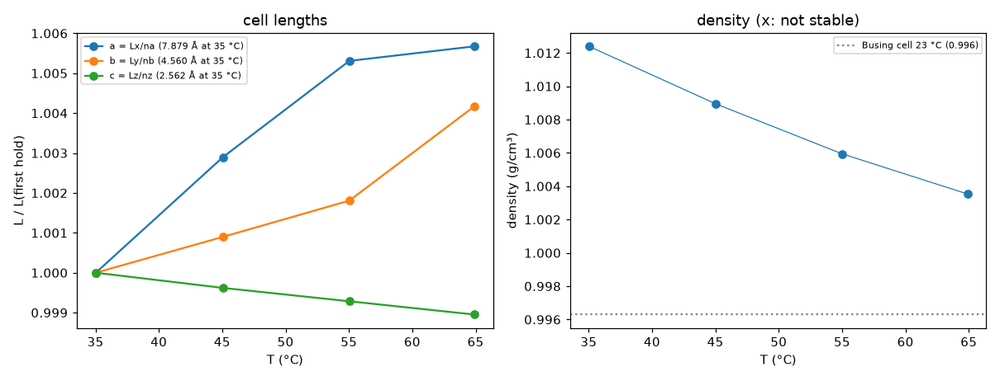
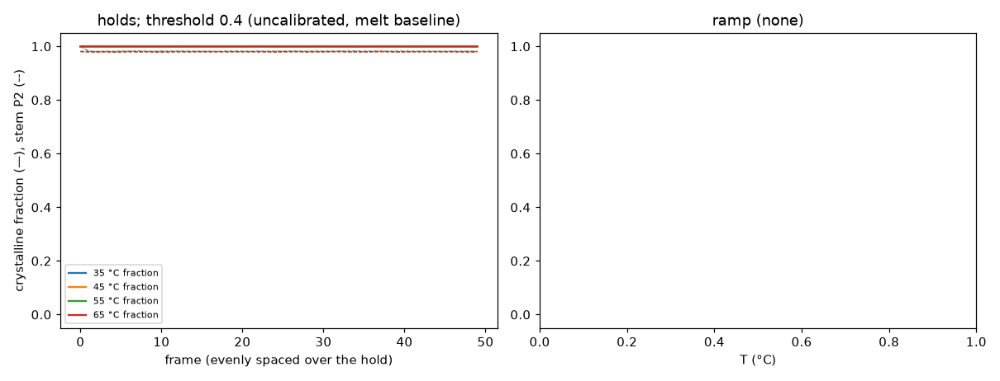

# Crystal analysis: pe_ua_crystal_7x10x40_s1 / crystal_fine_a

- system: `pe_ua_crystal_7x10x40_s1` (ua); source run directory `/home/rdyu/projects/che126_sims/results/runs/pe_ua_crystal_7x10x40_s1/crystal_fine_a` (status finished, node rdyu-rog, run code commit b969a5e8c3)
- analysis: `sepsim analyze crystal` (D59), code commit b969a5e8c3 (dirty), 2026-11-21 10:25 on rdyu-rog
- 140 stems x 80 sites, 7 x 10 x 40 repeats of pe_orthorhombic_busing (a 7.4069, b 4.9491, c 2.5511 Å at 23 °C, 0.9963 g/cm³, 18.33 Ų per chain)
- crystallinity: D26 local P2 with ring chords, r_c 6.50 Å, threshold 0.4 (**uncalibrated, melt baseline**); stable hold: last frame fraction ≥ 0.8 and stem P2 ≥ 0.8

## Holds

Thermo after the first 10% of each hold (mean ± SEM). a = Lx/na, b = Ly/nb, c = Lz/nz (CG: rise per bead; UA: the 2-CH2 repeat). ρ/ρ_exp and A/A_exp against the Busing cell (0.9963 g/cm³, 18.33 Ų).

| T (°C) | a (Å) | b (Å) | c (Å) | a/b | ρ (g/cm³) | ρ/ρ_exp | A/chain (Ų) | A/A_exp | drift | crystalline (mean; first → last) | stem P2 (last) | largest cluster (last) | stable |
|---|---|---|---|---|---|---|---|---|---|---|---|---|---|
| 35.0 | 7.8785 ± 0.0040 | 4.5597 ± 0.0021 | 2.5619 ± 0.0001 | 1.728 | 1.0124 ± 0.0002 | 1.016 | 17.96 ± 0.00 | 0.980 | density, volume_A3, area_per_chain_A2 | 1.000; 1.000 → 1.000 | 0.981 | 1.000 | True |
| 45.1 | 7.9013 ± 0.0016 | 4.5638 ± 0.0007 | 2.5609 ± 0.0000 | 1.731 | 1.0089 ± 0.0001 | 1.013 | 18.03 ± 0.00 | 0.984 | none | 1.000; 1.000 → 1.000 | 0.982 | 1.000 | True |
| 55.0 | 7.9203 ± 0.0026 | 4.5680 ± 0.0017 | 2.5600 ± 0.0000 | 1.734 | 1.0059 ± 0.0001 | 1.010 | 18.09 ± 0.00 | 0.987 | density, volume_A3, area_per_chain_A2 | 1.000; 1.000 → 1.000 | 0.980 | 1.000 | True |
| 64.9 | 7.9232 ± 0.0009 | 4.5787 ± 0.0008 | 2.5592 ± 0.0000 | 1.730 | 1.0035 ± 0.0001 | 1.007 | 18.14 ± 0.00 | 0.990 | none | 1.000; 1.000 → 1.000 | 0.979 | 1.000 | True |

## Thermal expansion (stable holds)

Holds 35, 45, 55, 65 °C; α = d ln L/dT, OLS.

| quantity | α (10⁻⁴ K⁻¹) |
|---|---|
| a | 1.948 ± 0.411 |
| b | 1.343 ± 0.256 |
| c | -0.349 ± 0.007 |
| V | 2.948 ± 0.157 |

## Caveats

- A periodic perfect crystal of infinite stems has no surfaces, ends or defects to nucleate melting: it superheats, so a hold or ramp that stays crystalline bounds its stability from above; it is not the melting point.
- CG (SDK) beads carry no setting angle: the stems pack as the model prefers (a/b = √3 is hexagonal); a, b and c of the CG crystal are not the orthorhombic PE cell.
- The barostat is anisotropic (x, y, z independent, couple none); the stems stay along z only while the crystal holds.

## Plots

**cell lengths and density per hold**

**crystallinity and stem P2**

