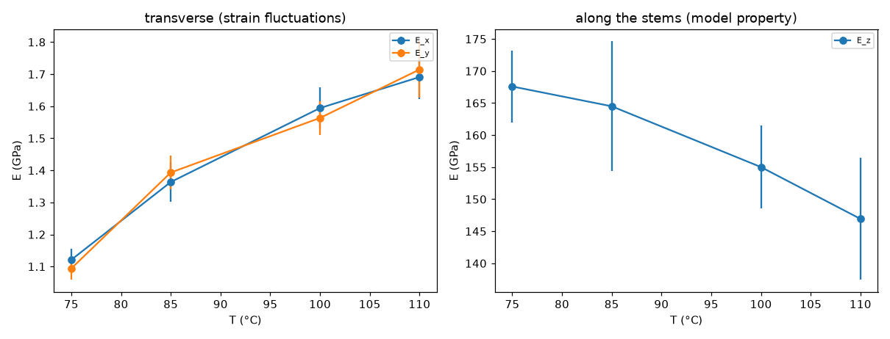
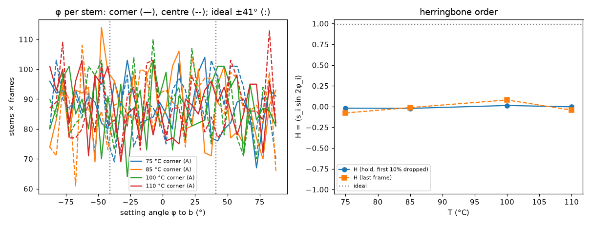

# Crystal analysis: pe_ua_crystal_7x10x40_s1 / crystal_fine_b

- system: `pe_ua_crystal_7x10x40_s1` (ua); source run directory `/home/rdyu/projects/che126_sims/results/runs/pe_ua_crystal_7x10x40_s1/crystal_fine_b` (status finished, node rdyu-rog, run code commit b969a5e8c3)
- analysis: `sepsim analyze crystal` (D59), code commit dfacaa42f9 (dirty), 2026-11-23 18:27 on rdyu-server
- 140 stems x 80 sites, 7 x 10 x 40 repeats of pe_orthorhombic_busing (a 7.4069, b 4.9491, c 2.5511 Å at 23 °C, 0.9963 g/cm³, 18.33 Ų per chain)
- crystallinity: D26 local P2 with ring chords, r_c 6.50 Å, threshold 0.4 (**uncalibrated, melt baseline**); stable hold: last frame fraction ≥ 0.8 and stem P2 ≥ 0.8

## Holds

Thermo after the first 10% of each hold (mean ± SEM). a = Lx/na, b = Ly/nb, c = Lz/nz (CG: rise per bead; UA: the 2-CH2 repeat). ρ/ρ_exp and A/A_exp against the Busing cell (0.9963 g/cm³, 18.33 Ų).

| T (°C) | a (Å) | b (Å) | c (Å) | a/b | ρ (g/cm³) | ρ/ρ_exp | A/chain (Ų) | A/A_exp | drift | crystalline (mean; first → last) | stem P2 (last) | largest cluster (last) | stable |
|---|---|---|---|---|---|---|---|---|---|---|---|---|---|
| 74.9 | 7.9288 ± 0.0010 | 4.5800 ± 0.0015 | 2.5586 ± 0.0001 | 1.731 | 1.0028 ± 0.0003 | 1.007 | 18.16 ± 0.01 | 0.991 | density, volume_A3, area_per_chain_A2 | 1.000; 1.000 → 1.000 | 0.979 | 1.000 | True |
| 85.0 | 7.9457 ± 0.0012 | 4.5881 ± 0.0005 | 2.5577 ± 0.0001 | 1.732 | 0.9993 ± 0.0001 | 1.003 | 18.23 ± 0.00 | 0.994 | none | 1.000; 1.000 → 1.000 | 0.977 | 1.000 | True |
| 100.0 | 7.9665 ± 0.0012 | 4.6001 ± 0.0006 | 2.5558 ± 0.0000 | 1.732 | 0.9947 ± 0.0001 | 0.998 | 18.32 ± 0.00 | 1.000 | none | 1.000; 1.000 → 1.000 | 0.976 | 1.000 | True |
| 110.0 | 7.9775 ± 0.0011 | 4.6056 ± 0.0009 | 2.5549 ± 0.0001 | 1.732 | 0.9926 ± 0.0001 | 0.996 | 18.37 ± 0.00 | 1.002 | c_A, area_per_chain_A2 | 1.000; 1.000 → 1.000 | 0.975 | 1.000 | True |

## Thermal expansion (stable holds)

Holds 75, 85, 100, 110 °C; α = d ln L/dT, OLS.

| quantity | α (10⁻⁴ K⁻¹) |
|---|---|
| a | 1.744 ± 0.097 |
| b | 1.613 ± 0.085 |
| c | -0.423 ± 0.018 |
| V | 2.936 ± 0.177 |

## Elastic constants (strain fluctuations)

Per hold (after the first 10%): ε_i = (L_i − ⟨L_i⟩)/⟨L_i⟩, S_ij = ⟨V⟩⟨ε_i ε_j⟩/(k_B T) with T the set point, over the normal strains of the orthogonal box (shear fixed; normal–shear couplings assumed zero by symmetry); E_i = 1/S_ii, ν_ij = −S_ij/S_ii, C = S⁻¹. ± is the bootstrap standard error over 100-row blocks (1000 draws). Rate-free (static, isothermal) constants; x, y transverse, z along the stems.

| T (°C) | blocks | E_x (GPa) | E_y (GPa) | E_z (GPa) | ν_xy | ν_yx | ν_xz | ν_yz | C11 | C22 | C33 | C12 | C13 | C23 | stable |
|---|---|---|---|---|---|---|---|---|---|---|---|---|---|---|---|
| 75 | 18 | 1.12 ± 0.04 | 1.09 ± 0.04 | 167.6 ± 5.6 | 0.865 ± 0.011 | 0.844 ± 0.013 | 0.005 ± 0.001 | 0.003 ± 0.002 | 4.3 ± 0.3 | 4.2 ± 0.3 | 172.8 ± 5.2 | 3.6 ± 0.3 | 4.6 ± 0.7 | 4.4 ± 0.8 | True |
| 85 | 18 | 1.36 ± 0.06 | 1.39 ± 0.05 | 164.5 ± 10.1 | 0.823 ± 0.011 | 0.841 ± 0.013 | 0.007 ± 0.002 | 0.002 ± 0.002 | 4.5 ± 0.2 | 4.6 ± 0.1 | 168.6 ± 10.1 | 3.8 ± 0.2 | 4.3 ± 0.8 | 3.9 ± 0.7 | True |
| 100 | 18 | 1.59 ± 0.06 | 1.56 ± 0.05 | 155.0 ± 6.4 | 0.814 ± 0.013 | 0.799 ± 0.016 | 0.005 ± 0.002 | 0.009 ± 0.002 | 4.8 ± 0.2 | 4.7 ± 0.2 | 163.1 ± 6.8 | 3.9 ± 0.2 | 5.7 ± 0.7 | 6.0 ± 0.6 | True |
| 110 | 18 | 1.69 ± 0.07 | 1.71 ± 0.09 | 146.9 ± 9.5 | 0.760 ± 0.021 | 0.771 ± 0.012 | 0.008 ± 0.003 | 0.010 ± 0.002 | 4.3 ± 0.2 | 4.4 ± 0.2 | 156.8 ± 8.3 | 3.4 ± 0.2 | 6.1 ± 0.9 | 6.3 ± 0.7 | True |

Halves check: E from the first vs the second half of the window (each with its own bootstrap error); **flag** when they differ by more than 2σ.

| T (°C) | E_x 1st → 2nd | E_y 1st → 2nd | E_z 1st → 2nd | flagged |
|---|---|---|---|---|
| 75 | 1.08 ± 0.04 → 1.16 ± 0.06 | 1.07 ± 0.04 → 1.14 ± 0.06 | 167.1 ± 5.9 → 170.0 ± 9.3 | none |
| 85 | 1.43 ± 0.09 → 1.31 ± 0.07 | 1.45 ± 0.08 → 1.34 ± 0.07 | 152.3 ± 13.1 → 184.3 ± 7.2 | E_z |
| 100 | 1.59 ± 0.09 → 1.60 ± 0.09 | 1.49 ± 0.07 → 1.64 ± 0.06 | 153.1 ± 9.1 → 157.8 ± 9.1 | none |
| 110 | 1.61 ± 0.09 → 1.78 ± 0.10 | 1.63 ± 0.13 → 1.82 ± 0.09 | 159.7 ± 9.0 → 146.6 ± 11.0 | none |

## Setting angle (herringbone)

Per stem and frame: at each site the bisector w = −(u₋ + u₊) of its two ring bonds, projected on xy, φ = atan2(w_x, w_y) (angle of the zigzag plane to b); folded over the stem by the double angle (w alternates sides). Corner stems (A) ideally +41°, centre stems (B) −41°; herringbone angle (φ_A − φ_B)/2 (≈ 0 if parallel); H = ⟨s_i sin 2φ_i⟩, s = ±1 per sublattice (0.990 ideal, 0 parallel or random). Spreads are circular SDs. Hold values over 45 of 50 frames (the first 10% of the hold, at least the starting frame, dropped); first and last frame over the whole hold.

| T (°C) | a/b | φ_A (°) | φ_B (°) | herringbone (°) | H (first → last) | ⟨abs φ⟩ (°) | across SD A / B (°) | within SD (°) |
|---|---|---|---|---|---|---|---|---|
| 75 | 1.731 | -38.6 | 46.7 | -42.6 | -0.019 (1.000 → -0.077) | 45.0 | 85.1 / 77.3 | 27.5 |
| 85 | 1.732 | -22.9 | 20.3 | -21.6 | -0.022 (-0.077 → -0.012) | 44.1 | 74.9 / 75.6 | 28.7 |
| 100 | 1.732 | 49.0 | -18.7 | 33.9 | 0.013 (-0.012 → 0.079) | 44.7 | 83.0 / 81.1 | 30.3 |
| 110 | 1.732 | -88.3 | 68.6 | 11.6 | -0.003 (0.079 → -0.043) | 45.6 | 77.0 / 89.7 | 30.8 |

Reading: last-frame H -0.077 to 0.079 over the holds; no herringbone: the zigzag planes are parallel or disordered.

## Caveats

- A periodic perfect crystal of infinite stems has no surfaces, ends or defects to nucleate melting: it superheats, so a hold or ramp that stays crystalline bounds its stability from above; it is not the melting point.
- CG (SDK) beads carry no setting angle: the stems pack as the model prefers (a/b = √3 is hexagonal); a, b and c of the CG crystal are not the orthorhombic PE cell.
- The barostat is anisotropic (x, y, z independent, couple none); the stems stay along z only while the crystal holds.
- Elastic constants from the box-length fluctuations of the NPT holds (Parrinello-Rahman/Ray strain-fluctuation formula, T = the set point): the box is orthogonal, so the shear strains are fixed and only the normal-normal block of the compliance is sampled; it equals the normal block of the full S only if the normal-shear couplings vanish, assumed here by the orthorhombic (or pseudo-hexagonal, stems along z) symmetry. They are static (zero-rate, isothermal) constants of the model crystal, to compare with the rate-dependent tensile E_app; they rest on the MTK (Nose-Hoover) barostat sampling the NPT ensemble (Pdamp 1000 dt, frames 1 ps apart), and fluctuation estimates converge slowly: the halves check flags E that differ by more than 2 sigma between the first and second half of the hold.
- E_z is along the covalent stems, each bonded to its own periodic image (infinite chains with no ends or folds): a model property, an upper bound for real crystalline stems.

## Plots

**cell lengths and density per hold**

**crystallinity and stem P2**

**elastic moduli from strain fluctuations**

**setting angle (herringbone)**

