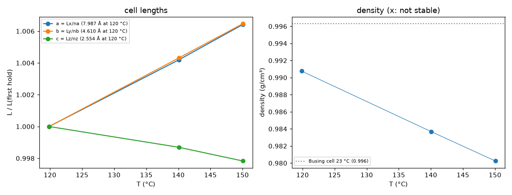
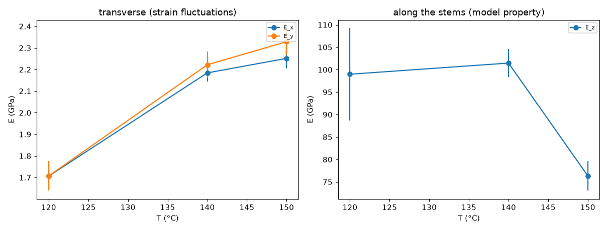

# Crystal analysis: pe_ua_crystal_7x10x40_s1 / crystal_fine_c

- system: `pe_ua_crystal_7x10x40_s1` (ua); source run directory `/home/rdyu/projects/che126_sims/results/runs/pe_ua_crystal_7x10x40_s1/crystal_fine_c` (status finished, node rdyu-rog, run code commit b969a5e8c3)
- analysis: `sepsim analyze crystal` (D59), code commit 8b68bd2293 (dirty), 2026-11-23 17:45 on rdyu-server
- 140 stems x 80 sites, 7 x 10 x 40 repeats of pe_orthorhombic_busing (a 7.4069, b 4.9491, c 2.5511 Å at 23 °C, 0.9963 g/cm³, 18.33 Ų per chain)
- crystallinity: D26 local P2 with ring chords, r_c 6.50 Å, threshold 0.4 (**uncalibrated, melt baseline**); stable hold: last frame fraction ≥ 0.8 and stem P2 ≥ 0.8

## Holds

Thermo after the first 10% of each hold (mean ± SEM). a = Lx/na, b = Ly/nb, c = Lz/nz (CG: rise per bead; UA: the 2-CH2 repeat). ρ/ρ_exp and A/A_exp against the Busing cell (0.9963 g/cm³, 18.33 Ų).

| T (°C) | a (Å) | b (Å) | c (Å) | a/b | ρ (g/cm³) | ρ/ρ_exp | A/chain (Ų) | A/A_exp | drift | crystalline (mean; first → last) | stem P2 (last) | largest cluster (last) | stable |
|---|---|---|---|---|---|---|---|---|---|---|---|---|---|
| 119.9 | 7.9872 ± 0.0029 | 4.6102 ± 0.0016 | 2.5538 ± 0.0004 | 1.733 | 0.9908 ± 0.0005 | 0.994 | 18.41 ± 0.01 | 1.005 | a_A, b_A, c_A, density, volume_A3, area_per_chain_A2 | 1.000; 1.000 → 1.000 | 0.974 | 1.000 | True |
| 140.1 | 8.0207 ± 0.0011 | 4.6301 ± 0.0004 | 2.5505 ± 0.0001 | 1.732 | 0.9837 ± 0.0001 | 0.987 | 18.57 ± 0.00 | 1.013 | none | 0.999; 1.000 → 1.000 | 0.971 | 1.000 | True |
| 150.0 | 8.0384 ± 0.0025 | 4.6400 ± 0.0010 | 2.5483 ± 0.0003 | 1.732 | 0.9802 ± 0.0004 | 0.984 | 18.65 ± 0.01 | 1.017 | a_A, b_A, c_A, density, volume_A3, area_per_chain_A2 | 0.999; 1.000 → 0.998 | 0.966 | 0.998 | True |

## Thermal expansion (stable holds)

Holds 120, 140, 150 °C; α = d ln L/dT, OLS.

| quantity | α (10⁻⁴ K⁻¹) |
|---|---|
| a | 2.111 ± 0.036 |
| b | 2.134 ± 0.005 |
| c | -0.708 ± 0.054 |
| V | 3.537 ± 0.013 |

## Elastic constants (strain fluctuations)

Per hold (after the first 10%): ε_i = (L_i − ⟨L_i⟩)/⟨L_i⟩, S_ij = ⟨V⟩⟨ε_i ε_j⟩/(k_B T) with T the set point, over the normal strains of the orthogonal box (shear fixed; normal–shear couplings assumed zero by symmetry); E_i = 1/S_ii, ν_ij = −S_ij/S_ii, C = S⁻¹. ± is the bootstrap standard error over 100-row blocks (1000 draws). Rate-free (static, isothermal) constants; x, y transverse, z along the stems.

| T (°C) | blocks | E_x (GPa) | E_y (GPa) | E_z (GPa) | ν_xy | ν_yx | ν_xz | ν_yz | C11 | C22 | C33 | C12 | C13 | C23 | stable |
|---|---|---|---|---|---|---|---|---|---|---|---|---|---|---|---|
| 120 | 18 | 1.71 ± 0.05 | 1.71 ± 0.07 | 99.0 ± 10.3 | 0.717 ± 0.019 | 0.717 ± 0.022 | 0.022 ± 0.005 | 0.019 ± 0.004 | 4.1 ± 0.2 | 4.1 ± 0.3 | 118.8 ± 11.2 | 3.1 ± 0.2 | 8.6 ± 0.9 | 8.4 ± 0.9 | True |
| 140 | 18 | 2.18 ± 0.04 | 2.22 ± 0.06 | 101.5 ± 3.1 | 0.664 ± 0.022 | 0.675 ± 0.018 | 0.023 ± 0.003 | 0.016 ± 0.003 | 4.4 ± 0.2 | 4.4 ± 0.2 | 113.7 ± 3.1 | 3.1 ± 0.2 | 6.9 ± 0.5 | 6.5 ± 0.5 | True |
| 150 | 18 | 2.25 ± 0.05 | 2.33 ± 0.06 | 76.3 ± 3.3 | 0.589 ± 0.019 | 0.610 ± 0.020 | 0.040 ± 0.004 | 0.025 ± 0.005 | 4.2 ± 0.1 | 4.2 ± 0.2 | 93.1 ± 4.2 | 2.8 ± 0.2 | 8.0 ± 0.5 | 7.2 ± 0.7 | True |

Halves check: E from the first vs the second half of the window (each with its own bootstrap error); **flag** when they differ by more than 2σ.

| T (°C) | E_x 1st → 2nd | E_y 1st → 2nd | E_z 1st → 2nd | flagged |
|---|---|---|---|---|
| 120 | 1.70 ± 0.05 → 1.77 ± 0.09 | 1.67 ± 0.09 → 1.82 ± 0.07 | 149.1 ± 11.8 → 111.1 ± 13.3 | E_z |
| 140 | 2.24 ± 0.06 → 2.13 ± 0.05 | 2.32 ± 0.06 → 2.13 ± 0.09 | 102.9 ± 5.7 → 101.2 ± 3.4 | none |
| 150 | 2.27 ± 0.09 → 2.32 ± 0.04 | 2.33 ± 0.09 → 2.38 ± 0.09 | 87.2 ± 7.8 → 77.8 ± 4.7 | none |

## Caveats

- A periodic perfect crystal of infinite stems has no surfaces, ends or defects to nucleate melting: it superheats, so a hold or ramp that stays crystalline bounds its stability from above; it is not the melting point.
- CG (SDK) beads carry no setting angle: the stems pack as the model prefers (a/b = √3 is hexagonal); a, b and c of the CG crystal are not the orthorhombic PE cell.
- The barostat is anisotropic (x, y, z independent, couple none); the stems stay along z only while the crystal holds.
- Elastic constants from the box-length fluctuations of the NPT holds (Parrinello-Rahman/Ray strain-fluctuation formula, T = the set point): the box is orthogonal, so the shear strains are fixed and only the normal-normal block of the compliance is sampled; it equals the normal block of the full S only if the normal-shear couplings vanish, assumed here by the orthorhombic (or pseudo-hexagonal, stems along z) symmetry. They are static (zero-rate, isothermal) constants of the model crystal, to compare with the rate-dependent tensile E_app; they rest on the MTK (Nose-Hoover) barostat sampling the NPT ensemble (Pdamp 1000 dt, frames 1 ps apart), and fluctuation estimates converge slowly: the halves check flags E that differ by more than 2 sigma between the first and second half of the hold.
- E_z is along the covalent stems, each bonded to its own periodic image (infinite chains with no ends or folds): a model property, an upper bound for real crystalline stems.

## Plots

**cell lengths and density per hold**

**crystallinity and stem P2**

**elastic moduli from strain fluctuations**

