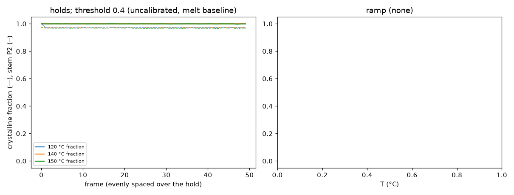

# Crystal analysis: pe_ua_crystal_7x10x40_s1 / crystal_fine_c

- system: `pe_ua_crystal_7x10x40_s1` (ua); source run directory `/home/rdyu/projects/che126_sims/results/runs/pe_ua_crystal_7x10x40_s1/crystal_fine_c` (status finished, node rdyu-rog, run code commit b969a5e8c3)
- analysis: `sepsim analyze crystal` (D59), code commit b969a5e8c3 (dirty), 2026-11-21 10:26 on rdyu-rog
- 140 stems x 80 sites, 7 x 10 x 40 repeats of pe_orthorhombic_busing (a 7.4069, b 4.9491, c 2.5511 Å at 23 °C, 0.9963 g/cm³, 18.33 Ų per chain)
- crystallinity: D26 local P2 with ring chords, r_c 6.50 Å, threshold 0.4 (**uncalibrated, melt baseline**); stable hold: last frame fraction ≥ 0.8 and stem P2 ≥ 0.8

## Holds

Thermo after the first 10% of each hold (mean ± SEM). a = Lx/na, b = Ly/nb, c = Lz/nz (CG: rise per bead; UA: the 2-CH2 repeat). ρ/ρ_exp and A/A_exp against the Busing cell (0.9963 g/cm³, 18.33 Ų).

| T (°C) | a (Å) | b (Å) | c (Å) | a/b | ρ (g/cm³) | ρ/ρ_exp | A/chain (Ų) | A/A_exp | drift | crystalline (mean; first → last) | stem P2 (last) | largest cluster (last) | stable |
|---|---|---|---|---|---|---|---|---|---|---|---|---|---|
| 119.9 | 7.9872 ± 0.0029 | 4.6102 ± 0.0016 | 2.5538 ± 0.0004 | 1.733 | 0.9908 ± 0.0005 | 0.994 | 18.41 ± 0.01 | 1.005 | a_A, b_A, c_A, density, volume_A3, area_per_chain_A2 | 1.000; 1.000 → 1.000 | 0.974 | 1.000 | True |
| 140.1 | 8.0207 ± 0.0011 | 4.6301 ± 0.0004 | 2.5505 ± 0.0001 | 1.732 | 0.9837 ± 0.0001 | 0.987 | 18.57 ± 0.00 | 1.013 | none | 0.999; 1.000 → 1.000 | 0.971 | 1.000 | True |
| 150.0 | 8.0384 ± 0.0025 | 4.6400 ± 0.0010 | 2.5483 ± 0.0003 | 1.732 | 0.9802 ± 0.0004 | 0.984 | 18.65 ± 0.01 | 1.017 | a_A, b_A, c_A, density, volume_A3, area_per_chain_A2 | 0.999; 1.000 → 0.998 | 0.966 | 0.998 | True |

## Thermal expansion (stable holds)

Holds 120, 140, 150 °C; α = d ln L/dT, OLS.

| quantity | α (10⁻⁴ K⁻¹) |
|---|---|
| a | 2.111 ± 0.036 |
| b | 2.134 ± 0.005 |
| c | -0.708 ± 0.054 |
| V | 3.537 ± 0.013 |

## Caveats

- A periodic perfect crystal of infinite stems has no surfaces, ends or defects to nucleate melting: it superheats, so a hold or ramp that stays crystalline bounds its stability from above; it is not the melting point.
- CG (SDK) beads carry no setting angle: the stems pack as the model prefers (a/b = √3 is hexagonal); a, b and c of the CG crystal are not the orthorhombic PE cell.
- The barostat is anisotropic (x, y, z independent, couple none); the stems stay along z only while the crystal holds.

## Plots

**cell lengths and density per hold**

**crystallinity and stem P2**

