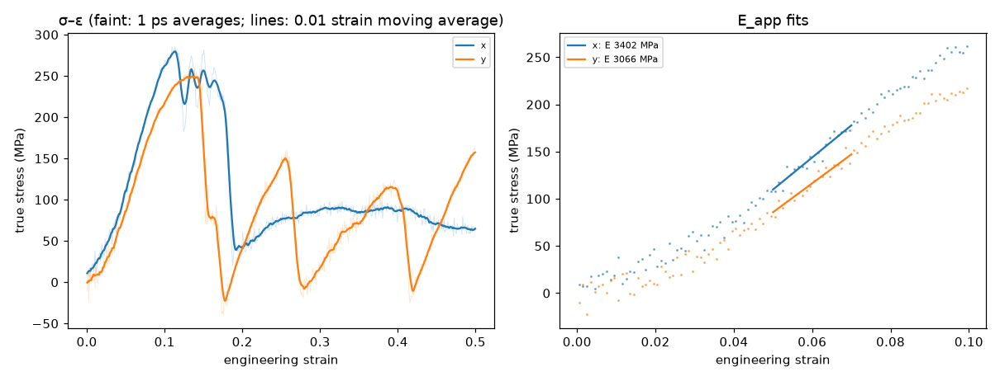
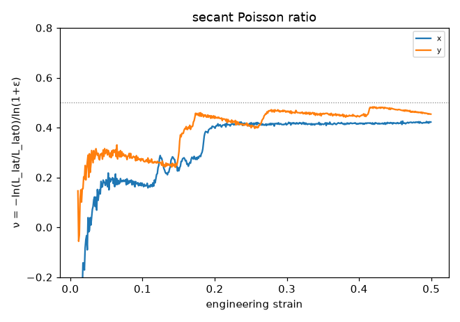

# Tensile analysis (D54)

Generated 2026-11-21T10:26:51-08:00. E_app and ν fitted over the steepest 0.02-wide strain window before the peak (largest slope of the smoothed stress; window in the E_app column); peak after a 0.01-strain moving average; flow stress = mean true stress over ε ∈ [0.3, 0.5]. True stress σ = −(P_axis − p_atm), tension positive; engineering stress σ·A/A0.

## pe_ua_crystal_7x10x40_s1 / tensile_75C_r1e9

- 75 °C, 1e+09 s⁻¹ to strain 0.5, lateral 1 atm; status finished on rdyu-rog; `/home/rdyu/projects/che126_sims/results/runs/pe_ua_crystal_7x10x40_s1/tensile_75C_r1e9`

| axis | strain reached | E_app (MPa) | ν (fit) | ν (run) | σ_peak (MPa) | ε_peak | flow σ (MPa) | T (K) |
|---|---|---|---|---|---|---|---|---|
| x | 0.500 | 3402 ± 233 (ε 0.050–0.070) | 0.18 | 0.47 | 279.7 | 0.114 | 81.0 | 348.1 |
| y | 0.500 | 3066 ± 227 (ε 0.050–0.070) | 0.30 | 0.50 | 249.7 | 0.136 | 75.5 | 348.2 |
| mean ± SD | | 3234 ± 238 | 0.24 ± 0.08 | 0.49 ± 0.02 | 264.7 ± 21.2 | 0.125 ± 0.016 | 78.3 ± 3.9 | |

## Caveats

- The box is an amorphous melt above Tg (Tg is below 25 °C for PE, D14), so the response is viscoelastic and rate-dependent: these are not the moduli of a semicrystalline separator, whose stiffness and yield come from its crystallinity.
- E_app is the apparent (high-frequency) modulus at the simulated strain rate, many orders of magnitude above experiment; it falls with the rate.
- There is no true yield in a melt: the peak or plateau is a viscous flow stress (≈ 3 η × rate for a Newtonian melt), again rate-dependent.
- ν is biased at high rate: the lateral barostat (Pdamp = 1000 dt) lags the imposed strain, so the lateral contraction trails the axial extension (ν low at small strain); a fully relaxed melt approaches ν = 0.5.
- Stress is -(P_axis - p_atm) from the virial pressure tensor averaged over avg_ps; the axes of one run start from the same snapshot, so their spread is not a full independent-sample error.

## Plots

**stress–strain and E_app fits**

**secant Poisson ratio vs strain**

