# Pore analysis: pe_ua_pore_w5nm_n40_c240_s1 / pore

- system: `pe_ua_pore_w5nm_n40_c240_s1` (ua); source run directory `/home/rdyu/projects/che126_sims/results/runs/pe_ua_pore_w5nm_n40_c240_s1/pore` (status finished, node rdyu-server, run code commit 4b92aee8b9)
- analysis: `sepsim analyze pore` (D51), code commit b9c027bcb5 (dirty), 2026-11-11 11:40 on rdyu-server
- pore: nominal width 5 nm at 25 °C, wall 63.8 Å at 25 °C, Lz 113.76 Å (fixed), slab mass 134740 g/mol; units real
- windows: steps, cool stages and the re-relaxation second half (50% of rows dropped); holds without the first 10% of rows; SEM from the statistical inefficiency (D26)
- bulk reference: `results/analysis/pe_ua_amorph_n40_c240_s1/sweep/results.json`
- note: bulk energies not available: /home/rdyu/projects/che126_sims/results/runs/pe_ua_amorph_n40_c240_s1/sweep/in.sweep: bulk uses a tail correction, the pore does not (D48)

## Segments: box, pressure tensor and surface tension

γ = (Lz/2)[Pzz − (Pxx+Pyy)/2] per surface (two surfaces), mean ± SEM of the instantaneous series.

| # | segment | T set (°C) | window (ns) | T (°C) | Lx (Å) | Ly (Å) | Pxx (atm) | Pyy (atm) | Pzz (atm) | γ (mN/m) | drift |
|---|---|---|---|---|---|---|---|---|---|---|---|
|  | Stage 2: surface re-relaxation 1000 ps NVT at 500 K after narrowing | 226.9 | 0.50 | 227.12 ± 0.18 | 66.960 | 66.960 | -53.9 ± 14.5 | -73.5 ± 14.0 | -39.1 ± 14.9 | 14.15 ± 8.87 |  |
|  | Stage 3 cool 1/8 (474.8 K) | 201.6 | 1.00 | 201.37 ± 0.14 | 66.560 | 66.560 | -56.1 ± 10.1 | -79.5 ± 10.7 | -25.0 ± 11.0 | 24.65 ± 6.98 |  |
|  | Stage 3 cool 2/8 (449.5 K) | 176.4 | 1.00 | 176.42 ± 0.11 | 66.171 | 66.171 | -80.3 ± 11.6 | -77.0 ± 10.4 | -34.7 ± 9.9 | 25.29 ± 5.96 | pe |
|  | Stage 3 cool 3/8 (424.3 K) | 151.2 | 1.00 | 151.05 ± 0.13 | 65.769 | 65.769 | -68.8 ± 9.6 | -68.8 ± 10.2 | -48.2 ± 9.9 | 11.88 ± 6.46 |  |
|  | Stage 3 cool 4/8 (399.1 K) | 125.9 | 1.00 | 125.88 ± 0.10 | 65.368 | 65.368 | -56.6 ± 15.6 | -66.8 ± 9.9 | -32.0 ± 12.8 | 17.11 ± 7.96 | pe |
|  | Stage 3 cool 5/8 (373.8 K) | 100.7 | 1.00 | 100.65 ± 0.13 | 64.977 | 64.977 | -56.0 ± 9.7 | -56.0 ± 10.5 | -12.3 ± 11.2 | 25.19 ± 6.63 |  |
|  | Stage 3 cool 6/8 (348.6 K) | 75.46 | 1.00 | 75.44 ± 0.15 | 64.625 | 64.625 | -63.1 ± 9.5 | -66.0 ± 9.8 | -10.2 ± 10.6 | 31.34 ± 5.45 |  |
|  | Stage 3 cool 7/8 (323.4 K) | 50.23 | 1.00 | 50.18 ± 0.09 | 64.204 | 64.204 | -56.9 ± 15.0 | -75.8 ± 9.3 | -21.3 ± 9.0 | 25.98 ± 5.20 | pe |
|  | Stage 3 cool 8/8 (298.1 K) | 25 | 1.00 | 24.98 ± 0.10 | 63.851 | 63.851 | -95.5 ± 13.6 | -61.4 ± 12.0 | -16.4 ± 8.7 | 35.78 ± 5.32 | pe |
| 1 | hold | 25 | 9.00 | 24.97 ± 0.03 | 63.806 | 63.806 | -78.2 ± 3.6 | -78.2 ± 3.2 | -22.2 ± 2.9 | 32.26 ± 1.85 | pe |
| 2 | step | 35 | 1.00 | 35.16 ± 0.10 | 63.951 | 63.951 | -67.0 ± 9.1 | -69.3 ± 12.5 | -17.9 ± 8.7 | 28.94 ± 6.92 | pe |
| 3 | step | 45 | 1.00 | 44.88 ± 0.08 | 64.106 | 64.106 | -70.9 ± 8.9 | -87.1 ± 10.8 | -15.6 ± 8.9 | 36.53 ± 5.28 |  |
| 4 | step | 55 | 1.00 | 55.14 ± 0.09 | 64.232 | 64.232 | -89.0 ± 10.2 | -85.5 ± 13.5 | -30.5 ± 9.2 | 32.71 ± 7.93 | pe, gamma |
| 5 | step | 65 | 1.00 | 64.97 ± 0.10 | 64.411 | 64.411 | -70.6 ± 9.2 | -71.1 ± 9.3 | -16.3 ± 9.0 | 31.48 ± 5.43 | pe |
| 6 | step | 75 | 1.00 | 75.02 ± 0.09 | 64.542 | 64.542 | -83.1 ± 11.1 | -87.5 ± 9.7 | -25.5 ± 8.9 | 34.45 ± 5.55 | pe |
| 7 | step | 85 | 1.00 | 84.90 ± 0.09 | 64.659 | 64.659 | -71.3 ± 10.8 | -73.7 ± 11.4 | -20.5 ± 9.2 | 30.01 ± 6.45 | pe |
| 8 | step | 90 | 1.00 | 90.00 ± 0.10 | 64.807 | 64.807 | -71.3 ± 11.5 | -81.6 ± 9.8 | -36.3 ± 9.1 | 23.15 ± 5.56 |  |
| 9 | hold | 90 | 9.00 | 89.99 ± 0.04 | 64.807 | 64.807 | -68.6 ± 3.2 | -74.5 ± 3.8 | -28.1 ± 3.1 | 25.03 ± 1.90 |  |
| 10 | step | 100 | 1.00 | 99.88 ± 0.11 | 64.938 | 64.938 | -54.5 ± 9.9 | -80.1 ± 10.5 | -19.5 ± 11.1 | 27.55 ± 5.79 | pe |
| 11 | step | 110 | 1.00 | 109.79 ± 0.10 | 65.123 | 65.123 | -84.7 ± 9.9 | -71.3 ± 14.6 | -33.2 ± 10.5 | 25.83 ± 5.77 | pe |
| 12 | step | 120 | 1.00 | 120.06 ± 0.10 | 65.255 | 65.255 | -75.0 ± 9.5 | -85.5 ± 10.1 | -32.7 ± 9.6 | 27.40 ± 5.43 |  |
| 13 | step | 130 | 1.00 | 130.09 ± 0.12 | 65.411 | 65.411 | -72.8 ± 10.4 | -86.8 ± 11.0 | -34.8 ± 10.7 | 25.93 ± 5.88 |  |
| 14 | hold | 130 | 9.00 | 130.00 ± 0.04 | 65.411 | 65.411 | -72.8 ± 3.2 | -75.8 ± 3.3 | -32.3 ± 3.4 | 24.21 ± 1.91 |  |
| 15 | step | 140 | 1.00 | 140.03 ± 0.11 | 65.556 | 65.556 | -76.2 ± 10.1 | -68.4 ± 10.4 | -49.9 ± 10.2 | 12.93 ± 5.91 |  |
| 16 | step | 150 | 1.00 | 150.10 ± 0.11 | 65.703 | 65.703 | -41.2 ± 9.9 | -67.4 ± 10.2 | -24.3 ± 10.0 | 17.29 ± 5.94 |  |
| 17 | step | 160 | 1.00 | 160.05 ± 0.11 | 65.883 | 65.883 | -54.7 ± 9.7 | -60.0 ± 10.2 | -20.7 ± 9.6 | 21.14 ± 5.76 |  |
| 18 | hold | 160 | 9.00 | 160.01 ± 0.04 | 65.883 | 65.883 | -62.7 ± 3.5 | -63.3 ± 3.6 | -32.2 ± 3.5 | 17.76 ± 2.72 |  |

## Surface tension vs T

SEM-weighted linear fit of γ in T, one point per temperature (hold where there is one); errors 1σ, scaled by √χ²_red when χ²_red > 1.

| branch | points | T range (°C) | dγ/dT (mN m⁻¹ K⁻¹) | γ(25 °C) from fit (mN/m) | χ²_red |
|---|---|---|---|---|---|
| heating (sweep) | 15 | 25–160 | -0.1031 ± 0.0191 | 33.24 | 0.63 |
| cooling (step-cool) | 8 | 25–202 | -0.0732 ± 0.0374 | 31.59 | 1.06 |

## Thermal analysis over the sweep grid

One point per set T (the hold where there is one). Film thickness t_G (Gibbs) and the interior plateau density from the segment's DCD (steps: second half; holds: without the first 10%; ≤ max-frames frames; SEM over frames); E = TotEng (NVT thermo window). Surface excess energy per surface e_s = (E_pore − (M_pore/M_bulk) E_bulk(T))/(2A), E_bulk from the bulk sweep at the same set T; γ − T dγ/dT with the sweep fit slope (should ≈ e_s).

| T (°C) | seg | t_G (Å) | ρ plateau (g/cm³) | ρ bulk (g/cm³) | Δρ/ρ bulk | Lx (Å) | E (kcal/mol) | γ (mN/m) | e_s (mJ/m²) | γ − T dγ/dT (mJ/m²) |
|---|---|---|---|---|---|---|---|---|---|---|
| 25 | hold | 64.91 ± 0.05 | 0.8466 ± 0.0007 | 0.8614 ± 0.0005 | -1.72% | 63.806 | 9471.9 ± 28.1 | 32.26 ± 1.85 | n/a | 63.0 |
| 35 | step | 65.05 ± 0.08 | 0.8410 ± 0.0010 | 0.8561 ± 0.0008 | -1.76% | 63.951 | 10212.3 ± 8.8 | 28.94 ± 6.92 | n/a | 60.7 |
| 45 | step | 65.35 ± 0.06 | 0.8331 ± 0.0008 | 0.8499 ± 0.0004 | -1.97% | 64.106 | 11027.3 ± 8.4 | 36.53 ± 5.28 | n/a | 69.3 |
| 55 | step | 65.53 ± 0.14 | 0.8276 ± 0.0018 | 0.8449 ± 0.0003 | -2.05% | 64.232 | 11810.4 ± 28.8 | 32.71 ± 7.93 | n/a | 66.5 |
| 65 | step | 65.55 ± 0.14 | 0.8227 ± 0.0017 | 0.8379 ± 0.0004 | -1.81% | 64.411 | 12622.3 ± 21.8 | 31.48 ± 5.43 | n/a | 66.3 |
| 75 | step | 65.91 ± 0.11 | 0.8149 ± 0.0014 | 0.8328 ± 0.0003 | -2.15% | 64.542 | 13457.2 ± 14.0 | 34.45 ± 5.55 | n/a | 70.3 |
| 85 | step | 66.18 ± 0.09 | 0.8087 ± 0.0011 | 0.8283 ± 0.0005 | -2.37% | 64.659 | 14203.1 ± 20.7 | 30.01 ± 6.45 | n/a | 66.9 |
| 90 | hold | 66.21 ± 0.03 | 0.8046 ± 0.0003 | 0.8227 ± 0.0004 | -2.20% | 64.807 | 14610.0 ± 8.8 | 25.03 ± 1.90 | n/a | 62.5 |
| 100 | step | 66.65 ± 0.13 | 0.7961 ± 0.0016 | 0.8177 ± 0.0004 | -2.63% | 64.938 | 15392.5 ± 13.5 | 27.55 ± 5.79 | n/a | 66.0 |
| 110 | step | 67.13 ± 0.15 | 0.7859 ± 0.0018 | 0.8107 ± 0.0008 | -3.06% | 65.123 | 16185.9 ± 16.9 | 25.83 ± 5.77 | n/a | 65.3 |
| 120 | step | 67.13 ± 0.16 | 0.7828 ± 0.0019 | 0.8058 ± 0.0004 | -2.86% | 65.255 | 16975.8 ± 17.1 | 27.40 ± 5.43 | n/a | 67.9 |
| 130 | hold | 67.09 ± 0.03 | 0.7795 ± 0.0003 | 0.8001 ± 0.0002 | -2.57% | 65.411 | 17715.0 ± 5.0 | 24.21 ± 1.91 | n/a | 65.8 |
| 140 | step | 67.31 ± 0.13 | 0.7735 ± 0.0015 | 0.7947 ± 0.0002 | -2.67% | 65.556 | 18471.2 ± 6.6 | 12.93 ± 5.91 | n/a | 55.5 |
| 150 | step | 67.45 ± 0.12 | 0.7684 ± 0.0014 | 0.7894 ± 0.0003 | -2.66% | 65.703 | 19205.5 ± 10.0 | 17.29 ± 5.94 | n/a | 60.9 |
| 160 | hold | 67.84 ± 0.03 | 0.7599 ± 0.0004 | 0.7834 ± 0.0002 | -3.00% | 65.883 | 19980.6 ± 5.6 | 17.76 ± 2.72 | n/a | 62.4 |

Surface entropy per area −dγ/dT = 0.1031 ± 0.0191 mJ m⁻² K⁻¹ (sweep fit).

Expansion: α_z = (1/t_G) dt_G/dT (film normal, SEM-weighted, errors ×√χ²_red when > 1); α_L = (1/2A) dA/dT of the imposed box area (D48: follows the bulk density, so ≈ bulk α_V/3 by construction); film α_V = α_z + 2 α_L. Cv = dE/dT per gram (classical, NVT) next to the bulk classical Cp.

| window (°C) | points | α_z (10⁻⁴ K⁻¹) | χ²_red | α_L (10⁻⁴ K⁻¹) | film α_V (10⁻⁴ K⁻¹) | bulk α_V/3 | bulk α_V | Cv (J g⁻¹ K⁻¹) | bulk Cp (J g⁻¹ K⁻¹) |
|---|---|---|---|---|---|---|---|---|---|
| 25–160 | 15 | 3.271 ± 0.073 | 2.01 | 2.376 | 8.023 | 2.384 | 7.151 | 2.423 ± 0.008 | 2.431 |
| 25–90 | 8 | 3.070 ± 0.118 | 0.46 | 2.316 | 7.703 | 2.315 | 6.946 | 2.481 ± 0.009 | 2.439 |
| 90–160 | 8 | 3.387 ± 0.148 | 3.04 | 2.335 | 8.056 | 2.336 | 7.007 | 2.375 ± 0.011 | 2.385 |
- surface excess energy not computed at every T: no bulk energies

## Density profile, film thickness and gap (holds)

ρ(z) is the mass density about the film's mass centre (periodic z, film centred per frame) over ≤ 500 evenly spaced hold frames, symmetrized; plateau = mean over |z| < t_G/2 − 15 Å (SEM over frames); t_G = M/(ρ_plateau A) (equimolar Gibbs surfaces), t_50 between the 50%-of-plateau crossings; gap = Lz − film. Clear gap per frame: z gap = Lz − z extent of all atoms; closest = smallest 3-D distance across the slit (periodic image).

| T (°C) | frames | ρ plateau (g/cm³) | ρ bulk (g/cm³) | Δρ/ρ bulk | t_G (Å) | t_50 (Å) | gap_G (Å) | gap_50 (Å) | z gap mean / min (Å) | closest mean / min (Å) |
|---|---|---|---|---|---|---|---|---|---|---|
| 25 | 450 | 0.8466 ± 0.0007 | 0.8614 ± 0.0005 | -1.72% | 64.91 | 65.23 | 48.85 | 48.53 | 39.7 / 33.7 | 41.8 / 34.9 |
| 90 | 450 | 0.8046 ± 0.0003 | 0.8227 ± 0.0004 | -2.20% | 66.21 | 66.37 | 47.55 | 47.38 | 35.3 / 27.1 | 37.9 / 29.9 |
| 130 | 450 | 0.7795 ± 0.0003 | 0.8001 ± 0.0002 | -2.57% | 67.08 | 67.40 | 46.68 | 46.36 | 32.6 / 23.0 | 35.6 / 27.4 |
| 160 | 450 | 0.7599 ± 0.0004 | 0.7834 ± 0.0002 | -3.00% | 67.83 | 68.15 | 45.93 | 45.61 | 31.0 / 19.5 | 34.3 / 22.9 |

Gibbs gap at 25 °C 4.885 nm vs nominal 5 nm (the nominal width uses the bulk density, D48).

Interfacial width: 10–90 distance of each surface (outermost crossings of 90% and 10% of the plateau) and the 10–90 width 2 atanh(0.8) δ of a tanh fit ρ_p/2 [1 − tanh((|z| − h)/δ)] to the symmetrized profile.

| T (°C) | 10–90 lower (Å) | 10–90 upper (Å) | tanh δ (Å) | tanh 10–90 (Å) | tanh h (Å) |
|---|---|---|---|---|---|
| 25 | 5.70 | 5.49 | 2.47 ± 0.02 | 5.42 | 32.56 |
| 90 | 7.18 | 7.02 | 3.22 ± 0.02 | 7.06 | 33.17 |
| 130 | 8.16 | 8.23 | 3.69 ± 0.02 | 8.12 | 33.67 |
| 160 | 8.73 | 8.65 | 3.99 ± 0.03 | 8.76 | 34.01 |

## Mobility by layer (holds)

Backbone sites (CG: beads; UA/AA: backbone carbons), positions relative to the system's mass centre, layer at the time origin; ≤ 200 origins per lag (hold DCD, lags ≥ its frame interval) and ≤ 50 per burst (D46 bursts, shorter lags). MSD per dimension (Ų): in-plane xy = (⟨Δx²⟩+⟨Δy²⟩)/2, normal z = ⟨Δz²⟩, bulk = MSD/3 of the bulk hold. P2 1/e: first 1/e crossing of ⟨P2(u(0)·u(t))⟩ of backbone bonds (layer of the bond midpoint at the origin).

| T (°C) | layer | site fraction | xy / z @ 10 ps | xy / z @ 100 ps | xy / z @ 1 ns | xy / z @ max | P2 1/e (ps) |
|---|---|---|---|---|---|---|---|
| 25 | interior | 0.54 | 1.1 / 1.1 | 3.4 / 3.4 | 14.4 / 14.0 | 42.1 / 42.6 | 51.1 |
| 25 | surface | 0.46 | 1.9 / 1.6 | 6.3 / 4.8 | 26.1 / 15.6 | 68.8 / 37.8 | 35.5 |
| 25 | film | 1.00 | 1.5 / 1.3 | 4.7 / 4.0 | 19.8 / 14.7 | 54.5 / 40.4 | 43.2 |
| 25 | bulk | | 0.9 | 2.6 | 9.4 | 27.4 | 60.1 |
| 90 | interior | 0.55 | 2.8 / 2.8 | 11.4 / 11.3 | 49.8 / 48.8 | 130.9 / 115.6 | 9.6 |
| 90 | surface | 0.45 | 4.7 / 4.0 | 19.8 / 13.9 | 77.8 / 44.3 | 177.8 / 103.4 | 7.3 |
| 90 | film | 1.00 | 3.7 / 3.4 | 15.2 / 12.5 | 62.5 / 46.8 | 152.1 / 110.1 | 8.5 |
| 90 | bulk | | 2.3 | 8.8 | 39.2 | 105.8 | 11.1 |
| 130 | interior | 0.55 | 4.4 / 4.4 | 19.0 / 18.6 | 79.0 / 74.6 | 188.9 / 160.8 | 5.0 |
| 130 | surface | 0.45 | 7.3 / 6.1 | 32.2 / 21.7 | 120.9 / 64.3 | 241.3 / 155.0 | 4.1 |
| 130 | film | 1.00 | 5.7 / 5.2 | 24.9 / 20.0 | 97.8 / 70.0 | 212.3 / 158.2 | 4.6 |
| 130 | bulk | | 3.6 | 14.7 | 59.2 | 164.4 | 5.4 |
| 160 | interior | 0.56 | 5.7 / 5.9 | 25.4 / 25.9 | 96.2 / 91.2 | 209.7 / 175.8 | 3.5 |
| 160 | surface | 0.44 | 9.2 / 8.0 | 41.5 / 28.1 | 139.7 / 81.5 | 275.2 / 185.3 | 2.8 |
| 160 | film | 1.00 | 7.3 / 6.8 | 32.5 / 26.9 | 115.4 / 86.9 | 238.7 / 179.9 | 3.2 |
| 160 | bulk | | 4.8 | 20.0 | 79.1 | 195.2 | 3.6 |

## Orientation and chain shape by layer (holds)

⟨P2(cos θ_z)⟩ of backbone bonds (θ_z: angle to the film normal; 0 isotropic, −0.5 all in-plane) by the layer of the bond midpoint; ⟨Rg_z²⟩ and ⟨Rg_xy²⟩/2 (mass-weighted, per dimension; equal for isotropic chains) of chains by the layer of their mass centre; over the profile frames, SEM over frames.

| T (°C) | layer | ⟨P2(cos θ_z)⟩ | chains | ⟨Rg_z²⟩ (Ų) | ⟨Rg_xy²⟩/2 (Ų) | ratio z/xy |
|---|---|---|---|---|---|---|
| 25 | interior | -0.009 ± 0.001 | 27.2 | 189 ± 2 | 292 ± 4 | 0.65 |
| 25 | surface | -0.037 ± 0.001 | 12.8 | 61 ± 2 | 361 ± 6 | 0.17 |
| 90 | interior | -0.010 ± 0.001 | 27.9 | 167 ± 1 | 306 ± 5 | 0.55 |
| 90 | surface | -0.033 ± 0.003 | 12.1 | 66 ± 4 | 359 ± 5 | 0.18 |
| 130 | interior | -0.006 ± 0.002 | 27.4 | 172 ± 3 | 252 ± 7 | 0.68 |
| 130 | surface | -0.029 ± 0.001 | 12.6 | 67 ± 4 | 262 ± 8 | 0.26 |
| 160 | interior | -0.000 ± 0.001 | 31.3 | 204 ± 7 | 237 ± 2 | 0.86 |
| 160 | surface | -0.022 ± 0.002 | 8.7 | 71 ± 4 | 284 ± 4 | 0.25 |

## Whole film vs bulk (holds; `analyze sweep` method)

Film-averaged results of the `analyze sweep` hold analysis (FFT MSD over every origin, bursts stitched) next to the bulk hold at the same T.

| T (°C) | MSD max film / bulk (Ų) | COM MSD max film / bulk (Ų) | P2 1/e film / bulk (ps) | Rg film / bulk (Å) | R_ee film / bulk (Å) | C_n film / bulk |
|---|---|---|---|---|---|---|
| 25 | 149 / 82 | 16 / 8 | 43.3 / 60.1 | 27.85 ± 0.17 / 29.33 ± 0.07 | 68.9 ± 1.1 / 72.9 ± 0.4 | 8.10 ± 0.10 / 9.21 ± 0.01 |
| 90 | 415 / 317 | 77 / 48 | 8.5 / 11.1 | 27.96 ± 0.11 / 29.95 ± 0.10 | 70.2 ± 0.8 / 74.3 ± 1.3 | 8.38 ± 0.14 / 9.86 ± 0.14 |
| 130 | 583 / 493 | 116 / 91 | 4.5 / 5.4 | 25.56 ± 0.20 / 30.91 ± 0.34 | 61.3 ± 1.0 / 78.9 ± 1.9 | 6.62 ± 0.12 / 10.86 ± 0.34 |
| 160 | 657 / 586 | 140 / 122 | 3.1 / 3.6 | 25.94 ± 0.12 / 29.59 ± 0.14 | 61.8 ± 0.5 / 75.7 ± 0.8 | 6.93 ± 0.08 / 9.85 ± 0.10 |

## Chain relaxation (hold (whole film)s; D56)

End-to-end vector ACF ⟨R(t)·R(0)⟩/⟨R²⟩ and Rouse mode ACFs ⟨X_p(t)·X_p(0)⟩/⟨X_p²⟩, X_p = (1/N) Σ_n cos(pπ(n−½)/N) r_n over the backbone sites, every time origin, lags up to half the hold (whole film) (5 ns here). Times in ns: the first 1/e crossing; if C stays above 1/e within the lag window the time is 'not reached' and only an exponential fit of ln C over 0.2 ≤ C ≤ 0.9 is given (marked extrap.: it extrapolates the early decay). τ_ee fit is that fit for R_ee. τ_1/τ_2 is 4 for Rouse chains. p²⟨X_p²⟩ (relative to p = 1, p = 2…5) is flat for an ideal Rouse chain; it falls at high p where the chain is stiffer than Gaussian on that scale. Crystallinity: D26 local alignment, fraction of backbone sites with p2 ≥ 0.4 (**uncalibrated, melt baseline**: no crystal reference, so the number is a baseline for an amorphous box, not a calibrated crystallinity) and the largest crystalline cluster (sites).

| T (°C) | τ_ee 1/e (ns) | τ_ee fit (ns) | τ_1 (ns) | τ_2 (ns) | τ_3 (ns) | τ_1/τ_2 (Rouse 4) | p²⟨X_p²⟩ / p=1 (p = 2…5) | crystallinity |
|---|---|---|---|---|---|---|---|---|
| 25 | not reached (C 0.92 at max lag) | n/a (extrap.) | not reached (C 0.98 at max lag) | not reached (C 0.93 at max lag) | not reached (C 0.89 at max lag; fit 40.5, extrap.) | n/a | 1.22 / 1.26 / 1.26 / 1.31 | 0.119 (max 0.146; cluster ≤ 1168) |
| 90 | not reached (C 0.81 at max lag; fit 32.2, extrap.) | 32.2 (extrap.) | not reached (C 0.93 at max lag) | not reached (C 0.78 at max lag; fit 25.3, extrap.) | not reached (C 0.56 at max lag; fit 10.1, extrap.) | n/a | 1.18 / 1.05 / 1.13 / 1.12 | 0.054 (max 0.072; cluster ≤ 225) |
| 130 | not reached (C 0.62 at max lag; fit 14.4, extrap.) | 14.4 (extrap.) | not reached (C 0.83 at max lag; fit 34.2, extrap.) | not reached (C 0.69 at max lag; fit 17.4, extrap.) | 4.25 | 1.97 (fits) | 1.43 / 1.31 / 1.51 / 1.28 | 0.042 (max 0.056; cluster ≤ 115) |
| 160 | not reached (C 0.64 at max lag; fit 15.3, extrap.) | 15.3 (extrap.) | not reached (C 0.82 at max lag; fit 28.6, extrap.) | not reached (C 0.46 at max lag; fit 7.06, extrap.) | 4.84 | 4.05 (fits) | 1.15 / 1.29 / 1.08 / 1.19 | 0.033 (max 0.041; cluster ≤ 52) |

Where τ_1 is not reached, p²τ_p of the faster modes estimates it under ideal Rouse scaling (τ_p ∝ p⁻²). Real melts show τ_p ∝ p^−2.2…−2.4 (stiffness, local friction), so p²τ_p underestimates τ_1, more so the higher p:

- 90 °C: τ_1 ≈ p²τ_p from the reached modes: p=5: 115 ns.
- 130 °C: τ_1 ≈ p²τ_p from the reached modes: p=3: 38.3, p=4: 38.5, p=5: 33.8 ns.
- 160 °C: τ_1 ≈ p²τ_p from the reached modes: p=3: 43.5, p=4: 23, p=5: 28.3 ns.

## Equilibration

Every average uses only the analysis window: steps second half (50% of rows dropped), holds without the first 10% of rows (the rest is equilibration after the T change; see `equilibration.png`, windows shaded, block averages ± SEM overlaid, and `equilibration_holds.png`). Drift: the window's two halves differ by > 2 combined SEM (statistical inefficiency).

Segments with a drifting window (tested: film_gibbs, gamma, pe):

| segment | T set (°C) | drift (second − first half ± SEM) |
|---|---|---|
| Stage 3 cool 2/8 (449.5 K) | 176.4 | pe -34.1 ± 15 |
| Stage 3 cool 4/8 (399.1 K) | 125.9 | pe +45.04 ± 21 |
| Stage 3 cool 7/8 (323.4 K) | 50.23 | pe +31.04 ± 13 |
| Stage 3 cool 8/8 (298.1 K) | 25 | pe -112.4 ± 24 |
| seg 01 hold 25 C | 25 | pe -76.66 ± 28 |
| seg 02 step 35 C | 35 | pe -32.36 ± 13 |
| seg 04 step 55 C | 55 | pe -70.38 ± 34; gamma -26.99 ± 13 |
| seg 05 step 65 C | 65 | pe -52.55 ± 17 |
| seg 06 step 75 C | 75 | pe -42.36 ± 17 |
| seg 07 step 85 C | 85 | pe -57.47 ± 19 |
| seg 10 step 100 C | 100 | pe -32.38 ± 12 |
| seg 11 step 110 C | 110 | pe -61.49 ± 28 |

Block-average check of the hold SEMs: SEM of the means of 32 / 16 / 8 blocks vs the statistical-inefficiency SEM (blocks longer than the correlation time plateau at it; flagged if the 8-block SEM exceeds it by > 2×).

| T (°C) | quantity | SEM (g) | block SEM 32 / 16 / 8 | converged |
|---|---|---|---|---|
| 25 | pe | 28.4 | 10.4 / 14.1 / 19.5 | yes |
| 25 | gamma | 1.85 | 1.67 / 1.59 / 1.34 | yes |
| 90 | pe | 8.63 | 5.85 / 6.95 / 8.93 | yes |
| 90 | gamma | 1.9 | 1.5 / 1.52 / 1.91 | yes |
| 130 | pe | 5.18 | 4.46 / 4.58 / 5.29 | yes |
| 130 | gamma | 1.91 | 1.92 / 1.56 / 1.69 | yes |
| 160 | pe | 6.96 | 4.49 / 4.63 / 5.83 | yes |
| 160 | gamma | 2.72 | 1.72 / 2.14 / 2.54 | yes |

Local quantities (γ, PE, film thickness and interior density, interfacial width, segmental MSD, bond P2: relaxation times ~10–100 ps in CG) equilibrate within the dropped part of each segment (`film_vs_time.png`: thickness, gap, interior density and clear gap per hold frame). Surface chain conformation and orientation by layer (Rg_z vs Rg_xy, layer membership of chains) are chain-scale quantities.

Chain-scale quantities (Rg, R_ee, C_n, chain COM motion) relax on the end-to-end time (CG C240 at 25 °C: of order 100 ns; C1500 far longer), longer than a 25 ns hold: their hold averages describe the chain configurations carried in from the 500 K equilibration and cooling rather than a re-equilibrated state at T. Per hold:
- 25 °C: chain COM MSD at 5 ns / ⟨Rg²⟩ = 0.02; chains have **not** moved their own size: chain-scale averages sample a partly relaxed set of chain configurations.
- 90 °C: chain COM MSD at 5 ns / ⟨Rg²⟩ = 0.10; chains have **not** moved their own size: chain-scale averages sample a partly relaxed set of chain configurations.
- 130 °C: chain COM MSD at 5 ns / ⟨Rg²⟩ = 0.18; chains have **not** moved their own size: chain-scale averages sample a partly relaxed set of chain configurations.
- 160 °C: chain COM MSD at 5 ns / ⟨Rg²⟩ = 0.21; chains have **not** moved their own size: chain-scale averages sample a partly relaxed set of chain configurations.

## Caveats

- γ uses a plain LJ cutoff without tail correction (D44/D48: `pair_modify tail no`, CG 15 Å, UA/AA 14 Å), so it is cutoff-dependent and lower than a full-dispersion (LJ-PPPM or tail-corrected) value; compare it across our runs, not directly with experiment.
- γ is the mechanical (pressure-tensor) value per surface, (Lz/2)[Pzz − (Pxx+Pyy)/2] with two film surfaces; the fits are SEM-weighted linear fits in T with errors scaled by √χ²_red when χ²_red > 1.
- The slit is a local patch of a pore wall: real separator pores are 30–100 nm and their walls semicrystalline (D50); these walls are amorphous (melt-like or post-shutdown).
- Layers: surface = within 15 Å of either Gibbs surface on the film side (or outside it), interior = the rest, assigned at each time origin; sites leave their layer at long lags, so long-lag layer MSDs mix layers. MSDs are per dimension: in-plane (⟨Δx²⟩+⟨Δy²⟩)/2, normal ⟨Δz²⟩, bulk MSD/3 (isotropic).
- Cv = dE/dT (total energy, NVT, per gram) and the surface excess energy are classical: Cv is not comparable to experiment for the same reasons as the bulk Cp (classical equipartition; UA/CG drop degrees of freedom). e_s = (E_pore − (M_pore/M_bulk) E_bulk(T))/(2A) compares the NVT film with the NPT bulk at 1 atm (PV ≈ 0) at the same set T; the film's lateral box follows the bulk density (D48).

## Plots

**γ vs T**

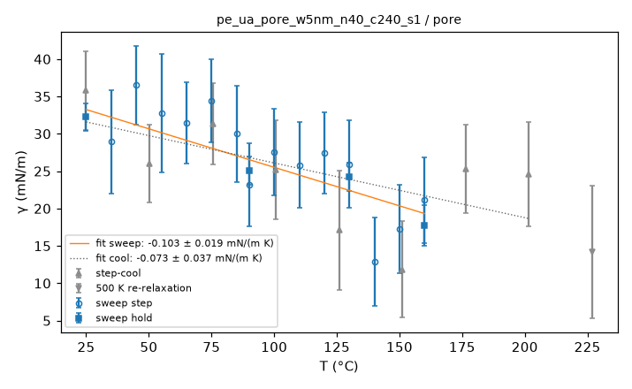

**film thickness, interior density and surface energy vs T**

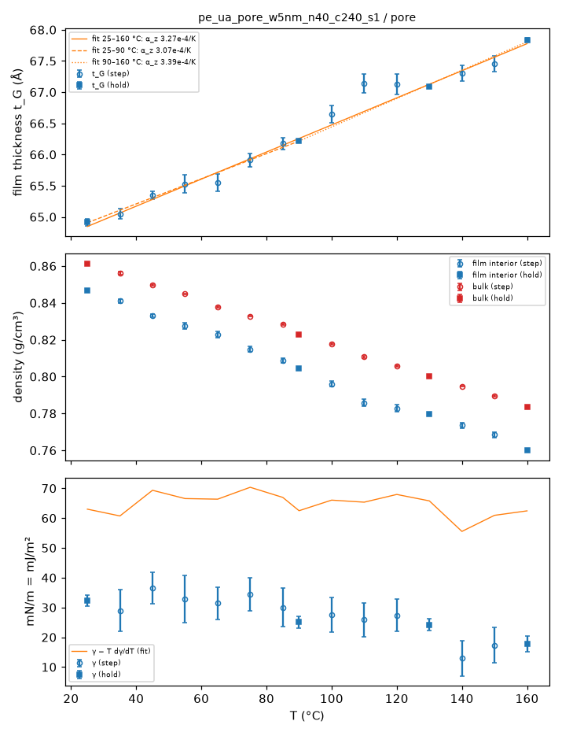

**ρ(z) at the holds**

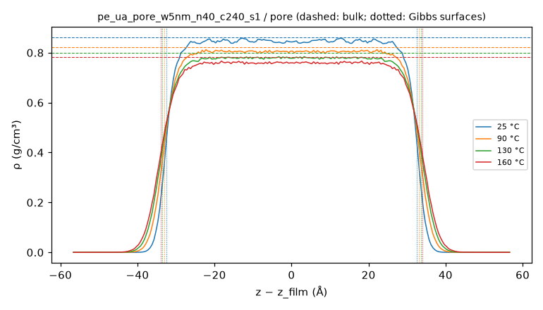

**gap width vs T**

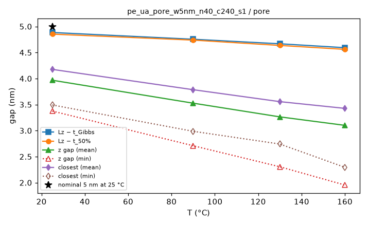

**MSD by layer**

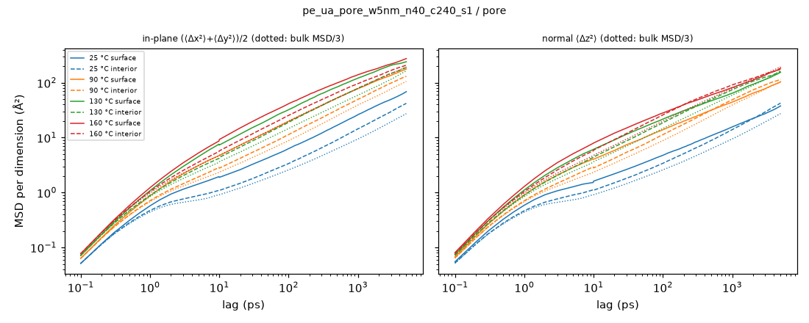

**bond P2 ACF by layer**

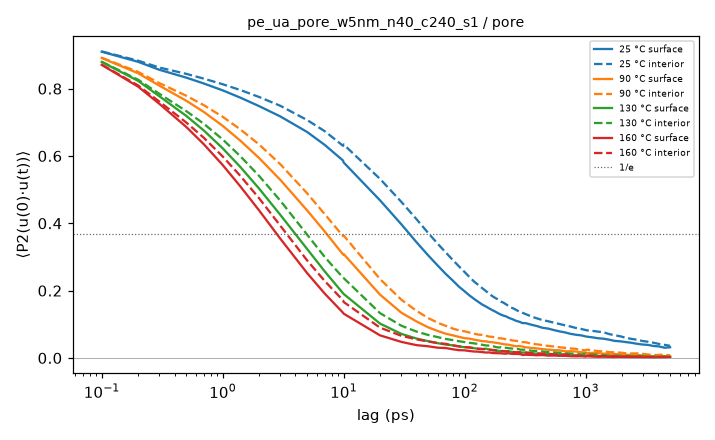

**⟨P2(cos θ_z)⟩ vs z**

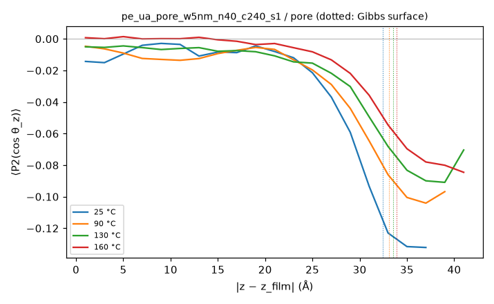

**film thickness, gap, interior density and closest approach vs time (holds)**

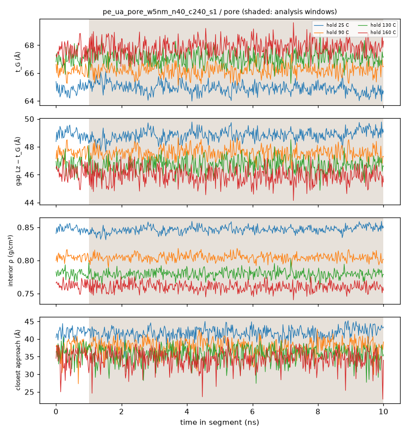

**whole film: end-to-end and Rouse mode ACFs, p²τ_p vs p**

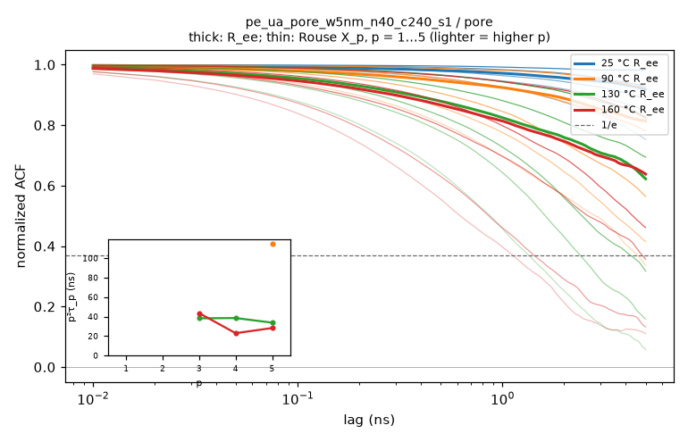

**thermo vs time, analysis windows shaded, block averages ± SEM**

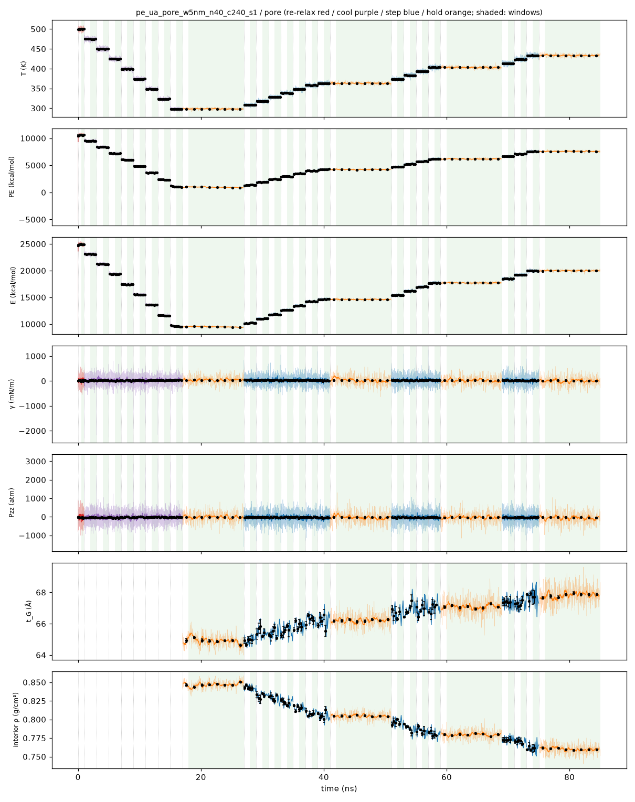

**holds: thermo vs time, analysis window shaded, block averages ± SEM**

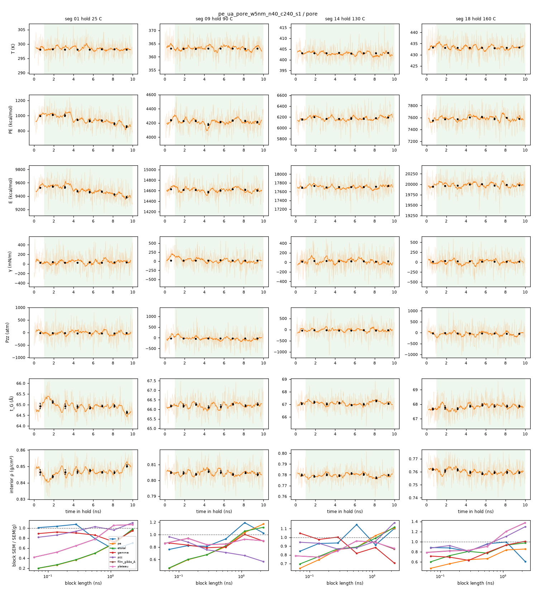

