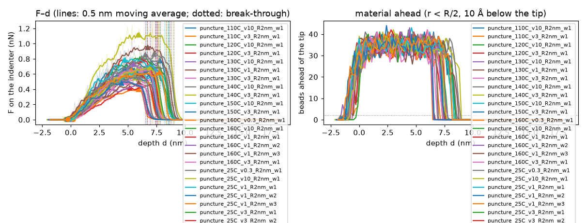
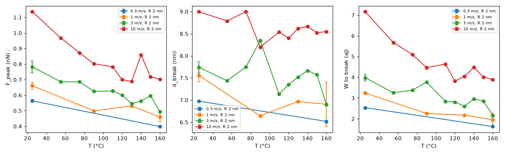
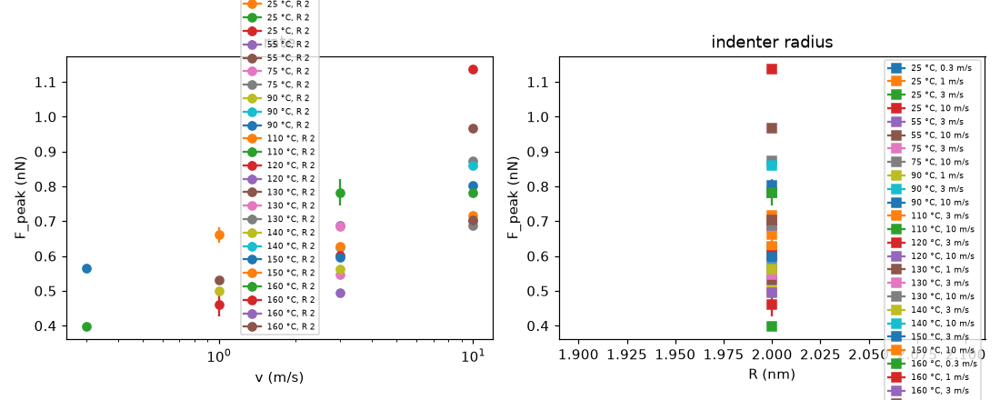
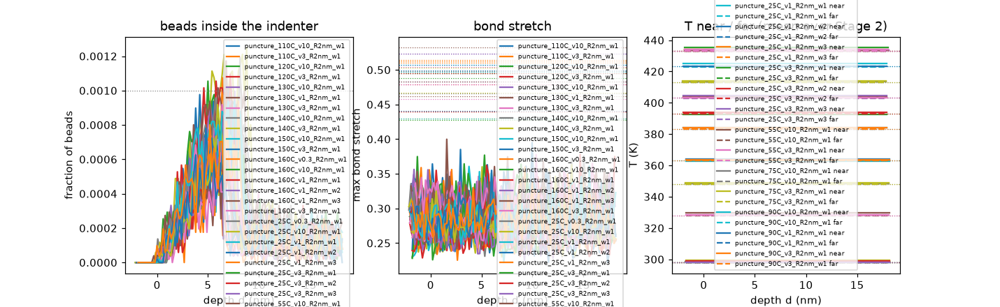
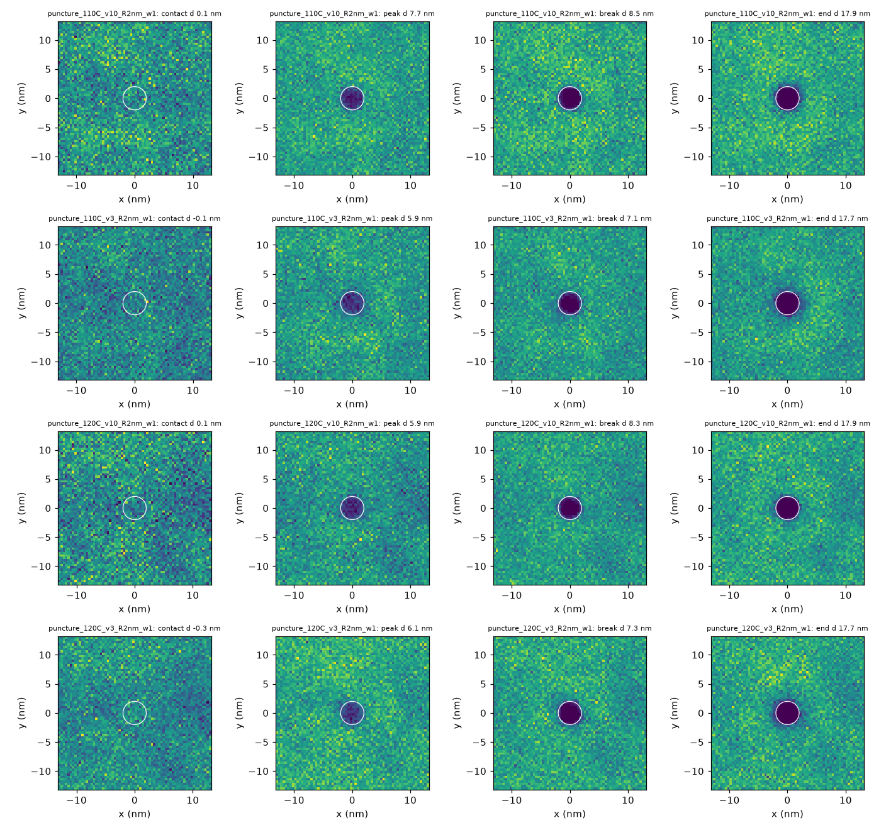

# Puncture analysis (D57)

Generated 2026-11-25T11:31:44+00:00. F = z force on the indenter (tip + shaft), nN; depth d = tip bottom below the far-field film top at t0, nm. F_peak = maximum of a 0.5 nm moving average (d_peak: largest raw F in that window); contact = first smoothed F above max(3 SD of the settle rows, 1% F_peak). Break-through needs (i) smoothed F < 50% F_peak after the peak over 0.5 nm and (iii) ≤ 2 beads ahead of the tip (r < R/2, 10 Å) for 3 frames; (ii) tip below the far-field bottom surface is reported. W = ∫F dd from contact (1 aJ = 1 nN·nm = 143.9 kcal/mol).

## pe_cg_film_110C_n640_c240_s1_rep441 / puncture_110C_v10_R2nm_w1

- 110 °C, v 10 m/s, R 2 nm, K 1 kcal/mol/ų, axis offset 0, 0 nm, travel 20.00 nm, thermostat nvt, boundary p p m; status finished; `/home/rdyu/projects/che126_sims/results/runs/pe_cg_film_110C_n640_c240_s1_rep441/puncture_110C_v10_R2nm_w1`
- film thickness (far field, t0) 6.61 nm (puncture.dcd frame 0 (far field, 50% crossings))

| quantity | value |
|---|---|
| contact depth (nm) | 0.09 |
| F_peak | 0.782 nN (782 pN) |
| d_peak (nm) | 7.79 |
| shaft share of F at the peak | 8.3% |
| (i) force break d (nm) | 8.49 |
| (iii) clear ahead d (nm) | 8.54 |
| (ii) tip below bottom surface d (nm) | 6.61 |
| **d_break** (i and iii, nm) | 8.54 |
| deflection contact → break (nm) | 8.45 |
| W to peak | 4.18 aJ (602 kcal/mol) |
| W to break | 4.64 aJ (667 kcal/mol) |
| re-seal | not resealed (free radius 1.12 nm at the end) |
| T set / all / near / far (K) | 383.1 / 383.2 / 384.2 / 383.1 |
| beads inside the indenter (max) | 48 (0.094%) |
| max bond stretch (before contact) | 38.5% (29.9%) |
| film edge z drift, max (nm) | 0.01 |
| z span max / Lz data (Å) | 103.0 / 115.8; Lz growth 0.0 Å |

## pe_cg_film_110C_n640_c240_s1_rep441 / puncture_110C_v3_R2nm_w1

- 110 °C, v 3 m/s, R 2 nm, K 1 kcal/mol/ų, axis offset 0, 0 nm, travel 20.00 nm, thermostat nvt, boundary p p m; status finished; `/home/rdyu/projects/che126_sims/results/runs/pe_cg_film_110C_n640_c240_s1_rep441/puncture_110C_v3_R2nm_w1`
- film thickness (far field, t0) 6.61 nm (puncture.dcd frame 0 (far field, 50% crossings))

| quantity | value |
|---|---|
| contact depth (nm) | -0.01 |
| F_peak | 0.627 nN (627 pN) |
| d_peak (nm) | 5.89 |
| shaft share of F at the peak | 6.0% |
| (i) force break d (nm) | 7.09 |
| (iii) clear ahead d (nm) | 7.14 |
| (ii) tip below bottom surface d (nm) | 6.61 |
| **d_break** (i and iii, nm) | 7.14 |
| deflection contact → break (nm) | 7.15 |
| W to peak | 2.18 aJ (314 kcal/mol) |
| W to break | 2.84 aJ (408 kcal/mol) |
| re-seal | not resealed (free radius 1.17 nm at the end) |
| T set / all / near / far (K) | 383.1 / 383.2 / 384.0 / 383.1 |
| beads inside the indenter (max) | 41 (0.080%) |
| max bond stretch (before contact) | 35.9% (29.5%) |
| film edge z drift, max (nm) | 0.02 |
| z span max / Lz data (Å) | 94.6 / 115.8; Lz growth 0.0 Å |

## pe_cg_film_120C_n640_c240_s1_rep441 / puncture_120C_v10_R2nm_w1

- 120 °C, v 10 m/s, R 2 nm, K 1 kcal/mol/ų, axis offset 0, 0 nm, travel 20.00 nm, thermostat nvt, boundary p p m; status finished; `/home/rdyu/projects/che126_sims/results/runs/pe_cg_film_120C_n640_c240_s1_rep441/puncture_120C_v10_R2nm_w1`
- film thickness (far field, t0) 6.69 nm (puncture.dcd frame 0 (far field, 50% crossings))

| quantity | value |
|---|---|
| contact depth (nm) | 0.10 |
| F_peak | 0.7 nN (700 pN) |
| d_peak (nm) | 5.90 |
| shaft share of F at the peak | 8.1% |
| (i) force break d (nm) | 8.40 |
| (iii) clear ahead d (nm) | 8.35 |
| (ii) tip below bottom surface d (nm) | 6.69 |
| **d_break** (i and iii, nm) | 8.40 |
| deflection contact → break (nm) | 8.30 |
| W to peak | 2.33 aJ (335 kcal/mol) |
| W to break | 3.82 aJ (549 kcal/mol) |
| re-seal | not resealed (free radius 0.88 nm at the end) |
| T set / all / near / far (K) | 393.1 / 393.2 / 392.7 / 393.2 |
| beads inside the indenter (max) | 46 (0.090%) |
| max bond stretch (before contact) | 34.5% (28.8%) |
| film edge z drift, max (nm) | 0.01 |
| z span max / Lz data (Å) | 100.2 / 116.0; Lz growth 0.0 Å |

## pe_cg_film_120C_n640_c240_s1_rep441 / puncture_120C_v3_R2nm_w1

- 120 °C, v 3 m/s, R 2 nm, K 1 kcal/mol/ų, axis offset 0, 0 nm, travel 20.00 nm, thermostat nvt, boundary p p m; status finished; `/home/rdyu/projects/che126_sims/results/runs/pe_cg_film_120C_n640_c240_s1_rep441/puncture_120C_v3_R2nm_w1`
- film thickness (far field, t0) 6.69 nm (puncture.dcd frame 0 (far field, 50% crossings))

| quantity | value |
|---|---|
| contact depth (nm) | -0.20 |
| F_peak | 0.601 nN (601 pN) |
| d_peak (nm) | 6.20 |
| shaft share of F at the peak | 5.0% |
| (i) force break d (nm) | 7.20 |
| (iii) clear ahead d (nm) | 7.35 |
| (ii) tip below bottom surface d (nm) | 6.69 |
| **d_break** (i and iii, nm) | 7.35 |
| deflection contact → break (nm) | 7.55 |
| W to peak | 2.28 aJ (329 kcal/mol) |
| W to break | 2.81 aJ (404 kcal/mol) |
| re-seal | not resealed (free radius 1.23 nm at the end) |
| T set / all / near / far (K) | 393.1 / 393.2 / 393.9 / 393.1 |
| beads inside the indenter (max) | 38 (0.074%) |
| max bond stretch (before contact) | 36.0% (27.9%) |
| film edge z drift, max (nm) | 0.02 |
| z span max / Lz data (Å) | 97.9 / 116.0; Lz growth 0.0 Å |

## pe_cg_film_130C_n640_c240_s1_rep441 / puncture_130C_v10_R2nm_w1

- 130 °C, v 10 m/s, R 2 nm, K 1 kcal/mol/ų, axis offset 0, 0 nm, travel 20.00 nm, thermostat nvt, boundary p p m; status finished; `/home/rdyu/projects/che126_sims/results/runs/pe_cg_film_130C_n640_c240_s1_rep441/puncture_130C_v10_R2nm_w1`
- film thickness (far field, t0) 6.68 nm (puncture.dcd frame 0 (far field, 50% crossings))

| quantity | value |
|---|---|
| contact depth (nm) | 0.02 |
| F_peak | 0.689 nN (689 pN) |
| d_peak (nm) | 6.52 |
| shaft share of F at the peak | 3.9% |
| (i) force break d (nm) | 8.62 |
| (iii) clear ahead d (nm) | 8.57 |
| (ii) tip below bottom surface d (nm) | 6.68 |
| **d_break** (i and iii, nm) | 8.62 |
| deflection contact → break (nm) | 8.60 |
| W to peak | 2.73 aJ (393 kcal/mol) |
| W to break | 4.05 aJ (582 kcal/mol) |
| re-seal | not resealed (free radius 0.92 nm at the end) |
| T set / all / near / far (K) | 403.1 / 403.1 / 404.4 / 403.0 |
| beads inside the indenter (max) | 48 (0.094%) |
| max bond stretch (before contact) | 35.6% (28.3%) |
| film edge z drift, max (nm) | 0.01 |
| z span max / Lz data (Å) | 104.2 / 116.1; Lz growth 0.0 Å |

## pe_cg_film_130C_n640_c240_s1_rep441 / puncture_130C_v1_R2nm_w1

- 130 °C, v 1 m/s, R 2 nm, K 1 kcal/mol/ų, axis offset 0, 0 nm, travel 20.00 nm, thermostat nvt, boundary p p m; status finished; `/home/rdyu/projects/che126_sims/results/runs/pe_cg_film_130C_n640_c240_s1_rep441/puncture_130C_v1_R2nm_w1`
- film thickness (far field, t0) 6.68 nm (puncture.dcd frame 0 (far field, 50% crossings))

| quantity | value |
|---|---|
| contact depth (nm) | -0.08 |
| F_peak | 0.531 nN (531 pN) |
| d_peak (nm) | 4.92 |
| shaft share of F at the peak | 4.8% |
| (i) force break d (nm) | 6.82 |
| (iii) clear ahead d (nm) | 6.97 |
| (ii) tip below bottom surface d (nm) | 6.68 |
| **d_break** (i and iii, nm) | 6.97 |
| deflection contact → break (nm) | 7.05 |
| W to peak | 1.3 aJ (187 kcal/mol) |
| W to break | 2.17 aJ (313 kcal/mol) |
| re-seal | not resealed (free radius 1.35 nm at the end) |
| T set / all / near / far (K) | 403.1 / 403.2 / 403.5 / 403.2 |
| beads inside the indenter (max) | 35 (0.068%) |
| max bond stretch (before contact) | 37.5% (28.3%) |
| film edge z drift, max (nm) | 0.02 |
| z span max / Lz data (Å) | 95.5 / 116.1; Lz growth 0.0 Å |

## pe_cg_film_130C_n640_c240_s1_rep441 / puncture_130C_v3_R2nm_w1

- 130 °C, v 3 m/s, R 2 nm, K 1 kcal/mol/ų, axis offset 0, 0 nm, travel 20.00 nm, thermostat nvt, boundary p p m; status finished; `/home/rdyu/projects/che126_sims/results/runs/pe_cg_film_130C_n640_c240_s1_rep441/puncture_130C_v3_R2nm_w1`
- film thickness (far field, t0) 6.68 nm (puncture.dcd frame 0 (far field, 50% crossings))

| quantity | value |
|---|---|
| contact depth (nm) | -0.08 |
| F_peak | 0.546 nN (546 pN) |
| d_peak (nm) | 5.92 |
| shaft share of F at the peak | 5.6% |
| (i) force break d (nm) | 7.52 |
| (iii) clear ahead d (nm) | 7.37 |
| (ii) tip below bottom surface d (nm) | 6.68 |
| **d_break** (i and iii, nm) | 7.52 |
| deflection contact → break (nm) | 7.60 |
| W to peak | 1.83 aJ (263 kcal/mol) |
| W to break | 2.6 aJ (375 kcal/mol) |
| re-seal | not resealed (free radius 1.10 nm at the end) |
| T set / all / near / far (K) | 403.1 / 403.2 / 403.4 / 403.2 |
| beads inside the indenter (max) | 43 (0.084%) |
| max bond stretch (before contact) | 37.8% (27.9%) |
| film edge z drift, max (nm) | 0.01 |
| z span max / Lz data (Å) | 97.7 / 116.1; Lz growth 0.0 Å |

## pe_cg_film_140C_n640_c240_s1_rep441 / puncture_140C_v10_R2nm_w1

- 140 °C, v 10 m/s, R 2 nm, K 1 kcal/mol/ų, axis offset 0, 0 nm, travel 20.00 nm, thermostat nvt, boundary p p m; status finished; `/home/rdyu/projects/che126_sims/results/runs/pe_cg_film_140C_n640_c240_s1_rep441/puncture_140C_v10_R2nm_w1`
- film thickness (far field, t0) 6.63 nm (puncture.dcd frame 0 (far field, 50% crossings))

| quantity | value |
|---|---|
| contact depth (nm) | -0.19 |
| F_peak | 0.859 nN (859 pN) |
| d_peak (nm) | 6.51 |
| shaft share of F at the peak | 5.9% |
| (i) force break d (nm) | 8.61 |
| (iii) clear ahead d (nm) | 8.66 |
| (ii) tip below bottom surface d (nm) | 6.63 |
| **d_break** (i and iii, nm) | 8.66 |
| deflection contact → break (nm) | 8.85 |
| W to peak | 2.95 aJ (425 kcal/mol) |
| W to break | 4.48 aJ (644 kcal/mol) |
| re-seal | not resealed (free radius 1.07 nm at the end) |
| T set / all / near / far (K) | 413.1 / 413.1 / 413.4 / 413.2 |
| beads inside the indenter (max) | 47 (0.092%) |
| max bond stretch (before contact) | 37.6% (29.8%) |
| film edge z drift, max (nm) | 0.01 |
| z span max / Lz data (Å) | 109.3 / 116.3; Lz growth 0.0 Å |

## pe_cg_film_140C_n640_c240_s1_rep441 / puncture_140C_v3_R2nm_w1

- 140 °C, v 3 m/s, R 2 nm, K 1 kcal/mol/ų, axis offset 0, 0 nm, travel 20.00 nm, thermostat nvt, boundary p p m; status finished; `/home/rdyu/projects/che126_sims/results/runs/pe_cg_film_140C_n640_c240_s1_rep441/puncture_140C_v3_R2nm_w1`
- film thickness (far field, t0) 6.63 nm (puncture.dcd frame 0 (far field, 50% crossings))

| quantity | value |
|---|---|
| contact depth (nm) | -0.49 |
| F_peak | 0.563 nN (563 pN) |
| d_peak (nm) | 5.61 |
| shaft share of F at the peak | 5.3% |
| (i) force break d (nm) | 7.61 |
| (iii) clear ahead d (nm) | 7.67 |
| (ii) tip below bottom surface d (nm) | 6.63 |
| **d_break** (i and iii, nm) | 7.67 |
| deflection contact → break (nm) | 8.15 |
| W to peak | 1.97 aJ (284 kcal/mol) |
| W to break | 2.96 aJ (426 kcal/mol) |
| re-seal | not resealed (free radius 0.95 nm at the end) |
| T set / all / near / far (K) | 413.1 / 413.1 / 414.2 / 413.1 |
| beads inside the indenter (max) | 37 (0.072%) |
| max bond stretch (before contact) | 36.3% (30.3%) |
| film edge z drift, max (nm) | 0.03 |
| z span max / Lz data (Å) | 99.9 / 116.3; Lz growth 0.0 Å |

## pe_cg_film_150C_n640_c240_s1_rep441 / puncture_150C_v10_R2nm_w1

- 150 °C, v 10 m/s, R 2 nm, K 1 kcal/mol/ų, axis offset 0, 0 nm, travel 20.00 nm, thermostat nvt, boundary p p m; status finished; `/home/rdyu/projects/che126_sims/results/runs/pe_cg_film_150C_n640_c240_s1_rep441/puncture_150C_v10_R2nm_w1`
- film thickness (far field, t0) 6.72 nm (puncture.dcd frame 0 (far field, 50% crossings))

| quantity | value |
|---|---|
| contact depth (nm) | -0.08 |
| F_peak | 0.717 nN (717 pN) |
| d_peak (nm) | 7.12 |
| shaft share of F at the peak | 6.1% |
| (i) force break d (nm) | 8.52 |
| (iii) clear ahead d (nm) | 8.37 |
| (ii) tip below bottom surface d (nm) | 6.72 |
| **d_break** (i and iii, nm) | 8.52 |
| deflection contact → break (nm) | 8.60 |
| W to peak | 3.18 aJ (458 kcal/mol) |
| W to break | 4.01 aJ (577 kcal/mol) |
| re-seal | not resealed (free radius 1.06 nm at the end) |
| T set / all / near / far (K) | 423.1 / 423.2 / 425.1 / 423.0 |
| beads inside the indenter (max) | 45 (0.088%) |
| max bond stretch (before contact) | 36.1% (29.7%) |
| film edge z drift, max (nm) | 0.01 |
| z span max / Lz data (Å) | 105.6 / 116.4; Lz growth 0.0 Å |

## pe_cg_film_150C_n640_c240_s1_rep441 / puncture_150C_v3_R2nm_w1

- 150 °C, v 3 m/s, R 2 nm, K 1 kcal/mol/ų, axis offset 0, 0 nm, travel 20.00 nm, thermostat nvt, boundary p p m; status finished; `/home/rdyu/projects/che126_sims/results/runs/pe_cg_film_150C_n640_c240_s1_rep441/puncture_150C_v3_R2nm_w1`
- film thickness (far field, t0) 6.72 nm (puncture.dcd frame 0 (far field, 50% crossings))

| quantity | value |
|---|---|
| contact depth (nm) | -0.28 |
| F_peak | 0.596 nN (596 pN) |
| d_peak (nm) | 7.22 |
| shaft share of F at the peak | 7.6% |
| (i) force break d (nm) | 7.52 |
| (iii) clear ahead d (nm) | 7.58 |
| (ii) tip below bottom surface d (nm) | 6.72 |
| **d_break** (i and iii, nm) | 7.58 |
| deflection contact → break (nm) | 7.85 |
| W to peak | 2.71 aJ (391 kcal/mol) |
| W to break | 2.85 aJ (411 kcal/mol) |
| re-seal | not resealed (free radius 1.13 nm at the end) |
| T set / all / near / far (K) | 423.1 / 423.2 / 423.1 / 423.1 |
| beads inside the indenter (max) | 39 (0.076%) |
| max bond stretch (before contact) | 39.5% (29.5%) |
| film edge z drift, max (nm) | 0.02 |
| z span max / Lz data (Å) | 100.6 / 116.4; Lz growth 0.0 Å |

## pe_cg_film_160C_n640_c240_s1_rep441 / puncture_160C_v0.3_R2nm_w1

- 160 °C, v 0.3 m/s, R 2 nm, K 1 kcal/mol/ų, axis offset 0, 0 nm, travel 16.00 nm, thermostat nvt, boundary p p m; status finished; `/home/rdyu/projects/che126_sims/results/runs/pe_cg_film_160C_n640_c240_s1_rep441/puncture_160C_v0.3_R2nm_w1`
- film thickness (far field, t0) 6.72 nm (puncture.dcd frame 0 (far field, 50% crossings))

| quantity | value |
|---|---|
| contact depth (nm) | 0.22 |
| F_peak | 0.398 nN (398 pN) |
| d_peak (nm) | 5.92 |
| shaft share of F at the peak | 7.3% |
| (i) force break d (nm) | 6.52 |
| (iii) clear ahead d (nm) | 6.47 |
| (ii) tip below bottom surface d (nm) | 6.72 |
| **d_break** (i and iii, nm) | 6.52 |
| deflection contact → break (nm) | 6.30 |
| W to peak | 1.42 aJ (204 kcal/mol) |
| W to break | 1.62 aJ (233 kcal/mol) |
| re-seal | not resealed (free radius 1.54 nm at the end) |
| T set / all / near / far (K) | 433.1 / 433.1 / 434.1 / 433.1 |
| beads inside the indenter (max) | 30 (0.059%) |
| max bond stretch (before contact) | 36.0% (31.4%) |
| film edge z drift, max (nm) | 0.02 |
| z span max / Lz data (Å) | 93.8 / 116.6; Lz growth 0.0 Å |

## pe_cg_film_160C_n640_c240_s1_rep441 / puncture_160C_v10_R2nm_w1

- 160 °C, v 10 m/s, R 2 nm, K 1 kcal/mol/ų, axis offset 0, 0 nm, travel 20.00 nm, thermostat nvt, boundary p p m; status finished; `/home/rdyu/projects/che126_sims/results/runs/pe_cg_film_160C_n640_c240_s1_rep441/puncture_160C_v10_R2nm_w1`
- film thickness (far field, t0) 6.72 nm (puncture.dcd frame 0 (far field, 50% crossings))

| quantity | value |
|---|---|
| contact depth (nm) | 0.05 |
| F_peak | 0.703 nN (703 pN) |
| d_peak (nm) | 7.05 |
| shaft share of F at the peak | 5.5% |
| (i) force break d (nm) | 8.55 |
| (iii) clear ahead d (nm) | 8.50 |
| (ii) tip below bottom surface d (nm) | 6.72 |
| **d_break** (i and iii, nm) | 8.55 |
| deflection contact → break (nm) | 8.50 |
| W to peak | 2.95 aJ (424 kcal/mol) |
| W to break | 3.89 aJ (560 kcal/mol) |
| re-seal | not resealed (free radius 1.19 nm at the end) |
| T set / all / near / far (K) | 433.1 / 433.2 / 435.3 / 433.1 |
| beads inside the indenter (max) | 42 (0.082%) |
| max bond stretch (before contact) | 37.7% (29.5%) |
| film edge z drift, max (nm) | 0.02 |
| z span max / Lz data (Å) | 104.1 / 116.6; Lz growth 0.0 Å |

## pe_cg_film_160C_n640_c240_s1_rep441 / puncture_160C_v1_R2nm_w1

- 160 °C, v 1 m/s, R 2 nm, K 1 kcal/mol/ų, axis offset 0, 0 nm, travel 20.00 nm, thermostat nvt, boundary p p m; status finished; `/home/rdyu/projects/che126_sims/results/runs/pe_cg_film_160C_n640_c240_s1_rep441/puncture_160C_v1_R2nm_w1`
- film thickness (far field, t0) 6.72 nm (puncture.dcd frame 0 (far field, 50% crossings))

| quantity | value |
|---|---|
| contact depth (nm) | -0.05 |
| F_peak | 0.423 nN (423 pN) |
| d_peak (nm) | 5.15 |
| shaft share of F at the peak | 4.6% |
| (i) force break d (nm) | 6.65 |
| (iii) clear ahead d (nm) | 6.70 |
| (ii) tip below bottom surface d (nm) | 6.72 |
| **d_break** (i and iii, nm) | 6.70 |
| deflection contact → break (nm) | 6.75 |
| W to peak | 1.09 aJ (157 kcal/mol) |
| W to break | 1.68 aJ (241 kcal/mol) |
| re-seal | not resealed (free radius 1.53 nm at the end) |
| T set / all / near / far (K) | 433.1 / 433.1 / 433.8 / 433.1 |
| beads inside the indenter (max) | 28 (0.055%) |
| max bond stretch (before contact) | 37.8% (29.5%) |
| film edge z drift, max (nm) | 0.01 |
| z span max / Lz data (Å) | 93.6 / 116.6; Lz growth 0.0 Å |

## pe_cg_film_160C_n640_c240_s1_rep441 / puncture_160C_v1_R2nm_w2

- 160 °C, v 1 m/s, R 2 nm, K 1 kcal/mol/ų, axis offset 3.5, 3.5 nm, travel 20.00 nm, thermostat nvt, boundary p p m; status finished; `/home/rdyu/projects/che126_sims/results/runs/pe_cg_film_160C_n640_c240_s1_rep441/puncture_160C_v1_R2nm_w2`
- film thickness (far field, t0) 6.72 nm (puncture.dcd frame 0 (far field, 50% crossings))

| quantity | value |
|---|---|
| contact depth (nm) | -0.31 |
| F_peak | 0.471 nN (471 pN) |
| d_peak (nm) | 5.99 |
| shaft share of F at the peak | 6.4% |
| (i) force break d (nm) | 6.49 |
| (iii) clear ahead d (nm) | 6.54 |
| (ii) tip below bottom surface d (nm) | 6.72 |
| **d_break** (i and iii, nm) | 6.54 |
| deflection contact → break (nm) | 6.85 |
| W to peak | 1.69 aJ (243 kcal/mol) |
| W to break | 1.89 aJ (272 kcal/mol) |
| re-seal | not resealed (free radius 1.61 nm at the end) |
| T set / all / near / far (K) | 433.1 / 433.1 / 433.8 / 433.2 |
| beads inside the indenter (max) | 43 (0.084%) |
| max bond stretch (before contact) | 35.6% (32.4%) |
| film edge z drift, max (nm) | 0.02 |
| z span max / Lz data (Å) | 96.1 / 116.6; Lz growth 0.0 Å |

## pe_cg_film_160C_n640_c240_s1_rep441 / puncture_160C_v1_R2nm_w3

- 160 °C, v 1 m/s, R 2 nm, K 1 kcal/mol/ų, axis offset -3.5, 3.5 nm, travel 20.00 nm, thermostat nvt, boundary p p m; status finished; `/home/rdyu/projects/che126_sims/results/runs/pe_cg_film_160C_n640_c240_s1_rep441/puncture_160C_v1_R2nm_w3`
- film thickness (far field, t0) 6.71 nm (puncture.dcd frame 0 (far field, 50% crossings))

| quantity | value |
|---|---|
| contact depth (nm) | 0.03 |
| F_peak | 0.485 nN (485 pN) |
| d_peak (nm) | 5.93 |
| shaft share of F at the peak | 6.6% |
| (i) force break d (nm) | 7.43 |
| (iii) clear ahead d (nm) | 7.48 |
| (ii) tip below bottom surface d (nm) | 6.71 |
| **d_break** (i and iii, nm) | 7.48 |
| deflection contact → break (nm) | 7.45 |
| W to peak | 1.64 aJ (236 kcal/mol) |
| W to break | 2.29 aJ (330 kcal/mol) |
| re-seal | not resealed (free radius 1.42 nm at the end) |
| T set / all / near / far (K) | 433.1 / 433.2 / 433.5 / 433.1 |
| beads inside the indenter (max) | 32 (0.062%) |
| max bond stretch (before contact) | 36.8% (33.2%) |
| film edge z drift, max (nm) | 0.02 |
| z span max / Lz data (Å) | 96.5 / 116.6; Lz growth 0.0 Å |

## pe_cg_film_160C_n640_c240_s1_rep441 / puncture_160C_v3_R2nm_w1

- 160 °C, v 3 m/s, R 2 nm, K 1 kcal/mol/ų, axis offset 0, 0 nm, travel 20.00 nm, thermostat nvt, boundary p p m; status finished; `/home/rdyu/projects/che126_sims/results/runs/pe_cg_film_160C_n640_c240_s1_rep441/puncture_160C_v3_R2nm_w1`
- film thickness (far field, t0) 6.71 nm (puncture.dcd frame 0 (far field, 50% crossings))

| quantity | value |
|---|---|
| contact depth (nm) | -0.15 |
| F_peak | 0.495 nN (495 pN) |
| d_peak (nm) | 4.55 |
| shaft share of F at the peak | 3.6% |
| (i) force break d (nm) | 6.85 |
| (iii) clear ahead d (nm) | 6.90 |
| (ii) tip below bottom surface d (nm) | 6.71 |
| **d_break** (i and iii, nm) | 6.90 |
| deflection contact → break (nm) | 7.05 |
| W to peak | 1.11 aJ (160 kcal/mol) |
| W to break | 2.16 aJ (311 kcal/mol) |
| re-seal | not resealed (free radius 1.44 nm at the end) |
| T set / all / near / far (K) | 433.1 / 433.2 / 434.1 / 433.1 |
| beads inside the indenter (max) | 31 (0.061%) |
| max bond stretch (before contact) | 36.5% (30.4%) |
| film edge z drift, max (nm) | 0.02 |
| z span max / Lz data (Å) | 94.8 / 116.6; Lz growth 0.0 Å |

## pe_cg_film_25C_n640_c240_s1_rep441 / puncture_25C_v0.3_R2nm_w1

- 25 °C, v 0.3 m/s, R 2 nm, K 1 kcal/mol/ų, axis offset 0, 0 nm, travel 16.00 nm, thermostat nvt, boundary p p m; status finished; `/home/rdyu/projects/che126_sims/results/runs/pe_cg_film_25C_n640_c240_s1_rep441/puncture_25C_v0.3_R2nm_w1`
- film thickness (far field, t0) 6.49 nm (puncture.dcd frame 0 (far field, 50% crossings))

| quantity | value |
|---|---|
| contact depth (nm) | -0.12 |
| F_peak | 0.564 nN (564 pN) |
| d_peak (nm) | 5.98 |
| shaft share of F at the peak | 6.9% |
| (i) force break d (nm) | 6.98 |
| (iii) clear ahead d (nm) | 6.93 |
| (ii) tip below bottom surface d (nm) | 6.49 |
| **d_break** (i and iii, nm) | 6.98 |
| deflection contact → break (nm) | 7.10 |
| W to peak | 2.05 aJ (295 kcal/mol) |
| W to break | 2.54 aJ (365 kcal/mol) |
| re-seal | not resealed (free radius 1.06 nm at the end) |
| T set / all / near / far (K) | 298.1 / 298.2 / 298.3 / 298.2 |
| beads inside the indenter (max) | 43 (0.084%) |
| max bond stretch (before contact) | 31.1% (24.0%) |
| film edge z drift, max (nm) | 0.02 |
| z span max / Lz data (Å) | 90.5 / 114.5; Lz growth 0.0 Å |

## pe_cg_film_25C_n640_c240_s1_rep441 / puncture_25C_v10_R2nm_w1

- 25 °C, v 10 m/s, R 2 nm, K 1 kcal/mol/ų, axis offset 0, 0 nm, travel 20.00 nm, thermostat nvt, boundary p p m; status finished; `/home/rdyu/projects/che126_sims/results/runs/pe_cg_film_25C_n640_c240_s1_rep441/puncture_25C_v10_R2nm_w1`
- film thickness (far field, t0) 6.50 nm (puncture.dcd frame 0 (far field, 50% crossings))
- **flag**: beads inside the indenter: up to 0.12% of beads (> 0.1%): the indenter is too soft (raise indent_k)

| quantity | value |
|---|---|
| contact depth (nm) | -0.25 |
| F_peak | 1.14 nN (1137 pN) |
| d_peak (nm) | 5.95 |
| shaft share of F at the peak | 3.6% |
| (i) force break d (nm) | 8.95 |
| (iii) clear ahead d (nm) | 9.00 |
| (ii) tip below bottom surface d (nm) | 6.50 |
| **d_break** (i and iii, nm) | 9.00 |
| deflection contact → break (nm) | 9.25 |
| W to peak | 4.02 aJ (579 kcal/mol) |
| W to break | 7.17 aJ (1.03e+03 kcal/mol) |
| re-seal | not resealed (free radius 0.83 nm at the end) |
| T set / all / near / far (K) | 298.1 / 298.2 / 299.5 / 298.1 |
| beads inside the indenter (max) | 64 (0.125%) |
| max bond stretch (before contact) | 29.9% (23.0%) |
| film edge z drift, max (nm) | 0.01 |
| z span max / Lz data (Å) | 104.3 / 114.5; Lz growth 0.0 Å |

## pe_cg_film_25C_n640_c240_s1_rep441 / puncture_25C_v1_R2nm_w1

- 25 °C, v 1 m/s, R 2 nm, K 1 kcal/mol/ų, axis offset 0, 0 nm, travel 20.00 nm, thermostat nvt, boundary p p m; status finished; `/home/rdyu/projects/che126_sims/results/runs/pe_cg_film_25C_n640_c240_s1_rep441/puncture_25C_v1_R2nm_w1`
- film thickness (far field, t0) 6.50 nm (puncture.dcd frame 0 (far field, 50% crossings))

| quantity | value |
|---|---|
| contact depth (nm) | -0.15 |
| F_peak | 0.642 nN (642 pN) |
| d_peak (nm) | 5.75 |
| shaft share of F at the peak | 7.8% |
| (i) force break d (nm) | 7.55 |
| (iii) clear ahead d (nm) | 7.60 |
| (ii) tip below bottom surface d (nm) | 6.50 |
| **d_break** (i and iii, nm) | 7.60 |
| deflection contact → break (nm) | 7.75 |
| W to peak | 2.15 aJ (309 kcal/mol) |
| W to break | 3.16 aJ (455 kcal/mol) |
| re-seal | not resealed (free radius 0.99 nm at the end) |
| T set / all / near / far (K) | 298.1 / 298.1 / 298.2 / 298.1 |
| beads inside the indenter (max) | 46 (0.090%) |
| max bond stretch (before contact) | 35.3% (23.0%) |
| film edge z drift, max (nm) | 0.01 |
| z span max / Lz data (Å) | 92.2 / 114.5; Lz growth 0.0 Å |

## pe_cg_film_25C_n640_c240_s1_rep441 / puncture_25C_v1_R2nm_w2

- 25 °C, v 1 m/s, R 2 nm, K 1 kcal/mol/ų, axis offset 3.5, 3.5 nm, travel 20.00 nm, thermostat nvt, boundary p p m; status finished; `/home/rdyu/projects/che126_sims/results/runs/pe_cg_film_25C_n640_c240_s1_rep441/puncture_25C_v1_R2nm_w2`
- film thickness (far field, t0) 6.50 nm (puncture.dcd frame 0 (far field, 50% crossings))
- **flag**: beads inside the indenter: up to 0.10% of beads (> 0.1%): the indenter is too soft (raise indent_k)

| quantity | value |
|---|---|
| contact depth (nm) | -0.05 |
| F_peak | 0.686 nN (686 pN) |
| d_peak (nm) | 4.75 |
| shaft share of F at the peak | 3.1% |
| (i) force break d (nm) | 7.35 |
| (iii) clear ahead d (nm) | 7.40 |
| (ii) tip below bottom surface d (nm) | 6.50 |
| **d_break** (i and iii, nm) | 7.40 |
| deflection contact → break (nm) | 7.45 |
| W to peak | 1.69 aJ (243 kcal/mol) |
| W to break | 3.29 aJ (474 kcal/mol) |
| re-seal | not resealed (free radius 1.08 nm at the end) |
| T set / all / near / far (K) | 298.1 / 298.1 / 298.4 / 298.1 |
| beads inside the indenter (max) | 52 (0.102%) |
| max bond stretch (before contact) | 31.4% (24.1%) |
| film edge z drift, max (nm) | 0.01 |
| z span max / Lz data (Å) | 93.1 / 114.5; Lz growth 0.0 Å |

## pe_cg_film_25C_n640_c240_s1_rep441 / puncture_25C_v1_R2nm_w3

- 25 °C, v 1 m/s, R 2 nm, K 1 kcal/mol/ų, axis offset -3.5, 3.5 nm, travel 20.00 nm, thermostat nvt, boundary p p m; status finished; `/home/rdyu/projects/che126_sims/results/runs/pe_cg_film_25C_n640_c240_s1_rep441/puncture_25C_v1_R2nm_w3`
- film thickness (far field, t0) 6.52 nm (puncture.dcd frame 0 (far field, 50% crossings))
- **flag**: beads inside the indenter: up to 0.11% of beads (> 0.1%): the indenter is too soft (raise indent_k)

| quantity | value |
|---|---|
| contact depth (nm) | -0.02 |
| F_peak | 0.654 nN (654 pN) |
| d_peak (nm) | 5.28 |
| shaft share of F at the peak | 4.2% |
| (i) force break d (nm) | 7.68 |
| (iii) clear ahead d (nm) | 7.63 |
| (ii) tip below bottom surface d (nm) | 6.52 |
| **d_break** (i and iii, nm) | 7.68 |
| deflection contact → break (nm) | 7.70 |
| W to peak | 1.86 aJ (268 kcal/mol) |
| W to break | 3.27 aJ (471 kcal/mol) |
| re-seal | not resealed (free radius 1.12 nm at the end) |
| T set / all / near / far (K) | 298.1 / 298.1 / 298.5 / 298.1 |
| beads inside the indenter (max) | 55 (0.107%) |
| max bond stretch (before contact) | 31.2% (31.2%) |
| film edge z drift, max (nm) | 0.01 |
| z span max / Lz data (Å) | 93.4 / 114.5; Lz growth 0.0 Å |

## pe_cg_film_25C_n640_c240_s1_rep441 / puncture_25C_v3_R2nm_w1

- 25 °C, v 3 m/s, R 2 nm, K 1 kcal/mol/ų, axis offset 0, 0 nm, travel 20.00 nm, thermostat nvt, boundary p p m; status finished; `/home/rdyu/projects/che126_sims/results/runs/pe_cg_film_25C_n640_c240_s1_rep441/puncture_25C_v3_R2nm_w1`
- film thickness (far field, t0) 6.50 nm (puncture.dcd frame 0 (far field, 50% crossings))
- **flag**: beads inside the indenter: up to 0.11% of beads (> 0.1%): the indenter is too soft (raise indent_k)

| quantity | value |
|---|---|
| contact depth (nm) | -0.25 |
| F_peak | 0.814 nN (814 pN) |
| d_peak (nm) | 6.05 |
| shaft share of F at the peak | 7.4% |
| (i) force break d (nm) | 7.75 |
| (iii) clear ahead d (nm) | 7.80 |
| (ii) tip below bottom surface d (nm) | 6.50 |
| **d_break** (i and iii, nm) | 7.80 |
| deflection contact → break (nm) | 8.05 |
| W to peak | 2.88 aJ (414 kcal/mol) |
| W to break | 4.13 aJ (594 kcal/mol) |
| re-seal | not resealed (free radius 0.90 nm at the end) |
| T set / all / near / far (K) | 298.1 / 298.1 / 298.7 / 298.1 |
| beads inside the indenter (max) | 54 (0.105%) |
| max bond stretch (before contact) | 31.9% (22.8%) |
| film edge z drift, max (nm) | 0.01 |
| z span max / Lz data (Å) | 94.5 / 114.5; Lz growth 0.0 Å |

## pe_cg_film_25C_n640_c240_s1_rep441 / puncture_25C_v3_R2nm_w2

- 25 °C, v 3 m/s, R 2 nm, K 1 kcal/mol/ų, axis offset 3.5, 3.5 nm, travel 20.00 nm, thermostat nvt, boundary p p m; status finished; `/home/rdyu/projects/che126_sims/results/runs/pe_cg_film_25C_n640_c240_s1_rep441/puncture_25C_v3_R2nm_w2`
- film thickness (far field, t0) 6.50 nm (puncture.dcd frame 0 (far field, 50% crossings))
- **flag**: beads inside the indenter: up to 0.11% of beads (> 0.1%): the indenter is too soft (raise indent_k)

| quantity | value |
|---|---|
| contact depth (nm) | -0.35 |
| F_peak | 0.793 nN (793 pN) |
| d_peak (nm) | 6.24 |
| shaft share of F at the peak | 5.5% |
| (i) force break d (nm) | 7.54 |
| (iii) clear ahead d (nm) | 7.60 |
| (ii) tip below bottom surface d (nm) | 6.50 |
| **d_break** (i and iii, nm) | 7.60 |
| deflection contact → break (nm) | 7.95 |
| W to peak | 3.13 aJ (450 kcal/mol) |
| W to break | 4.02 aJ (578 kcal/mol) |
| re-seal | not resealed (free radius 1.04 nm at the end) |
| T set / all / near / far (K) | 298.1 / 298.1 / 298.8 / 298.1 |
| beads inside the indenter (max) | 56 (0.109%) |
| max bond stretch (before contact) | 30.7% (23.9%) |
| film edge z drift, max (nm) | 0.01 |
| z span max / Lz data (Å) | 92.3 / 114.5; Lz growth 0.0 Å |

## pe_cg_film_25C_n640_c240_s1_rep441 / puncture_25C_v3_R2nm_w3

- 25 °C, v 3 m/s, R 2 nm, K 1 kcal/mol/ų, axis offset -3.5, 3.5 nm, travel 20.00 nm, thermostat nvt, boundary p p m; status finished; `/home/rdyu/projects/che126_sims/results/runs/pe_cg_film_25C_n640_c240_s1_rep441/puncture_25C_v3_R2nm_w3`
- film thickness (far field, t0) 6.52 nm (puncture.dcd frame 0 (far field, 50% crossings))

| quantity | value |
|---|---|
| contact depth (nm) | 0.08 |
| F_peak | 0.74 nN (740 pN) |
| d_peak (nm) | 5.48 |
| shaft share of F at the peak | 8.1% |
| (i) force break d (nm) | 7.68 |
| (iii) clear ahead d (nm) | 7.83 |
| (ii) tip below bottom surface d (nm) | 6.52 |
| **d_break** (i and iii, nm) | 7.83 |
| deflection contact → break (nm) | 7.75 |
| W to peak | 2.31 aJ (332 kcal/mol) |
| W to break | 3.8 aJ (547 kcal/mol) |
| re-seal | not resealed (free radius 0.82 nm at the end) |
| T set / all / near / far (K) | 298.1 / 298.2 / 298.0 / 298.2 |
| beads inside the indenter (max) | 51 (0.100%) |
| max bond stretch (before contact) | 32.3% (32.3%) |
| film edge z drift, max (nm) | 0.01 |
| z span max / Lz data (Å) | 92.0 / 114.5; Lz growth 0.0 Å |

## pe_cg_film_55C_n640_c240_s1_rep441 / puncture_55C_v10_R2nm_w1

- 55 °C, v 10 m/s, R 2 nm, K 1 kcal/mol/ų, axis offset 0, 0 nm, travel 20.00 nm, thermostat nvt, boundary p p m; status finished; `/home/rdyu/projects/che126_sims/results/runs/pe_cg_film_55C_n640_c240_s1_rep441/puncture_55C_v10_R2nm_w1`
- film thickness (far field, t0) 6.52 nm (puncture.dcd frame 0 (far field, 50% crossings))
- **flag**: beads inside the indenter: up to 0.12% of beads (> 0.1%): the indenter is too soft (raise indent_k)

| quantity | value |
|---|---|
| contact depth (nm) | -0.16 |
| F_peak | 0.968 nN (968 pN) |
| d_peak (nm) | 6.74 |
| shaft share of F at the peak | 3.4% |
| (i) force break d (nm) | 8.74 |
| (iii) clear ahead d (nm) | 8.79 |
| (ii) tip below bottom surface d (nm) | 6.52 |
| **d_break** (i and iii, nm) | 8.79 |
| deflection contact → break (nm) | 8.95 |
| W to peak | 4.03 aJ (579 kcal/mol) |
| W to break | 5.67 aJ (817 kcal/mol) |
| re-seal | not resealed (free radius 0.72 nm at the end) |
| T set / all / near / far (K) | 328.1 / 328.1 / 329.5 / 328.1 |
| beads inside the indenter (max) | 60 (0.117%) |
| max bond stretch (before contact) | 40.0% (26.2%) |
| film edge z drift, max (nm) | 0.01 |
| z span max / Lz data (Å) | 101.7 / 115.0; Lz growth 0.0 Å |

## pe_cg_film_55C_n640_c240_s1_rep441 / puncture_55C_v3_R2nm_w1

- 55 °C, v 3 m/s, R 2 nm, K 1 kcal/mol/ų, axis offset 0, 0 nm, travel 20.00 nm, thermostat nvt, boundary p p m; status finished; `/home/rdyu/projects/che126_sims/results/runs/pe_cg_film_55C_n640_c240_s1_rep441/puncture_55C_v3_R2nm_w1`
- film thickness (far field, t0) 6.52 nm (puncture.dcd frame 0 (far field, 50% crossings))

| quantity | value |
|---|---|
| contact depth (nm) | -0.06 |
| F_peak | 0.687 nN (687 pN) |
| d_peak (nm) | 6.14 |
| shaft share of F at the peak | 5.1% |
| (i) force break d (nm) | 7.44 |
| (iii) clear ahead d (nm) | 7.39 |
| (ii) tip below bottom surface d (nm) | 6.52 |
| **d_break** (i and iii, nm) | 7.44 |
| deflection contact → break (nm) | 7.50 |
| W to peak | 2.49 aJ (358 kcal/mol) |
| W to break | 3.25 aJ (468 kcal/mol) |
| re-seal | not resealed (free radius 1.01 nm at the end) |
| T set / all / near / far (K) | 328.1 / 328.2 / 328.3 / 328.2 |
| beads inside the indenter (max) | 47 (0.092%) |
| max bond stretch (before contact) | 33.6% (25.8%) |
| film edge z drift, max (nm) | 0.01 |
| z span max / Lz data (Å) | 92.8 / 115.0; Lz growth 0.0 Å |

## pe_cg_film_75C_n640_c240_s1_rep441 / puncture_75C_v10_R2nm_w1

- 75 °C, v 10 m/s, R 2 nm, K 1 kcal/mol/ų, axis offset 0, 0 nm, travel 20.00 nm, thermostat nvt, boundary p p m; status finished; `/home/rdyu/projects/che126_sims/results/runs/pe_cg_film_75C_n640_c240_s1_rep441/puncture_75C_v10_R2nm_w1`
- film thickness (far field, t0) 6.56 nm (puncture.dcd frame 0 (far field, 50% crossings))
- **flag**: beads inside the indenter: up to 0.12% of beads (> 0.1%): the indenter is too soft (raise indent_k)

| quantity | value |
|---|---|
| contact depth (nm) | -0.10 |
| F_peak | 0.872 nN (872 pN) |
| d_peak (nm) | 7.30 |
| shaft share of F at the peak | 5.6% |
| (i) force break d (nm) | 9.00 |
| (iii) clear ahead d (nm) | 8.95 |
| (ii) tip below bottom surface d (nm) | 6.56 |
| **d_break** (i and iii, nm) | 9.00 |
| deflection contact → break (nm) | 9.10 |
| W to peak | 3.8 aJ (548 kcal/mol) |
| W to break | 5.1 aJ (734 kcal/mol) |
| re-seal | not resealed (free radius 0.93 nm at the end) |
| T set / all / near / far (K) | 348.1 / 348.2 / 348.2 / 348.1 |
| beads inside the indenter (max) | 61 (0.119%) |
| max bond stretch (before contact) | 33.7% (26.6%) |
| film edge z drift, max (nm) | 0.01 |
| z span max / Lz data (Å) | 103.2 / 115.3; Lz growth 0.0 Å |

## pe_cg_film_75C_n640_c240_s1_rep441 / puncture_75C_v3_R2nm_w1

- 75 °C, v 3 m/s, R 2 nm, K 1 kcal/mol/ų, axis offset 0, 0 nm, travel 20.00 nm, thermostat nvt, boundary p p m; status finished; `/home/rdyu/projects/che126_sims/results/runs/pe_cg_film_75C_n640_c240_s1_rep441/puncture_75C_v3_R2nm_w1`
- film thickness (far field, t0) 6.56 nm (puncture.dcd frame 0 (far field, 50% crossings))

| quantity | value |
|---|---|
| contact depth (nm) | 0.10 |
| F_peak | 0.686 nN (686 pN) |
| d_peak (nm) | 6.80 |
| shaft share of F at the peak | 8.4% |
| (i) force break d (nm) | 7.70 |
| (iii) clear ahead d (nm) | 7.75 |
| (ii) tip below bottom surface d (nm) | 6.56 |
| **d_break** (i and iii, nm) | 7.75 |
| deflection contact → break (nm) | 7.65 |
| W to peak | 2.82 aJ (406 kcal/mol) |
| W to break | 3.38 aJ (486 kcal/mol) |
| re-seal | not resealed (free radius 1.16 nm at the end) |
| T set / all / near / far (K) | 348.1 / 348.1 / 348.9 / 348.1 |
| beads inside the indenter (max) | 47 (0.092%) |
| max bond stretch (before contact) | 32.6% (26.7%) |
| film edge z drift, max (nm) | 0.01 |
| z span max / Lz data (Å) | 92.8 / 115.3; Lz growth 0.0 Å |

## pe_cg_film_90C_n640_c240_s1_rep441 / puncture_90C_v10_R2nm_w1

- 90 °C, v 10 m/s, R 2 nm, K 1 kcal/mol/ų, axis offset 0, 0 nm, travel 20.00 nm, thermostat nvt, boundary p p m; status finished; `/home/rdyu/projects/che126_sims/results/runs/pe_cg_film_90C_n640_c240_s1_rep441/puncture_90C_v10_R2nm_w1`
- film thickness (far field, t0) 6.60 nm (puncture.dcd frame 0 (far field, 50% crossings))

| quantity | value |
|---|---|
| contact depth (nm) | -0.16 |
| F_peak | 0.802 nN (802 pN) |
| d_peak (nm) | 4.74 |
| shaft share of F at the peak | 4.8% |
| (i) force break d (nm) | 8.14 |
| (iii) clear ahead d (nm) | 8.19 |
| (ii) tip below bottom surface d (nm) | 6.60 |
| **d_break** (i and iii, nm) | 8.19 |
| deflection contact → break (nm) | 8.35 |
| W to peak | 2.02 aJ (291 kcal/mol) |
| W to break | 4.47 aJ (643 kcal/mol) |
| re-seal | not resealed (free radius 1.04 nm at the end) |
| T set / all / near / far (K) | 363.1 / 363.1 / 362.9 / 363.2 |
| beads inside the indenter (max) | 48 (0.094%) |
| max bond stretch (before contact) | 36.1% (30.7%) |
| film edge z drift, max (nm) | 0.02 |
| z span max / Lz data (Å) | 100.0 / 115.5; Lz growth 0.0 Å |

## pe_cg_film_90C_n640_c240_s1_rep441 / puncture_90C_v1_R2nm_w1

- 90 °C, v 1 m/s, R 2 nm, K 1 kcal/mol/ų, axis offset 0, 0 nm, travel 20.00 nm, thermostat nvt, boundary p p m; status finished; `/home/rdyu/projects/che126_sims/results/runs/pe_cg_film_90C_n640_c240_s1_rep441/puncture_90C_v1_R2nm_w1`
- film thickness (far field, t0) 6.60 nm (puncture.dcd frame 0 (far field, 50% crossings))

| quantity | value |
|---|---|
| contact depth (nm) | -0.36 |
| F_peak | 0.499 nN (499 pN) |
| d_peak (nm) | 4.44 |
| shaft share of F at the peak | 6.2% |
| (i) force break d (nm) | 6.64 |
| (iii) clear ahead d (nm) | 6.59 |
| (ii) tip below bottom surface d (nm) | 6.60 |
| **d_break** (i and iii, nm) | 6.64 |
| deflection contact → break (nm) | 7.00 |
| W to peak | 1.26 aJ (181 kcal/mol) |
| W to break | 2.25 aJ (325 kcal/mol) |
| re-seal | not resealed (free radius 1.31 nm at the end) |
| T set / all / near / far (K) | 363.1 / 363.2 / 363.9 / 363.1 |
| beads inside the indenter (max) | 40 (0.078%) |
| max bond stretch (before contact) | 35.5% (30.7%) |
| film edge z drift, max (nm) | 0.04 |
| z span max / Lz data (Å) | 91.7 / 115.5; Lz growth 0.0 Å |

## pe_cg_film_90C_n640_c240_s1_rep441 / puncture_90C_v3_R2nm_w1

- 90 °C, v 3 m/s, R 2 nm, K 1 kcal/mol/ų, axis offset 0, 0 nm, travel 20.00 nm, thermostat nvt, boundary p p m; status finished; `/home/rdyu/projects/che126_sims/results/runs/pe_cg_film_90C_n640_c240_s1_rep441/puncture_90C_v3_R2nm_w1`
- film thickness (far field, t0) 6.60 nm (puncture.dcd frame 0 (far field, 50% crossings))

| quantity | value |
|---|---|
| contact depth (nm) | -0.26 |
| F_peak | 0.626 nN (626 pN) |
| d_peak (nm) | 7.74 |
| shaft share of F at the peak | 8.9% |
| (i) force break d (nm) | 8.34 |
| (iii) clear ahead d (nm) | 8.19 |
| (ii) tip below bottom surface d (nm) | 6.60 |
| **d_break** (i and iii, nm) | 8.34 |
| deflection contact → break (nm) | 8.60 |
| W to peak | 3.46 aJ (497 kcal/mol) |
| W to break | 3.77 aJ (543 kcal/mol) |
| re-seal | not resealed (free radius 1.12 nm at the end) |
| T set / all / near / far (K) | 363.1 / 363.2 / 363.4 / 363.3 |
| beads inside the indenter (max) | 48 (0.094%) |
| max bond stretch (before contact) | 33.8% (31.0%) |
| film edge z drift, max (nm) | 0.02 |
| z span max / Lz data (Å) | 98.1 / 115.5; Lz growth 0.0 Å |

## Pooled at the same T, v and R (positions, tags)

| T (°C) | v (m/s) | R (nm) | runs | F_peak (nN) | d_peak (nm) | d_break (nm) | W to break (aJ) |
|---|---|---|---|---|---|---|---|
| 25 | 0.3 | 2 | 1 | 0.564 | 5.98 | 6.98 | 2.54 |
| 25 | 1 | 2 | 3 | 0.661 ± 0.0223 | 5.26 ± 0.50 | 7.56 ± 0.15 | 3.24 ± 0.0708 |
| 25 | 3 | 2 | 3 | 0.782 ± 0.0382 | 5.92 ± 0.40 | 7.74 ± 0.13 | 3.98 ± 0.166 |
| 25 | 10 | 2 | 1 | 1.14 | 5.95 | 9.00 | 7.17 |
| 55 | 3 | 2 | 1 | 0.687 | 6.14 | 7.44 | 3.25 |
| 55 | 10 | 2 | 1 | 0.968 | 6.74 | 8.79 | 5.67 |
| 75 | 3 | 2 | 1 | 0.686 | 6.80 | 7.75 | 3.38 |
| 75 | 10 | 2 | 1 | 0.872 | 7.30 | 9.00 | 5.1 |
| 90 | 1 | 2 | 1 | 0.499 | 4.44 | 6.64 | 2.25 |
| 90 | 3 | 2 | 1 | 0.626 | 7.74 | 8.34 | 3.77 |
| 90 | 10 | 2 | 1 | 0.802 | 4.74 | 8.19 | 4.47 |
| 110 | 3 | 2 | 1 | 0.627 | 5.89 | 7.14 | 2.84 |
| 110 | 10 | 2 | 1 | 0.782 | 7.79 | 8.54 | 4.64 |
| 120 | 3 | 2 | 1 | 0.601 | 6.20 | 7.35 | 2.81 |
| 120 | 10 | 2 | 1 | 0.7 | 5.90 | 8.40 | 3.82 |
| 130 | 1 | 2 | 1 | 0.531 | 4.92 | 6.97 | 2.17 |
| 130 | 3 | 2 | 1 | 0.546 | 5.92 | 7.52 | 2.6 |
| 130 | 10 | 2 | 1 | 0.689 | 6.52 | 8.62 | 4.05 |
| 140 | 3 | 2 | 1 | 0.563 | 5.61 | 7.67 | 2.96 |
| 140 | 10 | 2 | 1 | 0.859 | 6.51 | 8.66 | 4.48 |
| 150 | 3 | 2 | 1 | 0.596 | 7.22 | 7.58 | 2.85 |
| 150 | 10 | 2 | 1 | 0.717 | 7.12 | 8.52 | 4.01 |
| 160 | 0.3 | 2 | 1 | 0.398 | 5.92 | 6.52 | 1.62 |
| 160 | 1 | 2 | 3 | 0.46 ± 0.0322 | 5.69 ± 0.47 | 6.90 ± 0.50 | 1.95 ± 0.312 |
| 160 | 3 | 2 | 1 | 0.495 | 4.55 | 6.90 | 2.16 |
| 160 | 10 | 2 | 1 | 0.703 | 7.05 | 8.55 | 3.89 |

## Caveats

- The film is an amorphous melt film (no crystallinity, no lamellae or fibrils), a few nm thick: a nanoscale puncture of a melt, not the ASTM/UL puncture strength of a separator.
- Indentation speeds are 10³–10⁴× faster than standard puncture tests and CG time runs ≈ 4× fast (D57; reporting.CG_TIME_NOTE): forces are rate-inflated viscous forces.
- No bond breaking: the CG bonds are harmonic, so the melt yields by chain pull-out and flow; break-through is the film parting around the tip, not chain scission.
- The film is periodic in x and y: it is clamped at the box edge, a distance L/2 from the axis (L/2R sets the span); the deflection and the force scale with it.
- The indenter is soft (fix indent tip, F = K (R − r)², K in kcal/mol/ų; fix wall/region shaft, harmonic shaft_eps over shaft_cut_a): beads penetrate it slightly; check the inside-indenter count below.
- A hole in a melt re-seals: closure after break-through is physical (surface tension), but around the indenter column only the free annulus can close.
- The thermostat acts on all beads (thermostat=partial: x and y only), so the heat of the deformation near the tip is removed at the thermostat rate; see T_near.

## Plots

**force–depth curves**

**F_peak, d_break, W vs T**

**F_peak vs speed and radius**

**diagnostics**

**projected bead occupancy**

