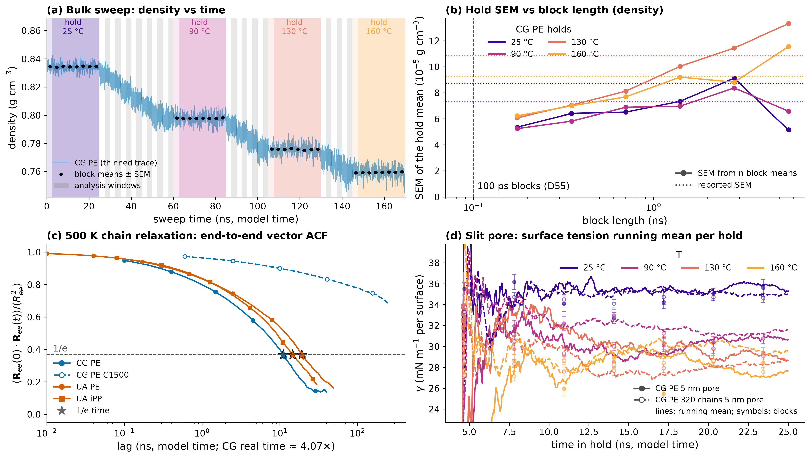
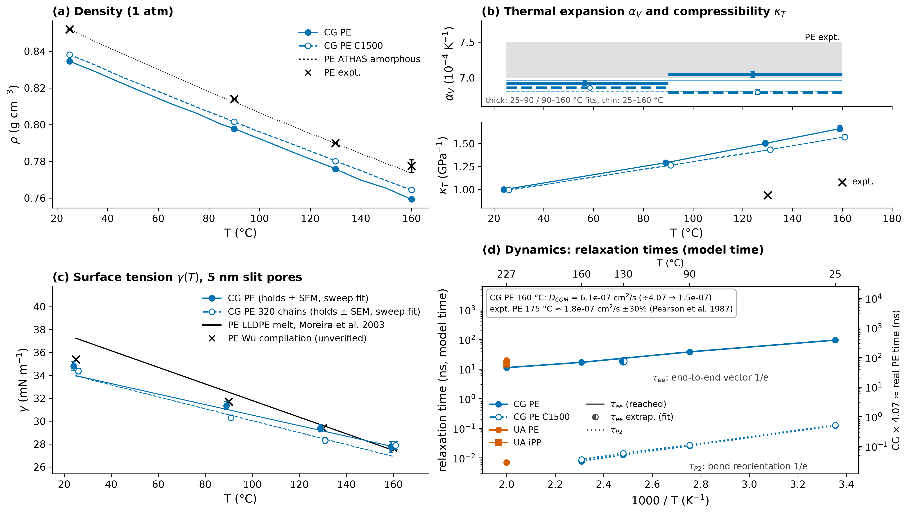
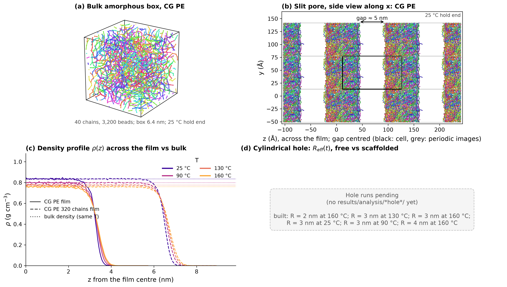
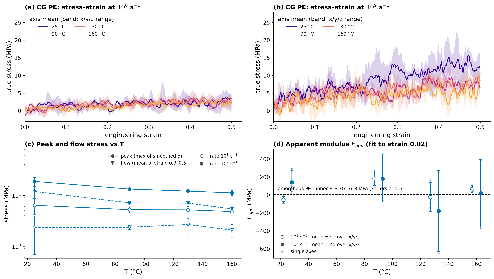

# Presentation figures

Regenerate: `uv run --frozen python scripts/presentation_figures.py` (reads only results/analysis/**/results.json, systems/*/manifest.yaml and data.lmp, the run progress.json copies and local results/runs snapshots where present). Each figure is written as PNG (300 dpi), PDF and SVG. Experimental values and their sources: [docs/experiment_comparison.md](../../docs/experiment_comparison.md); per-system validity: [summary](../summary.md) ("Physical validity by system").

Style: colour = resolution (CG blue, UA vermillion, AA green), marker = polymer (PE circle, iPP square), open/dashed = C1500 or a replicated (320-chain) box, black = experiment; temperatures 25 → 160 °C run dark violet → orange. CG dynamics are ≈4.07× faster than real PE, so every CG time is labelled model time. UA/AA and iPP series are added automatically once their results.json exist.

## fig1_convergence

**Figure 1. Equilibration evidence.** (a) CG PE heating sweep (25→160 °C, 14 5 ns steps and 4 25 ns holds): thinned density trace; light colour = hold, darker band / grey = the analysis window (holds without their first 10 %, steps their second half, D49), black = 8 block means ± SEM per hold. (b) SEM of each hold's mean density from n = 128 … 4 block means vs block length, against the reported SEM (dotted). The block SEM rises from the 0.2 ns blocks and reaches the reported value at 1–3 ns blocks (the slow ≈1–2 ns barostat/volume tail found by the audit); the 4-block points scatter (only 4 samples). D55 therefore computes SEMs on 100 ps block means. (c) End-to-end vector ACF at 500 K over the combined prep hold + extension (CG PE τ_ee(1/e) = 11.1 ns over a 80 ns hold; CG PE C1500 τ_ee(1/e) = n/a ns over a 500 ns hold; UA PE τ_ee(1/e) = 19.3 ns over a 98.19 ns hold; UA iPP τ_ee(1/e) = 14.7 ns over a 60.01 ns hold); D47 requires ACF < 1/e and COM MSD ≥ 2⟨Rg²⟩ at half the hold. C1500 is shown as the long-chain case for which D47 is out of reach (accepted on a C_n no-drift rule). CG and UA times are model times (CG real ≈ 4.07× longer; UA needs its own mapping). (d) Slit-pore surface tension per 25 ns hold (CG PE, CG PE 320 chains): running mean of the stored (thinned) γ series over the analysis window (drawn from 2 ns into the window, where the running mean of a few points is still noise) and the 8 per-segment block means ± SEM (symbols, inside the window). The stored series are thinned to ≤ 500 points per segment, so the running mean is that of the thinned trace, not of every thermo row. Sources: results/analysis/*/sweep|pore|extend/results.json (``convergence``, ``sem_vs_block``, ``traj.curves``) and the extend runs' progress.json ``hold.curves`` where the extend analysis has no trajectory.

Files: [fig1_convergence.png](fig1_convergence.png), [fig1_convergence.pdf](fig1_convergence.pdf), [fig1_convergence.svg](fig1_convergence.svg)

## fig2_properties_vs_T

**Figure 2. Properties vs temperature, model vs experiment** (colour = resolution: CG blue, UA vermillion, AA green; marker = polymer: PE circle, iPP square; open / dashed = C1500 or a larger box; black = experiment). (a) Density along the heating sweep; holds ± SEM as symbols (CG PE C240: 0.8345 / 0.7978 / 0.7758 / 0.7594 g/cm³ at 25/90/130/160 °C). Experiment: amorphous PE 0.852 / ≈0.814 / ≈0.790 / ≈0.774–0.781 g/cm³ (ATHAS amorphous line, Gaur & Wunderlich 1981; SANS densities; Tait fit, Padilha Júnior et al. 2015) and the ATHAS two-point line (dotted). CG PE is ≈2 % low (C1500 1–2 %): a force-field offset with no principled correction (validity: comparable). No iPP reference values are tabulated yet in docs/experiment_comparison.md, so iPP series will appear without an experimental curve until they are added to ``EXPERIMENT``. (b) Top: α_V from the linear V(T) fits (thick bars: 25–90 and 90–160 °C windows, thin: 25–160 °C); V(T) is curved (χ²_red ≈ 21), so the windowed values are the ones to quote. Grey band: experiment 7.0–7.5 × 10⁻⁴ K⁻¹ [derived from SANS densities / Tait]; CG ≈5 % low. Bottom: κ_T from hold volume fluctuations vs experiment 0.94 / 1.08 GPa⁻¹ at 130 / 160 °C (Tait fit of Sato PVT data); CG is 50–60 % too compressible, typical of CG. (c) γ per surface from the 25 ns holds of both 5 nm pores ± SEM and the sweep fits (CG PE: dγ/dT = -0.046 ± 0.006 mN m⁻¹ K⁻¹; CG PE 320 chains: dγ/dT = -0.052 ± 0.004 mN m⁻¹ K⁻¹). Experiment: LLDPE melt γ = 39.05 − 0.0725·t (Moreira et al. 2003, solid line; drawn over the full range although the data are melt values) and the Wu compilation (crosses, unverified). γ uses a plain 15 Å LJ cutoff without tail correction, so it is cutoff-dependent; the agreement (1–3 %) partly reflects SDK being fitted to surface tension; dγ/dT is ≈20 % shallower than experiment. (d) Relaxation times on an Arrhenius axis (top: °C), in model time: τ_ee = 1/e time of the end-to-end vector ACF (solid; 300 ns diffuse runs at 25/90/160 °C, 500 K from the extension), open symbols = exponential-fit extrapolations where the ACF never reached 1/e in a 25 ns sweep hold (order of magnitude, typically an underestimate), τ_P2 = bond P2 1/e time (dotted; CG bead–bead vector, UA C–C bond: different vectors, not the ¹³C NMR C–H vector). Right axis: CG times × 4.07 ≈ real PE time (Hall, Sirk, Klein, Shinoda, J. Chem. Phys. 150, 244901, 2019; the factor depends on T and should be recalibrated against UA/AA). The box lists D_COM only where the COM MSD is diffusive and ≥ 2⟨Rg²⟩, with the 4.07 mapping, next to Pearson et al. 1987 (short PE melt, read from a graph, ±30 %). Validity: CG dynamics need the time correction (corr); the diffuse holds at 25/90 °C were interrupted (277/176 ns).

Files: [fig2_properties_vs_T.png](fig2_properties_vs_T.png), [fig2_properties_vs_T.pdf](fig2_properties_vs_T.pdf), [fig2_properties_vs_T.svg](fig2_properties_vs_T.svg)

## fig3_structures

**Figure 3. Structures.** (a) CG PE box (40 chains, 3,200 beads, 6.4 nm), each chain one colour, bonds drawn, wrapped into the cell; from ``results/runs/pe_cg_amorph_n40_c240_s1/sweep/hold_25C.data`` (local run snapshot, end of the 25 °C hold). (b) CG PE 5 nm slit pore seen along x (z across the image), shifted along z so the gap is mid-cell, with 3 × 3 periodic images (y, z; grey outlines) so the film reads as a continuous sheet; depth-shaded; from ``results/runs/pe_cg_pore_w5nm_n40_c240_s1/pore/hold_25C.data``. (c) Symmetrised density profile ρ(z) about the film centre for every hold (colour = T; solid 40-chain, dashed 320-chain 2×2×2 pore), with the bulk density at the same T (dotted): the film interior matches bulk within ≈0.2 % (40 chains) and better for the thicker 320-chain film; interfaces are ≈6 Å wide (10–90 %). Film structure is a trend-level property (validity: trend); the slit is a local patch of an amorphous wall, whereas real separator pores are 30–100 nm, curved and semicrystalline. (d) Placeholder: the cylindrical-hole production runs have not run yet (built: R = 2 nm at 160 °C; R = 3 nm at 130 °C; R = 3 nm at 160 °C; R = 3 nm at 25 °C; R = 3 nm at 90 °C; R = 4 nm at 160 °C). When results/analysis/*hole*/<stage>/results.json appear, this panel shows R_eff(t) of the production phase (solid = free, dashed = scaffolded), coloured by T.

Files: [fig3_structures.png](fig3_structures.png), [fig3_structures.pdf](fig3_structures.pdf), [fig3_structures.svg](fig3_structures.svg)

## fig4_mechanics

**Figure 4. Mechanics (CG PE tensile).** The box is stretched along x, y and z in turn from the same snapshot at a constant engineering strain rate with the lateral axes at 1 atm. (a, b) Axis-mean smoothed true stress vs strain at 25/90/130/160 °C (band = range over the three axes) at 10⁸ and 10⁹ s⁻¹. (c) Peak stress (max of the smoothed σ) and flow stress (mean σ over strain 0.3–0.5) vs T, mean ± sd over the axes; both scale with the rate (viscous flow stress ≈ 3η × rate), so they are rate-dependent and not a yield stress. (d) Apparent modulus from the slope up to strain 0.02: not resolvable at this box size — the noise (fit errors 66–296 MPa, axis spread up to 450 MPa; i.e. ±70–450 MPa) dwarfs the ≈8 MPa expected for an amorphous PE rubber (E ≈ 3G_e, G_e = 2.6 MPa at 140 °C; Fetters, Lohse, Colby 2007), and several axes give negative slopes. The boxes are amorphous melts above Tg at MD rates ~10⁹× faster than experiment: these numbers show T and rate trends only (validity: trend) and are **not comparable to semicrystalline separator data** (Celgard E ≈ 0.25 GPa, tensile strength ≈ 165 MPa MD; Gor et al. 2014), whose stiffness and strength come from crystallinity.

Files: [fig4_mechanics.png](fig4_mechanics.png), [fig4_mechanics.pdf](fig4_mechanics.pdf), [fig4_mechanics.svg](fig4_mechanics.svg)
