# Result figures

Regenerate: `uv run --frozen python scripts/presentation_figures.py --runs /home/rdyu/projects/che126_sims/results/runs --runs results/run_sidecars --runs /home/rdyu/projects/che126_sims/results/progress/rdyu-rog [--hole-preview DIR]` (reads only results/analysis/**/results.json, systems/*/manifest.yaml and data.lmp, the run progress.json copies and local run snapshots; panels without data show a PENDING placeholder and fill in once their results.json appear). Each figure is PNG (300 dpi), PDF and SVG; molecular renders use PyMOL and are cached in [renders/](renders/). Experimental values and sources: [docs/experiment_comparison.md](../../docs/experiment_comparison.md); per-system validity: [summary](../summary.md) ("Physical validity by system"), rules in scripts/validity.py.

Style: colour = resolution (CG blue, UA vermillion, AA green), marker = polymer (PE circle, iPP square), open/dashed = C1500 or a replicated (320-chain) box, black = experiment; in temperature-resolved panels colour = T (25 °C dark violet → 160 °C orange, 500 K grey) and line style = resolution (CG solid, UA dashed, AA dotted); half-filled symbols = long holds (D53) where marked. Figures 2–4 use one shared legend row above the panels (series, then the line-style and marker-fill keys); a panel keeps an in-panel key only for what is unique to it. MSD / ACF axes use the time interval Δt between the two compared frames, averaged over all time origins. Error bars are SEM unless stated. CG dynamics are model time (≈4.07× faster than real PE). Appendix figures (supporting panels) are in [appendix/](appendix/), captions at the end.

## fig1_models

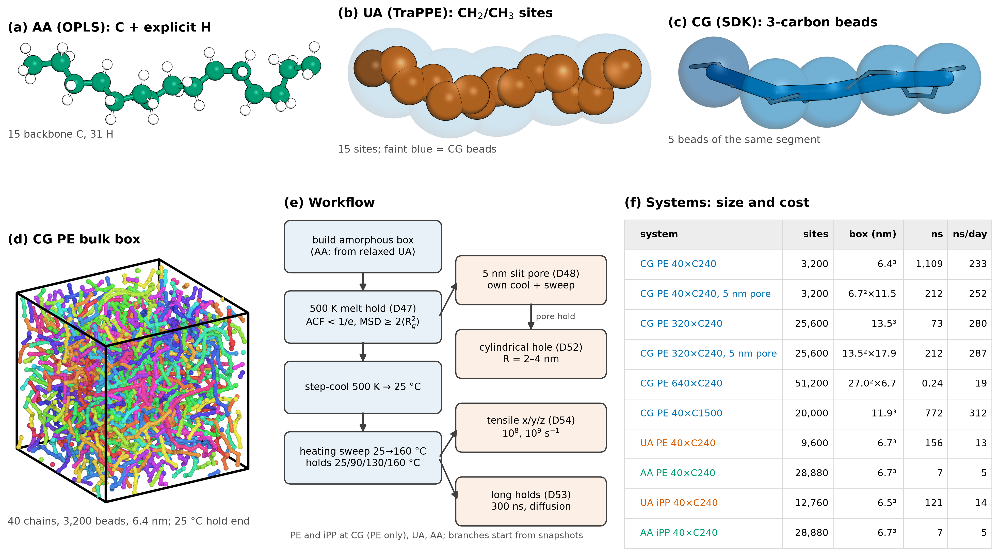

**Figure 1. Models and workflow.** (a–c) PyMOL renders of the same segment at every resolution: carbons 1–15 of the first chain of the ua2aa box `pe_aa_amorph_n40_c240_s1_from_ua`, whose carbons coincide with the UA source snapshot ``runs/pe_ua_amorph_n40_c240_s1/extend/hold_ext_70ns.data`` (max deviation 7e-07 Å), rotated to its principal axes: (a) AA (OPLS) carbons (green) with 31 explicit H; (b) UA (TraPPE) CH₂/CH₃ sites (σ/2 spheres, scaled; CH₃ end darker), with the CG bead positions of the same carbons as faint blue spheres; (c) CG (SDK): the centres of the same carbons in groups of 3 (the SDK 3-carbon mapping; CT end bead darker) with the carbon backbone inside. Panel (c) is a geometric mapping of the segment, not a CG trajectory frame (the CG boxes were built independently). (d) CG PE bulk box (40 chains, 3,200 beads, 6.4 nm), chains coloured, wrapped into the cell; from ``runs/pe_cg_amorph_n40_c240_s1/sweep/hold_25C.data``. (e) Workflow: build (soft push-off for AA/UA; AA from the relaxed UA box, ua2aa) → 500 K NPT melt hold, extended until D47 passes (end-to-end ACF < 1/e and chain COM MSD ≥ 2⟨Rg²⟩ at half the hold) → step-cool to 25 °C → heating sweep 25 → 160 °C (~10 °C steps, holds at 25/90/130/160 °C) → branches: 5 nm slit pore (cut from the 500 K box, D48), cylindrical hole through the pore film (D52), tensile pulls (D54), 300 ns long holds for chain diffusion (D53). (f) Every current bulk and 5 nm pore system (10 rows; colour = resolution): interaction sites, box edge (bulk: from the 25 °C hold density, else the latest run density; pores: the NVT box), total simulated time over all current runs (progress.json steps × timestep; CG times are model time) and the throughput of the main production run. Render status: aa cached, ua cached, cg cached.

Files: [fig1_models.png](fig1_models.png), [fig1_models.pdf](fig1_models.pdf), [fig1_models.svg](fig1_models.svg)

## fig2_equilibration

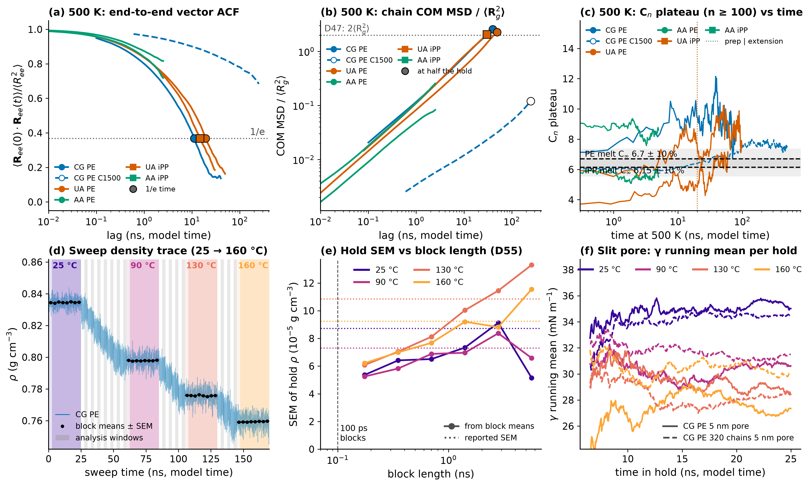

**Figure 2. Equilibration evidence.** (a, b) 500 K melt hold (prep + extension combined) per bulk system (colour = model, marker = polymer; dashed / open = CG PE C1500): (a) end-to-end vector autocorrelation ⟨**R**ee(t)·**R**ee(t+Δt)⟩/⟨Ree²⟩ with its 1/e time (black-edged markers; CG PE C240 τee = 11.1 ns over 80 ns; CG PE C1500 τee = n/a ns over 500 ns; UA PE τee = 19.3 ns over 98.19 ns; AA PE τee = n/a ns over 4.99 ns; UA iPP τee = 14.7 ns over 60.01 ns; AA iPP τee = n/a ns over 4.99 ns; 'nan' = not reached: C1500 and the 5 ns AA preps); (b) chain COM MSD / ⟨Rg²⟩ vs Δt with the D47 threshold 2 and the value at half the hold (black-edged markers). Δt is the time interval between the two compared frames, averaged over all time origins in the hold. CG and UA times are model times (CG ≈ 4.07× faster than real PE; UA needs its own mapping). The AA curves are the short ua2aa preps (AA conformations come from UA; validity: trend). (c) CG PE C240 heating sweep: thinned density trace, holds shaded by T (dark band = analysis window: holds without their first 10 %, steps their second half; grey = step windows), black = block means ± SEM. (d) Slit-pore γ per surface: running mean over each hold's analysis window (drawn from 4 ns into it), colour = T, line style = box size (solid = 40 chains, dashed = 320 chains, 2×2×2): CG PE C240 5 nm pore (40 chains) and CG PE C240 5 nm pore (320 chains). The Cn plateau vs time and the hold SEM vs block length are in appendix Fig. 2.1. Sources: results/analysis/*/{sweep,extend,pore}/results.json and the extend/prep progress.json ``hold`` curves. **Validity** (scripts/validity.py): CG PE C240 (`pe_cg_amorph_n40_c240_s1`): Rg/R_ee/C_n 500 K comparable | CG PE C1500 (`pe_cg_amorph_n40_c1500_s1`): Rg/R_ee/C_n 500 K trend (D47 not reached) | UA PE (`pe_ua_amorph_n40_c240_s1`): Rg/R_ee/C_n 500 K comparable | AA PE (`pe_aa_amorph_n40_c240_s1_from_ua`): Rg/R_ee/C_n 500 K trend (ua2aa box: the chain conformations were equilibrated with the UA force field) | UA iPP (`ipp_ua_amorph_n40_c240_s1`): Rg/R_ee/C_n 500 K comparable | AA iPP (`ipp_aa_amorph_n40_c240_s1_from_ua`): Rg/R_ee/C_n 500 K trend (ua2aa box: the chain conformations were equilibrated with the UA force field) | CG PE C240 (`pe_cg_pore_w5nm_n40_c240_s1`): γ, dγ/dT comparable | CG PE C240 (320 chains) (`pe_cg_pore_w5nm_n320_c240_s1_rep222`): γ, dγ/dT comparable.

Files: [fig2_equilibration.png](fig2_equilibration.png), [fig2_equilibration.pdf](fig2_equilibration.pdf), [fig2_equilibration.svg](fig2_equilibration.svg)

## fig3_thermo

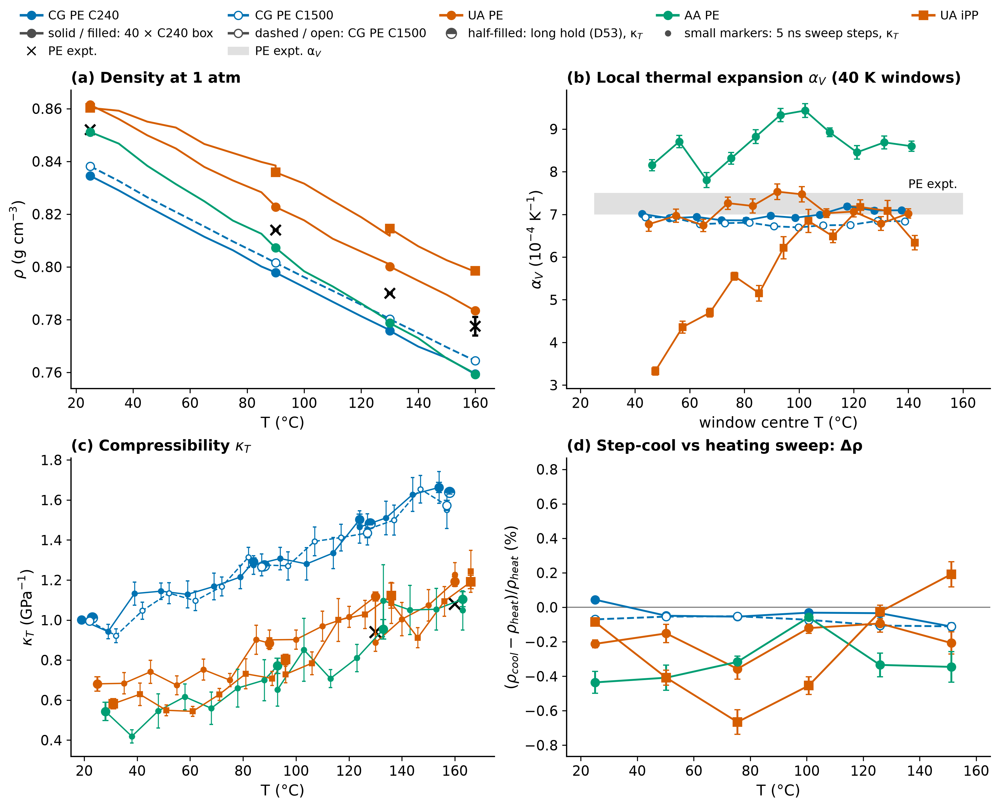

**Figure 3. Bulk thermodynamics vs experiment** (colour = model, marker = polymer; solid / filled = 40 × C240 boxes, dashed / open = CG PE C1500; black = experiment; one shared legend). (a) Density along the heating sweep at 1 atm, holds ± SEM as symbols (CG PE C240: 0.8345 / 0.7978 / 0.7758 / 0.7594; CG PE C1500: 0.8382 / 0.8015 / 0.7802 / 0.7644; UA PE: 0.8614 / 0.8227 / 0.8001 / 0.7834; UA iPP: 0.8603 / 0.8359 / 0.8146 / 0.7986 g/cm³ at 25/90/130/160 °C). PE expt. (×): amorphous PE 0.852 / ≈0.814 / ≈0.790 / ≈0.774–0.781 g/cm³ at 25/90/130/160 °C, from the ATHAS data bank amorphous line (Gaur & Wunderlich 1981; the 25 °C point), SANS densities and a Tait fit (Padilha Júnior et al. 2015). CG PE is ≈2 % low (C1500 1–2 %): a force-field offset. No iPP density, κT or αV reference is tabulated in docs/experiment_comparison.md yet, so UA iPP is shown without an experimental reference in (a–c). (b) Local αV (10⁻⁴ K⁻¹): for each window of 5 consecutive sweep temperatures (≈40 K; 35 K where the window contains 90 °C, as the grid is 25, 35, …, 85, 90, 100, …, 160 °C) a linear V(T) fit weighted by 1/SEM² of the per-segment volume means (the hold where a T has both a step and a hold), αV = slope / mean V, error bar = 1σ from the unscaled fit covariance, drawn at the window's mean T (small x offsets per model). Local ranges: CG PE C240 6.9–7.2; CG PE C1500 6.7–6.9; UA PE 6.7–7.5; UA iPP 3.3–7.2. UA iPP rises from 3.3–4.7 below 70 °C to 6.2–7.2 above 90 °C: an apparent glass transition of the UA iPP model on this heating sweep (rate- and history-dependent), so its single 25–160 °C value is an average over two regimes. Full 25–160 °C fits (results.json fits.alpha_V, Birge-scaled errors): CG PE C240 6.97 ± 0.04; CG PE C1500 6.81 ± 0.02; UA PE 7.15 ± 0.06; UA iPP 5.76 ± 0.22. Grey band: PE experiment 7.0–7.5 over 25–160 °C [derived from SANS densities / Tait]. (c) κT from the hold volume fluctuations ± SEM; half-filled = the 180–280 ns CG long holds (D53), which agree with the 25 ns holds; experiment 0.94 / 1.08 GPa⁻¹ at 130 / 160 °C (Tait fit of Sato PVT data [D]); CG is 50–60 % too compressible, UA closer (UA PE 0.68 / 0.88 / 1.12 / 1.19; UA iPP 0.58 / 0.80 / 1.12 / 1.19 GPa⁻¹ at 25/90/130/160 °C). The CG 90 and 130 °C values may be slight underestimates (κT still rising at the end of the hold; appendix Fig. 3.2). (d) Cooling-branch minus heating-branch density at the same T. Protocol: 500 K melt → cooled to 25 °C in 8 steps of 5 ns (≈25 K each) → heating sweep 25 → 160 °C in 10 °C steps with long holds at 25/90/130/160 °C; the comparison is at the cooling-step temperatures (25, 50, 76, 101, 126, 151 °C), the heating-branch density interpolated in T (sweep progress.json ``hysteresis``; error = cooling-step SEM). Classical Cp and the chain-length effect are in appendix Fig. 3.1, convergence of the hold density and κT in appendix Fig. 3.2. **Validity** (scripts/validity.py): CG PE C240 (`pe_cg_amorph_n40_c240_s1`): ρ(T) comparable; α_V comparable; κ_T comparable | CG PE C1500 (`pe_cg_amorph_n40_c1500_s1`): ρ(T) comparable; α_V comparable; κ_T comparable | UA PE (`pe_ua_amorph_n40_c240_s1`): ρ(T) comparable; α_V comparable; κ_T comparable | UA iPP (`ipp_ua_amorph_n40_c240_s1`): ρ(T) comparable; α_V comparable; κ_T comparable.

Files: [fig3_thermo.png](fig3_thermo.png), [fig3_thermo.pdf](fig3_thermo.pdf), [fig3_thermo.svg](fig3_thermo.svg)

## fig4_chains

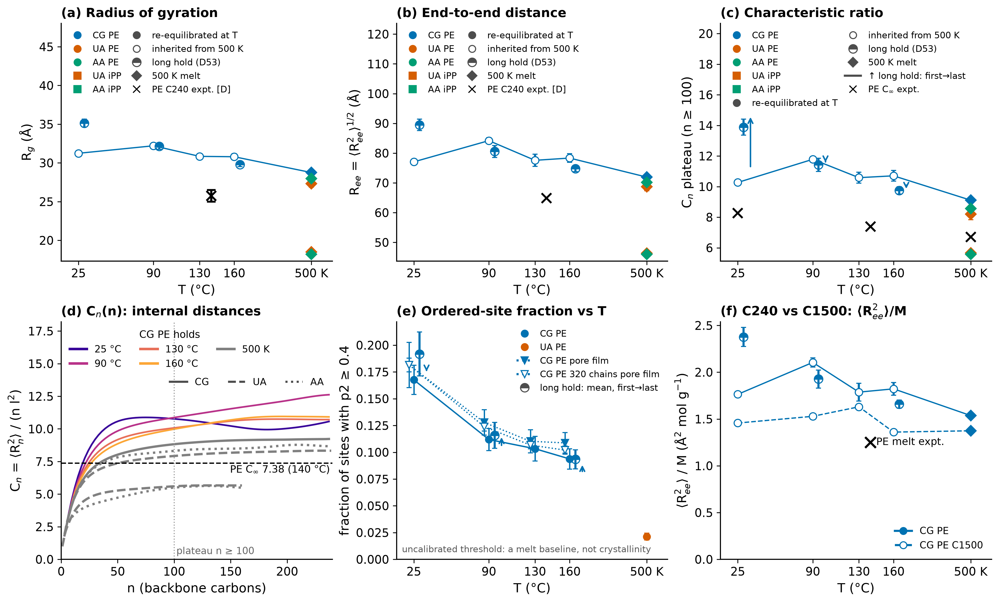

**Figure 4. Chain dimensions and order** (primary 40 × C240 boxes; colour = model, marker = polymer, diamond = 500 K melt, × = experiment; one shared legend). (a) Rg and (b) Cn plateau (n ≥ 100) ± SEM vs T: sweep holds (25 ns CG, 10 ns UA), the CG long holds (D53, 180–280 ns; plain points drawn at +4 °C) and the 500 K melt. Filled = the chains moved at least their own size in that hold (COM MSD ≥ ⟨Rg²⟩); open = inherited from the 500 K melt (the T dependence is not resolved; validity: trend). Long-hold drift from the first to the last 10 % of the hold: CG PE C240 25 °C: Cn 11.2 → 14.7, Rg 32.3 → 36.1 Å; CG PE C240 90 °C: Cn 11.8 → 11.6, Rg 32.4 → 32.4 Å; CG PE C240 130 °C: Cn 10.8 → 10.6, Rg 31.0 → 31.0 Å; CG PE C240 160 °C: Cn 10.2 → 9.7, Rg 30.3 → 29.8 Å; the rise at 25 °C goes with the box starting to order (see d). iPP chains are shorter in backbone (80 monomers, 160 backbone carbons), hence the smaller sizes. Experiment: C240 PE Rg 25–26.5 Å at 140 °C [D from ⟨R²⟩/M = 1.25 Ų mol/g], PE C∞ 8.26 (25 °C) and 7.38 (140 °C) (Fetters, Lohse, Colby 2007) and the 500 K melt value 6.7 used by D37 (×); iPP: only the 500 K melt C∞ = 6.15 (D37) is sourced (+, drawn just right of 500 K). CG PE Cn of 10–14 vs the experimental 7.4 is a known CG over-stiffening (CG chains ≈20 % too large, a force-field property). (c) Cn(n) internal-distance curves: CG PE C240 sweep holds (colour = T) and every system's 500 K melt (grey; line style = model; iPP curves end at 160 backbone carbons). (d) Ordered-site fraction (D26 local alignment, p2 ≥ 0.4, uncalibrated: a melt baseline, not a crystallinity) ± sd over frames: bulk sweep holds, long holds and the 500 K melt (CG PE C240: 25 °C 0.168, 90 °C 0.112, 130 °C 0.103, 160 °C 0.094, 25 °C long 0.192, 90 °C long 0.116, 130 °C long 0.103, 160 °C long 0.093; UA PE: 25 °C 0.122, 90 °C 0.053, 130 °C 0.036, 160 °C 0.030, 500 K 0.021; UA iPP: 25 °C 0.137, 90 °C 0.138, 130 °C 0.143, 160 °C 0.134) and the pore films (triangles, −4 °C). Long-hold first → last frame: CG PE C240 25 °C 0.179 → 0.173; CG PE C240 90 °C 0.104 → 0.116; CG PE C240 130 °C 0.102 → 0.113; CG PE C240 160 °C 0.080 → 0.090. The 25 °C CG long hold's largest ordered cluster grows to 672 of 3,200 beads (vs ≤ 492 in the sweep hold). Ree and the C240 vs C1500 ⟨Ree²⟩/M are in appendix Fig. 4.1. **Validity** (scripts/validity.py): CG PE C240 (`pe_cg_amorph_n40_c240_s1`): Rg/R_ee/C_n 500 K comparable; Rg/R_ee/C_n sweep T trend (inherited from the 500 K melt: hold COM MSD/⟨Rg²⟩ 0.18–0.60 < 1 at 25, 90, 130, 160 °C, so chains did not move their own size and Rg/R_ee/C_n were not re-equilibrated at that T) | UA PE (`pe_ua_amorph_n40_c240_s1`): Rg/R_ee/C_n 500 K comparable; Rg/R_ee/C_n sweep T trend (inherited from the 500 K melt: hold COM MSD/⟨Rg²⟩ 0.01–0.14 < 1 at 25, 90, 130, 160 °C, so chains did not move their own size and Rg/R_ee/C_n were not re-equilibrated at that T) | AA PE (`pe_aa_amorph_n40_c240_s1_from_ua`): Rg/R_ee/C_n 500 K trend (ua2aa box: the chain conformations were equilibrated with the UA force field); Rg/R_ee/C_n sweep T not yet computed | UA iPP (`ipp_ua_amorph_n40_c240_s1`): Rg/R_ee/C_n 500 K comparable; Rg/R_ee/C_n sweep T trend (inherited from the 500 K melt: hold COM MSD/⟨Rg²⟩ 0.00–0.10 < 1 at 25, 90, 130, 160 °C, so chains did not move their own size and Rg/R_ee/C_n were not re-equilibrated at that T) | AA iPP (`ipp_aa_amorph_n40_c240_s1_from_ua`): Rg/R_ee/C_n 500 K trend (ua2aa box: the chain conformations were equilibrated with the UA force field); Rg/R_ee/C_n sweep T not yet computed.

Files: [fig4_chains.png](fig4_chains.png), [fig4_chains.pdf](fig4_chains.pdf), [fig4_chains.svg](fig4_chains.svg)

## fig5_pore

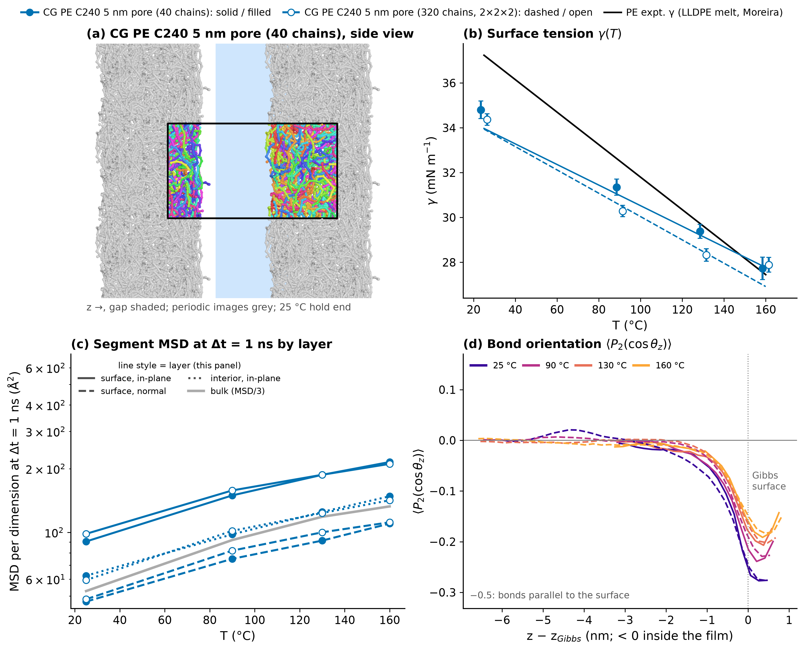

**Figure 5. Dry 5 nm slit pores** (colour = model, marker = polymer; solid / filled = 40 chains, dashed / open = 320 chains (2×2×2); colour = T in (d); one shared legend). (a) PyMOL side view along x of CG PE C240 from ``runs/pe_cg_pore_w5nm_n40_c240_s1/pore/hold_25C.data``: gap centred and shaded blue, the cell outlined in black with its chains coloured, periodic images (3 × 3 in y, z) in grey so the film reads as a continuous sheet. (b) γ per surface from the 25 ns holds ± SEM and the SEM-weighted sweep fits (CG PE C240 5 nm pore (40 chains): dγ/dT = -0.046 ± 0.006 mN m⁻¹ K⁻¹; CG PE C240 5 nm pore (320 chains): dγ/dT = -0.052 ± 0.004 mN m⁻¹ K⁻¹). Experiment (black line): LLDPE melt γ = 39.05 − 0.0725·t (Moreira et al. 2003). γ uses a plain 15 Å LJ cutoff without tail correction (cutoff-dependent); the 1–3 % agreement of γ partly reflects SDK being fitted to γ; CG dγ/dT is 28–37 % shallower than the Moreira slope -0.0725 mN m⁻¹ K⁻¹. The UA PE and UA iPP 5 nm pores are not analysed yet and will appear when their results.json exist. (c) Segment MSD per dimension at Δt = 1 ns by layer (surface = within 15 Å of a Gibbs surface; line style = layer in this panel): surface in-plane mobility is 1.5–1.7 × the interior; motion normal to the surface is suppressed. Δt is the time interval between the two compared frames, averaged over all time origins in the hold. CG model times. (d) ⟨P2(cos θz)⟩ of the bonds vs distance from the Gibbs surface: bonds lie parallel to the surface (negative) within ≈1.5 nm of it. The density profiles, chain shape and interfacial width are in appendix Fig. 5.1. The slit models a local patch of an amorphous wall; real separator pores are 30–100 nm, curved and semicrystalline. **Validity** (scripts/validity.py): CG PE C240 (`pe_cg_pore_w5nm_n40_c240_s1`): γ, dγ/dT comparable; film structure trend (no direct experiment: mechanism and within-simulation comparisons); Rg/R_ee/C_n sweep T trend (inherited from the 500 K melt: hold COM MSD/⟨Rg²⟩ 0.20–0.84 < 1 at 25, 90, 130, 160 °C, so chains did not move their own size and Rg/R_ee/C_n were not re-equilibrated at that T); P2, segment MSD needs correction (SDK CG dynamics are faster than real PE) | CG PE C240 (320 chains) (`pe_cg_pore_w5nm_n320_c240_s1_rep222`): γ, dγ/dT comparable; film structure trend (no direct experiment: mechanism and within-simulation comparisons); Rg/R_ee/C_n sweep T trend (inherited from the 500 K melt: hold COM MSD/⟨Rg²⟩ 0.21–0.65 < 1 at 25, 90, 130, 160 °C, so chains did not move their own size and Rg/R_ee/C_n were not re-equilibrated at that T); P2, segment MSD needs correction (SDK CG dynamics are faster than real PE).

Files: [fig5_pore.png](fig5_pore.png), [fig5_pore.pdf](fig5_pore.pdf), [fig5_pore.svg](fig5_pore.svg)

## fig6_dynamics

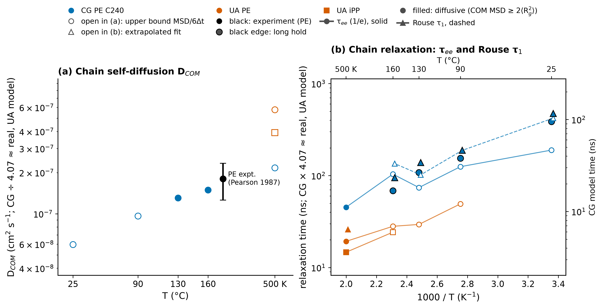

**Figure 6. Chain dynamics** (colour = model, marker = polymer; one shared legend). **Time convention (this figure and appendix Fig. 6.1):** CG times are multiplied by 4.07 (and D divided by 4.07) to approximate real PE time (SDK PE dynamics ≈ 4.07× faster; Hall, Sirk, Klein, Shinoda, J. Chem. Phys. 150, 244901, 2019; one constant for every T and quantity, an approximation to be recalibrated against UA/AA); UA times are shown as simulated (no mapping yet; UA also runs fast without H friction); right axes give CG model time. (a) DCOM vs T: filled where the COM MSD is diffusive and ≥ 2⟨Rg²⟩ (D55 criterion; CG PE C240 130 °C: 1.3e-07 cm²/s (model 5.3e-07); CG PE C240 160 °C: 1.5e-07 cm²/s (model 6.1e-07)); open = MSD/(6Δt) at the longest Δt, an upper bound while the MSD is still sub-diffusive (each marker is one hold). Experiment (black circle): short PE melt ≈1.8 × 10⁻⁷ cm²/s at 175 °C (Pearson et al. 1987, read from a graph, ±30 %). (b) τee (end-to-end 1/e, circles, solid) and Rouse τ1 (triangles, dashed) vs 1000/T: the 25 ns sweep holds give exponential-fit extrapolations (open; not reached, order of magnitude, typically low); the long holds (black edge) and the 500 K extension reach 1/e. Segment MSD, the long-hold COM MSD, bond P2 times and the Rouse spectrum are in appendix Fig. 6.1. **Validity** (scripts/validity.py): CG PE C240 (`pe_cg_amorph_n40_c240_s1`): P2, segment MSD needs correction (SDK CG dynamics are faster than real PE); D_COM, viscosity needs correction (SDK CG dynamics are faster than real PE) | UA PE (`pe_ua_amorph_n40_c240_s1`): P2, segment MSD needs correction (UA dynamics are faster than real PE); D_COM, viscosity not yet computed | AA PE (`pe_aa_amorph_n40_c240_s1_from_ua`): P2, segment MSD not yet computed; D_COM, viscosity not yet computed | UA iPP (`ipp_ua_amorph_n40_c240_s1`): P2, segment MSD needs correction (UA dynamics are faster than real PE); D_COM, viscosity not yet computed | AA iPP (`ipp_aa_amorph_n40_c240_s1_from_ua`): P2, segment MSD not yet computed; D_COM, viscosity not yet computed.

Files: [fig6_dynamics.png](fig6_dynamics.png), [fig6_dynamics.pdf](fig6_dynamics.pdf), [fig6_dynamics.svg](fig6_dynamics.svg)

## fig7_mechanics

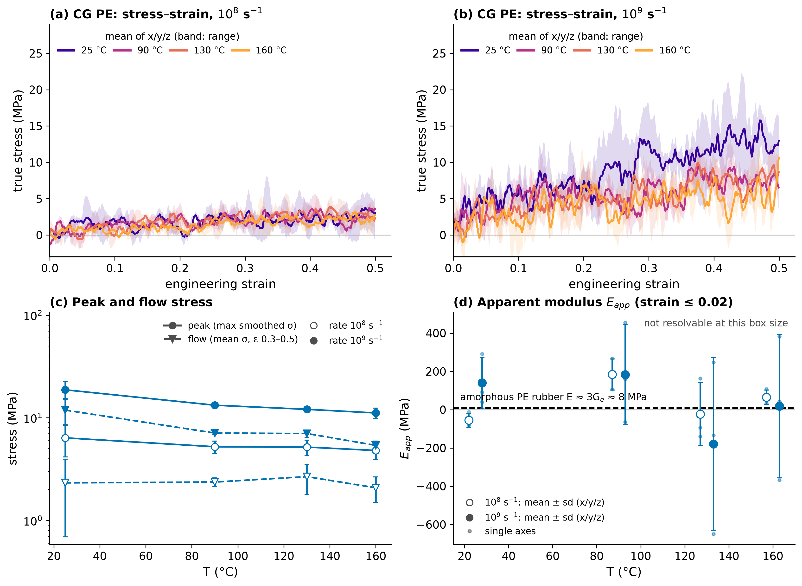

**Figure 7. Mechanics (CG PE tensile, D54).** The box is stretched along x, y and z in turn from the same hold snapshot at a constant engineering strain rate with the lateral axes at 1 atm. (a, b) Axis-mean smoothed true stress vs strain at 25/90/130/160 °C (band = range over the three axes) at 10⁸ and 10⁹ s⁻¹. (c) Peak stress (max of the smoothed σ) and flow stress (mean σ over strain 0.3–0.5) vs T, mean ± sd over the axes; both scale with the rate (viscous flow stress ≈ 3η × rate), so they are not a yield stress. (d) Apparent modulus from the slope up to strain 0.02: not resolvable at this box size (fit errors 66–296 MPa, axis spread up to 450 MPa), against the ≈8 MPa of an amorphous PE rubber (E ≈ 3Ge, Ge = 2.6 MPa at 140 °C; Fetters, Lohse, Colby 2007); several axes give negative slopes. Amorphous melts above Tg at rates ~10⁹× faster than tests: T and rate trends only (validity: trend), **not comparable to semicrystalline separator data** (Celgard E ≈ 0.25 GPa, tensile strength ≈ 165 MPa MD; Gor et al. 2014). **Validity** (scripts/validity.py): CG PE (`pe_cg_amorph_n40_c240_s1`): tensile E/ν/yield trend (not comparable to separator data).

Files: [fig7_mechanics.png](fig7_mechanics.png), [fig7_mechanics.pdf](fig7_mechanics.pdf), [fig7_mechanics.svg](fig7_mechanics.svg)

## fig8_holes

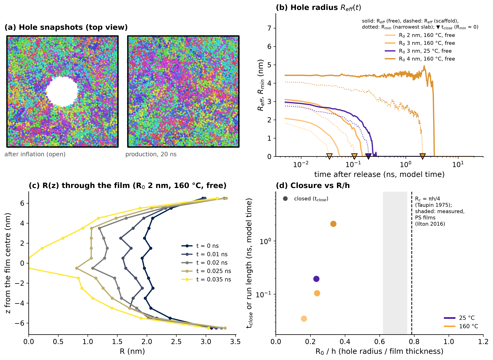

**Figure 8. Cylindrical hole through the free film (D52).** (a) PyMOL top views (along z, chains coloured, cell outlined) of a hole run: after inflation (hole open) and the latest production snapshot — **smoke test** (R = 3 nm, 160 °C, 2×2×2 film; 2 ns inflation, 1 ns scaffolded hold, released at t₀, 1 ns free; ps-scale stages, not a production run): the hole closed within ≈0.05 ns of the release. (b–d) **Pending**: no ``sepsim analyze hole`` results.json yet (built: R 2 nm / 160 °C; R 3 nm / 130 °C; R 3 nm / 160 °C; R 3 nm / 25 °C; R 3 nm / 90 °C; R 4 nm / 160 °C). When they appear: (b) Reff = √(A/π) of the projected hole vs production time (colour = T; solid free, dashed scaffolded; ▼ = tclose); (c) R(z) through the film at up to five times before closure (one run); (d) closure outcome vs R₀/h: tclose (filled) or run length (open, still open), with the expected critical Rc/h ≈ 0.3–1 (Taylor & Michael 1973; Ilton et al. 2016) and the 4×4×1 thin-film (rep441) critical-size scan marked. CG model times: compare runs with each other, not with experiment; the scaffold is imposed springs, not crystallinity, and releasing it emulates melting.

Files: [fig8_holes.png](fig8_holes.png), [fig8_holes.pdf](fig8_holes.pdf), [fig8_holes.svg](fig8_holes.svg)
## Appendix

### fig2_1_cn_sem

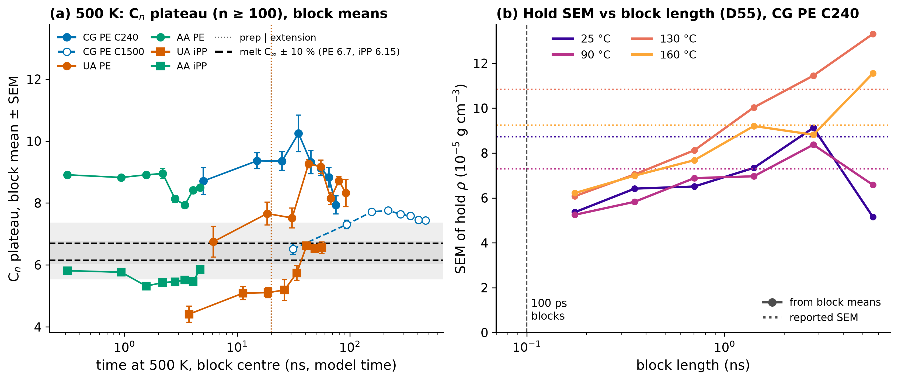

**Figure 2.1 (appendix). Chain-shape and density-error convergence.** (a) 500 K melt hold: Cn plateau (mean Cn over n ≥ 100 carbons) as block means, each series cut into 8 equal-time blocks, ± the SEM of each block from the statistical inefficiency of its samples (D26), drawn at the block centre (log axis); dotted verticals = prep | extension boundary; dashed = melt C∞ ± 10 % (PE 6.7, iPP 6.15; D37). Whole-hold plateaus and block lengths: CG PE C240 9.11 (10 ns blocks); CG PE C1500 7.43 (62 ns blocks); UA PE 8.19 (12 ns blocks); AA PE 8.57 (0.62 ns blocks); UA iPP 5.66 (7.5 ns blocks); AA iPP 5.58 (0.62 ns blocks). (b) CG PE C240 sweep holds: SEM of the hold mean density from block means vs block length (D55 check) against the reported SEM (dotted): the block SEM levels off only at 1–3 ns blocks (slow barostat/volume tail); D55 computes SEMs from 100 ps block means. At 130 and 160 °C the block SEM is still rising at the longest blocks, so the reported SEMs of those holds may be underestimated by 20–40 %.

Files: [fig2_1_cn_sem.png](appendix/fig2_1_cn_sem.png), [fig2_1_cn_sem.pdf](appendix/fig2_1_cn_sem.pdf), [fig2_1_cn_sem.svg](appendix/fig2_1_cn_sem.svg)

### fig3_1_cp_chain_length

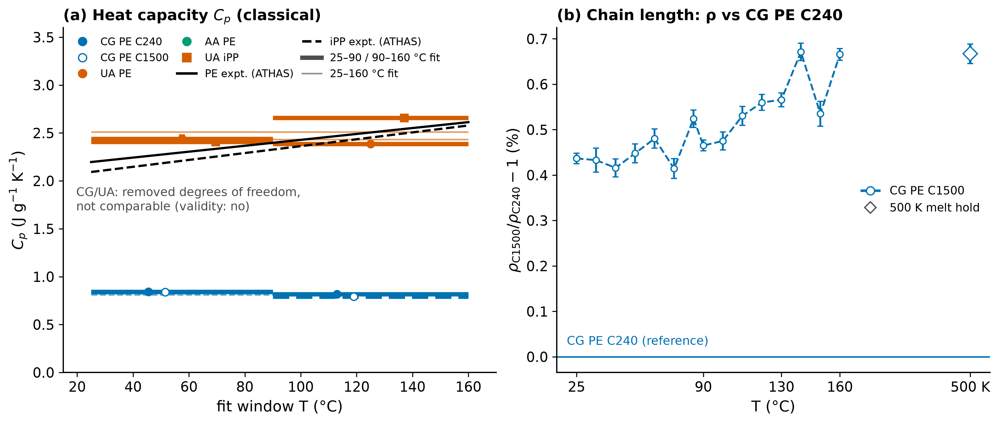

**Figure 3.1 (appendix). Heat capacity and chain length.** (a) Classical Cp = dH/dT per fit window (thick: 25–90 / 90–160 °C, thin: 25–160 °C) vs the ATHAS melt lines (PE: 0.04325·T + 17.919 J mol⁻¹ K⁻¹ per CH₂; iPP: 0.151291·T + 42.956 per C₃H₆; Gaur & Wunderlich 1981): CG and UA remove degrees of freedom, so their classical Cp is not comparable (validity: no); AA with the VDOS quantum correction (D12c) will be drawn dotted when its results.json provides it. (b) Chain-length effect: CG PE C1500 density relative to CG PE C240 at the same set T (sweep segments ± combined SEM; diamond = 500 K melt hold): CG PE C1500 +0.41 to +0.69 % (longer chains: fewer chain ends, denser). αV per window: CG PE C240 25–160 °C 6.97, 25–90 °C 6.92, 90–160 °C 7.05; CG PE C1500 25–160 °C 6.81, 25–90 °C 6.86, 90–160 °C 6.80. Box size (not drawn): CG PE C240 (640 chains) -0.008 % at 500 K vs CG PE C240 (40 chains); the 2×2×2 (320-chain) box has no sweep, so the box-size check along T is the pore comparison of Fig. 5.

Files: [fig3_1_cp_chain_length.png](appendix/fig3_1_cp_chain_length.png), [fig3_1_cp_chain_length.pdf](appendix/fig3_1_cp_chain_length.pdf), [fig3_1_cp_chain_length.svg](appendix/fig3_1_cp_chain_length.svg)

### fig3_2_convergence

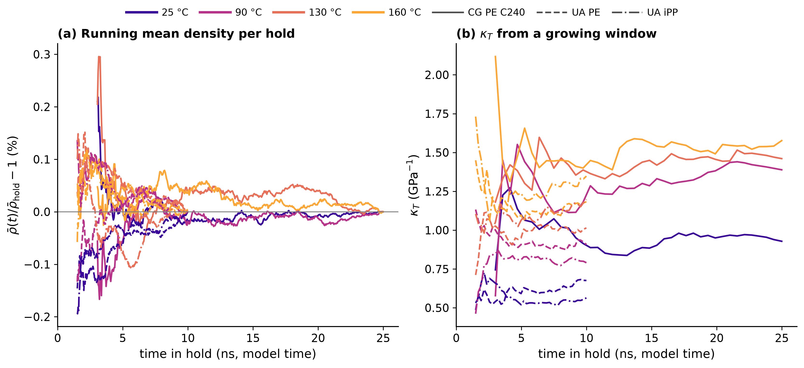

**Figure 3.2 (appendix). Bulk sweep holds: properties vs simulation time.** Holds at 25/90/130/160 °C (colour = T; line style = model: CG PE C240 solid, UA PE dashed, UA iPP dash-dot), from the thinned per-hold time series stored in the sweep results.json ``convergence`` (CG PE C240 every 51 ps over 25 ns holds; UA PE every 21 ps over 10 ns holds; UA iPP every 21 ps over 10 ns holds), over the analysis window (after the hold's first 10 %), drawn from 0.5 ns into it. (a) Running (cumulative) mean density relative to the whole-window mean: at half the hold the running mean is within CG PE C240 0.03 %; UA PE 0.04 %; UA iPP 0.10 % of the final value. (b) κT = ⟨δV²⟩/(kBT⟨V⟩) from the volume fluctuations of a window growing from the analysis-window start to time t. In (b) the CG κT at 90 and 130 °C is still rising at the end of the 25 ns holds (about 1.25 → 1.4–1.5 GPa⁻¹), while 25 and 160 °C level off. The volume fluctuates slowly enough that a 25 ns hold may not sample it fully, so those κT values may be slight underestimates. These curves use the thinned series stored in results.json, whose final κT differs from the full-resolution value by up to ±13 % (here -9 to +13 %), so read them for the trend, not the value. AA sweeps are not finished. The run logs are not needed (results.json only).

Files: [fig3_2_convergence.png](appendix/fig3_2_convergence.png), [fig3_2_convergence.pdf](appendix/fig3_2_convergence.pdf), [fig3_2_convergence.svg](appendix/fig3_2_convergence.svg)

### fig4_1_ree_length

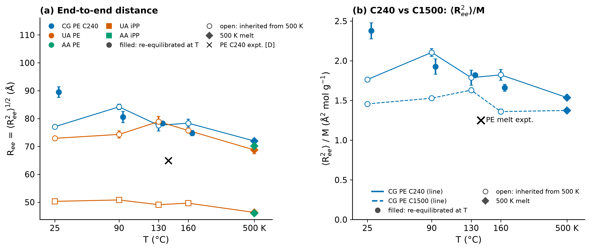

**Figure 4.1 (appendix). End-to-end distance and chain length.** Symbols as in Fig. 4 (filled = re-equilibrated at T, open = inherited from 500 K, diamond = 500 K melt; long holds at +4 °C). (a) Ree = ⟨Ree²⟩1/2 ± SEM vs T for the primary boxes; experiment: C240 PE Ree ≈ 65 Å at 140 °C [D from ⟨R²⟩/M = 1.25 Ų mol/g, Fetters, Lohse, Colby 2007]. (b) ⟨Ree²⟩/M for CG PE C240 and C1500 vs the PE melt value 1.25 Ų mol/g (140 °C; CG PE C240 +23 to +90 %; CG PE C1500 +9 to +30 %); the C1500 values are all inherited (D47 not reachable for C1500, validity: trend).

Files: [fig4_1_ree_length.png](appendix/fig4_1_ree_length.png), [fig4_1_ree_length.pdf](appendix/fig4_1_ree_length.pdf), [fig4_1_ree_length.svg](appendix/fig4_1_ree_length.svg)
### fig5_1_pore_checks

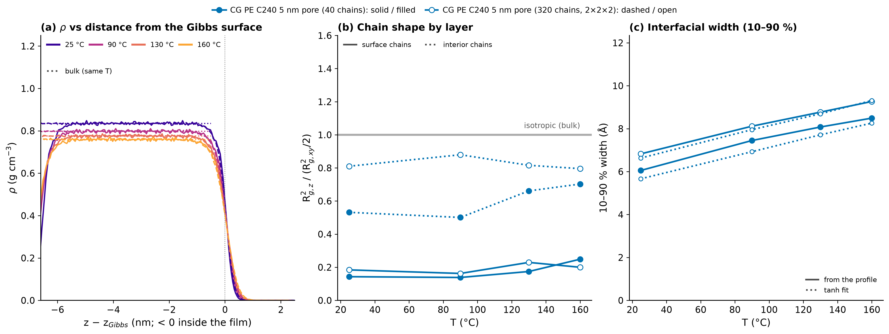

**Figure 5.1 (appendix). Slit-pore checks** (symbols and line styles as in Fig. 5). (a) Symmetrised ρ(z) per hold vs the distance from each film's own Gibbs dividing surface, so the 40- and 320-chain films overlay (colour = T); dotted = the bulk density at the same T: the film interior matches bulk within ≈0.2 %. (b) Chain shape Rg,z²/(Rg,xy²/2) of surface and interior chains (1 = isotropic): surface chains are flattened (≈0.2); the 40-chain film is thin enough that its interior chains are also compressed. (c) 10–90 % interfacial width from the profile (solid) and from the tanh fit (dotted): the interface broadens with T and is wider in the larger film.

Files: [fig5_1_pore_checks.png](appendix/fig5_1_pore_checks.png), [fig5_1_pore_checks.pdf](appendix/fig5_1_pore_checks.pdf), [fig5_1_pore_checks.svg](appendix/fig5_1_pore_checks.svg)

### fig6_1_dynamics_curves

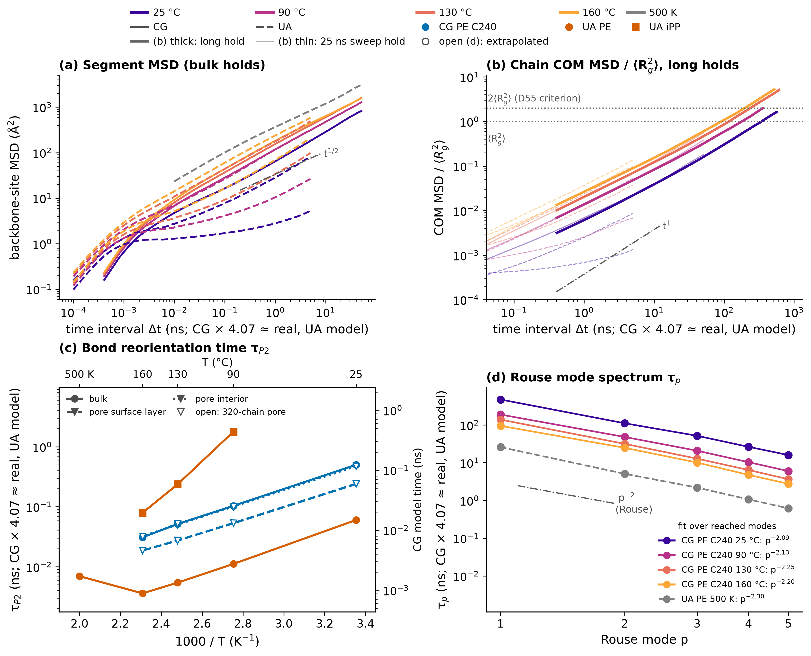

**Figure 6.1 (appendix). Dynamics curves** (time convention as in Fig. 6: CG × 4.07 ≈ real, UA as simulated; colour = T, line style = model). Δt is the time interval between the two compared frames, averaged over all time origins in the hold. (a) Backbone-site MSD vs Δt in the 25 ns sweep holds (grey = 500 K extension) with a t1/2 (Rouse) guide. (b) Chain COM MSD / ⟨Rg²⟩ vs Δt in the long holds (D53; thick: CG PE C240 25 °C 278 ns (MSD/⟨Rg²⟩ 1.64 at the longest Δt); CG PE C240 90 °C 176 ns (MSD/⟨Rg²⟩ 2.00 at the longest Δt); CG PE C240 130 °C 300 ns (MSD/⟨Rg²⟩ 5.10 at the longest Δt, diffusive); CG PE C240 160 °C 256 ns (MSD/⟨Rg²⟩ 5.26 at the longest Δt, diffusive)) and the sweep holds (thin): only the long holds reach the diffusive t¹ regime beyond 2⟨Rg²⟩. (c) Bond P2 1/e time vs 1000/T (top: °C; right: CG model time): bulk sweep holds (solid), the 500 K UA extension, and the pore surface layer (dashed) and interior (dotted): surface bonds reorient ≈2× faster. CG bead–bead vector, UA C–C bond (not the ¹³C NMR C–H vector). Long-hold P2 times are omitted: their 100 ps frames do not resolve the 1/e time (no D46 bursts). (d) Rouse mode times τp (p = 1–5) of the long holds and the UA 500 K extension vs the Rouse p⁻² line; fitted exponents over the reached modes: CG PE C240 25 °C p^-2.09; CG PE C240 90 °C p^-2.13; CG PE C240 130 °C p^-2.25; CG PE C240 160 °C p^-2.20; UA PE 500 K p^-2.30 (real melts: p−2.2…−2.4; C240 is near the entanglement length).

Files: [fig6_1_dynamics_curves.png](appendix/fig6_1_dynamics_curves.png), [fig6_1_dynamics_curves.pdf](appendix/fig6_1_dynamics_curves.pdf), [fig6_1_dynamics_curves.svg](appendix/fig6_1_dynamics_curves.svg)
